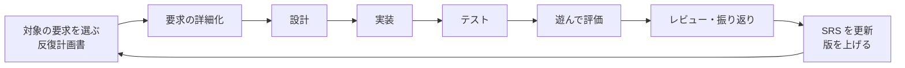

# プロジェクト計画書

- 文書 ID: PLAN-001
- 版: 0.1（案。開発者の承認待ち）
- 作成日: 2026-10-20

## 1. 目的

- ファイアーエムブレムのようなシミュレーション RPG を作り、姉妹プロジェクト「ふしぎ錬金」の戦闘の中心の部分を作り込む（E-01）
- 作り込んだ戦闘を、あとでふしぎ錬金に戻せる形にする（E-02）
- ふしぎ錬金と同じく、要求定義から設計・実装・試験までの工程を、トレーサブルな文書として残す（E-01「いまのドキュメント作るやつ」）

## 2. スコープ

### 2.1 対象

- 戦術戦闘（グリッドの上でユニットを動かすターン制）を中心にしたゲーム。範囲はヒアリングで決め、企画書と SRS に書く

### 2.2 対象外（今のところ）

- サウンド、凝ったグラフィック（Kenney の CC0 のタイルなど、簡易な絵で代用する）
- オンライン機能
- スマートフォン向けの最適化

## 3. 開発プロセス

ふしぎ錬金の PLAN-001 と同じ**反復型（インクリメンタル）開発**を使う。1 回の反復の中で、小さな V 字（要求の詳細化 → 設計 → 実装 → 試験）を回す。

| 文書 | 位置付け |
|---|---|
| 要求抽出記録 | 開発者の発言の記録（`E-xx`） |
| 企画書 | ゲームの軸、参考作品、作らないもの |
| 要求仕様書（SRS） | 要求の台帳。全体は粗いままにし、反復で扱う要求だけを詳しくする |
| 反復計画書 | 反復ごとに作る。目的（確かめたい仮説）、対象の要求 ID、作らないもの、完了条件 |
| 設計書 | 反復で扱う範囲だけを書き足していく |
| テスト仕様書 | 反復で扱う要求ごとに書き足していく |
| 反復の振り返り | 仮説の検証結果と SRS への変更点 |

- 最初の反復は、戦闘の核が面白いかを確かめる**プロトタイプ**とする
- ふしぎ錬金の戦闘のコード（`internal/core` の戦闘）を出発点にする（E-02）。ふしぎ錬金の `World` と結び付いているので、最初の反復の設計で切り出し方を決める

## 4. マイルストーン

| # | マイルストーン | 完了条件 | 状態 |
|---|---|---|---|
| M0 | 土台 | 開発のしくみ（AGENTS.md、CI、tccheck、レビュー役、文書の構成）がそろっている | 着手 |
| M1 | 企画確定 | ヒアリングをもとに、企画書と技術選定 ADR が承認されている | 未着手 |
| M2 | 要求の台帳 | SRS v0.1 が確定している | 未着手 |
| M3 | プロトタイプ（反復 1） | 戦闘の核が動き、仮説の検証結果が振り返りに記録されている | 未着手 |

## 5. 品質管理

- **レビュー**: 各工程の成果物はレビューし、指摘と対応を `docs/reviews/` に記録する
- **自動テスト**: ゲームの規則は単体テストで検証する
- **CI**: プルリクエストと `main` への push ごとに、フォーマット確認・静的解析・テスト・テストケース ID の整合を確かめる（文書だけの変更では Go の検査を省く。ふしぎ錬金 REV-053）
- **構成管理**: 1 Issue 1 ブランチ、プルリクエスト経由で `main` にマージする。CI の成功・別エージェントによるレビュー・要求と設計の変更に対する人の承認、を条件にエージェントが自動でマージする（AGENTS.md「自動マージの条件」）

## 6. 変更履歴

| 版 | 日付 | 内容 |
|---|---|---|
| 0.1（案） | 2026-10-20 | 初版。ふしぎ錬金の PLAN-001 をもとにした |
