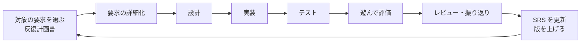

# プロジェクト計画書

- 文書 ID: PLAN-001
- 版: 0.2（承認（E-141）。新作「古代都市の復旧」を主題にした）
- 作成日: 2026-10-20（v0.2 の改訂: 2026-11-14）
- 入力（v0.2）: E-130〜E-140、IT08-PLAN v0.3（3.1 節・4 章）、[企画書 CON-001](../01_concept/concept.md) v0.7（改訂案）

## 1. 目的

- ファイアーエムブレムのようなシミュレーション RPG を作り、姉妹プロジェクト「ふしぎ錬金」の戦闘の中心の部分を作り込む（E-01）
- 作り込んだ戦闘を、あとでふしぎ錬金に戻せる形にする（E-02）。新作を主にしても、この目的は残す（E-130）
- 新作「古代都市の復旧」（企画書 CON-001。20 章）を、戦闘の基盤の上に作り、完成させる（E-130・E-134）
- ふしぎ錬金と同じく、要求定義から設計・実装・試験までの工程を、トレーサブルな文書として残す（E-01「いまのドキュメント作るやつ」）

## 2. スコープ

### 2.1 対象

- 戦術戦闘（グリッドの上でユニットを動かすターン制）を中心にした、章立てのキャンペーン（企画書 CON-001、E-06）
- 最初の反復（プロトタイプ）は、キャラ 3〜4 人と中くらいのマップ 1 枚で、キャラの強みとマップの動かし方を確かめる（E-06）
- 反復 8 から、リポジトリの主題を新作「古代都市の復旧」にする（E-130）。錬金（錬金の道具・章の間の調合）、画像と音を範囲に入れる（E-130〜E-132・E-137）

### 2.2 対象外（今のところ）

- オンライン機能
- スマートフォン向けの最適化
- v0.1 では「サウンド、凝ったグラフィック」と「初期の範囲では、錬金と品質（最終的には持ち込む。E-07）」も対象外にしていた。どちらも初期の範囲についてのことで、中期に入った今は、画像と音、錬金を作る（E-130〜E-132・E-137。CON-001 7・9・10 章）。ふしぎ錬金の品質をいつ入れるかは未決（CON-001 11 章 Q-02）

### 2.3 旧作の 9 章と `data/base` の位置付け

- 旧作の物語（小国アルケア）の 9 章と、その定義データ `data/base` は、戦闘の基盤の試験用の章として残す（E-130。CON-001 3.6 節）
- 戦闘の基盤（`internal/core`）は、新作に合わせて変えてよい。変えるときは、旧作の 9 章と自動の試し遊びへの影響をそのつど確かめ、変わった基準と理由を記録する（E-135。IT08-PLAN 4 章）
- 旧作の 9 章に手を入れるかは、反復の計画書で決める（反復 8 では #190 の案 B だけを入れ、作り直し・難しさの調整はしない。E-132。IT08-PLAN 4 章）

## 3. 開発プロセス

ふしぎ錬金の PLAN-001 と同じ**反復型（インクリメンタル）開発**を使う。1 回の反復の中で、小さな V 字（要求の詳細化 → 設計 → 実装 → 試験）を回す。

| 文書 | 位置付け |
|---|---|
| 要求抽出記録 | 開発者の発言の記録（`E-xx`） |
| 企画書 | ゲームの軸、参考作品、作らないもの |
| 要求仕様書（SRS） | 要求の台帳。全体は粗いままにし、反復で扱う要求だけを詳しくする |
| 反復計画書 | 反復ごとに作る。目的（確かめたい仮説）、対象の要求 ID、作らないもの、完了条件 |
| 設計書 | 反復で扱う範囲だけを書き足していく |
| テスト仕様書 | 反復で扱う要求ごとに書き足していく |
| 反復の振り返り | 仮説の検証結果と SRS への変更点 |

- 最初の反復は、戦闘の核が面白いかを確かめる**プロトタイプ**とする
- 反復の進め方は、新作を主題にしても変えない（IT08-PLAN。E-134）
- ふしぎ錬金の戦闘のコード（`internal/core` の戦闘）を出発点にする（E-02）。ふしぎ錬金の `World` と結び付いているので、最初の反復の設計で切り出し方を決める。品質つきのアイテムの使用（ふしぎ錬金 DES-QLT-05）は外し（E-07）、番の進め方は自軍と敵軍の交互に変える（E-09）

## 4. マイルストーン

| # | マイルストーン | 完了条件 | 状態 |
|---|---|---|---|
| M0 | 土台 | 開発のしくみ（AGENTS.md、CI、tccheck、レビュー役、文書の構成）がそろっている | 完了（REV-001、E-10） |
| M1 | 企画確定 | ヒアリングをもとに、企画書と技術選定 ADR が承認されている | 完了（企画書 v0.3、ADR-0001 を承認。E-10） |
| M2 | 要求の台帳 | SRS v0.1 が確定している | 完了（SRS v0.1 を承認。E-12） |
| M3 | プロトタイプ（反復 1） | 戦闘の核が動き、仮説の検証結果が振り返りに記録されている | 完了（反復 1 の振り返り v0.2 を承認。E-37） |

- 反復 2 以降のマイルストーンは、各反復の計画書に書く（反復 8 は IT08-PLAN 10 章）

## 5. 品質管理

- **レビュー**: 各工程の成果物はレビューし、指摘と対応を `docs/reviews/` に記録する
- **自動テスト**: ゲームの規則は単体テストで検証する
- **CI**: プルリクエストと `main` への push ごとに、フォーマット確認・静的解析・テスト・テストケース ID の整合を確かめる（文書だけの変更では Go の検査を省く。ふしぎ錬金 REV-053）
- **構成管理**: 1 Issue 1 ブランチ、プルリクエスト経由で `main` にマージする。CI の成功・別エージェントによるレビュー・要求と設計の変更に対する人の承認、を条件にエージェントが自動でマージする（AGENTS.md「自動マージの条件」）

## 6. 変更履歴

| 版 | 日付 | 内容 |
|---|---|---|
| 0.1 | 2026-10-20 | 初版。ふしぎ錬金の PLAN-001 をもとにした。REV-001 を反映し、2.1・2.2・3 章・4 章に E-06・E-07・E-09 を反映した。開発者が承認した（E-10） |
| 0.2 | 2026-11-14 | 開発者が承認（E-141）。REV-113 の指摘と E-139・E-140 を反映。IT08-PLAN v0.3 3.1 節に基づく。1 章の目的に新作の完成を足し、E-02 は残した（E-130・E-134）。2.1 節に新作を主題にすることを足した（E-130）。2.2 節のサウンド・凝ったグラフィックと錬金を対象外から外した（初回の範囲のことで、中期の今は作る。E-130〜E-132・E-137）。2.3 節に旧作の 9 章と `data/base` を試験用として残すこと、戦闘の基盤を変えるときの確かめ方を書いた（E-130・E-135）。3 章に、反復の進め方は変えないと書いた。4 章の M3 を完了にし（E-37）、反復 2 以降のマイルストーンは反復の計画書に書くと注記した |
