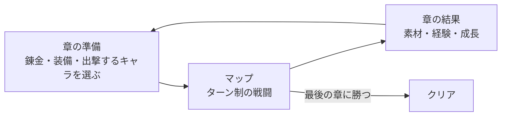

# 企画書「レンキン・タクティクス」（仮称）

- 文書 ID: CON-001
- 版: 0.7（**改訂案（開発者の承認待ち）**。新作「古代都市の復旧」の企画に改めた）
- 作成日: 2026-10-20（v0.7 の改訂: 2026-11-14）
- 入力: [要求抽出記録](elicitation-notes.md) E-01〜E-10、E-49〜E-51（v0.4）、E-55（v0.5）、IT06-PLAN v0.3 3 章、DES-IT06 v0.2 1.2 節・14 章 A、E-74〜E-93（v0.6）。v0.7: E-130〜E-137、Issue #191 のコメント（開発者の発言の原文）、[企画のたたき台 CON-DRAFT-NG01](new-game-draft.md) v0.1、IT08-PLAN v0.3（3.1 節・4 章・5 章・8 章）

この版から、企画の主題を新作「古代都市の復旧」にする（E-130）。旧作の物語（小国アルケア、9 章）は、戦闘の基盤の試験用の章として残す（E-130。3.6 節）。たたき台 CON-DRAFT-NG01 の中身は本書に入れ、たたき台は経緯として残す（IT08-PLAN 3.1 節）。

## 1. ひとことで

古代都市の復旧を国に命じられた錬金術師が、前衛に守られながら強い錬金の道具（広い範囲の爆弾など）を使い、隣の国と施設を奪い合う、ファイアーエムブレムのようなシミュレーション RPG（#191。CON-DRAFT-NG01 1 章）。錬金は、初期の範囲の外としていた（E-07）が、新作の中心にする（E-130・E-132。6 章）。

## 2. 体験の軸

| 軸 | 内容 | 根拠 |
|---|---|---|
| 錬金術 × SRPG | 錬金術師は後衛で、前衛に守られながら強い道具（広い範囲の爆弾など）を使う | #191（CON-DRAFT-NG01 1 章） |
| キャラの強みを見つける | キャラごとに得意な場面がはっきり違い、「このキャラはここで強い」と見つけて生かすことが、いちばんの楽しさ | E-03 |
| 大きなマップとギミック | 32 × 32 マスくらいの大きなマップに、よいギミックがあり、どう動かすかを考える | E-04 |
| 錬金で備えても手ごわい | 錬金の道具を使いすぎれば物量で勝てるが、それでも手ごわく、戦術を楽しめる。錬金の道具は強いままにし、いつ・どこで使うかに判断を置く（6 章） | E-03、P-7（E-134） |
| 単調にしない | スキルなどの要素で、戦闘ごとに違う考え方が要る | E-05 |
| 遊びやすさ | 予測のしやすさ・手直し（取消し・やり直し）のしやすさ・状況把握のしやすさを重視する。UI は風花雪月のような分かりやすさを目標にする | #191（CON-DRAFT-NG01 1 章） |

## 3. 世界と物語

- 戦争の話にする（E-07）。死を描く（E-07）
- 物語は簡単なプロットだけを決め、中身は Claude Code が書き、開発者が確認する（E-07）。物語は戦闘の舞台を用意する役で、量は多くしない

### 3.1 決定（開発者）

Issue #191 のコメントで開発者が決めたこと（CON-DRAFT-NG01 1 章に整理したもの）。

| 項目 | 内容 |
|---|---|
| テーマ | 古代都市の復旧。浄水施設・武器炉・家などの大きな施設を直していく |
| 復旧の順 | 固定。シナリオで進める |
| 古代都市の滅亡の原因 | 錬金術にしない |
| 復興の位置付け | 戦争の一部。直した施設が前線の補給になり、資源と施設を敵国と奪い合う |
| 錬金術の歴史 | 完全に忘れられている。今の国々の技術は、古代都市の遺物から発展したもの |
| 敵 | 今の隣の国と、古代都市を滅ぼした原因。ラスボスは後者 |
| 血筋 | 使う。ただし本人も周りも忘れている。祖母は錬金術を使っていたが、古代都市の出身はそれより前の祖先 |
| 隣の国 | 古代都市の遺物を掘り出して、そのまま武器に使い、他国に戦争を仕掛けて装備の強さで勝っている |
| 事件 | インフラが枯れそうになる |
| 主人公の立場 | 古代都市とは関係ない土地で暮らしていて、国から復興を命じられる |

### 3.2 滅亡の原因（ラスボス）: 古代の戦争の兵器（P-1）

たたき台の仮決め P-1 を採った（E-134）。

- 古代都市は、別の勢力との戦争に勝つため、自分で動く兵器を作った。兵器は敵を滅ぼしたあとも止まらず、都市を守る名目で都市そのものを食い尽くした
- 隣の国が掘り出している遺物の武器は、その兵器の部品である。隣の国の行い（遺物の武器を掘り出して使う）・インフラが枯れる事件・ラスボスが、1 本の因果でつながる。「錬金術は作り直す技術、遺物は戦争の技術」という対比を置く
- 兵器は、都市の施設と同じ材料・同じ仕組みでできている。施設を直すこと（主人公の仕事）と、兵器が目覚めることが、同じ力の取り合いになる。直せば都市は豊かになるが、力を多く流すほど、眠る本体の目に触れやすくなる
- 兵器は悪意ではなく、命令を守り続けているだけにする。ラスボスは怪物ではなく、止める手順（命令の解除）を探す相手にもなる
- 「暴走する古代兵器」は多い題材なので、見せ方（施設と兵器が同じ部品でできていること）で差を付ける

### 3.3 錬金術がなぜ今も残っているか（P-2）

たたき台の仮決め P-2 を採った（E-134）。

- 祖母の錬金術は、古代都市の住民が日用品として使っていた「調合の技」の末端が、家に薬づくりとして残ったもの。戦争の技術（遺物の武器）とは別の、暮らしの技術の系統
- 隣の国の遺物の技術は、戦争の技術の系統。両方とも同じ都市から出たが、隣の国は「使い方」だけを知り、仕組みは知らない。錬金術は「仕組みから作れる」ので、遺物の施設を直せる
- 主人公を選ばれし者にはしない。国が主人公を選んだ理由は、施設を直せた唯一の人だったから

### 3.4 主人公と動機（P-3）

たたき台の仮決め P-3 を採った（E-134）。

- 主人公の名前は、今は「アオイ」（E-134）。**性別・性格は未決**（IT08-PLAN 5 章 Q-5。11 章 Q-11）
- 主人公: 辺境の薬師の家の若者。祖母の調合帳を引き継いでいる
- 動機: 故郷の村の水が枯れかけていて、水源の元が古代都市の浄水施設だったと分かる。国の命令を受ける形だが、本当の目的は故郷の水を戻すこと。「国のため」より「自分の水のため」から始まり、途中で守る相手が広がる
- 仲間: 錬金術の仲間（調合の弟子など）と、前衛を担う護衛の兵（国から付けられる）の 2 系統。後衛の錬金術師を前衛が守る構図を、人間関係でも作る

### 3.5 隣の国と結末（P-4 の差し替え、P-5）

- **隣の国は、最初から敵対する。隣の国と共闘はしない**（E-134。たたき台の仮決め P-4「途中で共闘があり、終盤で崩れる」を差し替えた）。隣の国との戦いは、直した施設の奪い合い（施設の占領・防衛）を舞台にする（3.1 節「復興の位置付け」）
- 結末（P-5 を採った。E-134）
  - 隣の国との戦いは、遺物の使用をやめさせる（またはやめる）形で終わる
  - ラスボスは、戦って止める（物理）と、命令を解除する（錬金術の仕組みの理解）の両方が要る。戦闘に勝つだけでなく、直してきた施設の力を使って止める構成にし、復旧の積み重ねが結末につながるようにする
  - 結末は 1 本。分岐は作らない（規模のため）
- 隣の国の兵や将の描き方（たたき台 2.4 節にあった「武器を使うと都市が弱ることに気付く将」を残すか）は未決（11 章 Q-14）

### 3.6 旧作の物語（戦闘の基盤の試験用の章）

旧作の物語（小国アルケア、9 章。`data/base`）は、新作の物語には使わず、戦闘の基盤の試験用の章として残す（E-130）。プロットは次のとおり（Claude Code の案。開発者が承認、E-08。最後の行は E-50 で改訂）。

- 小国アルケアは、錬金術の工房で知られる国。大国ヴァルト帝国が、錬金術の技と資源を狙って攻め込む
- 主人公は、アルケアの国境の守備隊を率いる若い隊長。王都が落ち、散り散りになった兵と工房の錬金術士を集めて、反撃に出る
- 章ごとに、砦の防衛、撤退戦、山道の突破、帝国の補給線の襲撃、王都の奪還と、戦場が変わる（大きなマップのギミックの舞台になる）
- 帝国の側にも、戦争に疑問を持つ将がいて、途中で味方になる者もいる（仲間の加入の舞台）
- 王都を取り戻したあと、ヴァルトの門に籠もる帝国の本隊を破り、侵攻を終わらせてクリア

## 4. 規模と章立て

- 規模は 20 章にする（E-134。たたき台の仮決め P-6 の「20 章を目標」を、Q-7 の答えで決定にした）
- 最初に作るのは 1〜3 章（P-6）。反復 8 で作るのは 1〜3 章だけで、4 章以降は後の反復で作る（IT08-PLAN 4 章）
- 章立ての目安は次のとおり（たたき台 2.6 節の表。中盤の後・終盤の行は、P-4 の差し替え（E-134）に合わせて共闘を外した）。各章の中身は、章を作るときに決める

| 区分 | 章 | 内容 | 施設 |
|---|---|---|---|
| 序盤 | 1〜3 | 到着・最初の戦い・仲間との出会い | 浄水施設（小さな水路から） |
| 中盤の前 | 4〜8 | 隣の国との最初の衝突、施設の奪い合い | 家（居住区）、補給所 |
| 中盤の後 | 9〜14 | 武器炉の復旧、隣の国との戦い | 武器炉、動力の中枢 |
| 終盤 | 15〜18 | 兵器が目覚め始める | 地下の主要施設 |
| 最終 | 19〜20 | ラスボス戦 | 都市の中枢 |

## 5. 基本の流れ

- 章立てのキャンペーンで、章ごとにマップを 1 枚クリアして進む。最後の章に勝つとクリア（E-06）
- 錬金は章と章の間（マップの外）で行う（E-06）。反復 8 で、章の報酬の材料から準備の画面で錬金の道具を作る「章の間の調合」を作る（E-132。IT08-PLAN 7 章 B）
- 復旧の順は固定で、シナリオで進める（3.1 節）

## 6. 戦闘

FE の要素は、すべて入れたい（E-03）。反復ごとに少しずつ入れる。

| 要素 | 内容 | 根拠 |
|---|---|---|
| グリッドのターン制 | 自軍の番に全員を好きな順で動かし、次に敵軍が動く（ふしぎ錬金の素早さ順から変える） | E-09 |
| 地形 | 地形によって、移動のしやすさや、守りの強さが変わる | E-03 |
| 命中と回避 | 攻撃が当たるかどうかが確率で決まる。能力と地形で変わる | E-03 |
| 武器の相性 | 武器の種類どうしに有利と不利がある | E-03 |
| 成長 | レベルが上がると能力が伸びる。伸び方（成長率）はキャラごとに違う | E-03、E-09 |
| クラスと転職 | クラスによって、使える武器・移動・能力が違う。条件を満たすと上のクラスに変わる | E-03、E-09 |
| 支援 | 仲間どうしの関係が深まると、戦闘で効果がある。形は Q-08 で決める | E-03 |
| スキル | キャラやクラスごとの特別な能力。キャラの強みをはっきりさせる | E-03、E-05 |
| ギミック | マップの仕掛け（例: 開く扉、動く床、増援、守る拠点）。詰め将棋のように解き方を考えるマップも作る | E-03、E-04、E-09 |
| 錬金の道具 | 錬金術師が後衛から使う強い道具（広い範囲の爆弾など）。7 章 | #191、P-7（E-134） |

- **倒れた仲間**: 始めるときに、「離脱」（そのマップでは使えないが、次の章で戻る）か「ロスト」（戦死し、二度と使えない。E-07）かを選ぶ（E-06）
- **マップの大きさ**: 本番のマップは 32 × 32 マスくらい（E-04）
- **戦闘の基盤**: 旧作の章で作り込んだ戦闘の基盤（`internal/core`）の上に新作を作る。基盤も新作に合わせて変えてよい。変えるときは、旧作の 9 章への影響をそのつど確かめる（E-135。たたき台の仮決め P-8「戦闘の基盤は変えず、新作として別に作る」をこの意味に読み替えた）。ふしぎ錬金に戻せる形は保つ（8 章）

旧作の章で入れたもの（試験用の章で使う。新作でどう使うかは、新作の章を作るときに決める）: 反復 6 では、仲間に魔法と杖を使う「錬金術師」、敵に魔法を使う「魔道士」を足した（E-77・E-78）。錬金術師は 2 章の始めに加わる（E-79）。アーマーへの対抗は、錬金を作るときまで待つ方針（E-62）から、特効の武器と魔法で前倒しした（E-74・E-77）。武器・杖・道具は 1 本・1 個で 1 枠として 5 枠を分け合い、攻撃前に武器を選ぶ。騎兵は行動後の残りの移動力で再移動できる。エルザのスキルは兵種の再移動だけで、新しいキャラのスキルは付けない（E-84〜E-86、E-93）。

## 7. 錬金

初期の範囲では錬金をすべて範囲の外にしていた（E-07）。新作では錬金を中心にするので、この扱いを改める（E-130・E-132）。

- 錬金の道具（爆弾など）は、強いままにする。弱くするのではなく、「いつ・どこで使うか」に判断を置く（P-7。E-134）
  - 使える位置（射程と範囲）を前衛が作る
  - 範囲が広いので、味方の巻き込みを避ける配置が要る
  - 材料は有限だが、施設を直すと材料が増える（復旧と戦闘がつながる）
- 作りすぎると物量で押し切れるが、それでも手ごわいように調整する（E-03）
- 具体の数値・消費の規則は、反復の計画と設計で決める
- 反復 8 で広げるのは、錬金の道具の種類（爆弾のほか、味方を強くする薬・地形を変える道具・敵を止める道具など。何を作るかは設計で決める）と、章の間の調合（E-132。IT08-PLAN 7 章 A・B）。章で取り戻した施設が次の章の補給になる仕組み（施設の復旧。IT08-PLAN 7 章 C）は、反復 8 では作らない（E-132）
- ふしぎ錬金の品質（品質で威力が上がる）は、最終的に持ち込む（E-07）。いつ入れるかは未決（11 章 Q-02）
- 旧作の章（試験用）の持ち物: 消耗品と装備は、初めの持ち物と章の報酬で用意する。初めの持ち物は既存の武器・回復薬と、錬金術師の基本の魔法と杖。新しい武器は章の報酬でだけ共有の在庫に入り、敵は武器を落とさない（E-75、E-93）

## 8. ふしぎ錬金との関係とリポジトリ

- ふしぎ錬金の戦闘の中心の部分を、このゲームで作り込む（E-01）
- 作り込んだ戦闘は、あとでふしぎ錬金に戻す（E-02）。新作を主にしても、この目的は残す（E-130。たたき台 Q-3 の答え）。戻す形は ADR で決める（Q-06）。戦闘の規則のパッケージ `core/tactics` が World と `defs` を知らない境界（ADR-0002）は保つ
- ふしぎ錬金の戦闘のコード（グリッドのターン制、前衛と後衛、出来事の記録）を出発点にした（E-02）。番の進め方は素早さ順から自軍と敵軍の交互に変えた（E-09）
- 新作は、このリポジトリで作る。別のリポジトリに分けるかは、試作のあとに決める（たたき台 Q-2。IT08-PLAN 4 章。11 章 Q-12）

## 9. 見た目と音

- 絵は、売らないので AI 生成で進める（#191。CON-DRAFT-NG01 1 章）
- 画像の生成には、手元の Codex CLI の画像生成（ChatGPT のサブスクリプションの枠。API キーは使わない）を使う（E-133。たたき台 Q-6 の答え。E-131 の「OpenAI の画像生成 API」の案はこれに代わる）。一度に作る枚数は、作るときにトークンの残量を見て管理役が決める（E-133）
- 見た目と音の方針は [CON-DRAFT-NG02 新作の見た目と音の方針](new-game-visual-draft.md)、キャラの画像の指示文は [CON-DRAFT-NG03](new-game-prompts.md) に書いてある。どちらも、承認して新作の見た目の文書として使う案で、承認待ち（IT08-PLAN 3.1 節）
- 画像・音の利用条件と、確かめた人の記録は未決（IT08-PLAN 5 章 RV-2。11 章 Q-15）

## 10. 作らないもの

| 作らないもの | 理由 |
|---|---|
| ふしぎ錬金の経済、街、ゴーレムの自動生産 | 戦闘を作り込むためのゲーム（E-01 から推し、E-09 で確認） |
| 隣の国との共闘 | 隣の国は最初から敵対する（E-134） |
| 分岐する結末 | 結末は 1 本（P-5。E-134） |
| オンライン機能、スマートフォン向けの最適化 | ふしぎ錬金の PLAN-001 2.2 を引き継いだ（E-09） |

- v0.6 までの「作らないもの: 初期の範囲の錬金と品質」は、錬金を新作の中心にしたので外した（7 章。E-130・E-132）。品質の扱いは 11 章 Q-02
- v0.6 までの「作らないもの: サウンド、凝ったグラフィック」は、初回（初期の範囲）について作らないとしたもので、中期に入った今は作る（E-137。E-130・E-131 で画像と音を取り込むとも決めた）。9 章

## 11. 未決事項

| ID | 内容 | 補足 |
|---|---|---|
| Q-01 | ~~物語の量~~ | **決定（E-07）**: 簡単なプロットだけを決め、中身は Claude Code が書く（3 章） |
| Q-02 | 錬金の範囲 | E-07 で「品質は最終的に持ち込む。初期の範囲では、錬金はすべて範囲の外」と決めた。**錬金を範囲の外とする扱いは改めた**（E-130・E-132。7 章）。品質をいつ入れるかは未決 |
| Q-03 | ~~ロストの表し方~~ | **決定（E-07）**: 死を描く。戦争の話にする（3 章） |
| Q-04 | ~~章の数と 1 章の長さ~~ | **決定**: 新作は 20 章（E-134。4 章）。旧作（試験用）は 9 章（既存 3 章と新規 6 章。E-49〜E-51）。1 章の長さの目安は反復の計画書で決める（E-51） |
| Q-05 | 敵の動き方 | 突っ込んでくる、待ち構える、拠点を狙う、など |
| Q-06 | ふしぎ錬金に戻す形 | パッケージを共有するか、コードを写すか、定義データの形をそろえるか |
| Q-07 | ~~出撃の人数と、仲間の総数~~（旧作の章） | **決定（E-78・E-79・E-89・E-90、E-94）**: 旧作の章についての決定。出撃は章ごとに 6 人か 7 人まで（主人公は必須）。全 9 章の出撃枠を +1 とし、章順に 6・7・6・7・6・7・6・6・7 枠。仲間の総数は 9 人（初めの 5 人と、物語の途中で加わる 4 人）。2 章は錬金術師・騎兵が加わり 7 人全員が初めから出撃する。1 章は 5 人なので 6 枠のうち 1 枠空く。新作の人数は、新作の章を作るときに決める |
| Q-08 | 支援の形 | 会話を入れるか、数値の効果だけか |
| Q-09 | ~~初期の範囲で、消耗品と装備をどう手に入れるか~~（旧作の章） | **決定（E-75、E-93、E-94）**: 初めの武器・回復薬と錬金術師の魔法・杖、章の報酬で用意する。新しい武器は報酬でだけ在庫に入る（7 章） |
| Q-10 | 錬金の素材の入手場所と、装備も作るか | 反復 8 の章の間の調合では、章の報酬の材料を使う（IT08-PLAN 7 章 B）。施設を直すと材料が増える（P-7）。それ以外の入手場所と、装備も作るかは未決 |
| Q-11 | 主人公の性別・性格 | 未決（E-134 で名前は今は「アオイ」とした。IT08-PLAN 5 章 Q-5）。なお、見た目の方針（CON-DRAFT-NG02 3 章）には「2026-11-13 に開発者がアオイを女性・成人（20 歳くらい）・華奢・標準の身長と決めた」とあるが、要求抽出記録には記録がない。確認が要る |
| Q-12 | 別のリポジトリに分けるか | 試作のあとに決める（たたき台 Q-2。IT08-PLAN 4 章） |
| Q-13 | 4 章以降の章の中身、地名・人物名などの固有名詞 | 章を作るときに決める |
| Q-14 | 隣の国の兵・将の描き方 | 共闘はしない（E-134）。たたき台 2.4 節の「気付く将」を残すかは未決 |
| Q-15 | 画像・音の利用条件と、確かめた人の記録 | IT08-PLAN 5 章 RV-2。D・J の Issue で記録する |
| Q-16 | たたき台 2.8 節（既存作品との距離: 固有名詞を決める前に検索で確かめる、世界の見た目の方針を早めに決める）と 2.9 節（AI 生成の進め方: 利用規約の確認と記録、作家・作品の名前を指示に入れない、指示と版を残す、少数で方針を決めてから増やす）を、企画の方針として採るか | 仮決めの一覧（P-1〜P-8）に入っておらず、開発者の採否を確かめていない。本書には入れていない |

## 12. 変更履歴

| 版 | 日付 | 内容 |
|---|---|---|
| 0.3 | 2026-10-20 | 開発者が承認した（E-10） |
| 0.4 | 2026-10-24 | IT05-PLAN v0.3 3 章・10 章に基づき、3 章のプロットの最後の行を「王都を取り戻したあと、ヴァルトの門に籠もる帝国の本隊を破り、侵攻を終わらせてクリア」に改め（3 章までの筋は変えない）、Q-04（9 章、1 章の長さの目安）と Q-07（章ごとに 5 か 6 人、総数 6 人）を決定にした。改訂の内容は E-49・E-50 で承認済み。開発者が文面を承認した（E-51） |
| 0.5 | 2026-10-24 | IT05-PLAN v0.43 章に基づき、Q-07 の仲間の総数を 6 人から 8 人に改めた（E-55）。出撃の人数・プロットは変えていない（4 章の村と 7 章の荷駄の加入は、プロットの「途中で味方になる者もいる」の中に収まる）。開発者が承認した（E-57） |
| 0.6 | 2026-10-26 | IT06-PLAN v0.3 3 章、DES-IT06 v0.2 1.2 節・14 章 A に基づき、5 章に錬金術師・魔道士、特効の武器と魔法によるアーマーへの対抗の前倒し、5 枠と再移動を追記。6 章・Q-09 を初めの持ち物と章の報酬による入手へ具体化。Q-07 を仲間 9 人・全章の出撃枠 +1（6 か 7）へ改訂（計画書への追加 E-89・E-90）。プロット・錬金の対象外は維持。開発者が承認した（E-94） |
| 0.7 | 2026-11-14 | 改訂案（開発者の承認待ち）。IT08-PLAN v0.3 3.1 節に基づき、企画の主題を新作「古代都市の復旧」にした（E-130）。#191 で開発者が決めたこと（CON-DRAFT-NG01 1 章）を 1〜3 章に入れた。たたき台の仮決め P-1〜P-3・P-5〜P-7 を採り（E-134）、P-4 を「隣の国は最初から敵対し、共闘しない」に差し替え（E-134）、P-8 を「戦闘の基盤も新作に合わせて変えてよい。旧作の 9 章への影響はそのつど確かめる」と読んだ（E-135）。規模 20 章、主人公は今は「アオイ」（E-134）。錬金を初期の範囲の外とした扱い（E-07）を改め、7 章を新作の錬金にした（E-130・E-132）。8 章「作らないもの」のサウンド・凝ったグラフィックは初回の範囲のことで、中期の今は作ると改め、9 章「見た目と音」を足した（E-137）。画像の生成に Codex CLI を使う（E-133。たたき台 Q-6）。E-02 は残した（E-130。たたき台 Q-3）。別のリポジトリへの分離は試作のあとに決める（たたき台 Q-2）。旧作の物語（小国アルケア、9 章）は戦闘の基盤の試験用の章として 3.6 節に残した（E-130）。章の番号を付け直した（旧 4〜10 章 → 5〜8・10〜12 章。4 章「規模と章立て」と 9 章「見た目と音」を足した）。Q-11〜Q-16 を足した |
