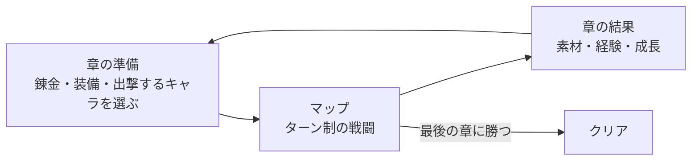

# 企画書「レンキン・タクティクス」（仮称）

- 文書 ID: CON-001
- 版: 0.3（案。開発者の確認待ち）
- 作成日: 2026-10-20
- 入力: [要求抽出記録](elicitation-notes.md) E-01〜E-09

## 1. ひとことで

章と章の間に錬金術で備え、キャラごとの強みを見つけて、大きなマップを攻略する、ファイアーエムブレムのようなシミュレーション RPG。初期の範囲では錬金を作らず、戦闘だけを作り込む（E-07。6 章）。

## 2. 体験の軸

| 軸 | 内容 | 根拠 |
|---|---|---|
| キャラの強みを見つける | キャラごとに得意な場面がはっきり違い、「このキャラはここで強い」と見つけて生かすことが、いちばんの楽しさ | E-03 |
| 大きなマップとギミック | 32 × 32 マスくらいの大きなマップに、よいギミックがあり、どう動かすかを考える | E-04 |
| 錬金で備えても手ごわい | 錬金で作った品を使いすぎれば物量で勝てるが、それでも手ごわく、戦術を楽しめる。錬金は初期の範囲の外（6 章） | E-03、E-07 |
| 単調にしない | スキルなどの要素で、戦闘ごとに違う考え方が要る | E-05 |

## 3. 世界と物語

- 戦争の話にする（E-07）。死を描く（E-07）
- 物語は簡単なプロットだけを決め、中身は Claude Code が書き、開発者が確認する（E-07）。物語は戦闘の舞台を用意する役で、量は多くしない

**プロット**（Claude Code の案。開発者が承認、E-08）

- 小国アルケアは、錬金術の工房で知られる国。大国ヴァルト帝国が、錬金術の技と資源を狙って攻め込む
- 主人公は、アルケアの国境の守備隊を率いる若い隊長。王都が落ち、散り散りになった兵と工房の錬金術士を集めて、反撃に出る
- 章ごとに、砦の防衛、撤退戦、山道の突破、帝国の補給線の襲撃、王都の奪還と、戦場が変わる（大きなマップのギミックの舞台になる）
- 帝国の側にも、戦争に疑問を持つ将がいて、途中で味方になる者もいる（仲間の加入の舞台）
- 最後の章で帝国の侵攻軍の総大将を倒し、王都を取り戻してクリア

## 4. 基本の流れ

- 章立てのキャンペーンで、章ごとにマップを 1 枚クリアして進む。最後の章に勝つとクリア（E-06）
- 錬金は章と章の間（マップの外）で行う（E-06）。初期の範囲では錬金を作らないので、章の準備は装備と出撃するキャラを選ぶだけ（E-07）

## 5. 戦闘

FE の要素は、すべて入れたい（E-03）。反復ごとに少しずつ入れる。

| 要素 | 内容 | 根拠 |
|---|---|---|
| グリッドのターン制 | 自軍の番に全員を好きな順で動かし、次に敵軍が動く（ふしぎ錬金の素早さ順から変える） | E-09 |
| 地形 | 地形によって、移動のしやすさや、守りの強さが変わる | E-03 |
| 命中と回避 | 攻撃が当たるかどうかが確率で決まる。能力と地形で変わる | E-03 |
| 武器の相性 | 武器の種類どうしに有利と不利がある | E-03 |
| 成長 | レベルが上がると能力が伸びる。伸び方（成長率）はキャラごとに違う | E-03、E-09 |
| クラスと転職 | クラスによって、使える武器・移動・能力が違う。条件を満たすと上のクラスに変わる | E-03、E-09 |
| 支援 | 仲間どうしの関係が深まると、戦闘で効果がある。形は Q-08 で決める | E-03 |
| スキル | キャラやクラスごとの特別な能力。キャラの強みをはっきりさせる | E-03、E-05 |
| ギミック | マップの仕掛け（例: 開く扉、動く床、増援、守る拠点）。詰め将棋のように解き方を考えるマップも作る | E-03、E-04、E-09 |

- **倒れた仲間**: 始めるときに、「離脱」（そのマップでは使えないが、次の章で戻る）か「ロスト」（戦死し、二度と使えない。E-07）かを選ぶ（E-06）
- **マップの大きさ**: 本番のマップは 32 × 32 マスくらい（E-04）。最初の反復は中くらいのマップ 1 枚とキャラ 3〜4 人で、キャラの強みとマップの動かし方を少しずつ確かめる（E-06）

## 6. 錬金

- 章と章の間に、素材から消耗品（回復薬、爆弾など）や装備を作る（E-06。素材の入手場所と装備を作るかは Q-10）
- 作りすぎると物量で押し切れるが、それでも手ごわいように調整する（E-03）
- ふしぎ錬金の品質（品質で威力が上がる）は、最終的に持ち込む（E-07）
- **初期の範囲では、錬金はすべて範囲の外にする**（E-07）。まず戦闘だけを作り込む。それまで、消耗品と装備は、決まった品を初めから持つか、マップで拾う形で代用する

## 7. ふしぎ錬金との関係

- ふしぎ錬金の戦闘の中心の部分を、このゲームで作り込む（E-01）
- 作り込んだ戦闘は、あとでふしぎ錬金に戻す（E-02）。戻す形は ADR で決める（Q-06）
- ふしぎ錬金の戦闘のコード（グリッドのターン制、前衛と後衛、出来事の記録）を出発点にする（E-02）。番の進め方は素早さ順から自軍と敵軍の交互に変える（E-09）。前衛・後衛の役割をクラスにどう置き換えるかと、品質つきのアイテムの使用を外す方法は、最初の反復の設計で決める

## 8. 作らないもの

| 作らないもの | 理由 |
|---|---|
| ふしぎ錬金の経済、街、ゴーレムの自動生産 | 戦闘を作り込むためのゲーム（E-01 から推し、E-09 で確認） |
| 初期の範囲の錬金と品質 | 最終的に持ち込むが、初期の範囲では作らない（E-07） |
| サウンド、凝ったグラフィック | Kenney の CC0 の絵などで代用する（ふしぎ錬金の PLAN-001 2.2 を引き継いだ。E-09） |
| オンライン機能、スマートフォン向けの最適化 | ふしぎ錬金の PLAN-001 2.2 を引き継いだ（E-09） |

## 9. 未決事項

| ID | 内容 | 補足 |
|---|---|---|
| Q-01 | ~~物語の量~~ | **決定（E-07）**: 簡単なプロットだけを決め、中身は Claude Code が書く（3 章） |
| Q-02 | ~~錬金の範囲~~ | **決定（E-07）**: 品質は最終的に持ち込む。初期の範囲では、錬金はすべて範囲の外（6 章）。素材の入手場所と、装備も作るかは、錬金を範囲に入れるときに決める（Q-10） |
| Q-03 | ~~ロストの表し方~~ | **決定（E-07）**: 死を描く。戦争の話にする（3 章） |
| Q-04 | 章の数と 1 章の長さ | 32 × 32 マスのマップ 1 枚を何分くらいで遊ぶか |
| Q-05 | 敵の動き方 | 突っ込んでくる、待ち構える、拠点を狙う、など |
| Q-06 | ふしぎ錬金に戻す形 | パッケージを共有するか、コードを写すか、定義データの形をそろえるか |
| Q-07 | 出撃の人数と、仲間の総数 | |
| Q-08 | 支援の形 | 会話を入れるか、数値の効果だけか |
| Q-09 | 初期の範囲で、消耗品と装備をどう手に入れるか | 錬金が範囲の外なので、初めから持つか、マップで拾うか |
| Q-10 | 錬金の素材の入手場所と、装備も作るか | 錬金を範囲に入れるときに決める |
