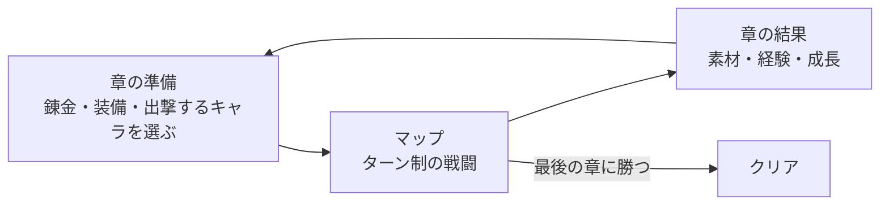

# 企画書「レンキン・タクティクス」（仮称）

- 文書 ID: CON-001
- 版: 0.1（案。開発者の確認待ち）
- 作成日: 2026-10-20
- 入力: [要求抽出記録](elicitation-notes.md) E-01〜E-06

## 1. ひとことで

章と章の間に錬金術で備え、キャラごとの強みを見つけて、大きなマップを攻略する、ファイアーエムブレムのようなシミュレーション RPG。

## 2. 体験の軸

| 軸 | 内容 | 根拠 |
|---|---|---|
| キャラの強みを見つける | キャラごとに得意な場面がはっきり違い、「このキャラはここで強い」と見つけて生かすことが、いちばんの楽しさ | E-03 |
| 大きなマップとギミック | 32 × 32 マスくらいの大きなマップに、よいギミックがあり、どう動かすかを考える | E-04 |
| 錬金で備えても手ごわい | 錬金で作った品を使いすぎれば物量で勝てるが、それでも手ごわく、戦術を楽しめる | E-03、E-06 |
| 単調にしない | スキルなどの要素で、戦闘ごとに違う考え方が要る | E-05 |

## 3. 基本の流れ

- 章立てのキャンペーンで、章ごとにマップを 1 枚クリアして進む。最後の章に勝つとクリア（E-06）
- 錬金は章と章の間（マップの外）で行う（E-06）

## 4. 戦闘

FE の要素は、すべて入れたい（E-03）。反復ごとに少しずつ入れる。

| 要素 | 内容 |
|---|---|
| グリッドのターン制 | 自軍の番と敵軍の番を交互に行う。ユニットごとに移動して行動する |
| 地形 | 地形によって、移動のしやすさや、守りの強さが変わる |
| 命中と回避 | 攻撃が当たるかどうかが確率で決まる。能力と地形で変わる |
| 武器の相性 | 武器の種類どうしに有利と不利がある |
| 成長 | レベルが上がると能力が伸びる。伸び方はキャラごとに違う |
| クラスと転職 | クラスによって、使える武器・移動・能力が違う。条件を満たすと上のクラスに変わる |
| 支援 | 仲間どうしの関係が深まると、近くにいるときに助け合う |
| スキル | キャラやクラスごとの特別な能力。キャラの強みをはっきりさせる（E-03、E-05） |
| ギミック | マップの仕掛け（例: 開く扉、動く床、増援、守る拠点）（E-04） |

- **倒れた仲間**: 始めるときに、「離脱」（そのマップでは使えないが、次の章で戻る）か「ロスト」（二度と使えない）かを選ぶ（E-06）
- **マップの大きさ**: 本番のマップは 32 × 32 マスくらい（E-04）。最初の反復は中くらいのマップ 1 枚とキャラ 3〜4 人で、キャラの強みとマップの動かし方を少しずつ確かめる（E-06）

## 5. 錬金

- 章と章の間に、マップで手に入れた素材から、消耗品（回復薬、爆弾など）や装備を作る（E-06）
- 作りすぎると物量で押し切れるが、それでも手ごわいように調整する（E-03）
- ふしぎ錬金の錬金と品質（品質で威力が上がる）を、どこまで持ち込むかは未決（Q-02）

## 6. ふしぎ錬金との関係

- ふしぎ錬金の戦闘の中心の部分を、このゲームで作り込む（E-01）
- 作り込んだ戦闘は、あとでふしぎ錬金に戻す（E-02）。戻す形は ADR で決める（Q-06）
- ふしぎ錬金の戦闘のコード（グリッドのターン制、前衛と後衛、出来事の記録）を出発点にする（E-02）

## 7. 作らないもの

| 作らないもの | 理由 |
|---|---|
| ふしぎ錬金の経済、街、ゴーレムの自動生産 | 戦闘を作り込むためのゲーム（E-01） |
| サウンド、凝ったグラフィック | Kenney の CC0 の絵などで代用する（PLAN-001 2.2） |
| オンライン機能 | PLAN-001 2.2 |

## 8. 未決事項

| ID | 内容 | 補足 |
|---|---|---|
| Q-01 | 物語の量 | FE は物語が多い。ふしぎ錬金は「物語を主役にしない」とした（ふしぎ錬金 E-23） |
| Q-02 | 錬金の範囲 | 品質を持ち込むか。素材をマップのどこで手に入れるか。装備も作るか |
| Q-03 | ロストの表し方 | 死として描くか、ふしぎ錬金のように死を描かず「戦えなくなって去る」とするか |
| Q-04 | 章の数と 1 章の長さ | 32 × 32 マスのマップ 1 枚を何分くらいで遊ぶか |
| Q-05 | 敵の動き方 | 突っ込んでくる、待ち構える、拠点を狙う、など |
| Q-06 | ふしぎ錬金に戻す形 | パッケージを共有するか、コードを写すか、定義データの形をそろえるか |
| Q-07 | 出撃の人数と、仲間の総数 | |
| Q-08 | 支援の形 | 会話を入れるか、数値の効果だけか |
