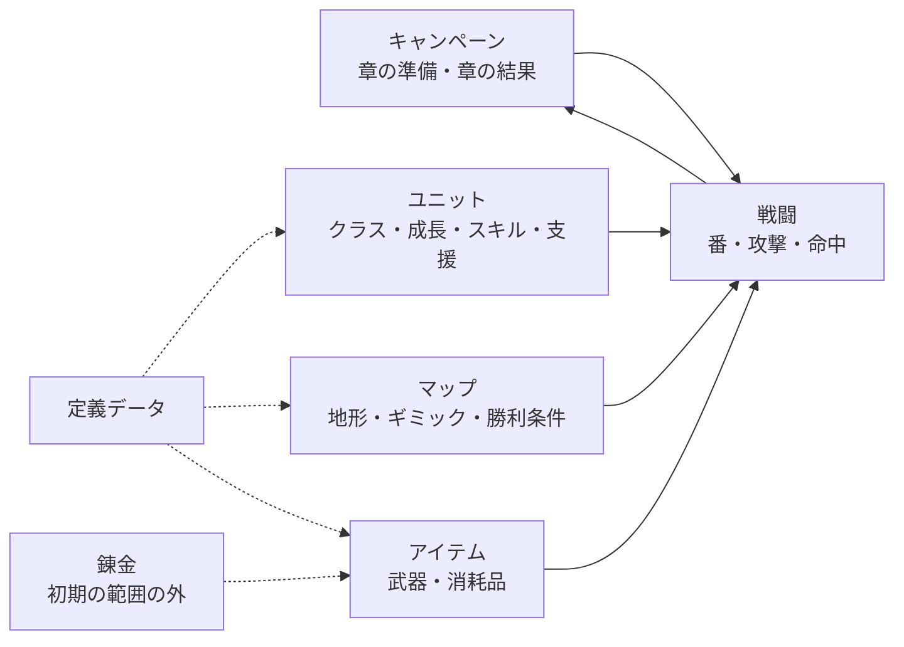

# 要求仕様書（SRS）「レンキン・タクティクス」（仮称）

- 文書 ID: SRS-001
- 版: 0.7（反復 6 の要求改訂。承認（E-94））
- 作成日: 2026-10-20
- 位置付け: ゲーム全体の要求の台帳。全体は粗いままにし、反復で扱う要求だけを反復計画書と設計書で詳しくする。反復で分かったことを反映して版を上げる（PLAN-001 3 章）
- 構成の参考: ISO/IEC/IEEE 29148、IEEE 830。ふしぎ錬金の SRS-001 と同じ構成にした

## 1. はじめに

### 1.1 目的

本書は、ゲーム「レンキン・タクティクス」が満たすべき要求を定義する。設計・実装・試験は本書の要求 ID を基準に行い、トレーサビリティマトリクスで対応を管理する。

### 1.2 範囲

本書はゲーム全体の要求を扱う。各反復で扱う要求は、反復計画書（`docs/iterations/itNN/plan.md`）で選ぶ。初期の範囲では錬金を作らない（E-07）。錬金の要求は 3.7 節に台帳として置き、優先度を W にする。

### 1.3 用語

| 用語 | 定義 |
|---|---|
| FE | ファイアーエムブレム。参考にするシミュレーション RPG |
| ユニット | マップの上で動く個体。自軍と敵軍がある |
| キャラ | 名前と個性を持つ自軍のユニット。仲間 |
| 自軍・敵軍 | プレイヤーが動かす陣営と、システムが動かす陣営 |
| 番 | 1 つの陣営が、自分のユニットを動かす期間。自軍の番と敵軍の番を交互に繰り返す |
| ターン | 自軍の番と敵軍の番の組 |
| クラス | ユニットの職業。使える武器、移動力、能力の傾向を決める |
| 移動力 | 1 回の移動で進めるマスの量。地形によって減り方が変わる |
| 転職 | ユニットのクラスを上のクラスに変えること |
| 成長率 | レベルが上がったときに、能力ごとに伸びる確率。キャラごとに違う |
| スキル | キャラやクラスが持つ特別な能力 |
| 支援 | 仲間どうしの関係。深まると戦闘で効果がある |
| 地形 | マスの種類。移動のしやすさや守りの強さを決める |
| ギミック | マップの仕掛け（例: 開く扉、動く床、増援、守る拠点） |
| 章 | キャンペーンの区切り。章ごとにマップを 1 枚クリアして進む |
| 章の準備 | 章のマップに入る前に、装備と出撃するキャラを選ぶ場面 |
| 離脱・ロスト | 倒れた仲間の扱い。離脱は次の章で戻る。ロストは戦死し、二度と使えない |
| 定義データ | ユニット、クラス、武器、マップなどを記述したデータ（AGENTS.md の `defs`・`defload`・`data`） |

### 1.4 参考文献

| ID | 文書 |
|---|---|
| ELI-001 | [要求抽出記録](../01_concept/elicitation-notes.md) |
| CON-001 | [企画書](../01_concept/concept.md) |
| PLAN-001 | [プロジェクト計画書](../00_plan/project-plan.md) |
| ADR-0001 | [技術選定](../adr/0001-tech-stack.md) |
| — | ふしぎ錬金の SRS-001（`sakana396/fushigi_renkin` の `docs/02_requirements/srs.md`） |

## 2. 全体の記述

### 2.1 製品の位置付け

PC で動く 1 人用の 2D のシミュレーション RPG。章立てのキャンペーンで、グリッドのマップの上でユニットを動かして戦う。体験の軸は「キャラの強みを見つける」「大きなマップとギミック」「錬金で備えても手ごわい」「単調にしない」（CON-001 2 章）。姉妹プロジェクト「ふしぎ錬金」の戦闘の中心の部分を作り込み、あとでふしぎ錬金に戻す（E-01、E-02）。

### 2.2 製品の主な機能

### 2.3 利用者

| 利用者 | 特性 | 主な関心 |
|---|---|---|
| プレイヤー | ファイアーエムブレムのような戦術ゲームを好む | キャラの強みを見つけて生かすこと、マップの解き方 |
| 開発者 | 本プロジェクトの保守者。ふしぎ錬金の開発者でもある | テストしやすさ、文書とコードの対応、ふしぎ錬金に戻しやすいこと |

### 2.4 制約

| ID | 制約 | 根拠 |
|---|---|---|
| CST-01 | 実装言語は Go、ゲームライブラリは Ebitengine を使う | ADR-0001、E-02 |
| CST-02 | 戦争の話にし、死を描く | E-07 |
| CST-03 | 物語は戦闘の舞台を用意する役とし、量を多くしない。プロットは CON-001 3 章のとおり | E-07、E-08 |
| CST-04 | 戦闘の規則は、あとでふしぎ錬金に戻せる形で作る。戻す形は TBD-03 | E-02 |
| CST-05 | 初期の範囲では、錬金と品質を作らない | E-07 |

### 2.5 前提と依存

- プレイヤーの PC は OpenGL などの GPU 描画に対応している
- 開発・試験の環境は WSL2（WSLg）と Windows
- 絵は Kenney の CC0 の素材などで代用する（CON-001 8 章）

## 3. 機能要求

### 要求の書き方

- **優先度**（MoSCoW）: M = 必須、S = あるべき、C = あると良い、W = 初期の範囲では作らない（あとの反復で範囲に入れる）
- **検証方法**: T = テスト、D = 実演、I = 査閲（文書やコードを読んで確認）、A = 分析
- **TBD**: 未決の値。9 章の一覧で管理する
- 根拠の欄が「補」の要求は、企画書と要求抽出記録に直接の根拠がなく、Claude Code が FE の一般的な形や、ふしぎ錬金の SRS から補ったもの（8 章の「補った要求」の表）。開発者は 22 件すべてを残すと決めた（E-11）
- 戦闘で起きたことを出来事として記録するしくみ（ふしぎ錬金にある）は、作り方の判断なので要求にせず、反復 1 の設計で決める（E-11）
- 根拠の「CON-001 x 章」は、企画書の文面（E-10 で承認）を指す

### 3.1 戦闘（BTL）

| ID | 要求 | 根拠 | 優先度 | 検証 |
|---|---|---|---|---|
| FR-BTL-01 | 戦闘は、グリッドのマップの上でユニットを移動させ、行動させるターン制で行うこと | E-01、E-03 | M | T |
| FR-BTL-02 | 自軍の番と敵軍の番を交互に繰り返すこと。自軍の番では、プレイヤーが自軍のユニットを好きな順に 1 体ずつ動かし、全員が動き終えるか、プレイヤーが番を終えると敵軍の番になること | E-09、補 | M | T |
| FR-BTL-03 | ユニットは、移動のあとに、攻撃・アイテムの使用・待機などの行動を 1 つ選べること。騎兵は、攻撃・回復・道具の使用のあと、生存し勝敗が決まっておらず移動力が残っていれば、その残りで再移動するか、その場で終えるかを選べること。待機では再移動せず、再移動のあとにもう一度行動はできないこと | 補、E-84〜E-86 | M | T |
| FR-BTL-04 | 攻撃が当たるかどうかを、攻撃する側の命中と守る側の回避による確率で決めること。確率は能力と地形で変わること。当たった攻撃では、必殺率と相手の幸運による必殺回避で必殺を判定すること。武器の重さと力で攻撃の速さが変わり、回避と追撃に効くこと。計算式は設計で決める | E-03、CON-001 5 章、E-76・E-77・E-81・E-83 | M | T |
| FR-BTL-05 | 武器の種類どうしに有利と不利（相性）があり、戦闘の結果に効くこと | E-03 | M | T |
| FR-BTL-06 | 攻撃を受けたユニットが、条件を満たせば反撃すること | 補 | M | T |
| FR-BTL-07 | 敵軍のユニットは、システムが動かすこと。動き方（突っ込む、待ち構える、拠点を狙う、一団でそろってから入る寄り方（章の定義で敵ごとに選ぶ）、など）は TBD-02。敵の騎兵は攻撃のあと、再移動の条件を満たせば残りの移動力で下がること | E-09、Q-05、E-81・E-82・E-84〜E-86 | M | T |
| FR-BTL-08 | 攻撃の前に、命中率・与えるダメージなどの予測を表示すること | 補 | S | D |
| FR-BTL-10 | 章ごとに 10 回、直前の行動からさかのぼり、実行済みの自軍の行動または自軍が明示的に番を終える操作の前を選んで戦闘を巻き戻せること。明示的に番を終える操作の前へ戻した場合は、番を終える前の自軍の入力待ちに戻ること。乱数も戻し、同じ行動なら同じ結果になること。一覧では自軍・敵軍の行動と番の境界を選んで、その行の前の盤面を確定前に確認できること。自軍の行動と明示的に番を終える操作の行は白で表示し、巻き戻せること。敵軍の行動の行は赤く薄く、敵軍の番の始めの行は薄い赤、自軍の番の始めの行は薄い灰で表示し、いずれもプレビューの閲覧だけができること。戻せない行では決定できず、理由を表示すること。閲覧・取消しでは戦闘・乱数・履歴・残り回数を変えず、決定に成功したときだけ巻き戻すこと。 | E-35〜E-37、E-39・E-41、E-44〜E-46 | M | T・D |

### 3.2 ユニット（UNT）

| ID | 要求 | 根拠 | 優先度 | 検証 |
|---|---|---|---|---|
| FR-UNT-01 | ユニットは能力（例: HP、力、技、速さ、守備、幸運、魔力、魔防）とクラスを持つこと。能力の種類は設計で決める | E-03、E-77 | M | T |
| FR-UNT-02 | クラスによって、使える武器の種類・移動力・能力の傾向が違うこと | E-03 | M | T |
| FR-UNT-03 | キャラごとに得意な場面がはっきり違い、プレイヤーがそれを見つけて生かせること | E-03 | M | D（遊んで評価し、反復の振り返りに記録する） |
| FR-UNT-04 | キャラは戦闘で経験を得て、レベルが上がると能力が伸びること。撃破の経験は相手とのレベル差で変わること。敵もレベルを持ち、章の定義データに記すこと。計算式と敵の能力の扱いは設計で決める | E-03、CON-001 4 章、E-79・E-86 | M | T |
| FR-UNT-05 | レベルが上がったときの能力の伸び方（成長率）が、キャラごとに違うこと | E-09 | M | T |
| FR-UNT-06 | 条件を満たしたキャラは、上のクラスに転職できること。条件は TBD-09 | E-09 | M | T |
| FR-UNT-07 | キャラやクラスがスキルを持ち、スキルが戦闘の結果や行動を変えること。エルザが持つスキルは、兵種のスキルの再移動だけとする | E-03、E-05、E-84〜E-86、E-93 | M | T |
| FR-UNT-08 | 仲間どうしの関係（支援）が深まると、戦闘で効果があること。形は TBD-05 | E-03、Q-08、E-11 | M | T |
| FR-UNT-09 | ユニットの能力・クラス・スキル・武器を、画面で確かめられること。自軍・敵軍の騎兵は馬に乗った絵とし、アーマーなどの歩兵と見分けられること | 補、E-39・E-41 | M | D |

### 3.3 マップ（MAP）

| ID | 要求 | 根拠 | 優先度 | 検証 |
|---|---|---|---|---|
| FR-MAP-01 | マップは地形を持つマスのグリッドであり、地形によって移動のしやすさと守りの強さが変わること | E-03 | M | T |
| FR-MAP-02 | 本番のマップは 32 × 32 マスくらいの大きさを扱えること。最後の章のマップは 32 × 32 マスで作ること | E-04、E-50 | M | T・D |
| FR-MAP-03 | マップにギミック（例: 開く扉、動く床、増援、守る拠点）を置けること。ギミックの種類は反復ごとに決める。ターンによる増援に加え、指定の敵が動く・倒れる・攻撃される、自軍が指定範囲に入る、の 4 つの出来事で増援の予約や一団の突撃が 1 回だけ起こること。出来事の増援は次に来る敵軍の番の始めに出し、予約時から出現処理の直前まで予兆を表示すること。ターンによる増援の予兆は、出現ターン T の自軍の番から出現処理の直前まで表示すること。正確な出現位置・ターン・人数の一覧は表示しないこと。出現マスがふさがれていたら、マップ内でそのユニットが立てるマンハッタン距離 2 以内の空きマスへ、距離と固定の順で決定的に出すこと。候補がなければその増援だけ出さず、後のターンへ延期しないこと。一度に生きている敵は 39 体までとし、初めの配置でこれを超える定義は拒むこと。増援はターンの増援、予約した出来事の増援の順に、それぞれ定義順・個体順に出すこと。出すと 39 体を超える個体は出さず、延期せず、乱数を引かず、出現の記録にも含めないこと。出来事は起きたままとし、上限で出なかった増援を再予約しないこと | E-03、E-04、E-39・E-41・E-42、E-63・E-80・E-89・E-91・E-92 | M | T・D |
| FR-MAP-04 | 詰め将棋のように、解き方を考えるマップを作れること | E-09 | S | D |
| FR-MAP-05 | マップごとに勝利条件と敗北条件を持つこと。条件の種類は TBD-08 | 補 | M | T |
| FR-MAP-06 | 大きなマップの全体を見渡せること。盤面は矢印キーで動かし、ホイールで上下・Shift＋ホイールで左右に動かし、行動の場面へ自動で寄ること。戦闘・配置・巻き戻しの下見で、画面の隅に常にミニマップを出し、全体の地形・生存ユニット・表示範囲・分かっている予兆を確認できること。ミニマップのクリックで盤面の中心を移せること | 補、E-49・E-61・E-80・E-89 | M | D |

### 3.4 キャンペーン（CMP）

| ID | 要求 | 根拠 | 優先度 | 検証 |
|---|---|---|---|---|
| FR-CMP-01 | ゲームは章立てのキャンペーンで、章ごとにマップを 1 枚クリアして次の章に進むこと。章の数は 9 章とする（TBD-01）。1 章の長さは要求にせず、目安を反復の計画書で決める | E-06、Q-04、E-49 | M | D |
| FR-CMP-02 | 最後の章のマップに勝つと、ゲームをクリアすること | E-06 | M | T |
| FR-CMP-03 | 章のマップに入る前に、出撃するキャラと装備を選べること。出撃の人数は章ごとに 6 人か 7 人までとし、主人公は必ず出撃する。全 9 章の出撃枠を従来より 1 つ増やす。各章の枠数は TBD-04 とする。仲間の総数は 9 人とする（初めの 5 人と、物語の途中で加わる 4 人。TBD-04） | CON-001 4 章、Q-07、E-49・E-50・E-55・E-78・E-79・E-89・E-90 | M | T |
| FR-CMP-04 | ゲームを始めるときに、倒れた仲間を「離脱」にするか「ロスト」にするかを選べること | E-06 | M | T |
| FR-CMP-05 | 「離脱」を選んだとき、倒れた仲間はそのマップでは使えず、次の章で戻ること | E-06 | M | T |
| FR-CMP-06 | 「ロスト」を選んだとき、倒れた仲間は戦死し、以後の章で使えないこと | E-06、E-07 | M | T |
| FR-CMP-07 | 章の前後に、プロットに沿った物語の文章を表示すること | E-07、E-08 | S | D |
| FR-CMP-08 | 物語の進みに合わせて、仲間が加わること（例: 帝国の側から味方になる将） | E-08（CON-001 3 章のプロット） | S | T |
| FR-CMP-09 | 主人公（守備隊の隊長）が倒れると、マップに敗北すること | 補 | S | T |
| FR-CMP-10 | 章のマップに勝つと、章の結果（得た経験、成長、手に入れた物など）を表示すること | CON-001 4 章 | M | D |
| FR-CMP-11 | 戦闘開始前に、主人公を含む出撃ユニットの場所を出撃のマスの中で入れ替え、空いたマスへも移せること。配置中に初めの敵の移動・攻撃範囲と敵全体の危険範囲を確認できること。未出現の増援は含めないこと | E-35・E-37、E-39・E-42 | M | T・D |

### 3.5 アイテム（ITM）

| ID | 要求 | 根拠 | 優先度 | 検証 |
|---|---|---|---|---|
| FR-ITM-01 | ユニットは武器を装備して攻撃すること。武器は種類（相性の単位）を持ち、物理と魔法の武器、特効を持つ武器があること。1 人が複数の武器を持ち、武器・杖 1 本と道具 1 個をそれぞれ 1 枠として、手持ちは合計 5 枠までとすること。攻撃の前に武器を選べ、攻撃操作の決定に成功したとき最後に使った武器をその戦闘の反撃に使うこと（外れも使用に含む）。回復・道具・待機では装備を変えないこと。武器には使用回数を付けず、杖の使用回数は保つこと | E-03、E-74・E-75・E-77〜E-79・E-86 | M | T |
| FR-ITM-02 | 戦闘中に消耗品（例: 回復薬）を使え、使うと手持ちから減ること | CON-001 6 章 | M | T |
| FR-ITM-03 | 初期の範囲では、消耗品と装備を、錬金を使わずに手に入れること。初めの持ち物は既存の武器・回復薬と、錬金術師の基本の魔法と杖とすること。新しい武器は章の報酬でだけ共有の在庫に入ること（TBD-06）。敵の武器は倒しても落とさないこと | E-07、Q-09、E-11、E-75、E-93 | M | T |

### 3.6 システム（SYS）

| ID | 要求 | 根拠 | 優先度 | 検証 |
|---|---|---|---|---|
| FR-SYS-01 | 章と章の間で、キャンペーンの状態をセーブし、ロードして再開できること。マップの途中のセーブは TBD-10 | 補 | M | T |
| FR-SYS-02 | タイトル画面から、新規開始・続きから・終了を選べること | 補 | M | D |
| FR-SYS-03 | ユニット・クラス・武器・スキル・マップを、定義データから読み込むこと | AGENTS.md（パッケージ構成の `defs`・`defload`・`data`） | M | I |
| FR-SYS-04 | 起動時に定義データを検証し、誤りがあれば、ファイル名・位置・理由を表示すること | 補（ふしぎ錬金 FR-MOD-04 から） | S | T |

### 3.7 錬金（ALC。初期の範囲の外）

| ID | 要求 | 根拠 | 優先度 | 検証 |
|---|---|---|---|---|
| FR-ALC-01 | 章と章の間（マップの外）で、素材から消耗品を作れること | E-06 | W | — |
| FR-ALC-02 | 装備も錬金で作れること（作るかどうかと、素材の入手場所は TBD-07） | E-06、Q-10 | W | — |
| FR-ALC-03 | ふしぎ錬金の品質（品質で威力が上がる）を持ち込むこと | E-07 | W | — |
| FR-ALC-04 | 錬金で作った品を使いすぎれば物量で勝てるが、それでも手ごわいように調整すること | E-03 | W | — |

## 4. 外部インタフェース要求

| ID | 要求 | 根拠 | 優先度 | 検証 |
|---|---|---|---|---|
| IF-01 | 操作はマウスとキーボードで行えること | 補 | M | D |
| IF-02 | 画面の表示言語は日本語とすること | 補 | M | I |
| IF-03 | 定義データは、人がテキストエディタで読み書きできる形式（形式は設計で決める）とすること | 補（ふしぎ錬金 IF-03 から） | S | I |
| IF-04 | セーブデータはユーザーのデータ用ディレクトリ（OS の慣例に従う）に保存すること | 補 | M | T |

## 5. 非機能要求

| ID | 区分 | 要求 | 根拠 | 優先度 | 検証 |
|---|---|---|---|---|---|
| NFR-01 | 性能 | 32 × 32 マスのマップで、ユニットが一度に 46 体（自軍最大 7・敵 39。TBD-11）いても、推奨環境（TBD-12）で 60 fps を保つこと | E-04、補、E-50・E-91 | S | T |
| NFR-02 | 性能 | 敵軍の番 1 回あたりの考える時間が、一度に 46 体（自軍最大 7・敵 39。TBD-11）のとき 1 秒以内であること | E-04、補、E-50・E-91 | S | T |
| NFR-03 | 移植性 | Windows 11 と Linux（Ubuntu 24.04）で動作すること | 補（ふしぎ錬金 NFR-03 から） | M | D |
| NFR-04 | 保守性 | ゲームの規則を実装するパッケージ（core）は、Ebitengine に依存しないこと | ADR-0001、AGENTS.md | M | I |
| NFR-05 | 保守性 | core は実時間を使わないこと | AGENTS.md | M | I |
| NFR-06 | 試験性 | 乱数の種（シード）と入力が同じなら、戦闘の結果が同じになること | AGENTS.md | M | T |
| NFR-07 | 信頼性 | 状態を変える操作が失敗したら、状態を変えずに、理由の分かる誤りを返すこと | AGENTS.md | M | T |
| NFR-08 | 信頼性 | セーブの途中で強制終了しても、直前の正常なセーブデータが壊れないこと | 補（ふしぎ錬金 NFR-07 から） | S | T |
| NFR-09 | 保守性 | core パッケージの命令網羅率が 80% 以上であること | 補（ふしぎ錬金 NFR-05 から） | S | T |

## 6. 品質保証の要求

| ID | 要求 | 根拠 |
|---|---|---|
| QA-01 | プルリクエストと `main` への push ごとに、CI でフォーマット確認・静的解析・単体テスト・テストケース ID の整合を確かめること（文書だけの変更では Go の検査を省く） | PLAN-001 5 章 |
| QA-02 | すべての M・S 要求は、トレーサビリティマトリクスで設計要素とテストケースに対応付けること | PLAN-001 5 章、AGENTS.md |
| QA-03 | 各工程の成果物はレビューし、記録を `docs/reviews/` に残すこと | PLAN-001 5 章 |

## 7. 将来の要求（初期の範囲では作らない）

| ID | 内容 | 根拠 |
|---|---|---|
| FR-ALC-01〜04 | 錬金と品質 | E-07 |
| — | ふしぎ錬金の経済、街、ゴーレムの自動生産 | CON-001 8 章、E-09 |
| — | サウンド、凝ったグラフィック、オンライン機能、スマートフォン向けの最適化 | CON-001 8 章、E-09 |

## 8. 要求の一覧（集計）

| 区分 | M | S | C | W | 計 |
|---|---|---|---|---|---|
| 機能要求 | 36 | 6 | 0 | 4 | 46 |
| 外部インタフェース要求 | 3 | 1 | 0 | 0 | 4 |
| 非機能要求 | 5 | 4 | 0 | 0 | 9 |

### 補った要求

企画書と要求抽出記録に直接の根拠がなく、Claude Code が FE の一般的な形や、ふしぎ錬金の SRS から補った要求。開発者は 22 件すべてを残すと決めた（E-11）。

| ID | 補った理由 |
|---|---|
| FR-BTL-02（番を途中で終える） | 全員を動かさずに番を終えられないと、待たせたいキャラがいるときに困る |
| FR-BTL-03 | FE の行動の基本（移動のあとに攻撃・アイテム・待機）。E-03 にはない |
| FR-BTL-06 | FE の戦闘の基本（反撃）。キャラの強み（反撃で返り討ちにする役など）を作りやすい |
| FR-BTL-08 | 命中が確率で決まるので、選ぶ前に見えないと考えて動かせない |
| FR-UNT-09 | キャラの強みを見つける（E-03）には、能力やスキルが見える必要がある |
| FR-MAP-05 | マップをクリアする（E-06）には、勝ちと負けの条件が要る |
| FR-MAP-06 | 32 × 32 マス（E-04）は 1 画面に収まらない |
| FR-CMP-09 | FE の一般的な敗北条件。主人公がいるプロット（E-08）に合う |
| FR-SYS-01、FR-SYS-02 | 章立てのキャンペーン（E-06）は 1 回で遊び終わらない |
| FR-SYS-04、IF-03 | ふしぎ錬金と同じく、定義データの誤りを早く見つけるため |
| IF-01、IF-02、IF-04 | PC の 1 人用のゲームとしての前提 |
| NFR-01、NFR-02 | 大きなマップ（E-04）で、表示と敵の考える時間が遅くならないため |
| NFR-03、NFR-08、NFR-09 | ふしぎ錬金の SRS-001 から引き継いだ |

## 9. 未決事項（TBD）

| ID | 内容 | 関連 | 状態 |
|---|---|---|---|
| TBD-01 | 章の数と 1 章の長さ | FR-CMP-01、Q-04 | 決定（E-49〜E-51）: 9 章（既存 3 章と新規 6 章）。1 章の長さは要求にせず、目安を反復の計画書で決める（E-51。反復 5 では短い課題 10〜20 分、大きな攻略 30〜45 分。IT05-PLAN 5 章） |
| TBD-02 | 敵の動き方の種類 | FR-BTL-07、Q-05 | 保留（反復 1 で決める。E-11） |
| TBD-03 | ふしぎ錬金に戻す形 | CST-04、Q-06 | 保留（反復 1 の設計で ADR を書く。E-11） |
| TBD-04 | 出撃の人数と、仲間の総数 | FR-CMP-03、Q-07 | 決定（E-78・E-79・E-89・E-90、E-94）: 全 9 章の出撃枠を +1 とし、章順に 6・7・6・7・6・7・6・6・7 枠（DES-IT06 13 章）。主人公は必須で、名簿が枠より少なくても出撃できる。仲間の総数は 9 人（初めの 5 人、2 章の始めに錬金術師と騎兵、4 章・8 章の始めに 1 人ずつ加入）。2 章は 7 人全員に初めから出撃の印を付ける |
| TBD-05 | 支援の形（会話を入れるか、数値の効果だけか） | FR-UNT-08、Q-08 | 保留 |
| TBD-06 | 初期の範囲で、消耗品と装備をどう手に入れるか | FR-ITM-03、Q-09 | 決定（E-75、E-93、E-94）: 初めは既存の武器・回復薬と、錬金術師の基本の魔法と杖を持つ。新しい武器は章の報酬でだけ共有の在庫に入る。敵は武器を落とさない。回復薬の章の報酬は保つ |
| TBD-07 | 錬金の素材の入手場所と、装備も作るか | FR-ALC-02、Q-10 | 保留（錬金を範囲に入れるとき） |
| TBD-08 | 勝利条件と敗北条件の種類（例: 全滅させる、ボスを倒す、拠点を制圧する、守り切る、目的地に着く、撤退する） | FR-MAP-05 | 保留 |
| TBD-09 | 転職の条件 | FR-UNT-06 | 保留 |
| TBD-10 | マップの途中でセーブできるか | FR-SYS-01 | 保留 |
| TBD-11 | 性能要求の基準とするユニットの数 | NFR-01、NFR-02 | 決定（E-91・E-92、E-94）: 一度に盤面にいる 46 体（自軍最大 7・敵 39。生存数）。章を通した敵の総数ではない。倒された敵を増援で補えるが、生きている敵は一度に 39 体まで。上限で出ない個体の扱いは FR-MAP-03。出撃の人数（TBD-04）に依存し、TBD-04 を変えるときは見直す |
| TBD-12 | 推奨環境 | NFR-01 | 決定（E-50）: 開発者がいつも遊ぶ Windows の PC（Intel Core i5-10400F、NVIDIA GeForce GTX 1660 SUPER、メモリ 32GB、Windows 11 Home）。描画ドライバ・画面倍率などは測定時に記録する |

保留の TBD は、関係する要求を反復で扱うときに決める。

ユースケース（UC-）は、ふしぎ錬金と同じく別の文書（`use-cases.md`）にし、反復ごとに対象の範囲を書き足す。

## 10. 変更履歴

| 版 | 日付 | 内容 |
|---|---|---|
| 0.1 | 2026-10-20 | 初版。CON-001 v0.3、E-01〜E-10 をもとにした。REV-002 の指摘と E-11 を反映した（FR-BTL-09 を設計に回し、FR-UNT-08 を M にした）。開発者が承認した（E-12） |
| 0.2 | 2026-10-22 | DES-IT03 v0.2 3.1 節の承認済みの文面（E-37、Q-IT03-02）を変えずに、FR-BTL-10（巻き戻し）と FR-CMP-11（出撃の配置）を追加。どちらも優先度 M、検証 T・D とし、集計を更新した。既存の要求の行は変更していない。承認（E-37） |
| 0.3 | 2026-10-23 | IT04-PLAN v0.3 3 章・Q-IT04-08、DES-IT04 v0.3 3 章に基づき、FR-BTL-10 の盤面プレビュー、FR-CMP-11 の配置中の敵範囲、FR-UNT-09 の両軍の騎乗の絵、FR-MAP-03 の予兆と距離 2 以内の代替出現・候補なしで不出現／延期なしを追記。既存 ID と優先度を維持し、FR-MAP-03 の検証を T・D に変更した。方針・追記内容は E-42 で承認済み。開発者が文面を承認した（E-43）。REV-042 F-12 の E-41・E-42 の要約の文面も開発者が承認した（E-43） |
| 0.4 | 2026-10-23 | E-44〜E-46、IT04-PLAN v0.4 3 章の承認された文面に従い FR-BTL-10 を改訂。自軍行動・明示の番終了前への復元と自軍入力待ち、全種類のプレビュー、行の色・閲覧専用・理由を明記。既存 ID・優先度 M・検証 T・D を維持した。承認（E-46） |
| 0.5 | 2026-10-24 | IT05-PLAN v0.3 3 章・10 章、DES-IT05 v0.3 に基づき、FR-CMP-01 に章の数（9 章）、FR-CMP-03 に出撃の人数（章ごとに 5 か 6、主人公は必須）と仲間の総数（6 人）、FR-MAP-02 に最後の章を 32 × 32 で作ること（検証を T・D に変更）、FR-MAP-06 にスクロールの方法、NFR-01・02 に基準の体数（40 体）を書き、TBD-01・04・11・12 を決定にした。FR-CMP-02・07 の文面、既存 ID、優先度、集計は変えていない。新しい FR は足していない。改訂の内容は E-49・E-50 で承認済み。REV-055 の F-01（FR-CMP-03 の根拠に E-50）・F-02（1 章の長さの目安は反復の計画書で決める）を直し、開発者が文面を承認した（E-51） |
| 0.6 | 2026-10-24 | IT05-PLAN v0.43 章、DES-IT05 v0.4に基づき、FR-CMP-03 と TBD-04 の仲間の総数を 6 人から 8 人に改め（根拠に E-55）、TBD-11 に出撃の人数を変えないので体数は変わらないことを書いた。出撃の人数・FR-CMP-06・FR-CMP-08 の文面、既存 ID、優先度、集計は変えていない。新しい FR は足していない。開発者が承認した（E-57） |
| 0.7 | 2026-10-26 | IT06-PLAN v0.3 3 章、DES-IT06 v0.2 1.2 節・14 章 A と計画書への追加（E-89〜E-92）に基づき、FR-UNT-01・04・07、FR-BTL-03・04・07、FR-ITM-01・03、FR-MAP-03・06、FR-CMP-03、NFR-01・02、TBD-04・06・11 を改訂。能力・必殺・重さ・魔法・複数武器・報酬・レベル差の経験・再移動・出来事と敵の思考・ミニマップを反映。エルザのスキルは兵種の再移動だけ。仲間 9 人、全章の出撃枠 +1、同時 46 体（自軍最大 7・敵 39）と敵の上限を明記。既存 ID・優先度・検証方法・集計は維持。開発者が承認した（E-94） |
