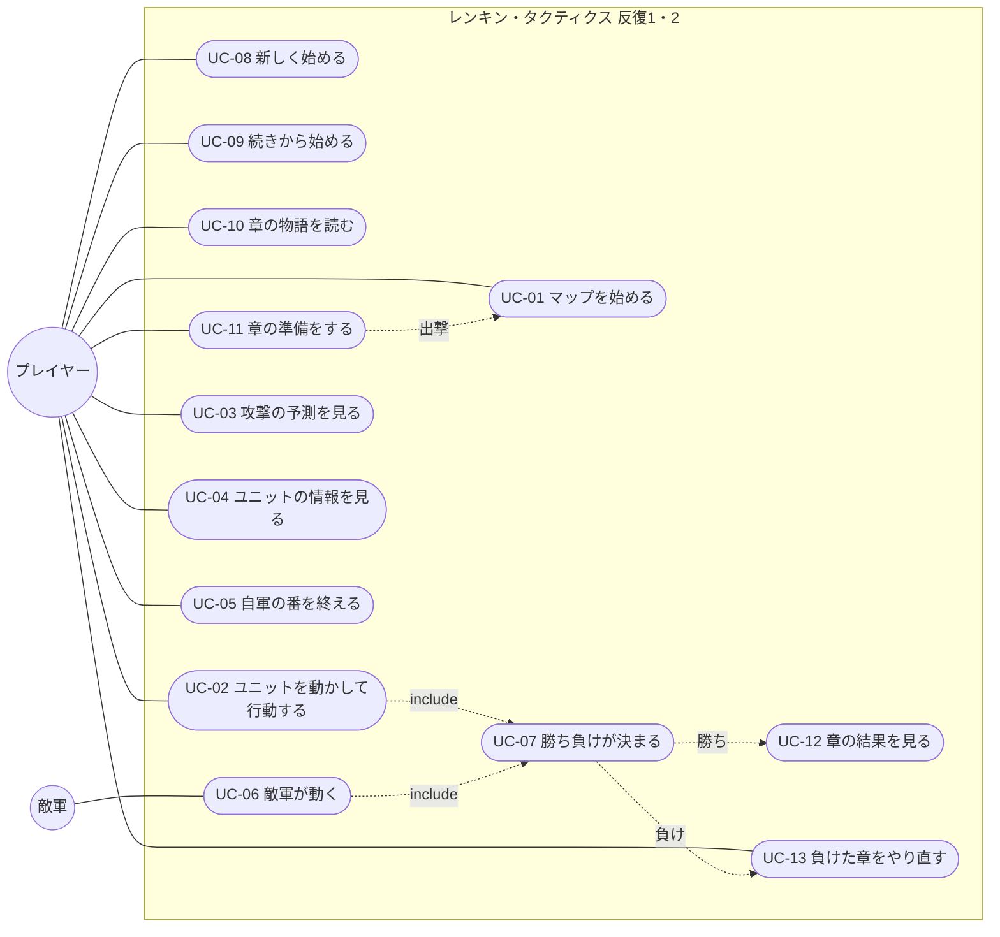

# ユースケース

- 文書 ID: UC-DOC-001
- 版: 0.3（案。反復 2 の範囲を書き足した。開発者の確認待ち）
- 作成日: 2026-10-20
- 対象: [反復 1 計画書](../iterations/it01/plan.md) と [反復 2 計画書](../iterations/it02/plan.md) の範囲。反復ごとに書き足す

## 1. アクター

| アクター | 説明 |
|---|---|
| プレイヤー | ゲームを遊ぶ人。自軍を動かす |
| 敵軍 | システムが動かす陣営（システム内部のアクター。FR-BTL-07） |

## 2. ユースケース図

反復 2 で足したユースケースは UC-08〜UC-13。反復 2 では、UC-01・UC-02・UC-04・UC-06・UC-07 も変えた（v0.3 の印）。

## 3. ユースケース記述

### UC-01 マップを始める

| 項目 | 内容 |
|---|---|
| アクター | プレイヤー |
| 関連要求 | FR-SYS-03、FR-ITM-03、FR-CMP-03、FR-CMP-05、IF-03 |
| 事前条件 | 章の準備（UC-11）で、出撃するキャラを選んでいる（v0.3） |
| 事後条件 | マップが表示され、1 ターン目の自軍の番になっている |

**基本フロー**（v0.3 で変えた）
1. プレイヤーは章の準備で「出撃」を選ぶ
2. システムは今の章のマップを用意し、出撃するキャラを出撃の枠に（主人公を 1 番目に）、敵軍を配置する。キャラは名簿のレベル・能力・手持ちで、HP は最大から始まる（離脱で前の章に倒れた仲間も戻る）
3. システムは 1 ターン目の自軍の番を始める（砦にいる自軍は回復する）

定義データの読み込みと検証（v0.2 までの 1・2 と 2a）は、UC-08 に移した。

### UC-02 ユニットを動かして行動する

| 項目 | 内容 |
|---|---|
| アクター | プレイヤー |
| 関連要求 | FR-BTL-01〜06、FR-ITM-01、FR-ITM-02、FR-MAP-01、FR-UNT-04、FR-UNT-05、FR-UNT-07 |
| 事前条件 | 自軍の番で、まだ行動していない自軍のユニットがいる |
| 事後条件 | ユニットが行動済みになる。全員が行動済みなら敵軍の番になる |

**基本フロー**
1. プレイヤーは、まだ行動していない自軍のユニットを選ぶ
2. システムは、移動できるマスと、攻撃できるマスを表示する
3. プレイヤーは、移動先のマスを選ぶ（今いるマスも選べる）
4. システムは、選べる行動（攻撃・アイテム・待機）を表示する
5. プレイヤーは「攻撃」を選び、攻撃する敵を選ぶ（UC-03 で予測を見る）
6. プレイヤーが決定すると、システムはユニットを移動させ、攻撃・反撃・追撃を行い、結果を表示する
7. システムはユニットを行動済みにする

**代替フロー**
- 3a. プレイヤーが取り消す: システムは 1 に戻る（まだ何も変わっていない）
- 5a. プレイヤーは「アイテム」を選ぶ: システムは回復薬を使って HP を回復し、手持ちを 1 つ減らす（FR-ITM-02）
- 5b. プレイヤーは「待機」を選ぶ: システムはユニットを移動させるだけにする
- 6a. 倒れたユニットがいる: システムはそのユニットをマップから外す（E-15）。倒れたのがボスか主人公なら UC-07 に進む
- 6b. 攻撃に加わった自軍のユニットが生きている: システムは経験を足して表示する。経験が 100 に達したら、レベルを上げ、上がった能力を表示する（FR-UNT-04、FR-UNT-05。v0.3）

### UC-03 攻撃の予測を見る

| 項目 | 内容 |
|---|---|
| アクター | プレイヤー |
| 関連要求 | FR-BTL-08、FR-BTL-04〜06、FR-UNT-07 |
| 事前条件 | UC-02 の 5 で、攻撃する敵を選んでいる |
| 事後条件 | 状態は変わらない |

**基本フロー**
1. システムは、攻撃する側と守る側のそれぞれについて、HP（今と、すべて当たったときの後）・ダメージ・命中率・追撃の有無・反撃の有無・効くスキル・武器の相性を表示する。すべて当たれば倒せるなら「撃破」、すべて当たると倒されるなら「危険」と出す。反撃できない側は数字を「―」にする。狙う相手のマスの上にも、ダメージと命中率を小さく出す（v0.2、E-22）
2. プレイヤーは、決定するか、別の敵を選ぶか、取り消す

### UC-04 ユニットの情報を見る

| 項目 | 内容 |
|---|---|
| アクター | プレイヤー |
| 関連要求 | FR-UNT-09、FR-MAP-01 |
| 事前条件 | なし（敵軍の番の表示中を除く） |
| 事後条件 | 状態は変わらない |

**基本フロー**
1. プレイヤーは、マップの上のユニット（自軍・敵軍）にカーソルを合わせる
2. システムは、ユニットの絵・名前・クラス・能力（棒つき）・武器（絵つき）・手持ち・スキル・いるマスの地形を表示する。敵のときは、自軍の番の入力を受け付けている間（行動の一覧や攻撃の相手・アイテムを選んでいるときを除く）、移動できるマスと攻撃できるマスも表示する。敵をクリックすると表示を出し続け、もう一度クリックで消す（v0.2、E-22、E-23）。自軍のときは、レベルと経験も表示する（v0.3）

**代替フロー**
- 1a. プレイヤーは Q キーを押す: システムは、敵全体が次に攻撃できるマス（危険範囲）を表示する。もう一度押すと消す（v0.2、E-22）

### UC-05 自軍の番を終える

| 項目 | 内容 |
|---|---|
| アクター | プレイヤー |
| 関連要求 | FR-BTL-02 |
| 事前条件 | 自軍の番 |
| 事後条件 | 敵軍の番になる（UC-06） |

**基本フロー**
1. プレイヤーは「番を終える」を選ぶ
2. システムは敵軍の番を始める

**代替フロー**
- 1a. まだ行動していない自軍がいる: システムは確認を求める。プレイヤーがもう一度「番を終える」を選ぶと 2 に進む

### UC-06 敵軍が動く

| 項目 | 内容 |
|---|---|
| アクター | 敵軍 |
| 関連要求 | FR-BTL-02、FR-BTL-07、FR-MAP-03 |
| 事前条件 | 敵軍の番が始まった |
| 事後条件 | 次のターンの自軍の番になっている |

**基本フロー**
1. システムは、このターンに現れる増援を置く（FR-MAP-03）
2. システムは、砦にいる敵を回復する
3. システムは、敵を決まった順に 1 体ずつ、動き方（突っ込む・待ち構える）に従って動かし、攻撃させる
4. システムは、出来事を順に表示する
5. システムはターンを 1 つ進め、自軍の番を始める（砦にいる自軍は回復する）

**代替フロー**
- 3a. 主人公が倒れた: UC-07 に進む
- 3b. 自軍の反撃でボスが倒れた: UC-07 に進む
- 3c. 攻撃を受けた自軍のユニットが生きている: システムは経験を足し、レベルが上がれば上がった能力を表示する（UC-02 の 6b と同じ。v0.3）

### UC-07 勝ち負けが決まる

| 項目 | 内容 |
|---|---|
| アクター | プレイヤー、敵軍 |
| 関連要求 | FR-MAP-05、FR-CMP-09 |
| 事前条件 | 攻撃でユニットが倒れた |
| 事後条件 | 勝ちか負けが表示されている |

**基本フロー**（v0.3 で変えた）
1. ボスが倒れたとき、システムは勝ちを表示する。プレイヤーがクリックすると、UC-12 に進む
2. 主人公が倒れたとき、システムは負けを表示する。プレイヤーがクリックすると、UC-13 に進む

v0.2 までの「3. プレイヤーは、最初からやり直すか、終了するかを選ぶ」は、UC-12・UC-13 に置き換えた。

### UC-08 新しく始める（v0.3）

| 項目 | 内容 |
|---|---|
| アクター | プレイヤー |
| 関連要求 | FR-SYS-02、FR-SYS-03、FR-SYS-04、FR-CMP-04、FR-SYS-01、IF-03、IF-04 |
| 事前条件 | なし |
| 事後条件 | 1 章の始めの状態がセーブされ、1 章の前の物語（UC-10）が始まっている |

**基本フロー**
1. プレイヤーはゲームを起動する
2. システムは定義データを読み込み、検証する
3. システムはタイトル（新規開始・続きから・終了）を表示する。セーブがあれば、「続きから」の下に章の名前を出す
4. プレイヤーは「新規開始」を選ぶ
5. システムは、倒れた仲間を「離脱」（次の章で戻る）にするか「ロスト」（戦死し、二度と戻らない）にするかを、説明とともに尋ねる
6. プレイヤーはどちらかを選ぶ
7. システムは、初めの名簿（主人公を含む 4 人）と 1 章で新しいキャンペーンを作り、セーブする
8. システムは 1 章の前の物語を始める（UC-10）

**代替フロー**
- 2a. 定義データに誤りがある: システムは、ファイル名・位置・理由をすべて表示して終了する（FR-SYS-04）
- 4a. プレイヤーは「終了」を選ぶ: システムは終了する
- 4b. セーブがある: システムは、上書きしてよいかを尋ねる。プレイヤーが「いいえ」を選ぶと 3 に戻る
- 6a. プレイヤーが取り消す: システムは 3 に戻る
- 7a. セーブに失敗した: システムは理由を表示し、遊びは続ける

### UC-09 続きから始める（v0.3）

| 項目 | 内容 |
|---|---|
| アクター | プレイヤー |
| 関連要求 | FR-SYS-01、FR-SYS-02、IF-04 |
| 事前条件 | UC-08 の 1〜3 で、タイトルが表示されている |
| 事後条件 | セーブした章の前の物語（UC-10）が始まっている |

**基本フロー**
1. プレイヤーは「続きから」を選ぶ
2. システムはセーブを読み、セーブした章の始めの状態（名簿・在庫・離脱かロスト）にする
3. システムは、その章の前の物語を始める（UC-10）

**代替フロー**
- 1a. セーブがない、または読めない: 「続きから」は選べない。読めないときは、システムが理由を表示する
- 2a. セーブがクリア済み: システムはクリアの画面を表示する。プレイヤーがクリックするとタイトルに戻る

### UC-10 章の物語を読む（v0.3）

| 項目 | 内容 |
|---|---|
| アクター | プレイヤー |
| 関連要求 | FR-CMP-07、FR-CMP-08 |
| 事前条件 | 章に入ったか（章の前）、章に勝って結果を見終えた（章のあと） |
| 事後条件 | 章の前なら章の準備（UC-11）、章のあとなら次の章の前の物語か、クリアの画面になっている |

**基本フロー**
1. システムは、章の名前と、物語の最初の段落を表示する
2. プレイヤーはクリックして、次の段落に進む。最後の段落まで繰り返す
3. 章の前の物語で、その章に加わる仲間がいれば、システムは「仲間に加わった」と、そのキャラの情報を表示する
4. システムは、章の前なら章の準備（UC-11）に、章のあとなら次の章の前の物語（1 に戻る）に進む。最後の章のあとなら、クリアの画面を表示する（FR-CMP-02）

**代替フロー**
- 1a. その章に物語がない: システムは 3 に進む
- 2a. プレイヤーは物語を飛ばす: システムは 3 に進む

### UC-11 章の準備をする（v0.3）

| 項目 | 内容 |
|---|---|
| アクター | プレイヤー |
| 関連要求 | FR-CMP-03、FR-ITM-03、FR-UNT-09 |
| 事前条件 | 章の前の物語（UC-10）を終えたか、負けた章をやり直す（UC-13） |
| 事後条件 | 状態は変わらない（アイテムの入れ替えを除く）。「出撃」を選べば UC-01 に進む |

**基本フロー**
1. システムは、章の名前、出撃の枠の数、名簿の生きているキャラ（レベル・HP・手持ち）、共有の在庫を表示する。主人公と、名簿の順に枠の数までのキャラに、出撃の印を付けておく
2. プレイヤーは、キャラの出撃の印を付け外しする（主人公は外せない。枠の数を超えて付けられない）
3. プレイヤーは、キャラを選んで、能力・武器・スキル・手持ちを見る
4. プレイヤーは、選んだキャラの手持ちと共有の在庫の間で、アイテムを 1 つずつ入れ替える
5. プレイヤーは「出撃」を選ぶ（UC-01）

**代替フロー**
- 4a. 手持ちが上限（5 個）: システムは入れ替えず、理由を表示する

### UC-12 章の結果を見る（v0.3）

| 項目 | 内容 |
|---|---|
| アクター | プレイヤー |
| 関連要求 | FR-CMP-10、FR-CMP-05、FR-CMP-06、FR-UNT-04、FR-ITM-03、FR-SYS-01、NFR-08 |
| 事前条件 | 章のマップに勝った（UC-07 の 1） |
| 事後条件 | 次の章の始めの状態（最後の章ならクリア済み）がセーブされ、章のあとの物語（UC-10）が始まっている |

**基本フロー**
1. システムは、出撃したキャラのレベル・経験・能力を名簿に書き戻し、章の報酬を共有の在庫に入れ、次の章に進めて（加わる仲間を名簿に足して）、セーブする
2. システムは、出撃したキャラごとに、前後のレベルと経験、上がった能力を表示し、報酬を表示する
3. プレイヤーはクリックして、章のあとの物語に進む（UC-10）

**代替フロー**
- 1a. 「離脱」で、倒れたキャラがいる: システムは、そのキャラに「離脱（次の章で戻る）」と表示する。キャラは名簿に残る（FR-CMP-05）
- 1b. 「ロスト」で、倒れたキャラがいる: システムは、そのキャラを戦死として名簿から外し（手持ちも失う）、「戦死」と表示する（FR-CMP-06）
- 1c. セーブに失敗した: システムは理由を表示し、遊びは続ける（前のセーブが残る）

### UC-13 負けた章をやり直す（v0.3）

| 項目 | 内容 |
|---|---|
| アクター | プレイヤー |
| 関連要求 | FR-CMP-09、FR-SYS-01 |
| 事前条件 | 主人公が倒れて負けた（UC-07 の 2） |
| 事後条件 | 章の始めの状態に戻り、章の準備（UC-11）になっているか、タイトルになっている |

**基本フロー**
1. システムは「敗北」と、「この章をやり直す」「タイトルへ」を表示する
2. プレイヤーは「この章をやり直す」を選ぶ
3. システムはセーブを読み、章の始めの状態に戻す（準備で入れ替えたアイテムも、負けた戦闘で倒れた仲間も戻る）
4. システムは章の準備を始める（UC-11）。章の前の物語は飛ばす

**代替フロー**
- 2a. プレイヤーは「タイトルへ」を選ぶ: システムはタイトルを表示する（UC-08 の 3）
- 3a. セーブを読めない: システムは理由を表示し、タイトルを表示する

## 4. 変更履歴

| 版 | 日付 | 内容 |
|---|---|---|
| 0.1 | 2026-10-20 | 初版（反復 1 の範囲）。開発者が承認した（E-19） |
| 0.2 | 2026-10-21 | 遊んだ結果（E-21）から、UC-03 の 1 と UC-04 の 2・代替フローを見せ方の改善に合わせた（E-22） |
| 0.3（案） | 2026-10-21 | 反復 2 の範囲（E-26）を書き足した。UC-08〜UC-13 を足し、UC-01・UC-02・UC-04・UC-06・UC-07 を変えた。UC-01 の定義データの読み込みを UC-08 に移した |
