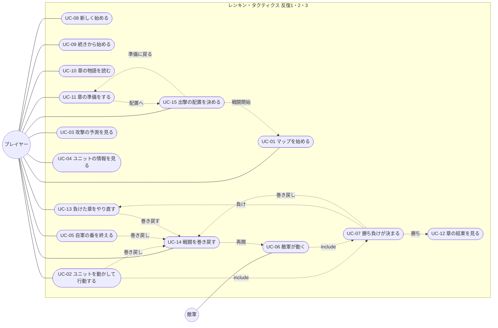

# ユースケース

- 文書 ID: UC-DOC-001
- 版: 0.5（反復 3 の承認済み設計に基づき、巻き戻しと出撃の配置を追加。E-37、DES-IT03 v0.2）
- 作成日: 2026-10-20
- 対象: [反復 1 計画書](../iterations/it01/plan.md) と [反復 2 計画書](../iterations/it02/plan.md)、[反復 3 計画書](../iterations/it03/plan.md) の範囲。反復ごとに書き足す

## 1. アクター

| アクター | 説明 |
|---|---|
| プレイヤー | ゲームを遊ぶ人。自軍を動かす |
| 敵軍 | システムが動かす陣営（システム内部のアクター。FR-BTL-07） |

## 2. ユースケース図

反復 2 で足したユースケースは UC-08〜UC-13。反復 2 では、UC-01・UC-02・UC-04・UC-06・UC-07 も変えた（v0.3 の印）。

反復 3 では UC-14・UC-15 を追加し、UC-01・UC-02・UC-05〜UC-07・UC-11・UC-13 の流れを更新した（v0.5）。根拠は DES-IT03 v0.2 4〜7 章と E-37。

## 3. ユースケース記述

### UC-01 マップを始める

| 項目 | 内容 |
|---|---|
| アクター | プレイヤー |
| 関連要求 | FR-SYS-03、FR-ITM-03、FR-CMP-03、FR-CMP-05、FR-CMP-11、FR-BTL-10、IF-03 |
| 事前条件 | 章の準備（UC-11）で出撃するキャラを選び、配置（UC-15）を決めている（v0.5） |
| 事後条件 | マップが表示され、1 ターン目の自軍の番になっている |

**基本フロー**（v0.3 で変えた）
1. プレイヤーは配置の画面で「戦闘開始」を選ぶ（v0.5）
2. システムは今の章のマップを用意し、出撃するキャラを UC-15 で決めた出撃のマスに、敵軍を定義された位置に配置する（v0.5）。キャラは名簿のレベル・能力・手持ちで、HP は最大から始まる（離脱で前の章に倒れた仲間も戻る）
3. システムは巻き戻しの残りを 10 回、履歴なしで戦闘を作り、1 ターン目の自軍の番を始める（砦にいる自軍は回復する）。章のやり直し・ロードからの出撃でも同じとする（v0.5）

定義データの読み込みと検証（v0.2 までの 1・2 と 2a）は、UC-08 に移した。

### UC-02 ユニットを動かして行動する

| 項目 | 内容 |
|---|---|
| アクター | プレイヤー |
| 関連要求 | FR-BTL-01〜06、FR-BTL-08、FR-ITM-01、FR-ITM-02、FR-MAP-01、FR-UNT-04、FR-UNT-05、FR-UNT-07、FR-BTL-10 |
| 事前条件 | 自軍の番で、まだ行動していない自軍のユニットがいる |
| 事後条件 | ユニットが行動済みになる。全員が行動済みなら敵軍の番になる |

**基本フロー**
1. プレイヤーは、まだ行動していない自軍のユニットを選ぶ
2. システムは、移動できるマスと、攻撃できるマスを表示する
3. プレイヤーは、移動先のマスを選ぶ（今いるマスも選べる）
4. システムは、選べる行動（攻撃・アイテム・待機。杖を持つユニットは、攻撃の代わりに回復。v0.4）を表示する
5. プレイヤーは「攻撃」を選び、攻撃する敵を選ぶ（UC-03 で予測を見る）
6. プレイヤーが決定すると、システムはユニットを移動させ、攻撃・反撃・追撃を行い、結果を表示する
7. システムはユニットを行動済みにする

**代替フロー**
- 3a. プレイヤーが取り消す: システムは 1 に戻る（まだ何も変わっていない）
- 5a. プレイヤーは「アイテム」を選ぶ: システムは回復薬を使って HP を回復し、手持ちを 1 つ減らす（FR-ITM-02）
- 5b. プレイヤーは「待機」を選ぶ: システムはユニットを移動させるだけにする
- 5c. 杖を持つユニットで、プレイヤーは「回復」を選ぶ（v0.4）: システムは、杖の届く範囲にいる、HP が最大でない味方を示す。プレイヤーが味方を選ぶと、システムは回復の予測（回復する量と、回復したあとの HP）を表示する。攻撃の予測（UC-03）は出さない。プレイヤーが決定すると、システムはユニットを移動させ、味方の HP を回復し（最大 HP を超えない）、回復したユニットに経験を足す（6b と同じく、レベルが上がれば上がった能力を表示する）。プレイヤーは、別の味方を選ぶか、取り消して 4 に戻ることもできる。杖には使用回数があり、回復するたびに 1 減る。章の始めには満タンに戻る。残りがなければ、4 で「回復」は出ない（E-33）
- 5d. 杖を持つユニットは攻撃できず、攻撃されても反撃しない（v0.4）
- 6a. 倒れたユニットがいる: システムはそのユニットをマップから外す（E-15）。倒れたのがボスか主人公なら UC-07 に進む
- 6b. 攻撃に加わった自軍のユニットが生きている: システムは経験を足して表示する。経験が 100 に達したら、レベルを上げ、上がった能力を表示する（FR-UNT-04、FR-UNT-05。v0.3）

**反復 3 の追加フロー（v0.5）**

- 入力待ちでは、プレイヤーは巻き戻し（UC-14）を開ける。取消しでは仮移動と選択を含む元の入力状態に戻り、成功時には選択や予測を消して復元した盤面を表示する。出来事の再生中は開けない（v0.5）

### UC-03 攻撃の予測を見る

| 項目 | 内容 |
|---|---|
| アクター | プレイヤー |
| 関連要求 | FR-BTL-08、FR-BTL-04〜06、FR-UNT-07 |
| 事前条件 | UC-02 の 5 で、攻撃する敵を選んでいる |
| 事後条件 | 状態は変わらない |

**基本フロー**
1. システムは、攻撃する側と守る側のそれぞれについて、HP（今と、すべて当たったときの後）・ダメージ・命中率・追撃の有無・反撃の有無・効くスキル・武器の相性を表示する。すべて当たれば倒せるなら「撃破」、すべて当たると倒されるなら「危険」と出す。反撃できない側は数字を「―」にする。狙う相手のマスの上にも、ダメージと命中率を小さく出す（v0.2、E-22）
2. 「撃破」「危険」のときは、システムは予測の上に大きな帯（撃破は金、危険は赤）を出し、狙う相手のマスの上の文字にも「撃破」「危険」を色つきで付ける。危険のときは、自分の移動先のマスにも赤い枠を出す（v0.4、E-30）
3. プレイヤーは、決定するか、別の敵を選ぶか、取り消す

### UC-04 ユニットの情報を見る

| 項目 | 内容 |
|---|---|
| アクター | プレイヤー |
| 関連要求 | FR-UNT-09、FR-MAP-01 |
| 事前条件 | なし（敵軍の番の表示中を除く） |
| 事後条件 | 状態は変わらない |

**基本フロー**
1. プレイヤーは、マップの上のユニット（自軍・敵軍）にカーソルを合わせる
2. システムは、ユニットの絵・名前・クラス・能力（棒つき）・武器（絵つき）・手持ち・スキル・いるマスの地形を表示する。敵のときは、自軍の番の入力を受け付けている間（行動の一覧や攻撃の相手・アイテムを選んでいるときを除く）、移動できるマスと攻撃できるマスも表示する。敵をクリックすると表示を出し続け、もう一度クリックで消す（v0.2、E-22、E-23）。自軍のときは、レベルと経験も表示する（v0.3）

**代替フロー**
- 1a. プレイヤーは Q キーを押す: システムは、敵全体が次に攻撃できるマス（危険範囲）を表示する。もう一度押すと消す（v0.2、E-22）

### UC-05 自軍の番を終える

| 項目 | 内容 |
|---|---|
| アクター | プレイヤー |
| 関連要求 | FR-BTL-02、FR-BTL-10 |
| 事前条件 | 自軍の番 |
| 事後条件 | 敵軍の番になる（UC-06） |

**基本フロー**
1. プレイヤーは「番を終える」を選ぶ
2. システムは敵軍の番を始める

**代替フロー**
- 1a. まだ行動していない自軍がいる: システムは確認を求める。プレイヤーがもう一度「番を終える」を選ぶと 2 に進む

**反復 3 の追加フロー（v0.5）**

- 入力待ちでは、プレイヤーは巻き戻し（UC-14）を開ける。番の終了の確認中に開いて取り消した場合も、元の確認に戻る（v0.5）

### UC-06 敵軍が動く

| 項目 | 内容 |
|---|---|
| アクター | 敵軍 |
| 関連要求 | FR-BTL-02、FR-BTL-07、FR-MAP-03、FR-BTL-10 |
| 事前条件 | 敵軍の番が始まった |
| 事後条件 | 次のターンの自軍の番になっている |

**基本フロー**
1. システムは、このターンに現れる増援を置く（FR-MAP-03）
2. システムは、砦にいる敵を回復する
3. システムは、敵を決まった順に 1 体ずつ、動き方（突っ込む・待ち構える）に従って動かし、攻撃させる
4. システムは、出来事を順に表示する
5. システムはターンを 1 つ進め、自軍の番を始める（砦にいる自軍は回復する）

**代替フロー**
- 3a. 主人公が倒れた: UC-07 に進む
- 3b. 自軍の反撃でボスが倒れた: UC-07 に進む
- 3c. 攻撃を受けた自軍のユニットが生きている: システムは経験を足し、レベルが上がれば上がった能力を表示する（UC-02 の 6b と同じ。v0.3）

**反復 3 の追加フロー（v0.5）**

- 巻き戻し（UC-14）で敵軍の行動前へ戻った場合は、プレイヤーの再開操作でその敵から残りを進める。既に動いた敵や増援・砦の回復を二重に処理しない。敵軍の途中で自軍は操作できず、同じ行動なら同じ展開になる。自動の番の移行や自軍の番の開始前へ戻った場合も、再開操作で保留した処理を一度だけ進める（v0.5）

### UC-07 勝ち負けが決まる

| 項目 | 内容 |
|---|---|
| アクター | プレイヤー、敵軍 |
| 関連要求 | FR-MAP-05、FR-CMP-09、FR-BTL-10 |
| 事前条件 | 攻撃でユニットが倒れた |
| 事後条件 | 勝ちか負けが表示されている |

**基本フロー**（v0.3 で変えた）
1. ボスが倒れたとき、システムは勝ちを表示する。プレイヤーがクリックすると、UC-12 に進む
2. 主人公が倒れたとき、システムは負けを表示する。プレイヤーがクリックすると、UC-13 に進む

v0.2 までの「3. プレイヤーは、最初からやり直すか、終了するかを選ぶ」は、UC-12・UC-13 に置き換えた。

**反復 3 の追加フロー（v0.5）**

- 勝敗の帯から、名簿に結果を反映する前なら巻き戻し（UC-14）を開ける。主人公やボスが倒れる前へ戻すと勝敗も戻る。取消しでは元の勝敗の帯を表示し、UC-12・UC-13 へ進まない。UC-12 で結果を名簿に反映した後は戻せない（v0.5）

### UC-08 新しく始める（v0.3）

| 項目 | 内容 |
|---|---|
| アクター | プレイヤー |
| 関連要求 | FR-SYS-02、FR-SYS-03、FR-SYS-04、FR-CMP-04、FR-SYS-01、IF-03、IF-04 |
| 事前条件 | なし |
| 事後条件 | 1 章の始めの状態がセーブされ、1 章の前の物語（UC-10）が始まっている |

**基本フロー**
1. プレイヤーはゲームを起動する
2. システムは定義データを読み込み、検証する
3. システムはタイトル（新規開始・続きから・終了）を表示する。セーブがあれば、「続きから」の下に章の名前を出す
4. プレイヤーは「新規開始」を選ぶ
5. システムは、倒れた仲間を「離脱」（次の章で戻る）にするか「ロスト」（戦死し、二度と戻らない）にするかを、説明とともに尋ねる
6. プレイヤーはどちらかを選ぶ
7. システムは、初めの名簿（主人公を含む 5 人。v0.4）と 1 章で新しいキャンペーンを作り、セーブする
8. システムは 1 章の前の物語を始める（UC-10）

**代替フロー**
- 2a. 定義データに誤りがある: システムは、ファイル名・位置・理由をすべて表示して終了する（FR-SYS-04）
- 4a. プレイヤーは「終了」を選ぶ: システムは終了する
- 4b. セーブがある: システムは、上書きしてよいかを尋ねる。プレイヤーが「いいえ」を選ぶと 3 に戻る
- 6a. プレイヤーが取り消す: システムは 3 に戻る
- 7a. セーブに失敗した: システムは理由を表示し、遊びは続ける

### UC-09 続きから始める（v0.3）

| 項目 | 内容 |
|---|---|
| アクター | プレイヤー |
| 関連要求 | FR-SYS-01、FR-SYS-02、IF-04 |
| 事前条件 | UC-08 の 1〜3 で、タイトルが表示されている |
| 事後条件 | セーブした章の前の物語（UC-10）が始まっている |

**基本フロー**
1. プレイヤーは「続きから」を選ぶ
2. システムはセーブを読み、セーブした章の始めの状態（名簿・在庫・離脱かロスト）にする
3. システムは、その章の前の物語を始める（UC-10）

**代替フロー**
- 1a. セーブがない、または読めない: 「続きから」は選べない。読めないときは、システムが理由を表示する
- 2a. セーブがクリア済み: システムはクリアの画面を表示する。プレイヤーがクリックするとタイトルに戻る

### UC-10 章の物語を読む（v0.3）

| 項目 | 内容 |
|---|---|
| アクター | プレイヤー |
| 関連要求 | FR-CMP-07、FR-CMP-08 |
| 事前条件 | 章に入ったか（章の前）、章に勝って結果を見終えた（章のあと） |
| 事後条件 | 章の前なら章の準備（UC-11）、章のあとなら次の章の前の物語か、クリアの画面になっている |

**基本フロー**
1. システムは、章の名前と、物語の最初の段落を表示する
2. プレイヤーはクリックして、次の段落に進む。最後の段落まで繰り返す
3. 章の前の物語で、その章に加わる仲間がいれば、システムは「仲間に加わった」と、そのキャラの情報を表示する
4. システムは、章の前なら章の準備（UC-11）に、章のあとなら次の章の前の物語（1 に戻る）に進む。最後の章のあとなら、クリアの画面を表示する（FR-CMP-02）

**代替フロー**
- 1a. その章に物語がない: システムは 3 に進む
- 2a. プレイヤーは物語を飛ばす: システムは 3 に進む

### UC-11 章の準備をする（v0.5）

| 項目 | 内容 |
|---|---|
| アクター | プレイヤー |
| 関連要求 | FR-CMP-03、FR-CMP-11、FR-ITM-03、FR-UNT-09 |
| 事前条件 | 章の前の物語（UC-10）を終えたか、負けた章をやり直す（UC-13）か、配置（UC-15）から準備へ戻った（v0.5） |
| 事後条件 | 状態は変わらない（アイテムの入れ替えを除く）。「配置へ」を選べば UC-15 に進む |

**基本フロー**
1. システムは、章の名前、出撃の枠の数、名簿の生きているキャラ（レベル・HP・手持ち）、共有の在庫を表示する。主人公と、名簿の順に枠の数までのキャラに、出撃の印を付けておく
2. プレイヤーは、キャラの出撃の印を付け外しする（主人公は外せない。枠の数を超えて付けられない）
3. プレイヤーは、キャラを選んで、能力・武器・スキル・手持ちを見る
4. プレイヤーは、選んだキャラの手持ちと共有の在庫の間で、アイテムを 1 つずつ入れ替える
5. プレイヤーは「配置へ」を選ぶ（UC-15）

**代替フロー**
- 4a. 手持ちが上限（5 個）: システムは入れ替えず、理由を表示する

### UC-12 章の結果を見る（v0.3）

| 項目 | 内容 |
|---|---|
| アクター | プレイヤー |
| 関連要求 | FR-CMP-10、FR-CMP-05、FR-CMP-06、FR-UNT-04、FR-ITM-03、FR-SYS-01、NFR-08 |
| 事前条件 | 章のマップに勝った（UC-07 の 1） |
| 事後条件 | 次の章の始めの状態（最後の章ならクリア済み）がセーブされ、章のあとの物語（UC-10）が始まっている |

**基本フロー**
1. システムは、出撃したキャラのレベル・経験・能力を名簿に書き戻し、章の報酬を共有の在庫に入れ、次の章に進めて（加わる仲間を名簿に足して）、セーブする
2. システムは、出撃したキャラごとに、前後のレベルと経験、上がった能力を表示し、報酬を表示する
3. プレイヤーはクリックして、章のあとの物語に進む（UC-10）

**代替フロー**
- 1a. 「離脱」で、倒れたキャラがいる: システムは、そのキャラに「離脱（次の章で戻る）」と表示する。キャラは名簿に残る（FR-CMP-05）
- 1b. 「ロスト」で、倒れたキャラがいる: システムは、そのキャラを戦死として名簿から外し（手持ちも失う）、「戦死」と表示する（FR-CMP-06）
- 1c. セーブに失敗した: システムは理由を表示し、遊びは続ける（前のセーブが残る）

### UC-13 負けた章をやり直す（v0.5）

| 項目 | 内容 |
|---|---|
| アクター | プレイヤー |
| 関連要求 | FR-CMP-09、FR-SYS-01、FR-BTL-10 |
| 事前条件 | 主人公が倒れて負けた（UC-07 の 2） |
| 事後条件 | 章の始めの状態に戻り、章の準備（UC-11）になっているか、タイトルになっている。巻き戻しに成功した場合は戦闘に戻っている（v0.5） |

**基本フロー**
1. システムは「敗北」と、「この章をやり直す」「タイトルへ」「巻き戻す」を表示する（v0.5）
2. プレイヤーは「この章をやり直す」を選ぶ
3. システムはセーブを読み、章の始めの状態に戻す（準備で入れ替えたアイテムも、負けた戦闘で倒れた仲間も戻る）
4. システムは章の準備を始める（UC-11）。章の前の物語は飛ばす

**代替フロー**
- 2a. プレイヤーは「タイトルへ」を選ぶ: システムはタイトルを表示する（UC-08 の 3）
- 2b. プレイヤーは「巻き戻す」を選ぶ: UC-14 を開く。成功すれば戦闘に戻る。取消しでは敗北の選択に戻り、章をやり直さない（v0.5）
- 3a. セーブを読めない: システムは理由を表示し、タイトルを表示する

「この章をやり直す」「タイトルへ」を選んだときは、現在の戦闘と履歴を破棄する（v0.5）。

### UC-14 戦闘を巻き戻す（v0.5）

| 項目 | 内容 |
|---|---|
| アクター | プレイヤー |
| 関連要求 | FR-BTL-10、FR-CMP-09、IF-01、IF-02、NFR-06、NFR-07 |
| 事前条件 | 戦闘の入力待ち、勝敗の帯、または敗北の選択（UC-13）で、結果を名簿に反映していない。出来事の再生中ではない |
| 事後条件 | 選んだ行動の前の状態と乱数に戻り、残り回数が 1 減る。選んだ項目とそれ以降の履歴・表示は捨てる |

**基本フロー**

1. プレイヤーは「巻き戻し 残り n/10」か T キーを選ぶ（UC-13 では「巻き戻す」）
2. システムは、実行済みの自軍・敵軍の行動と番の境界を古い順の一覧で表示する。ターン・陣営・名前・行動・相手と残り回数を示し、最新の行を選んで表示する
3. プレイヤーは行をクリックするか上下キーで、戻りたい行動を選ぶ。一覧は 8 行ずつで、前・次のボタンか PageUp・PageDown でページを移す
4. プレイヤーは「この前へ」か Enter を選ぶ。システムは「この行動から先を取り消して戻りますか。残り n → n−1」と確認する
5. プレイヤーは「戻す」を選ぶ。システムは、移動と行動・反撃・追撃・倒れる処理・経験・成長・勝敗判定をひとまとめにした行動の前へ、位置・HP・最大 HP・レベル・経験・能力・生死・手持ち・杖の回数・番・増援・勝敗・乱数を戻す。何手戻しても成功 1 回につき 1 回消費し、古い状態に戻しても残り回数は増えない
6. システムは、選択・予測・未来の記録・経験や成長の表示・勝敗の帯を消し、復元した盤面を表示する。自軍の行動前なら UC-02 へ戻る。同じ行動をすれば同じ結果になる

**代替フロー**

- 1a. 出来事の再生中: 一覧を開かず、早送りだけを受け付ける。再生後に開ける
- 2a. 履歴がない: 「戻せる行動がありません」と表示する。最も古い戻り先は、確定した配置で最初の自軍の番の開始処理を終えたあとの行動前とし、配置には戻れない
- 2b. 残り 0 回: 一覧は閲覧できるが、理由を表示して確定できない
- 3a. プレイヤーが右クリック・Esc・「戻る」を選ぶ: 元の入力・勝敗の帯・敗北の選択に戻る。戦闘・乱数・履歴・回数を変えない
- 4a. 確認で「やめる」か右クリック・Esc を選ぶ: 一覧に戻り、回数を消費しない
- 5a. 巻き戻しに失敗する: 理由を表示し、戦闘・乱数・履歴・回数と元の入力・表示を変えない
- 6a. 敵軍の行動前へ戻した: 自軍の操作はできない。「敵軍の行動を再開」を選び、UC-06 でその敵から続ける。同じ行動なら同じ展開になる。再開前に再び一覧を開くこともできる
- 6b. 自動の番の移行や番の開始処理の前へ戻した: 「番の処理を再開」を選び、保留した処理を一度だけ進める。再開前に自軍の行動や番の終了はできない

章をまたいだ巻き戻しや、捨てた未来へ進み直す操作はできない。結果を名簿に反映するのは巻き戻したあとの最終的な勝利に対して一度だけとする。履歴・残り回数はセーブせず、章のやり直し・ロードから新たに戦闘を作ると残り 10 回で始める。

### UC-15 出撃の配置を決める（v0.5）

| 項目 | 内容 |
|---|---|
| アクター | プレイヤー |
| 関連要求 | FR-CMP-11、FR-CMP-03、IF-01、IF-02、NFR-07 |
| 事前条件 | 章の準備（UC-11）で出撃するキャラと手持ちを決め、「配置へ」を選んだ |
| 事後条件 | 配置を確定して戦闘を開始している（UC-01）か、準備に戻っている（UC-11） |

**基本フロー**

1. システムはマップ・地形・出撃のマス・出撃者・初めの敵を表示する。まだ現れていない増援は表示しない。最初は主人公を先頭、あとは名簿の順で、出撃の枠の 1 番目から置く
2. プレイヤーは味方をクリックして選ぶ。システムは選択の枠と味方の情報、交換の案内を表示する
3. プレイヤーは別の味方をクリックして場所を交換するか、空いた出撃のマスをクリックして移す。主人公も移せる。出撃必須の主人公を外すことはできない
4. プレイヤーは配置を決め、「戦闘開始」を選ぶ。システムは配置を検証し、成功すれば UC-01 に進む

**代替フロー**

- 2a. 選んだ本人を再度クリックするか、選択中に右クリック・Esc を選ぶ: 選択を解除する
- 3a. 枠外・敵・壁をクリックする: 場所を変えず、「出撃のマスを選んでください」と表示する
- 4a. 「準備に戻る」か、未選択で右クリック・Esc を選ぶ: 仮の配置を捨てて UC-11 に戻る。手持ちの変更は残す。再び配置へ入ると最初の並びから始める
- 4b. 戦闘開始に失敗する: 理由を表示し、配置とキャンペーンを変えない

配置の閲覧・選択・交換では戦闘を作らず、乱数や最初の番の処理を進めない。「戦闘開始」のときだけ戦闘の種を一度取得する。戦闘開始後は配置へ戻れず、配置をセーブに含めない。

## 4. 変更履歴

| 版 | 日付 | 内容 |
|---|---|---|
| 0.1 | 2026-10-20 | 初版（反復 1 の範囲）。開発者が承認した（E-19） |
| 0.2 | 2026-10-21 | 遊んだ結果（E-21）から、UC-03 の 1 と UC-04 の 2・代替フローを見せ方の改善に合わせた（E-22） |
| 0.3 | 2026-10-21 | 反復 2 の範囲（E-26）を書き足した。UC-08〜UC-13 を足し、UC-01・UC-02・UC-04・UC-06・UC-07 を変えた。UC-01 の定義データの読み込みを UC-08 に移した |
| 0.4 | 2026-10-21 | 開発者が反復 1 の版を遊んだ結果（E-29〜E-32）から、UC-02 に回復（5c・5d）を、UC-03 に撃破・危険の強調（2）を足した。UC-08 の初めの名簿を 5 人にした（反復 2 設計書 v0.3）。REV-021 のあと、5c に杖の使用回数を足した。開発者が承認した（E-33） |
| 0.5 | 2026-10-22 | DES-IT03 v0.2 4〜7 章と E-37 に基づき、UC-14（巻き戻し）・UC-15（配置）を追加。UC-01・UC-02・UC-05〜UC-07・UC-11・UC-13 と図を更新し、回数・乱数の復元、敵軍の再開、結果反映前の入口、配置からの戦闘開始と準備への戻りを反映した。REV-035 F-02〜F-05 を修正し、開発者が承認した（E-38） |
