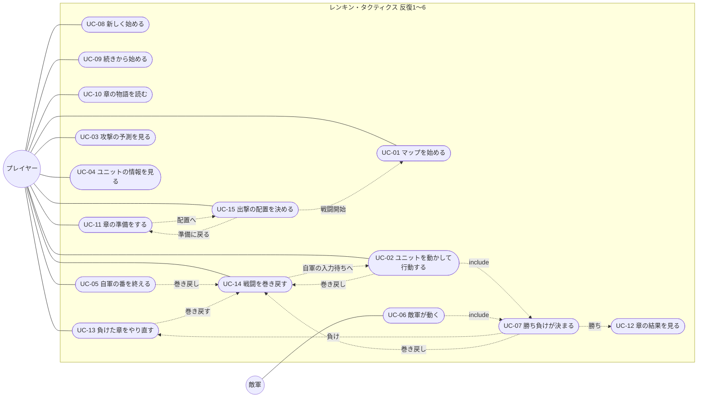

# ユースケース

- 文書 ID: UC-DOC-001
- 版: 0.10（反復 6 の改訂。案（開発者の承認待ち））
- 作成日: 2026-10-20
- 対象: [反復 1 計画書](../iterations/it01/plan.md) と [反復 2 計画書](../iterations/it02/plan.md)、[反復 3 計画書](../iterations/it03/plan.md)、[反復 4 計画書](../iterations/it04/plan.md)、[反復 5 計画書](../iterations/it05/plan.md) と [反復 6 計画書](../iterations/it06/plan.md) の範囲。反復ごとに書き足す

## 1. アクター

| アクター | 説明 |
|---|---|
| プレイヤー | ゲームを遊ぶ人。自軍を動かす |
| 敵軍 | システムが動かす陣営（システム内部のアクター。FR-BTL-07） |

## 2. ユースケース図

反復 2 で足したユースケースは UC-08〜UC-13。反復 2 では、UC-01・UC-02・UC-04・UC-06・UC-07 も変えた（v0.3 の印）。

反復 3 では UC-14・UC-15 を追加し、UC-01・UC-02・UC-05〜UC-07・UC-11・UC-13 の流れを更新した（v0.5）。根拠は DES-IT03 v0.2 4〜7 章と E-37。

反復 4 では UC-02・UC-04〜UC-06・UC-10・UC-11・UC-14・UC-15 を詳細化した（v0.6）。根拠は IT04-PLAN v0.3 3 章、DES-IT04 v0.3、E-41・E-42。改訂方針は承認済みで、開発者が文面を承認した（E-43）。

反復 5 では UC-01・UC-02・UC-04・UC-06・UC-14・UC-15 に、大きな盤面のスクロール・行動の場面への自動の寄り・画面外の予兆の案内を足した（v0.8）。新しいユースケースは足さず、図の要素とつながりも変えていない。章が 9 章に増えても、UC-08〜UC-13 の流れは同じ。根拠は IT05-PLAN v0.3 3 章、DES-IT05 v0.3 4 章・7 章、E-49・E-50。開発者が文面を承認した（E-51）。

反復 5 の途中で、4 章と 8 章の始めに仲間が 1 人ずつ加わることになった（E-55）。加入の流れ（UC-10 の 3）は同じなので、UC-09 に、加入を足す前のセーブを読んだときの扱いだけを足した（v0.9）。根拠は IT05-PLAN v0.43 章、DES-IT05 v0.43.4 節。

反復 6 では、新しい UC は足さず、図の要素とつながりを保ったまま、既存の UC に武器の選択・再移動・出来事の増援・ミニマップなどを書き足した（v0.10）。根拠は IT06-PLAN v0.3 3 章、DES-IT06 v0.2 1.2 節・6〜12 章・14 章 A。

## 3. ユースケース記述

### UC-01 マップを始める

| 項目 | 内容 |
|---|---|
| アクター | プレイヤー |
| 関連要求 | FR-SYS-03、FR-ITM-03、FR-CMP-03、FR-CMP-05、FR-CMP-11、FR-BTL-10、IF-03、FR-MAP-02、FR-MAP-06 |
| 事前条件 | 章の準備（UC-11）で出撃するキャラを選び、配置（UC-15）を決めている（v0.5） |
| 事後条件 | マップが表示され、1 ターン目の自軍の番になっている |

**基本フロー**（v0.3 で変えた）
1. プレイヤーは配置の画面で「戦闘開始」を選ぶ（v0.5）
2. システムは今の章のマップを用意し、出撃するキャラを UC-15 で決めた出撃のマスに、敵軍を定義された位置に配置する（v0.5）。キャラは名簿のレベル・能力・手持ちで、HP は最大から始まる（離脱で前の章に倒れた仲間も戻る）
3. システムは巻き戻しの残りを 10 回、履歴なしで戦闘を作り、1 ターン目の自軍の番を始める（砦にいる自軍は回復する）。章のやり直し・ロードからの出撃でも同じとする（v0.5）

定義データの読み込みと検証（v0.2 までの 1・2 と 2a）は、UC-08 に移した。

（v0.8）マップは 32 × 32 マスまでの大きさがある。盤面に一度に表示するのは 16 × 16 マスで、それより大きいマップは UC-02 のスクロールで見る。戦闘を始めると、システムは確定した主人公が見える位置に盤面を合わせる。章のやり直し・ロードからの出撃でも同じとする。

### UC-02 ユニットを動かして行動する

| 項目 | 内容 |
|---|---|
| アクター | プレイヤー |
| 関連要求 | FR-BTL-01〜06、FR-BTL-08、FR-ITM-01、FR-ITM-02、FR-MAP-01、FR-UNT-04、FR-UNT-05、FR-UNT-07、FR-BTL-10、FR-MAP-03、FR-MAP-06、IF-01 |
| 事前条件 | 自軍の番で、まだ行動していない自軍のユニットがいる |
| 事後条件 | ユニットが行動済みになる。全員が行動済みで再移動を待っていなければ敵軍の番になる（v0.10） |

**基本フロー**
1. プレイヤーは、まだ行動していない自軍のユニットを選ぶ
2. システムは、移動できるマスと、攻撃できるマスを表示する
3. プレイヤーは、移動先のマスを選ぶ（今いるマスも選べる）
4. システムは、選べる行動（攻撃・回復・アイテム・待機）を手持ちに応じて表示する。攻撃武器と杖を持つ錬金術師には攻撃と回復の両方を出す（v0.10）
5. プレイヤーは「攻撃」を選び、手持ちの武器を選んでから攻撃する敵を選ぶ（UC-03 で選んだ武器の予測を見る）。決定までは装備を変えない（v0.10）
6. プレイヤーが決定すると、システムはユニットを移動させ、攻撃・反撃・追撃を行い、結果を表示する
7. システムは、攻撃・回復・道具の使用後に騎兵が生存し勝敗が決まっておらず移動力が残っていれば再移動を待つ。プレイヤーは残りの移動力で行けるマスを選ぶか、今の位置・「終える」・Esc でその場で終える。再移動のあとに再び行動はできない。それ以外は行動を終える。最後の自軍でも、再移動が終わるまで敵軍の番へ進めない（v0.10）

**代替フロー**
- 3a. プレイヤーが取り消す: システムは 1 に戻る（まだ何も変わっていない）
- 5a. プレイヤーは「アイテム」を選ぶ: システムは回復薬を使って HP を回復し、手持ちを 1 つ減らす（FR-ITM-02）
- 5b. プレイヤーは「待機」を選ぶ: システムはユニットを移動させるだけにする
- 5c. 杖を持つユニットで、プレイヤーは「回復」を選ぶ（v0.4）: プレイヤーが手持ちの杖を選ぶと、システムは、その杖の届く範囲にいる、HP が最大でない味方を示す。プレイヤーが味方を選ぶと、システムは回復の予測（回復する量と、回復したあとの HP）を表示する。攻撃の予測（UC-03）は出さない。プレイヤーが決定すると、システムはユニットを移動させ、味方の HP を回復し（最大 HP を超えない）、回復したユニットに経験を足す（6b と同じく、レベルが上がれば上がった能力を表示する）。プレイヤーは、別の味方を選ぶか、予測・相手・杖の選択を順に取り消して 4 に戻ることもできる（v0.10）。杖には使用回数があり、回復するたびに 1 減る。章の始めには満タンに戻る。使える回数の残る杖が 1 本もなければ、4 で「回復」は出ない（v0.10）
- 5d. 杖は攻撃に使えず、杖を装備している間は反撃しない。攻撃武器も持つユニットは、攻撃でその武器を選べる。回復で杖を使っても装備は変わらない（v0.10）
- 6a. 倒れたユニットがいる: システムはそのユニットをマップから外す（E-15）。倒れたのがボスか主人公なら UC-07 に進む
- 6b. 攻撃に加わった自軍のユニットが生きている: システムは経験を足して表示する。経験が 100 に達したら、レベルを上げ、上がった能力を表示する（FR-UNT-04、FR-UNT-05。v0.3）

**反復 3 の追加フロー（v0.5）**

- 入力待ちでは、プレイヤーは巻き戻し（UC-14）を開ける。取消しでは仮移動と選択を含む元の入力状態に戻り、成功時には選択や予測を消して復元した盤面を表示する。出来事の再生中は開けない（v0.5）

（v0.6）増援の予兆は、出現ターン T の自軍開始後から敵軍の出現処理の直前まで表示する。正確な出現位置・ターン・人数の一覧は出さない。番処理・出現に追従し、出来事の再生中と勝敗の帯では表示しない。巻き戻し一覧中は UC-14 の選択中の盤面に従う。

**反復 5 の追加フロー（v0.8）**

- 入力待ち（ユニットを選ぶ前、選んだあと、攻撃や回復の相手を選んでいる間）では、プレイヤーは矢印キー（押し続けると続けて動く）で盤面を動かせる。盤面の上にカーソルがあるときは、ホイールで上下、Shift＋ホイールで左右に動かせる。マップの端では止まる
- 行動の一覧・アイテムの一覧・確認を開いている間は、盤面の位置を固定する。取り消して移動先を選ぶ場面（2・3）に戻ると、また動かせる
- 攻撃・回復の相手を選ぶ場面に入ると、システムは最初の候補が見える位置へ盤面を寄せる。プレイヤーは盤面を動かして、画面の外にいた候補も選べる
- 行動の一覧は、移動先の横の画面に収まる位置に出す
- 出来事の再生中は手で動かせない。システムは、移動したユニットの行き先、攻撃・回復の相手、倒れたユニット、成長したユニット、増援の出たマスへ盤面を寄せる。早送りでも出来事を飛ばさない
- 表示しているマスとクリックしたマスは常に一致する。右の欄・下の欄のクリックはマスとして扱わない
- 増援の予兆の範囲が画面の外にもあるときは、右の欄の案内に画面の外にも気配があることを添える。正確な出現位置・ターン・人数は出さない
- 盤面の位置を変えても、戦闘・乱数・履歴は変わらない。盤面の位置はセーブしない

（v0.10）攻撃の決定に成功したときだけ、外れも含め選んだ武器を装備し、その戦闘の反撃・追撃に使う。回復・道具・待機では装備を変えない。回復量は選んだ杖の回復量 ＋ 魔力を基に、最大 HP と錬金術師の上限を設計どおり適用する。

（v0.10）右クリック・Esc は予測 → 相手 → 武器（回復は杖） → 行動の一覧 → 移動先の選択の順に戻る。攻撃を決めたあとの Esc は再移動の終了であり、攻撃結果を取り消さない。再移動待ちの間はほかのユニットの行動・番終了を受け付けず、巻き戻し（UC-14）はできる。待機では再移動しない。エルザが持つスキルは兵種のスキルの再移動だけで、キャラのスキルは持たない。

（v0.10）移動先を選ぶ場面（2・3）で敵をクリックすると、攻撃できる位置と武器の候補を求め、武器の選択へ進む。選んだ武器で今の位置から届けばその場、届かなければ移動費用の最小、同じなら Y・X の小さいマスを仮の移動先とし、予測で示して決定する。候補がなければ理由を示して移動先の選択を保つ。確定前に乱数・装備は変えない。出来事は行動の解決後と再移動後に評価し、増援はその途中に割り込ませない。

### UC-03 攻撃の予測を見る

| 項目 | 内容 |
|---|---|
| アクター | プレイヤー |
| 関連要求 | FR-BTL-08、FR-BTL-04〜06、FR-UNT-07 |
| 事前条件 | UC-02 の 5 で、攻撃する敵を選んでいる |
| 事後条件 | 状態は変わらない |

**基本フロー**
1. システムは、攻撃する側と守る側のそれぞれについて、HP（今と、すべて当たったときの後）・ダメージ・命中率・必殺率・攻撃の速さ・特効・攻撃回数・追撃の有無・反撃の有無・効くスキル・武器の相性を表示する。すべて当たれば倒せるなら「撃破」、すべて当たると倒されるなら「危険」と出す。反撃できない側は回数 0 と「反撃なし」を表示する（v0.10）。狙う相手のマスの上にも、ダメージと命中率を小さく出す（v0.2、E-22）
2. 「撃破」「危険」のときは、システムは予測の上に大きな帯（撃破は金、危険は赤）を出し、狙う相手のマスの上の文字にも「撃破」「危険」を色つきで付ける。危険のときは、自分の移動先のマスにも赤い枠を出す（v0.4、E-30）
3. プレイヤーは、決定するか、別の敵を選ぶか、取り消す

（v0.10）選んだ武器で予測する。通常ダメージと回数を示し、自分から勇者の斧で攻撃すると最大 4 回、反撃側は最大 2 回（反撃とその追撃は各 1 回）とする。重さによる速さの低下、特効の対象と威力を確認できる。怒りは条件を満たすと必殺率 ＋50 であり、必殺を確定で表示しない。予測・取消しで装備・戦闘・乱数は変わらない。

### UC-04 ユニットの情報を見る

| 項目 | 内容 |
|---|---|
| アクター | プレイヤー |
| 関連要求 | FR-UNT-09、FR-MAP-01、FR-CMP-11、FR-MAP-06 |
| 事前条件 | なし（敵軍の番の表示中を除く） |
| 事後条件 | 状態は変わらない |

**基本フロー**
1. プレイヤーは、マップの上のユニット（自軍・敵軍）にカーソルを合わせる
2. システムは、ユニットの絵・名前・クラス・能力（棒つき）・武器（絵つき）・手持ち・スキル・いるマスの地形を表示する。敵のときは、自軍の番の入力を受け付けている間（行動の一覧や攻撃の相手・アイテムを選んでいるときを除く）、移動できるマスと攻撃できるマスも表示する。敵をクリックするとその敵の範囲を足し、同じ敵をもう一度クリックで消す。複数の敵の範囲を同時に出せる（v0.10。従来の根拠は E-22・E-23）。自軍のときは、レベルと経験も表示する（v0.3）

**代替フロー**
- 1a. プレイヤーは Q キーを押す: システムは、敵全体が次に攻撃できるマス（危険範囲）を表示する。もう一度押すと消す（v0.2、E-22）

（v0.6）配置中（UC-15）も敵へのホバーで個別範囲を表示し、Q で全敵の危険範囲を切り替えられる。配置中の敵クリックは場所を変えない無効入力とし、戦闘中のクリック固定とは区別する。戦闘・情報欄・準備・配置・加入・巻き戻しプレビューの該当場面では共通の絵を使い、自軍・敵軍の騎兵を馬に乗った絵にしてアーマーなどの歩兵と見分けられるようにする。

（v0.8）敵の移動・攻撃範囲と Q の危険範囲は、画面の外のマスも含めてマップ全体で求める。プレイヤーは UC-02 のスクロールで画面の外の範囲も見られる。

（v0.10）情報欄は「予測などの専用表示 → カーソル下の生存ユニット → 選択中のユニット → 地形」の順で表示する。配置中も初めの敵の能力を見られる。能力のページでは幸運・魔力・魔防と敵のレベルを、装備・スキルのページでは全武器とキャラ・兵種のスキルを確認する。クリック・Tab のページ切替で選択や配置を変えない。エルザのスキルは兵種の再移動だけ。

（v0.10）固定した敵の範囲は自軍の選択やスクロールでも保ち、位置・装備・生死の変更後は計算し直す。戦死者は除き、別の戦闘では空にする。巻き戻し後は戻った盤面で生存する敵だけを残す。Q の全敵の危険範囲とは別の設定とし、敵の手持ちの全攻撃武器の射程を合わせる（杖は除く）。移動先の選択中の敵クリックは UC-02 の攻撃操作を優先する。

### UC-05 自軍の番を終える

| 項目 | 内容 |
|---|---|
| アクター | プレイヤー |
| 関連要求 | FR-BTL-02、FR-BTL-10、FR-MAP-03 |
| 事前条件 | 自軍の番 |
| 事後条件 | 敵軍の番になる（UC-06） |

**基本フロー**
1. プレイヤーは「番を終える」を選ぶ
2. システムは敵軍の番を始める

**代替フロー**
- 1a. まだ行動していない自軍がいる: システムは確認を求める。プレイヤーがもう一度「番を終える」を選ぶと 2 に進む
- 1b. 再移動を待っているユニットがいる（v0.10）: 番を終えず、理由を表示する

**反復 3 の追加フロー（v0.5）**

- 入力待ちでは、プレイヤーは巻き戻し（UC-14）を開ける。番の終了の確認中に開いて取り消した場合も、元の確認に戻る（v0.5）

（v0.6）増援の予兆は、出現ターン T の自軍開始後から敵軍の出現処理の直前まで表示する。正確な出現位置・ターン・人数の一覧は出さない。番処理・出現に追従し、出来事の再生中と勝敗の帯では表示しない。巻き戻し一覧中は UC-14 の選択中の盤面に従う。

### UC-06 敵軍が動く

| 項目 | 内容 |
|---|---|
| アクター | 敵軍 |
| 関連要求 | FR-BTL-02、FR-BTL-07、FR-MAP-03、FR-BTL-10、FR-MAP-06 |
| 事前条件 | 敵軍の番が始まった |
| 事後条件 | 次のターンの自軍の番になっている |

**基本フロー**
1. システムは敵軍の番を開始し、このターンに現れるターンの増援、予約した出来事の増援の順に、それぞれ定義順・個体順に置く（v0.10、FR-MAP-03）。出現処理を終えた増援の予兆を消す（v0.6）
2. システムは、砦にいる敵を回復する
3. システムは、敵を決まった順に 1 体ずつ、動き方（突っ込む・待ち構える・一団でそろってから入る）に従って動かし、手持ちから武器を選んで攻撃させる。騎兵は条件を満たせば残りの移動力で下がる。同じ敵の移動・攻撃・再移動は 1 手として履歴に載せる（v0.10）
4. システムは、出来事を順に表示する
5. システムはターンを 1 つ進め、自軍の番を始める（砦にいる自軍は回復する）

**代替フロー**
- 1a. 増援の出現マスが生存ユニットで占有されている（v0.6）: マップ内でその増援が立てる、元のマスからマンハッタン距離 2 以内の空きマスへ出す。距離の昇順、同距離なら Y・X の昇順で選び、先行する同ターンの増援も占有に含める。候補がなければその増援だけ出さず、後のターンへ延期しない。ほかの番処理は続ける。番開始 → 増援 → 砦回復の順と、増援は出現した番に動かない規則を保つ
- 1b. 生きている敵が 39 体に達している（v0.10）: 出すと上限を超える増援の個体は出さず、延期せず、乱数を引かず、出現の記録にも含めない。出来事は起きたままとし、再予約しない。残りの個体と番の処理は続ける
- 3a. 主人公が倒れた: UC-07 に進む
- 3b. 自軍の反撃でボスが倒れた: UC-07 に進む
- 3c. 攻撃を受けた自軍のユニットが生きている: システムは経験を足し、レベルが上がれば上がった能力を表示する（UC-02 の 6b と同じ。v0.3）

**反復 3 の追加フロー（v0.5）**

- 巻き戻し（UC-14）の成功後は自軍の入力待ちへ戻る。同じ行動・番終了なら同じ展開となる。通常の番進行では、既に動いた敵や増援・砦の回復を二重に処理しない（v0.7、E-44〜E-46）

（v0.6）次の自軍の番の開始後には、そのターンに出現する増援の予兆を表示する（UC-02・UC-05）。巻き戻し後も盤面に従って予兆を表示し、同じ行動・番終了を再実行しても出現や砦回復を二重に進めない。

（v0.8）4 の出来事の表示では、システムは動いた敵の行き先、攻撃の相手、倒れたユニット、増援の出たマスへ盤面を寄せる（UC-02 の反復 5 の追加フローと同じ）。

（v0.10）出来事は、指定の敵が動く・倒れる・攻撃される、自軍が指定範囲に着く、の 4 つをきっかけに 1 回だけ起こり、増援を予約するか指定の一団を突撃に変える。外れ・0 ダメージ・反撃も「攻撃された」に含み、経路を通過しただけでは「範囲に着く」に含めない。自軍の番で予約した増援はそのターンの敵軍の番の始め、敵軍の番で予約した分は次のターンの敵軍の番の始めに出す。予約時から予兆を出し、正確な位置・人数・ターンの一覧は表示しない。上限や空き不足で出ないこともある。出た番には動かず、次の敵軍の番から動く。

### UC-07 勝ち負けが決まる

| 項目 | 内容 |
|---|---|
| アクター | プレイヤー、敵軍 |
| 関連要求 | FR-MAP-05、FR-CMP-09、FR-BTL-10 |
| 事前条件 | 攻撃でユニットが倒れた |
| 事後条件 | 勝ちか負けが表示されている |

**基本フロー**（v0.3 で変えた）
1. ボスが倒れたとき、システムは勝ちを表示する。プレイヤーがクリックすると、UC-12 に進む
2. 主人公が倒れたとき、システムは負けを表示する。プレイヤーがクリックすると、UC-13 に進む

v0.2 までの「3. プレイヤーは、最初からやり直すか、終了するかを選ぶ」は、UC-12・UC-13 に置き換えた。

**反復 3 の追加フロー（v0.5）**

- 勝敗の帯から、名簿に結果を反映する前なら巻き戻し（UC-14）を開ける。過去の自軍の行動の前へ戻すと勝敗も戻る。明示の「番を終える」の前へ戻す場合も同様（v0.7）。取消しでは元の勝敗の帯を表示し、UC-12・UC-13 へ進まない。UC-12 で結果を名簿に反映した後は戻せない（v0.5）

### UC-08 新しく始める（v0.3）

| 項目 | 内容 |
|---|---|
| アクター | プレイヤー |
| 関連要求 | FR-SYS-02、FR-SYS-03、FR-SYS-04、FR-CMP-04、FR-SYS-01、IF-03、IF-04 |
| 事前条件 | なし |
| 事後条件 | 1 章の始めの状態がセーブされ、1 章の前の物語（UC-10）が始まっている |

**基本フロー**
1. プレイヤーはゲームを起動する
2. システムは定義データを読み込み、検証する
3. システムはタイトル（新規開始・続きから・終了）を表示する。セーブがあれば、「続きから」の下に章の名前を出す
4. プレイヤーは「新規開始」を選ぶ
5. システムは、倒れた仲間を「離脱」（次の章で戻る）にするか「ロスト」（戦死し、二度と戻らない）にするかを、説明とともに尋ねる
6. プレイヤーはどちらかを選ぶ
7. システムは、初めの名簿（主人公を含む 5 人。v0.4）と 1 章で新しいキャンペーンを作り、セーブする
8. システムは 1 章の前の物語を始める（UC-10）

**代替フロー**
- 2a. 定義データに誤りがある: システムは、ファイル名・位置・理由をすべて表示して終了する（FR-SYS-04）
- 4a. プレイヤーは「終了」を選ぶ: システムは終了する
- 4b. セーブがある: システムは、上書きしてよいかを尋ねる。プレイヤーが「いいえ」を選ぶと 3 に戻る
- 6a. プレイヤーが取り消す: システムは 3 に戻る
- 7a. セーブに失敗した: システムは理由を表示し、遊びは続ける

### UC-09 続きから始める（v0.9）

| 項目 | 内容 |
|---|---|
| アクター | プレイヤー |
| 関連要求 | FR-SYS-01、FR-SYS-02、IF-04 |
| 事前条件 | UC-08 の 1〜3 で、タイトルが表示されている |
| 事後条件 | セーブした章の前の物語（UC-10）が始まっている |

**基本フロー**
1. プレイヤーは「続きから」を選ぶ
2. システムはセーブを読み、セーブした章の始めの状態（名簿・在庫・離脱かロスト）にする。セーブした章までに加わるはずの仲間が名簿にいなければ（加入を足す前の版のセーブ）、その仲間を加わるときの能力で名簿の後ろに足す。戦死して名簿に残っている仲間は足し直さない（v0.9）
3. システムは、その章の前の物語を始める（UC-10）

**代替フロー**
- 1a. セーブがない、または読めない: 「続きから」は選べない。読めないときは、システムが理由を表示する
- 2a. セーブがクリア済み: システムはクリアの画面を表示する。プレイヤーがクリックするとタイトルに戻る

（v0.10）版 1 のセーブは、新しい能力・武器の列・在庫を版 2 へ移し替える。古い武器と道具が合計 5 枠を超えるときは、あふれた道具を在庫に戻す。再読込しても増えない。2 章以降の古い名簿に錬金術師がいなければ加入を補い、戦死した仲間は復活させない（DES-IT06 3.4・6.3 節・11 章）。

### UC-10 章の物語を読む（v0.6）

| 項目 | 内容 |
|---|---|
| アクター | プレイヤー |
| 関連要求 | FR-CMP-07、FR-CMP-08、FR-UNT-09 |
| 事前条件 | 章に入ったか（章の前）、章に勝って結果を見終えた（章のあと） |
| 事後条件 | 章の前なら章の準備（UC-11）、章のあとなら次の章の前の物語か、クリアの画面になっている |

**基本フロー**
1. システムは、章の名前と、物語の最初の段落を表示する
2. プレイヤーはクリックして、次の段落に進む。最後の段落まで繰り返す
3. 章の前の物語で、その章に加わる仲間がいれば、システムは「仲間に加わった」と、そのキャラの情報を表示する。加入表示にもクラスを渡し、騎兵は共通の馬に乗った絵で表示する（v0.6）
4. システムは、章の前なら章の準備（UC-11）に、章のあとなら次の章の前の物語（1 に戻る）に進む。最後の章のあとなら、クリアの画面を表示する（FR-CMP-02）

**代替フロー**
- 1a. その章に物語がない: システムは 3 に進む
- 2a. プレイヤーは物語を飛ばす: システムは 3 に進む

（v0.10）2 章の加入は、物語の順に錬金術師 → 騎兵（ノエル → エルザ）と表示する。仲間の総数は 9 人。

### UC-11 章の準備をする（v0.6）

| 項目 | 内容 |
|---|---|
| アクター | プレイヤー |
| 関連要求 | FR-CMP-03、FR-CMP-11、FR-ITM-03、FR-UNT-09 |
| 事前条件 | 章の前の物語（UC-10）を終えたか、負けた章をやり直す（UC-13）か、配置（UC-15）から準備へ戻った（v0.5） |
| 事後条件 | 状態は変わらない（アイテムの入れ替えを除く）。「配置へ」を選べば UC-15 に進む |

**基本フロー**
1. システムは、章の名前、出撃の枠の数、名簿の生きているキャラ（レベル・HP・手持ち）、共有の在庫を表示する。主人公と、名簿の順に枠の数までのキャラに、出撃の印を付けておく
2. プレイヤーは、キャラの出撃の印を付け外しする（主人公は外せない。枠の数を超えて付けられない）
3. プレイヤーは、キャラを選んで、能力・武器・スキル・手持ちを見る。騎兵は戦闘・情報欄と共通の馬に乗った絵で表示し、アーマーなどの歩兵と区別する（v0.6）
4. プレイヤーは、選んだキャラの手持ちと共有の在庫の間で、武器・杖・道具を 1 本・1 個ずつ入れ替える。武器を先頭へ動かして、初めの装備を選ぶ（v0.10）
5. プレイヤーは「配置へ」を選ぶ（UC-15）

**代替フロー**
- 4a. 在庫から持たせると武器・杖の本数と道具の個数の合計が 5 枠を超える: システムは入れ替えず、理由を表示する（v0.10）
- 4b. 最後の武器・杖 1 本を外そうとする: 外さず理由を表示する。出撃時にも武器・杖が 1 本以上あることを確認する（v0.10）

（v0.10）出撃枠は章順に 6・7・6・7・6・7・6・6・7。名簿は最大 9 人、1 人の手持ちは武器・杖・道具で合計 5 枠。名簿・在庫をスクロールしても案内・ボタンと重ならず、持てない種類の武器は理由を示して選べない。2 章では加入後の 7 人全員に初めから出撃の印を付ける。1 章は名簿 5 人に対して 6 枠なので 1 枠空いたまま出撃できる。エルザのスキルは兵種の再移動だけと表示する。

### UC-12 章の結果を見る（v0.3）

| 項目 | 内容 |
|---|---|
| アクター | プレイヤー |
| 関連要求 | FR-CMP-10、FR-CMP-05、FR-CMP-06、FR-UNT-04、FR-ITM-03、FR-SYS-01、NFR-08 |
| 事前条件 | 章のマップに勝った（UC-07 の 1） |
| 事後条件 | 次の章の始めの状態（最後の章ならクリア済み）がセーブされ、章のあとの物語（UC-10）が始まっている |

**基本フロー**
1. システムは、出撃したキャラのレベル・経験・能力を名簿に書き戻し、章の報酬を共有の在庫に入れ、次の章に進めて（加わる仲間を名簿に足して）、セーブする
2. システムは、出撃したキャラごとに、前後のレベルと経験、上がった能力を表示し、報酬を表示する
3. プレイヤーはクリックして、章のあとの物語に進む（UC-10）

**代替フロー**
- 1a. 「離脱」で、倒れたキャラがいる: システムは、そのキャラに「離脱（次の章で戻る）」と表示する。キャラは名簿に残る（FR-CMP-05）
- 1b. 「ロスト」で、倒れたキャラがいる: システムは、そのキャラを戦死として名簿から外し（手持ちも失う）、「戦死」と表示する（FR-CMP-06）
- 1c. セーブに失敗した: システムは理由を表示し、遊びは続ける（前のセーブが残る）

### UC-13 負けた章をやり直す（v0.5）

| 項目 | 内容 |
|---|---|
| アクター | プレイヤー |
| 関連要求 | FR-CMP-09、FR-SYS-01、FR-BTL-10 |
| 事前条件 | 主人公が倒れて負けた（UC-07 の 2） |
| 事後条件 | 章の始めの状態に戻り、章の準備（UC-11）になっているか、タイトルになっている。巻き戻しに成功した場合は戦闘に戻っている（v0.5） |

**基本フロー**
1. システムは「敗北」と、「この章をやり直す」「タイトルへ」「巻き戻す」を表示する（v0.5）
2. プレイヤーは「この章をやり直す」を選ぶ
3. システムはセーブを読み、章の始めの状態に戻す（準備で入れ替えたアイテムも、負けた戦闘で倒れた仲間も戻る）
4. システムは章の準備を始める（UC-11）。章の前の物語は飛ばす

**代替フロー**
- 2a. プレイヤーは「タイトルへ」を選ぶ: システムはタイトルを表示する（UC-08 の 3）
- 2b. プレイヤーは「巻き戻す」を選ぶ: UC-14 を開く。成功すれば戦闘に戻る。取消しでは敗北の選択に戻り、章をやり直さない（v0.5）
- 3a. セーブを読めない: システムは理由を表示し、タイトルを表示する

「この章をやり直す」「タイトルへ」を選んだときは、現在の戦闘と履歴を破棄する（v0.5）。

### UC-14 戦闘を巻き戻す（v0.7）

| 項目 | 内容 |
|---|---|
| アクター | プレイヤー |
| 関連要求 | FR-BTL-10、FR-CMP-09、IF-01、IF-02、NFR-06、NFR-07、FR-MAP-03、FR-MAP-06 |
| 事前条件 | 戦闘の入力待ち、勝敗の帯、または敗北の選択（UC-13）で、結果を名簿に反映していない。出来事の再生中ではない |
| 事後条件 | 選んだ自軍の行動または明示の「番を終える」の前の状態と乱数に戻り、自軍の入力待ちになる。成功したときだけ残り回数が 1 減る。選んだ項目とそれ以降の履歴・表示は捨てる |

**基本フロー**

1. プレイヤーは「巻き戻し 残り n/10」か T キーを選ぶ（UC-13 では「巻き戻す」）
2. システムは、実行済みの自軍・敵軍の行動と番の境界を古い順の一覧で表示する。ターン・陣営・名前・行動・相手と残り回数を示し、最新の行を選んで表示する。自軍行動と明示の「番を終える」は白、敵軍行動は赤く薄く、敵軍の番の始めは薄い赤、自軍の番の始めは薄い灰とする。明示の番終了と自動移行は Automatic で区別する（DES-IT04 7.1 節、v0.7）。左に選択した行動前の盤面、右に一覧を表示する（v0.6）
3. プレイヤーは行をクリックするか上下キーで、盤面を見たい行を選ぶ。敵軍・番境界も飛ばさず選べる。行選択は閲覧だけで、戦闘や回数を変えない（v0.7）。一覧は 8 行ずつで、前・次のボタンか PageUp・PageDown でページを移す。行の選択が変わると、位置・HP・生死などをその行動前の盤面へ切り替える。番開始前の盤面は、行ラベルと区別して実際のターン・陣営を表示する（v0.6）
4. 自軍行動または明示の「番を終える」の行で、残り 1 回以上かつプレビュー取得成功なら、プレイヤーは「決定」か Enter を選ぶ（v0.7）。システムは「この行動から先を取り消して戻りますか。残り n → n−1」と確認する。確認中も選択中の行動前の盤面を保持する（v0.6）
5. プレイヤーは「戻す」を選ぶ。システムは、決定に成功したときだけ、移動と行動・反撃・追撃・倒れる処理・経験・成長・勝敗判定・再移動（v0.10）をひとまとめにした自軍の行動、または明示の「番を終える」の前へ、位置・HP・最大 HP・レベル・経験・能力・生死・手持ち・装備・杖の回数・番・増援・出来事の発火と予約・一団の状態・待っている再移動・勝敗・乱数（v0.10）を戻す。何手戻しても成功 1 回につき 1 回消費し、古い状態に戻しても残り回数は増えない
6. システムは、選択・予測・未来の記録・経験や成長の表示・勝敗の帯を消し、復元した盤面を表示する。自軍行動または明示の「番を終える」の前の自軍入力待ちへ戻り、UC-02 へ進む。再開ボタン・Enter による再開・再開待ちの案内は出さない。同じ行動・番終了をすれば同じ結果になる（v0.7）

**代替フロー**

- 1a. 出来事の再生中: 一覧を開かず、早送りだけを受け付ける。再生後に開ける
- 2a. 履歴がない: 「戻せる行動がありません」と表示する。最も古い戻り先は、確定した配置で最初の自軍の番の開始処理を終えたあとの自軍行動または明示の「番を終える」の前とし、配置には戻れない
- 2b. 残り 0 回: 一覧と行動前の盤面は閲覧できるが、理由を表示して確定できない
- 3a. プレイヤーが右クリック・Esc・「戻る」を選ぶ: プレビューを捨て、仮移動・選択を含む元の盤面・入力・勝敗の帯・敗北の選択に戻る（v0.6）。戦闘・乱数・履歴・回数を変えない
- 3b. 敵軍行動・番の始め（自動移行）を選んだとき: 左にその行の前の盤面を表示するが、「決定」を無効にし、「自軍の行動か『番を終える』の前だけ戻せます」を表示する。クリック・Enter とも確認へ進まない。全行が閲覧専用でも一覧を閲覧・取消しできる。敗北後も決定先は過去の自軍行動または明示の「番を終える」で、対象がなければ閲覧だけできる（v0.7）
- 4a. 確認で「やめる」か右クリック・Esc を選ぶ: 選択中のプレビューを保持した一覧に戻り、回数を消費しない（v0.6）
- 5a. プレビュー取得または巻き戻しに失敗する（v0.6）: 理由を表示して一覧に戻る。戦闘・乱数・履歴・回数と保持した元の入力を変えない。有効なプレビューは保持し、取得に失敗した行は確定できず、別の行の古い盤面を見せない

章をまたいだ巻き戻しや、捨てた未来へ進み直す操作はできない。結果を名簿に反映するのは巻き戻したあとの最終的な勝利に対して一度だけとする。履歴・残り回数はセーブせず、章のやり直し・ロードから新たに戦闘を作ると残り 10 回で始める。

（v0.6）閲覧・確認・取消しでは戦闘・乱数・履歴・残り回数を変えず、プレビューから行動できない。予兆は選択した行動前の盤面と進行位置に従い、出現前・出現後・番境界・勝敗に対応する。確定後は復元した盤面の予兆、一覧取消しでは元の盤面の予兆へ戻る。

（v0.8）一覧を開いている間、盤面の上でのホイール（上下）と Shift＋ホイール（左右）は、左の行動前の盤面を動かす。右の欄の上でのホイールは、今どおり理由の詳細を送る。1 回のホイールを両方へは送らない。上下キー・PageUp・PageDown は行の選択とページの移動に使い、盤面は動かさない。行を選ぶと、システムはその行の行動前の盤面で、行動したユニットが見える位置へ寄せる。確認中は盤面を動かさない。確認の取消しでは位置を保ち、一覧の取消しでは開く前の位置に戻る。決定に成功すると、復元した盤面の、選んだ行の場所へ寄せる。盤面の位置を変えても、戦闘・乱数・履歴・残り回数は変わらない。

（v0.10）移動 ＋ 行動 ＋ 再移動をひとまとめの 1 手とする。再移動待ちでも、最初の移動前に戻せる。再移動だけの履歴行は作らない。出来事の発火・予約・一団の状態も深く戻し、同じ入力で必殺と出来事の増援を含む同じ展開を再現する。

### UC-15 出撃の配置を決める（v0.6）

| 項目 | 内容 |
|---|---|
| アクター | プレイヤー |
| 関連要求 | FR-CMP-11、FR-CMP-03、FR-UNT-09、FR-MAP-03、IF-01、IF-02、NFR-07、FR-MAP-06 |
| 事前条件 | 章の準備（UC-11）で出撃するキャラと手持ちを決め、「配置へ」を選んだ |
| 事後条件 | 配置を確定して戦闘を開始している（UC-01）か、準備に戻っている（UC-11） |

**基本フロー**

1. システムはマップ・地形・出撃のマス・出撃者・初めの敵を表示する。自軍・敵軍の騎兵は共通の馬に乗った絵とし、アーマーなどの歩兵と区別する。まだ現れていない増援とその予兆は表示しない（v0.6）。最初は主人公を先頭、あとは名簿の順で、出撃の枠の 1 番目から置く
2. プレイヤーは味方をクリックして選ぶ。システムは選択の枠と味方の情報、交換の案内を表示する。敵のホバーでは初めの敵の能力・レベル・手持ち・スキルも表示する（v0.10）。敵にカーソルを合わせると青い移動範囲と赤い攻撃範囲を表示し、外すと消す。Q キーで全初期敵の危険範囲（橙）を切り替えられる。初期値は OFF。味方の選択・配置を保ち、選択中も両方の範囲を見られる（v0.6）
3. プレイヤーは別の味方をクリックして場所を交換するか、空いた出撃のマスをクリックして移す。主人公も移せる。出撃必須の主人公を外すことはできない。交換・空き枠移動後は、味方の占有も反映して個別範囲と全敵の危険範囲を再計算する（v0.6）
4. プレイヤーは配置を決め、「戦闘開始」を選ぶ。システムは配置を検証し、成功すれば UC-01 に進む

**代替フロー**

- 2a. 選んだ本人を再度クリックするか、選択中に右クリック・Esc を選ぶ: 選択を解除する
- 3a. 枠外・敵・壁をクリックする: 場所を変えず、「出撃のマスを選んでください」と表示する
- 4a. 「準備に戻る」か、未選択で右クリック・Esc を選ぶ: 仮の配置と範囲の表示設定を捨てて UC-11 に戻る。手持ちの変更は残す。再び配置へ入ると最初の並び・危険範囲 OFF から始める（v0.6）
- 4b. 戦闘開始に失敗する: 理由を表示し、配置とキャンペーンを変えない

配置の閲覧・選択・交換では戦闘を作らず、乱数や最初の番の処理を進めない。範囲の表示に失敗したら理由を示して古い範囲を消し、配置・キャンペーン・乱数は変えない（v0.6）。「戦闘開始」のときだけ戦闘の種を一度取得し、配置用の範囲設定を捨てる。戦闘開始後は配置へ戻れず、配置をセーブに含めない。

（v0.8）配置の始めは、主人公が見える位置に盤面を合わせる。プレイヤーは UC-02 と同じ操作（矢印キー、ホイール、Shift＋ホイール）で盤面を動かし、画面の外の出撃のマスと敵も見て、クリックで交換・移動できる。準備に戻ると盤面の位置も捨て、再び配置へ入ると主人公の位置から始める。盤面の位置を変えても、配置・キャンペーン・乱数は変わらない。

（v0.10）配置は全章の増やした出撃枠を使う。敵の範囲は手持ちの全攻撃武器から求め、配置と戦闘で同じ能力・装備を使う。未出現の増援の能力・位置は見せない。専用表示がなければカーソル下の生存ユニットを優先し、空きマス・盤外では選択中の味方の情報へ戻る。敵クリックで味方の配置は変わらない。

（v0.10）戦闘・配置・巻き戻しの下見では、画面の隅にミニマップを常に出す。各場面の盤面に従う地形・生存する自軍／敵軍・表示範囲・既知の予兆だけを描き、未出現の敵は出さない。地図のクリックは盤面の中心を動かすだけとし、行動・乱数・履歴・固定した敵の範囲を変えない。余白は無視し、出来事の再生中・巻き戻しの確認中はクリックで動かさない。情報欄と地図は重ならず、情報のページを替えても地図は動かない（DES-IT06 12.5 節、確認中は既存 UC-14 の規則）。

## 4. 変更履歴

| 版 | 日付 | 内容 |
|---|---|---|
| 0.1 | 2026-10-20 | 初版（反復 1 の範囲）。開発者が承認した（E-19） |
| 0.2 | 2026-10-21 | 遊んだ結果（E-21）から、UC-03 の 1 と UC-04 の 2・代替フローを見せ方の改善に合わせた（E-22） |
| 0.3 | 2026-10-21 | 反復 2 の範囲（E-26）を書き足した。UC-08〜UC-13 を足し、UC-01・UC-02・UC-04・UC-06・UC-07 を変えた。UC-01 の定義データの読み込みを UC-08 に移した |
| 0.4 | 2026-10-21 | 開発者が反復 1 の版を遊んだ結果（E-29〜E-32）から、UC-02 に回復（5c・5d）を、UC-03 に撃破・危険の強調（2）を足した。UC-08 の初めの名簿を 5 人にした（反復 2 設計書 v0.3）。REV-021 のあと、5c に杖の使用回数を足した。開発者が承認した（E-33） |
| 0.5 | 2026-10-22 | DES-IT03 v0.2 4〜7 章と E-37 に基づき、UC-14（巻き戻し）・UC-15（配置）を追加。UC-01・UC-02・UC-05〜UC-07・UC-11・UC-13 と図を更新し、回数・乱数の復元、敵軍の再開、結果反映前の入口、配置からの戦闘開始と準備への戻りを反映した。REV-035 F-02〜F-05 を修正し、開発者が承認した（E-38） |
| 0.6 | 2026-10-23 | IT04-PLAN v0.3 3 章・Q-IT04-08、DES-IT04 v0.3 に基づき、UC-14 の盤面プレビュー・確認・取消し・失敗・0 回の閲覧、UC-04・UC-15 の配置中の敵ホバー／Q と交換後の再計算、UC-04・UC-10・UC-11・UC-15 の共通の騎乗の絵と加入のクラス情報、UC-02・UC-05・UC-06・UC-14 の予兆と代替出現を詳細化し、図の対象反復を更新。方針・追記内容は E-42 で承認済み。開発者が文面を承認した（E-43）。REV-042 F-12 の E-41・E-42 の要約の文面も開発者が承認した（E-43） |
| 0.7 | 2026-10-23 | E-44〜E-46、IT04-PLAN v0.4 3 章の承認された改訂文面に従い UC-06・07・14 と図を更新。自軍行動・明示の番終了前への決定と自軍入力待ち、全種類の閲覧と色・理由を区別し、再開操作・案内・代替 6a・6b を削除した。取消し・失敗時不変・回数・結果反映の条件は維持。承認（E-46） |
| 0.8 | 2026-10-24 | IT05-PLAN v0.3 3 章、DES-IT05 v0.3 4 章・7 章に基づき、UC-01・UC-02・UC-04・UC-06・UC-14・UC-15 に、戦闘・配置・出来事の再生・巻き戻しの一覧での盤面のスクロール、行動の場面への自動の寄り、画面の外の予兆の案内、巻き戻しの一覧の盤面でのホイールを足し、関連要求に FR-MAP-06 などを足した。表示とクリックのマスの一致を明記した。UC-08〜UC-13 と図の要素は変えず、図の対象反復だけを更新した。改訂の内容は E-49・E-50 で承認済み。REV-055 の F-05（UC-02 の取消し後に動かせる場面）を直し、開発者が文面を承認した（E-51） |
| 0.9 | 2026-10-24 | IT05-PLAN v0.43 章、DES-IT05 v0.43.4 節に基づき、UC-09 の 2 に、加入を足す前の版のセーブを読んだとき、その章までに加わるはずの仲間を名簿の後ろに足すこと（戦死者は足し直さない）を足した。UC-10 の加入の流れ・UC-11 の出撃の選び方・図は変えていない。根拠は E-55。開発者が承認した（E-57） |
| 0.10 | 2026-10-26 | IT06-PLAN v0.3 3 章と DES-IT06 v0.2 1.2 節・6〜12 章・14 章 A に基づき UC-02・03・04・05・06・09・10・11・14・15 を改訂。武器・杖の選択と取消し、必殺等の予測、情報の優先と複数の敵範囲、敵クリックで攻撃、再移動を含む 1 手と再移動待ちでは番を終えないこと、出来事の増援と生きている敵 39 体の上限、古いセーブの移し替え、錬金術師の加入、9 人・全章の出撃枠 +1・5 枠の準備、ミニマップを反映。エルザのスキルは兵種の再移動だけと明記。図は対象反復だけ更新。ID・巻き戻しの回数・決定対象は維持。案（開発者の承認待ち） |
