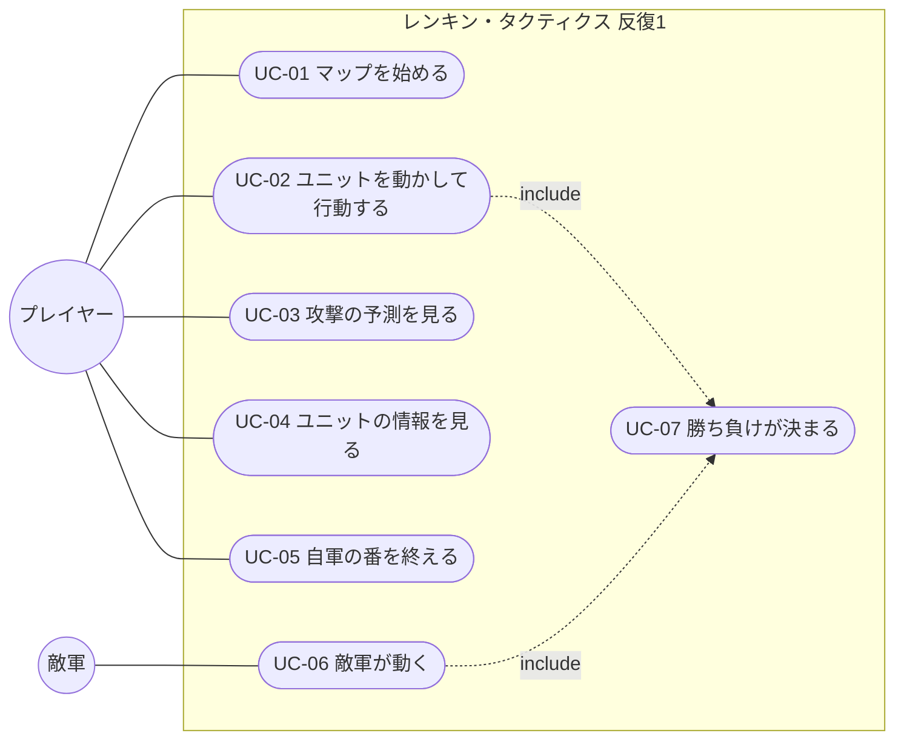

# ユースケース

- 文書 ID: UC-DOC-001
- 版: 0.1（案。反復 1 の範囲）
- 作成日: 2026-10-20
- 対象: [反復 1 計画書](../iterations/it01/plan.md) の範囲。反復ごとに書き足す

## 1. アクター

| アクター | 説明 |
|---|---|
| プレイヤー | ゲームを遊ぶ人。自軍を動かす |
| 敵軍 | システムが動かす陣営（システム内部のアクター。FR-BTL-07） |

## 2. ユースケース図

## 3. ユースケース記述

### UC-01 マップを始める

| 項目 | 内容 |
|---|---|
| アクター | プレイヤー |
| 関連要求 | FR-SYS-03、FR-SYS-04、FR-ITM-03、IF-03 |
| 事前条件 | なし |
| 事後条件 | マップが表示され、1 ターン目の自軍の番になっている |

**基本フロー**
1. プレイヤーはゲームを起動する
2. システムは定義データを読み込み、検証する
3. システムは反復 1 のマップを用意し、自軍と敵軍を配置する。自軍は武器と回復薬を初めから持つ
4. システムは 1 ターン目の自軍の番を始める（砦にいる自軍は回復する）

**代替フロー**
- 2a. 定義データに誤りがある: システムは、ファイル名・位置・理由をすべて表示して終了する（FR-SYS-04）

### UC-02 ユニットを動かして行動する

| 項目 | 内容 |
|---|---|
| アクター | プレイヤー |
| 関連要求 | FR-BTL-01〜06、FR-ITM-01、FR-ITM-02、FR-MAP-01、FR-UNT-07 |
| 事前条件 | 自軍の番で、まだ行動していない自軍のユニットがいる |
| 事後条件 | ユニットが行動済みになる。全員が行動済みなら敵軍の番になる |

**基本フロー**
1. プレイヤーは、まだ行動していない自軍のユニットを選ぶ
2. システムは、移動できるマスと、攻撃できるマスを表示する
3. プレイヤーは、移動先のマスを選ぶ（今いるマスも選べる）
4. システムは、選べる行動（攻撃・アイテム・待機）を表示する
5. プレイヤーは「攻撃」を選び、攻撃する敵を選ぶ（UC-03 で予測を見る）
6. プレイヤーが決定すると、システムはユニットを移動させ、攻撃・反撃・追撃を行い、結果を表示する
7. システムはユニットを行動済みにする

**代替フロー**
- 3a. プレイヤーが取り消す: システムは 1 に戻る（まだ何も変わっていない）
- 5a. プレイヤーは「アイテム」を選ぶ: システムは回復薬を使って HP を回復し、手持ちを 1 つ減らす（FR-ITM-02）
- 5b. プレイヤーは「待機」を選ぶ: システムはユニットを移動させるだけにする
- 6a. 倒れたユニットがいる: システムはそのユニットをマップから外す（E-15）。倒れたのがボスか主人公なら UC-07 に進む

### UC-03 攻撃の予測を見る

| 項目 | 内容 |
|---|---|
| アクター | プレイヤー |
| 関連要求 | FR-BTL-08、FR-BTL-04〜06、FR-UNT-07 |
| 事前条件 | UC-02 の 5 で、攻撃する敵を選んでいる |
| 事後条件 | 状態は変わらない |

**基本フロー**
1. システムは、攻撃する側と守る側のそれぞれについて、HP・ダメージ・命中率・追撃の有無・反撃の有無・効くスキルを表示する
2. プレイヤーは、決定するか、別の敵を選ぶか、取り消す

### UC-04 ユニットの情報を見る

| 項目 | 内容 |
|---|---|
| アクター | プレイヤー |
| 関連要求 | FR-UNT-09、FR-MAP-01 |
| 事前条件 | なし（敵軍の番の表示中を除く） |
| 事後条件 | 状態は変わらない |

**基本フロー**
1. プレイヤーは、マップの上のユニット（自軍・敵軍）にカーソルを合わせる
2. システムは、名前・クラス・能力・武器・手持ち・スキル・いるマスの地形を表示する。敵のときは、移動できるマスと攻撃できるマスも表示できる

### UC-05 自軍の番を終える

| 項目 | 内容 |
|---|---|
| アクター | プレイヤー |
| 関連要求 | FR-BTL-02 |
| 事前条件 | 自軍の番 |
| 事後条件 | 敵軍の番になる（UC-06） |

**基本フロー**
1. プレイヤーは「番を終える」を選ぶ
2. システムは敵軍の番を始める

**代替フロー**
- 1a. まだ行動していない自軍がいる: システムは確認を求める。プレイヤーがもう一度「番を終える」を選ぶと 2 に進む

### UC-06 敵軍が動く

| 項目 | 内容 |
|---|---|
| アクター | 敵軍 |
| 関連要求 | FR-BTL-02、FR-BTL-07、FR-MAP-03 |
| 事前条件 | 敵軍の番が始まった |
| 事後条件 | 次のターンの自軍の番になっている |

**基本フロー**
1. システムは、このターンに現れる増援を置く（FR-MAP-03）
2. システムは、砦にいる敵を回復する
3. システムは、敵を決まった順に 1 体ずつ、動き方（突っ込む・待ち構える）に従って動かし、攻撃させる
4. システムは、出来事を順に表示する
5. システムはターンを 1 つ進め、自軍の番を始める（砦にいる自軍は回復する）

**代替フロー**
- 3a. 主人公が倒れた: UC-07 に進む
- 3b. 自軍の反撃でボスが倒れた: UC-07 に進む

### UC-07 勝ち負けが決まる

| 項目 | 内容 |
|---|---|
| アクター | プレイヤー、敵軍 |
| 関連要求 | FR-MAP-05、FR-CMP-09 |
| 事前条件 | 攻撃でユニットが倒れた |
| 事後条件 | 勝ちか負けが表示されている |

**基本フロー**
1. ボスが倒れたとき、システムは勝ちを表示する
2. 主人公が倒れたとき、システムは負けを表示する
3. プレイヤーは、最初からやり直すか、終了するかを選ぶ

## 4. 変更履歴

| 版 | 日付 | 内容 |
|---|---|---|
| 0.1（案） | 2026-10-20 | 初版（反復 1 の範囲） |
