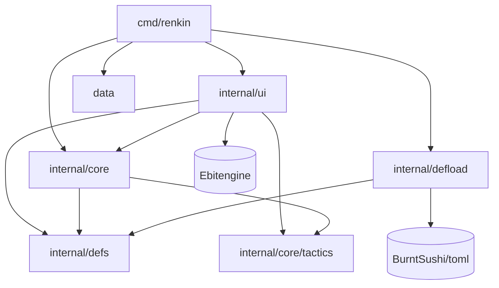
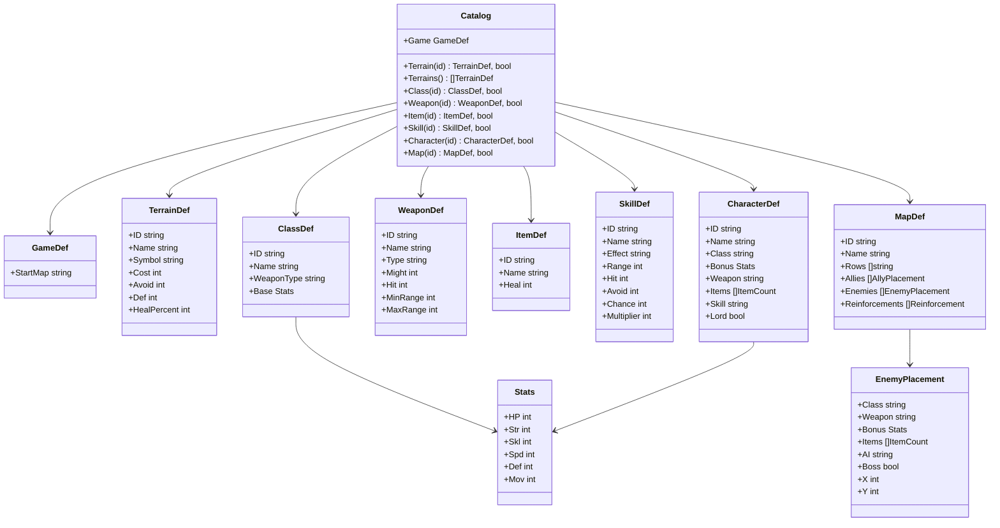
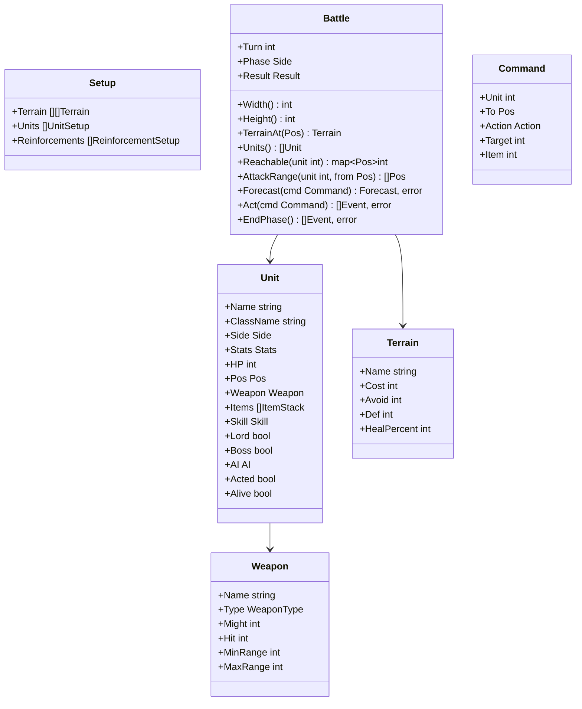
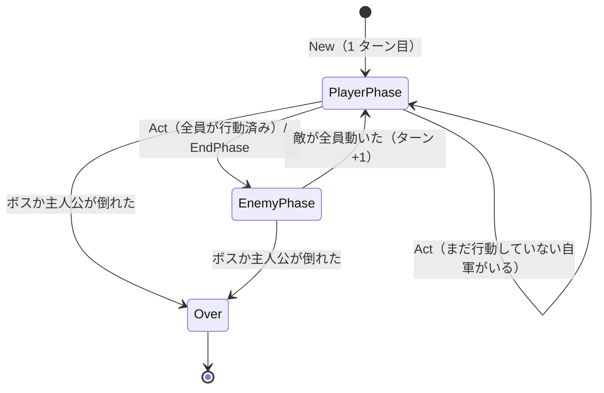
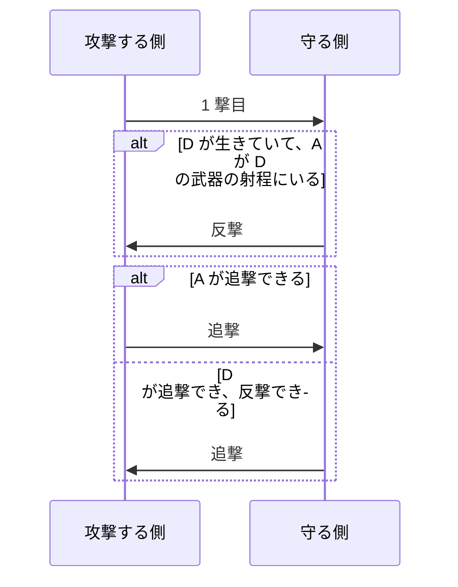
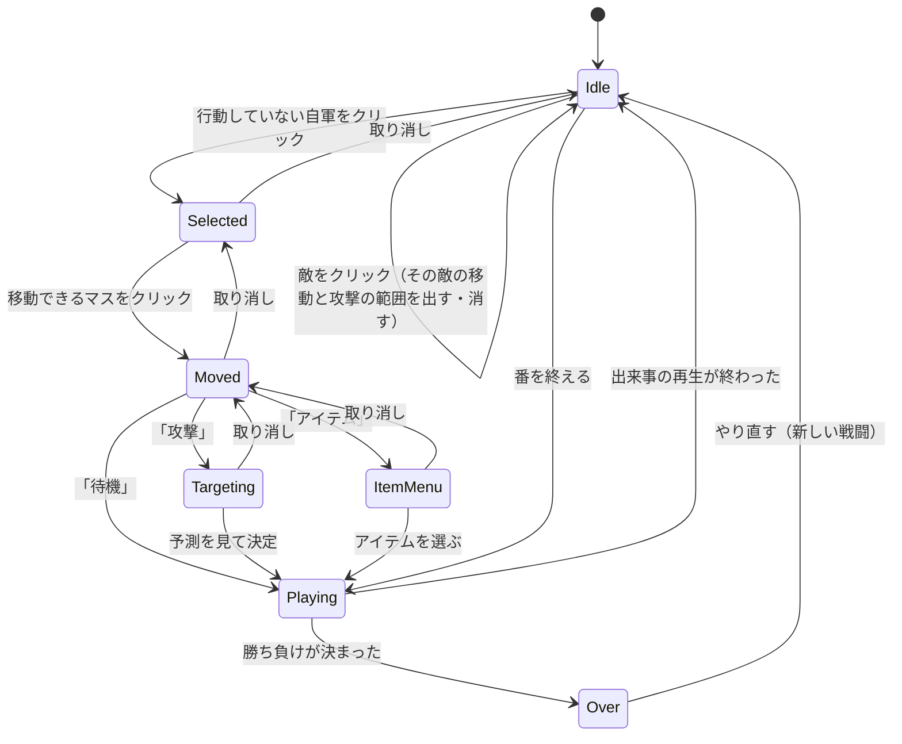

# 設計書（反復 1: プロトタイプ）

- 文書 ID: DES-IT01
- 版: 0.2（開発者が承認。REV-006）
- 作成日: 2026-10-20
- 対象: [反復 1 計画書](../iterations/it01/plan.md) の範囲
- 入力: [SRS-001](../02_requirements/srs.md) v0.1、[ユースケース](../02_requirements/use-cases.md)、[ADR-0001](../adr/0001-tech-stack.md)、[ADR-0002](../adr/0002-return-to-fushigi.md)、[ADR-0003](../adr/0003-definition-data-format.md)、E-13〜E-18

反復型の方針（PLAN-001 3 章）に従い、反復 1 で作る範囲だけを設計する。後の反復で書き足す。数の値（能力、武器、地形、マップ）は 10 章の仮置きで、遊んで調整する。

## 1. アーキテクチャ

### 1.1 パッケージ構成

| ID | パッケージ | 責務 | 依存してよい先 |
|---|---|---|---|
| DES-PKG-01 | `cmd/renkin` | 起動。定義データを読み込み、戦闘を作り、画面を動かす。乱数の種を決める | すべて |
| DES-PKG-02 | `internal/defs` | 定義データの型と、ID で引ける目録（`Catalog`） | なし |
| DES-PKG-03 | `internal/defload` | TOML の読み込みと、意味の検証（ADR-0003） | `defs`、`github.com/BurntSushi/toml` |
| DES-PKG-04 | `internal/core` | ゲームの状態。反復 1 では、定義データから戦闘の入力（`tactics.Setup`）を組み立てるだけ | `defs`、`core/tactics` |
| DES-PKG-05 | `internal/core/tactics` | 戦闘の規則と状態。World と `defs` を知らない（ADR-0002） | Go の標準ライブラリだけ |
| DES-PKG-06 | `internal/ui` | Ebitengine による描画と入力。使い捨てにせず育てる（E-13 P-07） | `core`、`core/tactics`、`defs`、Ebitengine、`github.com/hajimehoshi/bitmapfont/v3` |
| DES-PKG-07 | `data` | 本体の定義データ（`data/base/*.toml`）。`go:embed` で埋め込む | なし |



- `core` と `core/tactics` は Ebitengine と実時間（`time`）を使わない（NFR-04、NFR-05）。テストで `go list` の結果を調べて自動で確かめる（DES-NFR-01）
- `tactics` は定義データの型を知らない。テストでは Go のコードで `tactics.Setup` を組み立てられる
- AGENTS.md のパッケージ構成の表にも、この構成を書いた（E-18）

### 1.2 乱数（DES-RNG-01）

- 乱数は `rand.New(rand.NewPCG(seed, 0))`（`math/rand/v2`。ふしぎ錬金と同じ）で作り、`tactics.Battle` が持つ。種は `tactics.New` に渡す（NFR-06）
- 0〜99 の乱数は `IntN(100)` で 1 つずつ引く
- テストで当たり・外れを決まった値で確かめられるように、`Battle` は乱数を引く関数を内部の欄（例: `roll func() int`）で持つ。テストでは、`export_test.go` からその欄を差し替え、決まった数の列を返させる
- 乱数を引くのは命中の判定と大盾の発動だけで、引く順番は 3.6 節のとおり。同じ種と同じコマンドの列なら、同じ結果になる
- 種は `cmd/renkin` が決める（`-seed` の指定、なければ起動した時刻）。`core` と `tactics` は時刻を使わない
- やり直すとき、`-seed` を指定していれば同じ種を使う（同じ戦闘を再現できる）。指定していなければ、やり直した時刻から種を作る

### 1.3 誤り（DES-ERR-01）

- 状態を変える操作（`Act`、`EndPhase`）は、検証をすべて終えてから状態を変える。失敗したら状態を変えず、理由の分かる誤りを返す（NFR-07）
- 誤りは `errors.New` で作った値を公開し、`errors.Is` で見分けられるようにする（3.14 節）

## 2. 定義データ（defs、defload、data）

### 2.1 クラス図（DES-DAT-01）



- `AllyPlacement` は `Character`（キャラの ID）と `X`、`Y` を持つ。`Reinforcement` は `Turn` と `EnemyPlacement` を持つ
- `ItemCount` は `Item`（アイテムの ID）と `Count` を持つ。敵の `Items` は、反復 1 では情報欄に出すためだけに使う（敵はアイテムを使わない。DES-ITM-01）
- 武器の種類（`WeaponType`、`Type`）は `sword`・`lance`・`axe`・`bow` のどれか（E-17 D-2）
- キャラの `Skill` は、スキルの定義（`skills.toml`）の ID か空。スキルは名前、効果の種類（`Effect`）、数値を持つ。効果の種類は `inspire`（鼓舞）・`pavise`（大盾）・`wrath`（怒り）・`snipe`（狙撃）のどれかで、働き方はコードで決める（E-17 D-5）。数値（`Range`・`Hit`・`Avoid`・`Chance`・`Multiplier`）は定義データから読む（FR-SYS-03、E-18）。使う数値は効果の種類ごとに DES-SKL-01 のとおりで、使わない数値は 0 にする
- 敵の動き方（`AI`）は `charge`（突っ込む）・`hold`（待ち構える）のどれか（E-13 P-03）
- クラスは使える武器の種類を 1 つ持つ（反復 1 では、1 クラスに 1 種類で足りる）

### 2.2 ファイルと TOML の例（DES-DAT-02）

`data/base/` に次のファイルを置く。

| ファイル | 中身 |
|---|---|
| `game.toml` | 始めるマップの ID |
| `terrains.toml` | 地形 |
| `classes.toml` | クラス |
| `weapons.toml` | 武器 |
| `items.toml` | アイテム |
| `skills.toml` | スキル |
| `characters.toml` | 自軍のキャラ |
| `maps.toml` | マップ（地形の行、配置、増援） |

```toml
# data/base/terrains.toml
[[terrains]]
id = "forest"
name = "森"
symbol = "F"
cost = 2
avoid = 20
def = 1
heal_percent = 0

# data/base/characters.toml
[[characters]]
id = "leon"
name = "レオン"
class = "lord"
bonus = { hp = 2, str = 1, skl = 1, spd = 1, def = 0, mov = 0 }
weapon = "iron_sword"
items = [{ item = "potion", count = 2 }]
skill = "inspire"
lord = true

# data/base/skills.toml
[[skills]]
id = "inspire"
name = "鼓舞"
effect = "inspire"
range = 2
hit = 10
avoid = 10

# data/base/maps.toml
[[maps]]
id = "ch01"
name = "国境の砦"
rows = [
  "^^^^^^..FFF..^^^",
  # …（16 行。10.4 節）
]
allies = [{ character = "leon", x = 1, y = 14 }]

[[maps.enemies]]
class = "soldier"
weapon = "iron_lance"
bonus = { hp = 8, str = 3, skl = 3, spd = 2, def = 3, mov = 0 }
ai = "hold"
boss = true
x = 13
y = 1

[[maps.reinforcements]]
turn = 3
class = "fighter"
weapon = "iron_axe"
ai = "charge"
x = 0
y = 3
```

- 座標は左上を (0, 0) とし、x は右、y は下に増える
- 地形の行の 1 文字は、地形の `symbol` に対応する

### 2.3 意味の検証（DES-DAT-03）

`defload.Load(fsys fs.FS) (*defs.Catalog, error)` は、すべてのファイルを読み、次の規則を確かめる（FR-SYS-04）。誤りは 1 つで止めず、すべて集めて返す。

| # | 規則 |
|---|---|
| 1 | TOML の文法の誤りは、ファイル名と行番号を示す |
| 2 | 同じ種類の定義の中で、ID が重ならない。ID は空でない |
| 3 | 参照（クラス、武器、アイテム、キャラ、地形の文字、始めるマップ）が存在する |
| 4 | 武器の種類、スキルの効果の種類、敵の動き方は、2.1 節の値のどれか |
| 5 | キャラと敵の武器の種類が、クラスの武器の種類と同じ |
| 6 | 数の範囲: クラスの能力（ボーナスを足したあと）は HP 1 以上、ほかは 0 以上。武器の `might`・`hit` は 0 以上、射程は 1 ≦ 最小 ≦ 最大。アイテムの `heal` は 1 以上、数は 1 以上。スキルの `range`・`hit`・`avoid` は 0 以上、`chance` は 0〜100、`multiplier` は 0 以上（怒りでは 1 以上）。地形の `cost`・`avoid`・`def` は 0 以上（`cost` が 0 なら通れない）、`heal_percent` は 0〜100 |
| 7 | 地形の `symbol` は 1 文字（rune で数える）で、地形どうしで重ならない |
| 8 | マップの行はすべて同じ長さ（rune で数える）。行の数と行の長さは、どちらも 1 以上 16 以下（反復 1 はスクロールしないため。E-13 P-08） |
| 9 | 配置と増援の座標がマップの中にあり、通れる地形で、初めの配置どうしが重ならない |
| 10 | 自軍の配置に、`lord = true` のキャラがちょうど 1 人いる。同じキャラを 2 回置かない |
| 11 | 敵の配置に、`boss = true` がちょうど 1 体いる（増援はボスになれない） |
| 12 | 増援の `turn` は 2 以上 |
| 13 | 定義にないキーを書かない（書き間違いを見つけるため） |

- 意味の誤りの位置は、キーの道筋で示す（例: `characters.toml: characters[2].class: クラス "knight" がありません`）（ADR-0003）
- `cmd/renkin` は、誤りがあれば全部を表示して終了する（UC-01 2a）

## 3. 戦闘の規則と状態（core/tactics）

### 3.1 クラス図（DES-BTL-01）



- `tactics.New(setup Setup, seed uint64) (*Battle, []Event, error)` で戦闘を作る。`tactics` は単独で写して使うので（ADR-0002）、`defload` に頼らず、次の検証をする。どれかに当てはまれば `ErrInvalidSetup` を返す（理由を含める）

| # | `Setup` の規則 |
|---|---|
| 1 | 地形の行が 1 行以上あり、すべて同じ長さ（1 以上） |
| 2 | ユニットと増援の座標がマップの中にあり、`Cost` が 1 以上の地形にある |
| 3 | 初めのユニットどうしが重ならない |
| 4 | 能力: 最大 HP は 1 以上、ほかは 0 以上。武器の射程は 1 ≦ 最小 ≦ 最大。アイテムの数と回復量は 1 以上 |
| 5 | 主人公（`Lord`）がちょうど 1 体いて、自軍である。ボス（`Boss`）がちょうど 1 体いて、敵軍である。増援はボスと主人公になれず、敵軍である |
| 6 | 増援のターンは 2 以上。武器の種類・スキルの効果の種類・動き方は定められた値のどれか。スキルの数値は DES-DAT-03 の規則 6 と同じ範囲 |
- ユニットは `Units()` の添字で指す。倒れたユニットも添字は変わらず、`Alive` が偽になる。増援は現れたときに末尾に足す
- `Side` は `Player`（自軍）と `Enemy`（敵軍）。`Result` は `Ongoing`・`Won`・`Lost`
- `Stats` は 2.1 節と同じ 6 つ（HP は最大 HP）。`ItemStack` は `Item{Name, Heal}` と `Count`
- `Skill` は `Name`、`Effect` と数値（`Range`・`Hit`・`Avoid`・`Chance`・`Multiplier`）を持つ
- `WeaponType`（`Sword`・`Lance`・`Axe`・`Bow`）、`SkillEffect`（`NoSkill`・`Inspire`・`Pavise`・`Wrath`・`Snipe`）、`AI`（`Charge`・`Hold`）、`Action`（`Wait`・`Attack`・`UseItem`）は、それぞれ定数の型にする

### 3.2 番の進み方（DES-BTL-02）



- **自軍の番の始め**: 自軍の全員の `Acted` を偽にし、`PhaseStart` を出し、砦にいる自軍を回復する（DES-MAP-02）
- **自軍の番**: プレイヤーは、まだ行動していない自軍を好きな順に `Act` で 1 体ずつ動かす。全員が行動済みになると、その `Act` の中で敵軍の番に進む。`EndPhase` で途中でも終えられる（FR-BTL-02）
- **敵軍の番の始め**: `PhaseStart` を出し、このターンの増援を置き（DES-MAP-03）、砦にいる敵を回復する。出来事の順は `PhaseStart` → 増援ごとの `Reinforce`（増援の定義の順）→ 回復ごとの `Heal`（ユニットの添字の順）
- **敵軍の番**: 生きている敵を添字の順に 1 体ずつ動かす（DES-AI-01）。この番に現れた増援は動かない
- **敵軍の番の終わり**: ターンを 1 つ進め、自軍の番を始める
- `Act` と `EndPhase` は、敵軍の番と次の自軍の番の始めまでを一度に進め、その間の出来事をすべて返す。画面は出来事を順に再生する（DES-UI-04）
- ふしぎ錬金の素早さ順（ふしぎ錬金 DES-BTL-02）は使わない（E-09）

### 3.3 移動（DES-BTL-03）

- 移動の費用は、入るマスの地形の `Cost`。`Cost` が 0 の地形には入れない（FR-MAP-01）
- 味方のユニットのいるマスは通り抜けられるが、止まれない。相手の陣営のユニットのいるマスには入れない
- 移動できるマスは、今いるマスから費用の合計が `Mov` 以下で行けるマス（今いるマスを含む）。最小の費用はダイクストラ法で求める
- `Reachable(unit)` は、移動できるマスと、そこまでの費用を返す

### 3.4 行動（DES-BTL-04）

`Act(cmd)` は、移動と行動を 1 つのコマンドでまとめて行う。移動の取り消しは画面の側で扱い、`tactics` は決定したコマンドだけを受け取る。

| `Action` | 意味 | 追加の検証 |
|---|---|---|
| `Wait` | 移動するだけ（待機） | なし |
| `Attack` | 移動してから `Target` を攻撃する（3.6 節） | `Target` が生きている相手の陣営のユニットで、`To` から武器の射程（マンハッタン距離が最小〜最大）に入っている |
| `UseItem` | 移動してから、手持ちの `Item` 番目のアイテムを使う（DES-ITM-01） | `Item` 番目のアイテムがある。HP が最大でない |

共通の検証（順に確かめ、最初に当てはまった誤りを返す）:

0. `Action` が 3 つのどれかである（`ErrInvalidAction`）
1. 戦闘が終わっていない（`ErrBattleOver`）
2. 自軍の番である（`ErrNotPlayerPhase`）
3. `Unit` が存在し、生きている自軍のユニットである（`ErrInvalidUnit`）
4. `Unit` がまだ行動していない（`ErrAlreadyActed`）
5. `To` が移動できるマスである（`ErrUnreachable`）
6. `Action` ごとの検証（`ErrNoTarget`、`ErrOutOfRange`、`ErrNoItem`、`ErrFullHP`）

行動のあと、ユニットの `Acted` を真にする。

### 3.5 攻撃の計算（DES-BTL-05）

攻撃する側を A、守る側を D とする。相性・地形・スキルの補正を足した値で計算する（FR-BTL-04、FR-BTL-05、E-17 D-1〜D-3）。

| 値 | 式 |
|---|---|
| 相性 | 剣は斧に、斧は槍に、槍は剣に有利。有利なら `t = +1`、不利なら `t = −1`、それ以外（弓を含む）は `t = 0` |
| 攻撃力 | A の力 ＋ 武器の威力 ＋ t |
| ダメージ | max(0, 攻撃力 − (D の守備 ＋ D のいるマスの地形の守備)) |
| 命中 | A の技 × 2 ＋ 武器の命中 ＋ 15 × t ＋ スキルの補正（鼓舞、狙撃） |
| 回避 | D の速さ × 2 ＋ D のいるマスの地形の回避 ＋ スキルの補正（鼓舞） |
| 命中率 | 命中 − 回避 を 0〜100 に収めた値 |
| 追撃 | A の速さ − D の速さ ≧ 4 なら、A は 2 回攻撃する |
| 当たるか | 0〜99 の整数の乱数を 2 つ引き、その和が 命中率 × 2 より小さければ当たる（乱数 2 つの平均。E-17 D-3） |

- 予測（DES-BTL-07）に出す命中率は、上の「命中率」そのもの。乱数 2 つの平均で判定するので、実際に当たる確率は、命中率が 50 より高いと予測より高く、低いと予測より低くなる（E-17 D-3）
- 必殺（怒り）が出たときのダメージは `Multiplier` 倍（3 倍）。大盾が出たときのダメージは半分（切り捨て）。両方出たら、3 倍してから半分にする

**計算例**（10 章の仮置きの値。スクリプトで検算した）

| # | 場面 | 計算 | 結果 |
|---|---|---|---|
| 1 | レオン（剣、力 6・技 8・速さ 9）が、森にいるソルジャー（槍、守備 4・速さ 4）を攻撃 | 不利 t = −1。攻撃力 6 ＋ 5 − 1 = 10。ダメージ 10 − (4 ＋ 1) = 5。命中 16 ＋ 90 − 15 = 91、回避 8 ＋ 20 = 28 → 命中率 63。速さの差 5 → 追撃あり | 5 ダメージ × 2 回、命中率 63 |
| 1' | 例 1 の反撃（ソルジャー、力 5・技 4、平地のレオン 守備 4・速さ 9） | 有利 t = +1。攻撃力 5 ＋ 7 ＋ 1 = 13。ダメージ 13 − 4 = 9。命中 8 ＋ 80 ＋ 15 = 103、回避 18 → 命中率 85 | 9 ダメージ × 1 回、命中率 85 |
| 2 | ブラン（斧、力 8・技 4・速さ 5）が、平地の剣士（剣、守備 2・速さ 9）を攻撃 | 不利 t = −1。攻撃力 8 ＋ 8 − 1 = 15。ダメージ 15 − 2 = 13。命中 8 ＋ 70 − 15 = 63、回避 18 → 命中率 45。反撃では剣士の速さが 4 上回るので、剣士が追撃する | 13 ダメージ × 1 回、命中率 45 |
| 3 | 例 2 で、ブランの HP が最大 26 の半分（13）以下 | 怒りで当たれば必殺。13 × 3 | 39 ダメージ |
| 4 | ガルド（槍、力 6・技 3）がレオンから 2 マス以内で、平地のファイター（斧、守備 3・速さ 4）を攻撃 | 不利 t = −1。攻撃力 6 ＋ 7 − 1 = 12。ダメージ 12 − 3 = 9。命中 6 ＋ 80 − 15 ＋ 10（鼓舞） = 81、回避 8 → 命中率 73 | 9 ダメージ × 1 回、命中率 73 |
| 5 | 乱数 2 つの判定（命中率 63） | (40, 90): 和 130 ≧ 126 → 外れ。(70, 50): 和 120 < 126 → 当たり | — |

### 3.6 攻撃の流れ（DES-BTL-06）



- 反撃: 守る側が生きていて、攻撃する側との距離が守る側の武器の射程に入っていれば反撃する（FR-BTL-06）。弓は隣のマスに反撃できない
- どちらかが倒れたら、そこで攻撃を終える
- 1 撃ごとの手順と乱数を引く順番（DES-RNG-01）:
  1. 乱数を 2 つ引き、当たるかを決める
  2. 当たって、受ける側が大盾を持っていれば、乱数を 1 つ引き、0〜99 が `Chance`（30）より小さければ大盾が出る
  3. ダメージを決めて HP を減らす（0 で止める）。HP が 0 になったら倒れる
- 倒れたユニットは `Alive` を偽にし、マップから外す（E-15）

### 3.7 スキル（DES-SKL-01）

キャラごとに 1 つ（E-13 P-01、E-17 D-5）。表の数値は本体のデータ（`skills.toml`）の値で、効果の働き方だけをコードで決める（E-18）。

| スキル | 効果 | 予測への表示 |
|---|---|---|
| 鼓舞（`inspire`。数値: `Range` 2、`Hit` 10、`Avoid` 10） | 持ち主から距離 2 以内にいる同じ陣営のユニット（持ち主は除く）の、命中と回避が +10。攻撃するときも守るときも効く。距離はマンハッタン距離で、攻撃する側の位置は移動したあとのマス（`To`）で測る。持ち主が移動しているときも、移動したあとの位置で測る | 命中・回避に足して表示する |
| 大盾（`pavise`。数値: `Chance` 30） | 攻撃が当たったとき、30% の確率で、受けるダメージを半分（切り捨て）にする | 「大盾 30%」と表示する（ダメージは半分にしない値を出す） |
| 怒り（`wrath`。数値: `Multiplier` 3） | 1 撃ごとに、そのときの HP が最大 HP の半分（切り捨て）以下なら、当たった攻撃が必殺（ダメージ 3 倍）になる | 攻撃の始めに条件を満たしていれば「必殺」と表示する |
| 狙撃（`snipe`。数値: `Hit` 20） | 自分から攻撃するとき、移動せずに（`To` が今いるマス）攻撃すれば、その攻撃（追撃を含む）の命中が +20。反撃には効かない | 命中に足して表示する |

### 3.8 アイテム（DES-ITM-01）

- 武器は 1 人 1 つで、初めから持つ（E-13 P-05）。武器の使用回数はない
- 回復薬などの消耗品は、手持ち（`Items`）にあるものを `UseItem` で使う。HP を `Heal` だけ回復し（最大 HP を超えない）、数を 1 減らす。0 になったら手持ちから消す（FR-ITM-02）
- HP が最大のときは使えない（`ErrFullHP`）
- 敵は反復 1 ではアイテムを使わない

### 3.9 地形とギミック

**地形（DES-MAP-01）**: 地形は移動の費用、回避、守備、回復の割合を持つ（FR-MAP-01）。

**砦（DES-MAP-02）**: `HealPercent` が 1 以上の地形にいるユニットは、自分の陣営の番の始めに、最大 HP × `HealPercent` ÷ 100（切り捨て）だけ回復する（E-17 D-4）。

**増援（DES-MAP-03）**: 増援はターンと配置を持つ。そのターンの敵軍の番の始めに現れる。現れるマスにユニットがいれば、その増援は現れない（後のターンにも現れない）。現れた増援はその番には動かない（FR-MAP-03、E-17 D-4）。

### 3.10 勝ち負け（DES-MAP-04）

- 攻撃が終わるたびに確かめる。ボスが倒れていれば勝ち（`Won`）。主人公が倒れていれば負け（`Lost`）（FR-MAP-05、FR-CMP-09、E-13 P-04）
- 1 回の攻撃で倒れるのは 1 体だけなので、勝ちと負けが同時に起きることはない
- 勝ち負けが決まったら、それ以降の敵の行動と番の進行を止め、`Act` と `EndPhase` は `ErrBattleOver` を返す

### 3.11 敵の動き方（DES-AI-01）

敵は添字の順に 1 体ずつ動く。動き方は 2 種類（FR-BTL-07、E-13 P-03、E-17 D-6）。

**攻撃の候補**: 敵が移動できる各マスから、武器の射程に入る生きている自軍のユニットの組を、攻撃の候補とする。候補は次の順に比べ、最もよいものを選ぶ（乱数を使わない）。ダメージ・命中率・攻撃の回数は、予測（DES-BTL-07）と同じ値（鼓舞を含む）を使う。

1. 倒せるものを先にする。倒せるとは、ダメージ × 攻撃の回数 ≧ 相手の今の HP（必殺と大盾は数えない）
2. ダメージ × 命中率 × 攻撃の回数 が大きいもの（整数のまま比べる）
3. 反撃のダメージ × 反撃の命中率 × 反撃の回数 が小さいもの（整数のまま比べる）
4. 狙う自軍の添字が小さいもの
5. 移動先のマスの y が小さいもの、同じなら x が小さいもの

| 動き方 | 規則 |
|---|---|
| 突っ込む（`charge`） | 攻撃の候補があれば、最もよい候補のマスに移動して攻撃する。なければ、下の「近さ」が今いるマスより小さくなる移動先のうち、最も小さいマスに移動する（同じなら y、x の小さいマス）。今いるマスより小さくなるマスがなければ動かない |
| 待ち構える（`hold`） | 攻撃の候補があれば、突っ込むと同じく攻撃し、以後は突っ込むに変わる。なければ動かない |

- **近さ**: あるマスから、生きている自軍のいるマスのどれかまでの最小の費用。ユニットはいないものとし、通るマスに入る費用の和で数える（出発するマスの費用は数えず、自軍のいるマスに入る費用は数える）。どの自軍にもたどり着けないマスの近さは無限大
- 動かない敵（攻撃も移動もしない）は、出来事を出さない
- ボスも動き方を持つ（反復 1 の本体のデータでは待ち構える。10.4 節）。待ち構えるボスも、一度攻撃したあとは突っ込むに変わり、砦を出る

### 3.12 予測（DES-BTL-07）

`Forecast(cmd)` は、`Action` が `Attack` のコマンドについて、状態を変えずに次を返す（FR-BTL-08、UC-03）。検証は `Act` と同じで、`Action` が `Attack` でなければ `ErrInvalidAction` を返す。

| 項目 | 攻撃する側 | 守る側 |
|---|---|---|
| 名前、今の HP | ○ | ○ |
| ダメージ（1 撃あたり。必殺と大盾を入れない） | ○ | ○ |
| 命中率（鼓舞・狙撃を入れる） | ○ | ○ |
| 攻撃の回数（反撃できなければ 0、追撃すれば 2） | ○ | ○ |
| 必殺（怒りの条件を満たしているか） | ○ | ○ |
| 効くスキル（鼓舞、狙撃、怒り、大盾 30%） | ○ | ○ |

### 3.13 出来事（DES-EVT-01）

`Act`、`EndPhase`、`New` は、起きたことを出来事（`Event`）の列で返す。画面は出来事を順に再生して表示する（E-11 で設計に回した点への答え）。ふしぎ錬金の出来事の記録（ふしぎ錬金 DES-BTL-05）と同じく、出来事ごとに、その時点のユニットの写しを持つ。

| `Kind` | 起きたこと | 主な項目 |
|---|---|---|
| `PhaseStart` | 番が始まった | `Side`、`Turn` |
| `Reinforce` | 増援が現れた | `Unit`、`To` |
| `Heal` | 砦かアイテムで回復した | `Unit`、`Amount`（実際に回復した量。0 なら出さない）、`Item`（アイテムのときの名前） |
| `Move` | 移動した | `Unit`、`From`、`To` |
| `Strike` | 1 撃を行った | `Unit`、`Target`、`Hit`、`Amount`、`Crit`（必殺）、`Pavise`（大盾） |
| `Fall` | 倒れた | `Unit` |
| `Wait` | 待機した | `Unit` |
| `Won`、`Lost` | 勝ち負けが決まった | — |

- 移動しないとき（`To` が今いるマス）は `Move` を出さない

### 3.14 誤り（DES-BTL-08）

| 誤り | 意味 |
|---|---|
| `ErrBattleOver` | 戦闘はもう終わっている |
| `ErrNotPlayerPhase` | 自軍の番ではない |
| `ErrInvalidUnit` | ユニットがいない、倒れている、または自軍でない |
| `ErrAlreadyActed` | すでに行動した |
| `ErrUnreachable` | そのマスには移動できない |
| `ErrNoTarget` | 狙う相手がいない（いない、倒れている、味方である） |
| `ErrOutOfRange` | 相手が武器の射程に入っていない |
| `ErrNoItem` | そのアイテムがない |
| `ErrFullHP` | HP が最大なので回復薬を使えない |
| `ErrInvalidAction` | `Action` が定められた値でない。`Forecast` に `Attack` でないコマンドを渡した |
| `ErrInvalidSetup` | `Setup` が正しくない（`New` だけ） |

## 4. 戦闘の組み立て（core）

### 4.1 定義データから戦闘を作る（DES-CORE-01）

`core.NewBattle(cat *defs.Catalog, mapID string, seed uint64) (*tactics.Battle, []tactics.Event, error)` は、マップの定義から `tactics.Setup` を作り、`tactics.New` を呼ぶ（ADR-0002）。

- 能力は、クラスの `Base` にキャラ（または敵の配置）の `Bonus` を足したもの（FR-UNT-01、FR-UNT-02）
- 自軍は `allies` の順、敵は `enemies` の順に並べる。増援は `reinforcements` の順
- 敵の名前はクラスの名前とし、同じクラスが 2 体以上いれば「ソルジャー 1」「ソルジャー 2」のように番号を付ける（増援も通して数える）
- 定義データの誤りは `defload` で見つけているので、ここで見つかった誤り（ID がないなど）は、そのまま誤りとして返す

## 5. 画面（ui）

### 5.1 画面の構成（DES-UI-01）

- タイルは Kenney の 16 × 16 ピクセルを 2 倍で描く。マップは 512 × 512 ピクセル（16 × 16 マス。E-13 P-02）。スクロールは作らない（E-13 P-08）
- 右に幅 320 ピクセルの情報欄、下に高さ 64 ピクセルの案内欄を置く。窓は 832 × 576 ピクセル
- 文字は `bitmapfont` の日本語のグリフで描く（IF-02。ふしぎ錬金と同じ）
- 情報欄には、カーソルのあるユニットの情報（名前、クラス、HP、能力、武器、手持ち、スキル）と、いるマスの地形（回避、守備、回復）を出す（FR-UNT-09、UC-04）。攻撃の相手を選んでいるときは、予測（DES-BTL-07）を出す（FR-BTL-08、UC-03）
- 案内欄には、今の番とターン、できる操作を出す

### 5.2 入力の状態（DES-UI-02）



- 操作（IF-01）: 左クリックで選ぶ・決める。右クリックか Esc で取り消す。E キーで番を終える（まだ行動していない自軍がいるときは、もう一度 E を押すと終える）。Space か Enter で出来事の再生を早送りする。勝ち負けの画面では R でやり直し、Esc で終了する
- `Moved` の状態では、まだ `Act` を呼ばない。画面の上だけでユニットを移動先に描き、取り消せるようにする。決定したときに `Act` を 1 回呼ぶ（DES-BTL-04）
- 行動の一覧には、できる行動だけを出す（攻撃は射程に相手がいるとき、アイテムは手持ちがあって HP が最大でないとき）
- 入力の状態の遷移は、描画から分けた型にして、テストを書ける形にする

### 5.3 表示（DES-UI-03）

- 移動できるマスを青、攻撃できるマス（移動できるマスから届くマスのうち、移動できないマス）を赤で重ねて描く
- 行動済みの自軍は暗く描く。ユニットの下に HP の棒を描く。自軍と敵軍は色の違う下地で見分ける
- 番の始めに「自軍の番」「敵軍の番」と帯を出す

### 5.4 出来事の再生（DES-UI-04）

- `Act` と `EndPhase` が返した出来事を、1 つずつ 20 フレーム（約 1/3 秒）かけて表示する。出来事の写しのユニットで盤面を描く
- `Strike` は、当たり・外れ・ダメージ・必殺・大盾を文字で出す
- 再生中は入力を受け付けない（早送りを除く）。時間はフレーム数で数え、`core` には渡さない

### 5.5 素材（DES-UI-05）

- `internal/ui/assets` が、持ち込んだ Kenney の画像（`tiny_town.png`、`tiny_dungeon.png`）を `go:embed` で読み、地形とユニットのタイルを切り出す
- どのタイルを使うかは、実装のときに選び、`internal/ui/assets/README.md` に記録する

## 6. 起動（cmd）

### 6.1 起動の流れ（DES-CMD-01）

1. `data` の埋め込みの定義データを `defload.Load` で読む。誤りがあれば、すべてを標準エラーに書き、Windows ではメッセージボックスでも出して、終了コード 1 で終える（UC-01 2a。ふしぎ錬金 `cmd/fushigi` の `error_windows.go` と同じ形）
2. 乱数の種を決める（`-seed`、なければ起動した時刻。DES-RNG-01）
3. `core.NewBattle` で `game.toml` の始めるマップの戦闘を作り、`ui` を動かす
4. やり直すときは、DES-RNG-01 の規則で種を決めて 3 からやり直す

## 7. 非機能（DES-NFR）

| ID | 内容 | 要求 |
|---|---|---|
| DES-NFR-01 | `internal/core` 以下の各パッケージが直接 import するものに、Ebitengine（`github.com/hajimehoshi/ebiten`）と `time` が入っていないことを、`go list` の結果を調べるテストで確かめる。`tactics` は標準ライブラリだけを import していることも確かめる | NFR-04、NFR-05、ADR-0002 |
| DES-NFR-02 | CI で `GOOS=windows` と `GOOS=linux` の `go build ./...` を行う。Windows 11 と Linux で起動して遊べることは、手で確かめる（D） | NFR-03 |
| DES-NFR-03 | CI で `go test -coverprofile` を `./internal/core/...` に行い、命令網羅率の合計が 80% 未満なら失敗にする | NFR-09 |

## 8. 設計と SRS の対応

| 要求 | 設計 |
|---|---|
| FR-BTL-01 | DES-BTL-01、DES-BTL-03、DES-BTL-04 |
| FR-BTL-02 | DES-BTL-02 |
| FR-BTL-03 | DES-BTL-04 |
| FR-BTL-04 | DES-BTL-05、DES-RNG-01 |
| FR-BTL-05 | DES-BTL-05 |
| FR-BTL-06 | DES-BTL-06 |
| FR-BTL-07 | DES-AI-01 |
| FR-BTL-08 | DES-BTL-07、DES-UI-01 |
| FR-UNT-01、FR-UNT-02 | DES-DAT-01、DES-CORE-01 |
| FR-UNT-03 | （H-01 で確かめる。振り返り） |
| FR-UNT-07 | DES-SKL-01 |
| FR-UNT-09 | DES-UI-01 |
| FR-MAP-01 | DES-BTL-03、DES-MAP-01 |
| FR-MAP-03 | DES-MAP-02、DES-MAP-03 |
| FR-MAP-05、FR-CMP-09 | DES-MAP-04 |
| FR-ITM-01 | DES-BTL-05、DES-ITM-01 |
| FR-ITM-02 | DES-ITM-01 |
| FR-ITM-03 | DES-ITM-01、DES-DAT-01、DES-CORE-01 |
| FR-SYS-03 | DES-DAT-01、DES-DAT-02、DES-CORE-01 |
| FR-SYS-04 | DES-DAT-03、DES-CMD-01 |
| IF-01 | DES-UI-02 |
| IF-02 | DES-UI-01 |
| IF-03 | DES-DAT-02、ADR-0003 |
| NFR-03 | DES-NFR-02 |
| NFR-04、NFR-05 | DES-NFR-01 |
| NFR-06 | DES-RNG-01 |
| NFR-07 | DES-ERR-01、DES-BTL-08 |
| NFR-09 | DES-NFR-03 |

**反復 1 の設計で決めること（IT01-PLAN 7 章）への答え**

| 事項 | 答え |
|---|---|
| 出来事の記録を使うか | 使う（DES-EVT-01）。敵軍の番の動きを 1 つずつ見せるため |
| 前衛・後衛の役割をクラスにどう置き換えるか | 前衛はアーマー（重装、守備が高く遅い）、後衛はアーチャー（離れたマスから攻撃し、隣には反撃できない）に置き換える（E-17 D-5） |
| 品質つきのアイテムの使用を外す方法 | アイテムは回復量を固定の値で持つ（DES-ITM-01）。品質は `tactics` に入れない（ADR-0002） |
| 番の進め方を交互に変える方法 | 自軍の番と敵軍の番の状態を持ち、自軍は好きな順に動かす（DES-BTL-02） |

## 9. 実装の分け方（Issue の案）

設計の承認のあとで、次の Issue を切る（ラベル `it01`、マイルストーン `IT01`）。実装は Codex が担当する（E-14）。

| # | Issue | 要求・設計 | 依存 |
|---|---|---|---|
| 1 | 定義データの型・読み込み・検証と、本体のデータ（スキルを含む） | FR-SYS-03、FR-SYS-04、IF-03 / DES-DAT-01〜03、10 章 | なし |
| 2 | 戦闘の土台: 型・盤面・移動・番の進行・待機・誤り・出来事 | FR-BTL-01、02、03（`Wait` だけ）、FR-MAP-01、NFR-06、07 / DES-BTL-01（型と定数すべて、`New` の検証）、DES-BTL-02（番の進行。敵軍の番は、敵が動かない骨組みまで）、DES-BTL-03、DES-BTL-04（共通の検証 0〜5 と `Wait`）、DES-BTL-08（誤りの値すべて）、DES-MAP-01、DES-RNG-01、DES-ERR-01、DES-EVT-01 | なし |
| 3 | 非機能の検査（依存、網羅率、クロスビルド） | NFR-03、04、05、09 / DES-NFR-01〜03 | 2 |
| 4 | 攻撃: 計算・流れ・予測・スキル | FR-BTL-04、05、06、08、FR-UNT-07、FR-ITM-01 / DES-BTL-04（`Attack`）、DES-BTL-05〜07、DES-SKL-01 | 2 |
| 5 | アイテム・砦・増援・勝ち負け | FR-ITM-02、03、FR-MAP-03、05、FR-CMP-09 / DES-BTL-04（`UseItem`）、DES-ITM-01、DES-MAP-02〜04 | 4 |
| 6 | 敵の動き方 | FR-BTL-07 / DES-AI-01（Issue 2 の敵軍の番の骨組みに、動き方を入れる） | 4 |
| 7 | 定義データから戦闘を作る | FR-UNT-01、02、FR-SYS-03 / DES-CORE-01 | 1、2 |
| 8 | 画面: 盤面・入力・出来事の再生と、起動 | IF-01、02 / DES-UI-01（盤面と案内欄）、DES-UI-02〜05、DES-CMD-01 | 5、6、7 |
| 9 | 画面: 情報欄と予測の表示 | FR-UNT-09、FR-BTL-08 / DES-UI-01（情報欄）、DES-BTL-07 | 8 |

- 1・2 は並べて進められる。3・4・7 は 2 のあと並べて進められる。5 と 6 は、敵軍の番の骨組みが 2 にあるので、並べても衝突しにくい
- テストケースは、実装の担当がテスト仕様書（`docs/04_test/test-spec-it01.md`）に書き足す（implement-req の手順 3）

## 10. この設計で仮置きした事項

数はすべて Claude Code の案で、遊んで調整する（IT01-PLAN 5 章）。

### 10.1 クラス

| ID | 名前 | 武器 | HP | 力 | 技 | 速さ | 守備 | 移動 | 使う陣営 |
|---|---|---|---|---|---|---|---|---|---|
| lord | ロード | 剣 | 18 | 5 | 7 | 8 | 4 | 5 | 自軍 |
| armor | アーマー | 槍 | 22 | 6 | 3 | 2 | 9 | 4 | 自軍 |
| fighter | ファイター | 斧 | 24 | 7 | 4 | 4 | 3 | 5 | 自軍・敵 |
| archer | アーチャー | 弓 | 17 | 5 | 7 | 6 | 3 | 5 | 自軍・敵 |
| soldier | ソルジャー | 槍 | 18 | 5 | 4 | 4 | 4 | 5 | 敵（ボスを含む） |
| myrmidon | 剣士 | 剣 | 17 | 4 | 8 | 9 | 2 | 5 | 敵 |

敵の武器の種類をそろえるために、ソルジャーと剣士を足した（自軍のクラスは 4 つ。E-17 D-5）。

### 10.2 武器・アイテム・地形

| 武器 | 種類 | 威力 | 命中 | 射程（最小〜最大） |
|---|---|---|---|---|
| 鉄の剣（`iron_sword`） | 剣 | 5 | 90 | 1〜1 |
| 鉄の槍（`iron_lance`） | 槍 | 7 | 80 | 1〜1 |
| 鉄の斧（`iron_axe`） | 斧 | 8 | 70 | 1〜1 |
| 鉄の弓（`iron_bow`） | 弓 | 6 | 85 | 2〜2（隣のマスには攻撃できない） |

| アイテム | 回復 |
|---|---|
| 回復薬（`potion`） | 10 |

| 地形 | 文字 | 費用 | 回避 | 守備 | 回復 |
|---|---|---|---|---|---|
| 平地（`plain`） | `.` | 1 | 0 | 0 | 0 |
| 森（`forest`） | `F` | 2 | 20 | 1 | 0 |
| 山（`mountain`） | `^` | 3 | 30 | 2 | 0 |
| 砦（`fort`） | `T` | 1 | 20 | 2 | 20% |
| 壁（`wall`） | `#` | 0（通れない） | 0 | 0 | 0 |

### 10.3 自軍のキャラ

| ID | 名前 | クラス | ボーナス（HP/力/技/速さ/守備） | 能力（HP/力/技/速さ/守備/移動） | 武器 | 手持ち | スキル |
|---|---|---|---|---|---|---|---|
| leon | レオン（主人公） | ロード | 2/1/1/1/0 | 20/6/8/9/4/5 | 鉄の剣 | 回復薬 × 2 | 鼓舞 |
| gald | ガルド | アーマー | 2/0/0/0/1 | 24/6/3/2/10/4 | 鉄の槍 | 回復薬 × 1 | 大盾 |
| bran | ブラン | ファイター | 2/1/0/1/0 | 26/8/4/5/3/5 | 鉄の斧 | 回復薬 × 1 | 怒り |
| mira | ミラ | アーチャー | 0/0/2/1/0 | 17/5/9/7/3/5 | 鉄の弓 | 回復薬 × 1 | 狙撃 |

名前はプロット（CON-001 3 章）に合わせて Claude Code が付けた（E-07）。

### 10.4 マップ「国境の砦」（`ch01`）

```text
   x 0123456789012345
y 0  ^^^^^^..FFF..^^^
  1  ^^^^...FF....T^^
  2  ^^.....F....###.
  3  .....FF.....#...
  4  ..T..F......#...
  5  ....FF..^^......
  6  .......^^^..FF..
  7  ..FF....^...FF..
  8  ..FF.........T..
  9  .....^^.........
 10  ....^^^..FF.....
 11  .........FF..^^.
 12  ..FF............
 13  ..FF...^^.......
 14  ........^.......
 15  ................
```

| 陣営 | ユニット | 座標 | 動き方 |
|---|---|---|---|
| 自軍 | レオン | (1, 14) | — |
| 自軍 | ガルド | (2, 13) | — |
| 自軍 | ブラン | (3, 14) | — |
| 自軍 | ミラ | (1, 15) | — |
| 敵 | ソルジャー（ボーナスなし） | (6, 10)、(7, 4) | 突っ込む、待ち構える |
| 敵 | 剣士 | (9, 8)、(11, 3) | 待ち構える、待ち構える |
| 敵 | ファイター | (10, 11)、(13, 8) | 突っ込む、待ち構える（砦の上） |
| 敵 | アーチャー | (12, 7) | 待ち構える |
| 敵 | ボス: ソルジャー（ボーナス 8/3/3/2/3、能力 26/8/7/6/7/5） | (13, 1)（砦の上） | 待ち構える |
| 増援 | ファイター、ソルジャー | 3 ターン目に (0, 3)、(0, 4) | 突っ込む |
| 増援 | 剣士 | 5 ターン目に (15, 15) | 突っ込む |

- 敵は 8 体（ボスを含む）と増援 3 体で、計画書 5 章の目安（8〜10 体）より 1 体多い。増援を 2 つのターンと 2 つの方向から出し、増援のギミックを確かめやすくするため
- 配置の座標が 16 × 16 の中で、通れる地形にあり、重ならないことを、スクリプトで確かめた

### 10.5 そのほか

| 事項 | 仮置き | 理由 |
|---|---|---|
| 攻撃の計算の係数 | 命中は技 × 2、回避は速さ × 2、相性は攻撃力 ±1・命中 ±15 | FE に近い値。3.5 節 |
| 大盾の発動率 | 30%（固定。`skills.toml`） | 予測に出しやすい。技に比例させると、アーマーの技が低くほとんど出ない |
| 必殺の倍率 | 3 倍（`skills.toml`） | FE と同じ |
| 追撃の速さの差 | 4 以上 | FE と同じ（E-17 D-3 の選択肢の説明） |
| 武器の使用回数、敵のアイテムの使用 | なし | FR-ITM-01・02 は求めていない。いちばん単純 |
| 鼓舞の範囲と量 | 距離 2 以内、命中と回避 +10（`skills.toml`） | E-17 D-5 の選択肢の説明 |
| 狙撃の量 | 命中 +20（`skills.toml`） | E-17 D-5 の選択肢の説明 |
| 砦の回復 | 最大 HP の 20% | FE に近い値 |
| 増援が現れるマスがふさがっているとき | 現れない | いちばん単純 |
| ボスのクラス | ソルジャー（槍） | アーマーにすると、砦の上ではブランしかダメージを与えられず、砦の回復を下回った（REV-004 F-17、E-18）。ソルジャーなら、砦の上でもレオン 1、ガルド 4、ブラン 8、ミラ 2 のダメージが通り、4 人で回復 5 を上回れる（スクリプトで検算した） |
| 敵の攻撃の候補の比べ方 | 3.11 節の 5 段階 | 乱数を使わず決まる（NFR-06） |

## 11. 変更履歴

| 版 | 日付 | 内容 |
|---|---|---|
| 0.1 | 2026-10-20 | 初版。E-13〜E-17 の決定を反映した。REV-004 の指摘と E-18 を反映した。開発者が承認した（E-19） |
| 0.2 | 2026-10-20 | 2.1 節のクラス図に Catalog.Terrains() を、2.3 節に規則 13（知らないキー）を足した（REV-006、開発者の承認） |
