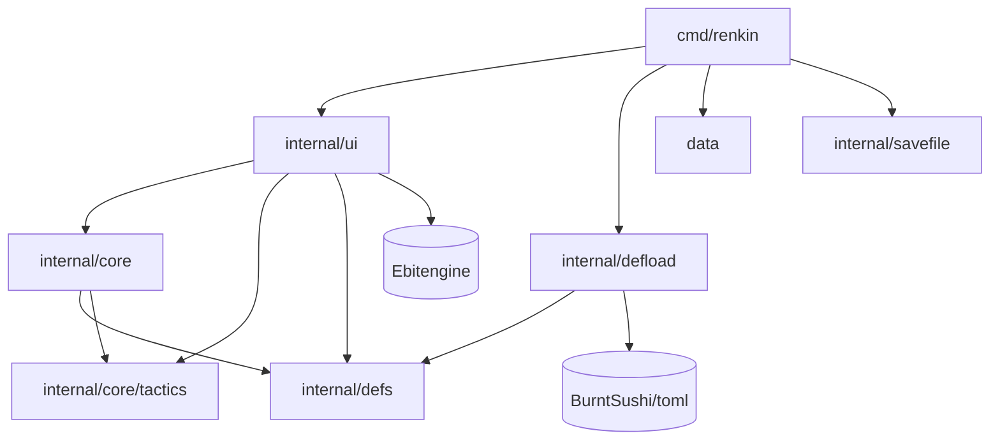
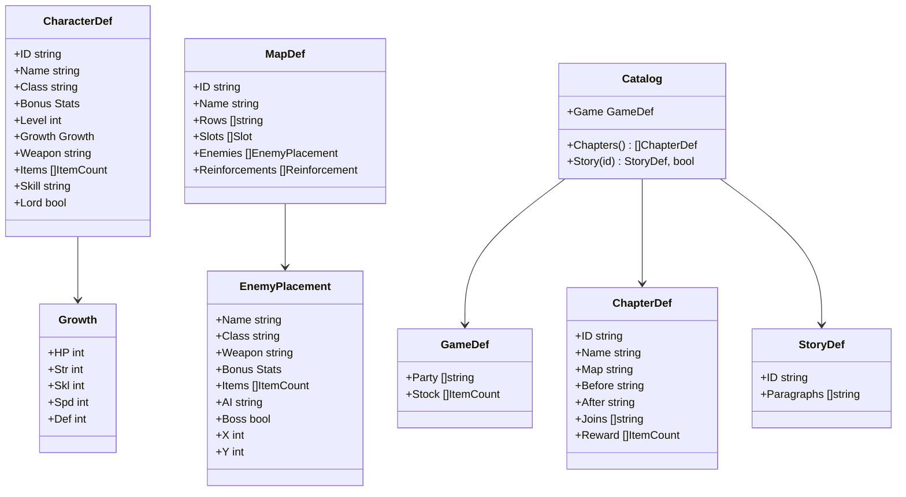
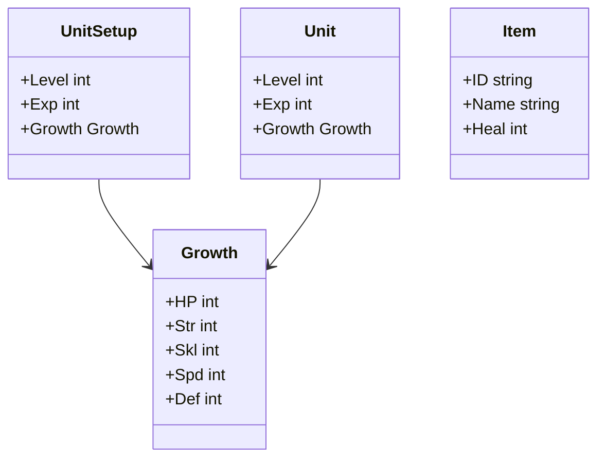
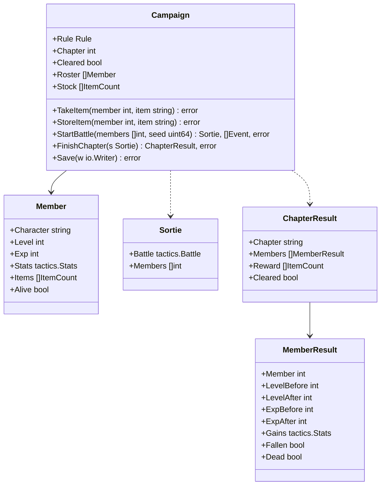
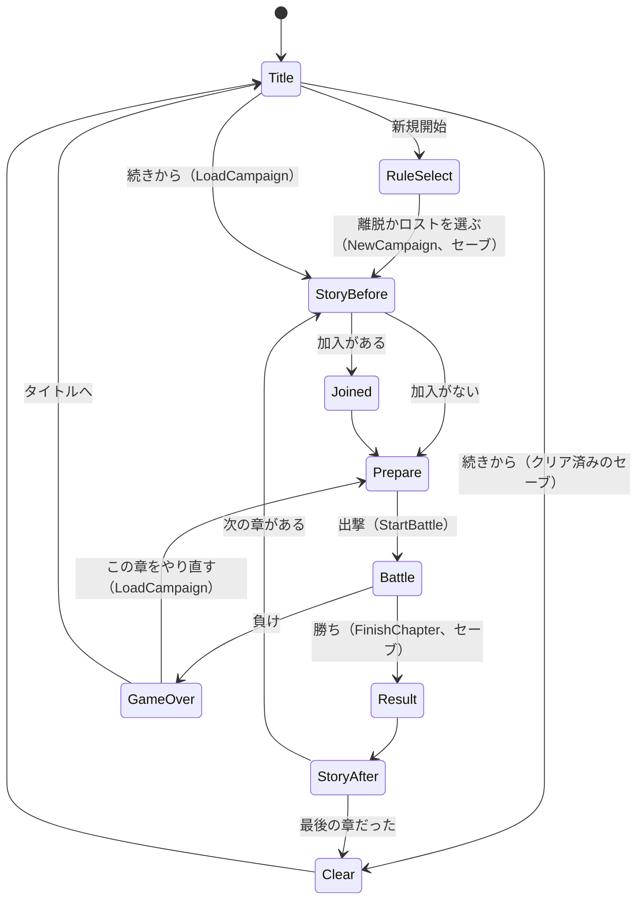

# 設計書（反復 2: 章立てと成長）

- 文書 ID: DES-IT02
- 版: 0.2（案。REV-020 の指摘を反映。開発者の確認待ち）
- 作成日: 2026-10-21
- 対象: [反復 2 計画書](../iterations/it02/plan.md) の範囲
- 入力: [SRS-001](../02_requirements/srs.md) v0.1、[ユースケース](../02_requirements/use-cases.md) v0.3（案）、[設計書（反復 1）](design-it01.md) v0.3、[ADR-0002](../adr/0002-return-to-fushigi.md)、[ADR-0003](../adr/0003-definition-data-format.md)、CON-001 3〜5 章、E-07、E-08、E-25、E-26

反復 1 の設計書（DES-IT01）に書き足すのではなく、反復 2 で**変える部分と足す部分**だけをこの文書に書く。ここに書いていないことは、反復 1 の設計書のとおりとする。反復 1 の設計要素を変えるときは、同じ ID を使い「（反復 2 で変更）」と書く。数の値は 10 章の仮置きで、遊んで調整する。

E-26 の「細かい点は任せる」に従い、決める点はすべて Claude Code の推奨の案で書いた。開発者がまとめて確かめる点（C-01〜C-10）は、計画書 9.2 節に一覧がある。本文では、その点に「（C-xx）」と印を付けた。

## 1. 反復 1 の設計からの変更点

| 設計要素 | 反復 2 での扱い | 節 |
|---|---|---|
| DES-PKG-04 `internal/core` | 責務に、キャンペーンの状態・流れと、セーブの中身の読み書きを足す | 2 章 |
| DES-PKG-08 `internal/savefile`（新） | セーブのファイルの置き場所と、壊れない書き方 | 2 章、6.2 節 |
| DES-DAT-01〜03 | 成長率・レベル・章・物語・出撃の枠・敵の名前を足す。`game.toml` の `start_map` と、マップの `allies` をやめる | 3 章 |
| DES-BTL-01 | `UnitSetup`・`Unit` に `Level`・`Exp`・`Growth` を、`Item` に `ID` を足す。`Setup` の規則 7 を足す | 4.3 節 |
| DES-BTL-06 | 攻撃の流れの終わりに、経験とレベルアップを足す（勝ち負けを確かめる前） | 4.1・4.2 節 |
| DES-RNG-01 | 成長の乱数を、攻撃の流れの乱数のあとに引く | 4.2 節 |
| DES-EVT-01 | 出来事 `Exp`・`LevelUp` を足す | 4.3 節 |
| DES-CORE-01 | 自軍を `game.toml` の名簿と、マップの出撃の枠から置く。敵の名前を定義データから取れるようにする | 5.5 節 |
| DES-UI-01、02 | 戦闘の画面は 1 つの場面になる。勝ち負けの画面（`Over`）の R・Esc をやめ、章の結果とゲームオーバーの場面に進む（DES-UI-17） | 7 章 |
| DES-UI-06 | 情報欄に、自軍のレベルと経験を足す | 7.8 節 |
| DES-CMD-01 | DES-CMD-02 に置き換える（セーブの置き場所を決め、タイトルから始める）。その前の Issue 2 の間は、始めるマップを `chapters.toml` の最初の章のマップにする（9 章） | 8.1 節 |

変えないもの: 攻撃の計算・流れ・予測（DES-BTL-02〜07）、スキル（DES-SKL-01）、アイテムの使い方（DES-ITM-01）、地形とギミック（DES-MAP-01〜03）、勝ち負け（DES-MAP-04）、敵の動き方（DES-AI-01）、見せ方の改善（DES-UI-06〜08 のうち、レベルの表示を除く）。

## 2. アーキテクチャ

| ID | パッケージ | 責務 | 依存してよい先 |
|---|---|---|---|
| DES-PKG-04（反復 2 で変更） | `internal/core` | ゲームの状態。定義データから戦闘を組み立てる（DES-CORE-01）。キャンペーン（名簿・章・在庫・離脱かロスト）の状態と流れ（5 章）。セーブの中身（JSON）の読み書き（6 章）。ファイルと OS は扱わず、`io.Reader`・`io.Writer` を受け取る | `defs`、`core/tactics` |
| DES-PKG-08 | `internal/savefile` | セーブのファイルを、決まったディレクトリに壊れない形で書き、読む（NFR-08）。中身の形は知らない | Go の標準ライブラリだけ |



- `core` は `os` を import しない。DES-NFR-01 の依存の検査（Ebitengine と `time` を使わない）は `core` にそのまま効く
- `ui` は `savefile` を import しない。`ui` は、セーブを読み書きする口（`ui.SaveStore`、7.1 節）だけを知り、`cmd/renkin` が `savefile.Store` を渡す
- `internal/savefile` を足すので、AGENTS.md のパッケージ構成の表に 1 行足した（この設計のプルリクエストで足した。REV-020 F-12）
- `tactics` は反復 2 でも World と `defs` を知らない（ADR-0002）。経験と成長は `tactics` の中で扱うが、成長率とレベルは `UnitSetup` で受け取り、結果は `Units()` で読み出す

## 3. 定義データ（反復 2 で変更）

### 3.1 クラス図の変更（DES-DAT-01）



- 図にない型と、`Catalog` のほかの関数は反復 1 のまま
- `GameDef.StartMap` をやめ、`Party`（初めの名簿。キャラの ID の並び）と `Stock`（初めの共有の在庫。省略できる）にする
- `CharacterDef` に `Level`（加わるときのレベル。省略すると 1）と `Growth`（成長率。%）を足す
- `MapDef.Allies` をやめ、`Slots`（出撃の枠。`Slot` は `X`・`Y` を持つ）にする。枠の並びの 1 番目は主人公の枠
- `EnemyPlacement` に `Name`（省略できる）を足す。ボスに名前を付け、物語とつなげるため（10.4 節）
- `ChapterDef` は章 1 つ。`Catalog.Chapters()` は、`chapters.toml` に書いた順（章の順）に返す。`Before`・`After` は物語の ID で、空なら物語を出さない。`Joins` は、その章の始めに名簿に加わるキャラの ID の並び。`Reward` は、その章に勝ったときに共有の在庫に入るアイテム
- `StoryDef` は物語 1 本。`Paragraphs` は段落の並び

### 3.2 ファイルと TOML の例（DES-DAT-02）

`data/base/` に `chapters.toml` と `story.toml` を足す。ほかのファイルは反復 1 のまま（中身を変えるものがある）。

```toml
# data/base/game.toml
party = ["leon", "gald", "bran", "mira"]
# stock = [{ item = "potion", count = 1 }]  # 初めの在庫（省略すると空）

# data/base/characters.toml（足すキー）
[[characters]]
id = "elsa"
name = "エルザ"
class = "cavalier"
bonus = { hp = 1, str = 1, skl = 1, spd = 1, def = 0, mov = 0 }
level = 2
growth = { hp = 65, str = 45, skl = 40, spd = 40, def = 35 }
weapon = "iron_lance"
items = [{ item = "potion", count = 1 }]

# data/base/chapters.toml
[[chapters]]
id = "ch02"
name = "灰の街道"
map = "ch02"
before = "ch02_before"
after = "ch02_after"
joins = ["elsa"]
reward = [{ item = "potion", count = 2 }]

# data/base/story.toml
[[stories]]
id = "ch02_before"
paragraphs = [
  "西の谷へ向かう街道は、逃げる人々で埋まっていた。",
  "エルザ「村を焼けという命令に、従えなかった」",
]

# data/base/maps.toml（変えるキー）
[[maps]]
id = "ch02"
name = "灰の街道"
rows = [ "^^^^^FF^^^^^^^^^", ] # …（16 行。10.5 節）
slots = [{ x = 1, y = 7 }, { x = 1, y = 6 }, { x = 1, y = 8 }, { x = 0, y = 6 }, { x = 0, y = 8 }]

[[maps.enemies]]
name = "ヴォルグ"
class = "cavalier"
weapon = "iron_lance"
bonus = { hp = 8, str = 2, skl = 3, spd = 2, def = 1, mov = 0 }
ai = "hold"
boss = true
x = 14
y = 8
```

### 3.3 意味の検証（DES-DAT-03）

反復 1 の規則 1〜13 のうち、3・8・9・10 を変え、14〜20 を足す。

| # | 規則 |
|---|---|
| 3（変更） | 参照（クラス、武器、アイテム、キャラ、地形の文字、**章のマップ、章の物語、名簿と加入のキャラ**）が存在する。「始めるマップ」はなくなる |
| 8（変更なし。確認） | マップの行の数と行の長さは、どちらも 1 以上 16 以下（反復 2 もスクロールしない。E-26） |
| 9（変更） | 出撃の枠・敵の配置・増援の座標がマップの中にあり、通れる地形にある。出撃の枠どうし、初めの敵の配置どうし、出撃の枠と初めの敵の配置は、どれも重ならない |
| 10（変更） | `game.toml` の `party` が 1 人以上で、同じキャラが 2 回ない。`lord = true` のキャラが `party` にちょうど 1 人いて、`party` の外に `lord = true` のキャラはいない |
| 14 | 章が 1 つ以上ある。各章の `slots` の数（マップの出撃の枠の数）が 1 以上 |
| 15 | 加入（`joins`）のキャラは、`party` にも、ほかの章の `joins` にも出てこない（1 人は 1 回だけ加わる） |
| 16 | キャラの `level` は 1 以上 20 以下。省略すると 1 で、`level = 0` と書いたら誤り。`growth` の各値は 0 以上 100 以下。`growth` を省略すると、すべて 0（成長しない）。表の中の能力を省略したものも 0 |
| 17 | キャラの `items` の数の合計は 5 以下（手持ちの上限。DES-CMP-04）。`stock`・`reward` の各要素の数は 1 以上で、同じアイテムを 2 回書かない |
| 18 | 物語の `paragraphs` は 1 つ以上で、各段落は空でなく、200 文字（rune で数える）以下 |
| 19 | 敵の `name` は、書くなら空でない |
| 20 | 章・物語の ID は、それぞれの中で重ならず、空でない（規則 2 と同じ） |

- 誤りの位置は反復 1 と同じく、キーの道筋で示す（例: `chapters.toml: chapters[1].joins[0]: キャラ "elsa" は party にもいます`）
- 規則 13（知らないキー）は、足したファイルとキーにも効く。`start_map`・`allies` を書くと、知らないキーの誤りになる

## 4. 経験と成長（core/tactics）

### 4.1 経験（DES-GRW-01）

経験は `tactics` の中で、攻撃の流れ（DES-BTL-06）が終わるたびに足す（FR-UNT-04）。

- 経験を得るのは、`Level` が 1 以上の**自軍**のユニットだけ。敵と、`Level` が 0 の自軍（反復 1 のテストの `Setup` など）は経験を得ない。`Level` が 20 のユニットも得ない
- 1 回の攻撃の流れ（自軍の番の `Attack` も、敵軍の番の敵の攻撃も）には、自軍と敵が 1 体ずつ加わる。流れが終わったとき、加わった自軍のユニットが生きていれば、次の経験を足す（C-01）

| 条件（上から順に見る） | 経験 |
|---|---|
| 相手（敵）がこの流れの中で倒れた | 30 |
| このユニットの 1 撃が 1 回以上当たった（ダメージが 0 でも、`Hit` が真なら当たり） | 10 |
| それ以外（すべて外れた。反撃できず 1 撃も行わなかった） | 1 |

- 待機とアイテムの使用では、経験を得ない
- 加わった自軍のユニットが倒れたときは、経験を足さない

### 4.2 レベルアップと成長（DES-GRW-02）

- 経験を足して 100 以上になったら、レベルを 1 上げ、経験から 100 を引く（余りは持ち越す）。1 回に足す経験は 30 以下で、足す前の経験は 99 以下なので、1 回に上がるのは 1 レベルまで
- レベルが 20 になったら、経験を 0 にする（余りは捨てる）
- レベルが上がったら、**HP・力・技・速さ・守備の順に**、0〜99 の乱数（`roll`。DES-RNG-01）を 1 つずつ、計 5 つ引く。引いた値が、そのキャラのその能力の成長率より小さければ、その能力を 1 上げる（FR-UNT-05）。移動は上がらない。成長率が 0 なら上がらず、100 なら必ず上がる。5 つとも上がらなくても、引き直さない
- 最大 HP が上がったら、今の HP も 1 上げる
- 能力の上限は設けない（反復 2 では、上がっても 1 人 3〜4 レベルの見込み。10.2 節）

**乱数を引く順（DES-RNG-01 に足す）**: 1 回の攻撃の流れの中では、1 撃ごとの乱数（命中 2 つ、大盾 1 つ）をすべて引いたあと、レベルが上がったときだけ、成長の乱数を 5 つ引く。同じ種と同じコマンドの列なら、成長も同じになる（NFR-06）。

**出来事の順**: `Strike`（…）→ 倒れたら `Fall` → `Exp` → レベルが上がったら `LevelUp` → 勝ち負けが決まったら `Won`・`Lost`。ボスを倒した 1 撃でも、経験とレベルアップを済ませてから勝ちを出す。

**計算例**（10 章の仮置きの値。スクリプトで検算した）

| # | 場面 | 計算 | 結果 |
|---|---|---|---|
| 1 | レオン（Lv 1、経験 0）が、ソルジャーに 1 撃を当て、倒さない | 経験 0 ＋ 10 = 10 < 100 | Lv 1、経験 10。成長の乱数は引かない。出来事は `Exp`（10）だけ |
| 2 | ミラ（Lv 1、経験 90。成長率 55/40/60/45/20）が敵を倒す。成長の乱数は (12, 75, 40, 44, 90) | 90 ＋ 30 = 120 → Lv 2、経験 20。HP 12 < 55 ○、力 75 < 40 ×、技 40 < 60 ○、速さ 44 < 45 ○、守備 90 < 20 × | Lv 2、経験 20。HP・技・速さ ＋1 |
| 3 | ブラン（Lv 1、経験 80、HP 26。成長率 85/55/30/35/20）が、平地の剣士（HP 10）を攻撃。乱数の列は (20, 30, 50, 60, 10, 35, 5) | 1 撃目: 20 ＋ 30 = 50 < 45 × 2 = 90 → 当たり、13 ダメージで剣士が倒れる（反撃はない）。経験 80 ＋ 30 = 110 → Lv 2、経験 10。成長: HP 50 < 85 ○、力 60 < 55 ×、技 10 < 30 ○、速さ 35 < 35 ×（小さくないので上がらない）、守備 5 < 20 ○ | 出来事は `Strike` → `Fall` → `Exp`（30）→ `LevelUp`（Lv 2、HP・技・守備 ＋1）。乱数は 7 つ引いた。`Exp` と `LevelUp` の写しのブランは、どちらも更新後の Lv 2、経験 10、能力 27/8/5/5/4/5、今の HP 27（4.3 節） |
| 4 | レオン（Lv 3、経験 99。成長率 70/40/50/55/30）が、1 撃も当てずに生き残る。成長の乱数は (99, 0, 50, 54, 30) | 99 ＋ 1 = 100 → Lv 4、経験 0。HP 99 ×、力 0 ○、技 50 < 50 ×、速さ 54 < 55 ○、守備 30 < 30 × | Lv 4、経験 0。力・速さ ＋1 |
| 5 | Lv 19、経験 95 のユニットが当てる | 95 ＋ 10 = 105 → Lv 20、経験は 0 にする | Lv 20、経験 0。以後は経験を得ない（`Exp` も出さない） |
| 6 | 敵軍の番に、ファイターが隣のミラ（弓）を攻撃し、外れる | ミラは隣に反撃できない。1 撃も行わず、生き残った | ミラの経験 ＋1 |

### 4.3 型と出来事（DES-GRW-03。DES-BTL-01・DES-EVT-01 の変更）



- 図は足す欄だけを書いた。ほかの欄は反復 1 のまま
- `Item.ID` は、`tactics` の外（`core`）がアイテムを見分けるための値で、`tactics` は使わない（比べもしない）。戦闘のあとに手持ちを名簿に書き戻すために使う（DES-CMP-06）
- `Setup` の検証に規則 7 を足す。当てはまらなければ `ErrInvalidSetup` を返す

| # | `Setup` の規則 |
|---|---|
| 7 | `Level` は 0 以上 20 以下。敵（増援を含む）の `Level` は 0。`Exp` は 0 以上 99 以下で、`Level` が 0 か 20 なら 0。`Growth` の各値は 0 以上 100 以下 |

- 出来事を 2 つ足す。`EventKind` の定数は、反復 1 の定数のあと（`EventLost` のあと）に足し、反復 1 の値を変えない。`Event` に `Level`・`Gains`（`Stats` の型。移動は 0）を足す

| `Kind` | 起きたこと | 主な項目 |
|---|---|---|
| `Exp` | 経験を得た | `Unit`、`Amount`（得た経験。1・10・30 のどれか） |
| `LevelUp` | レベルが上がった | `Unit`、`Level`（上がったあとのレベル）、`Gains`（上がった能力。上がった能力が 1、ほかは 0） |

- **写しの値**: 経験を足し、レベルアップと成長の判定をすべて済ませて、ユニットの経験・レベル・能力・今の HP を更新してから、`Exp` と（レベルが上がったら）`LevelUp` を出す。どちらの出来事の写し（`Units`）も、更新後の値になる。`Exp` の写しで経験が足す前の値に見えることはない。画面は、上がる前の値を `Gains` と `Level` から求める

## 5. キャンペーン（core）

### 5.1 クラス図（DES-CMP-01）



- 図では `*` を省いた。`StartBattle` は `*Sortie` を返し、`FinishChapter` は `*Sortie` を受け取る。`Sortie.Battle` は `*tactics.Battle`
- `NewCampaign(cat *defs.Catalog, rule Rule) (*Campaign, error)` で新しく始め、`LoadCampaign(cat *defs.Catalog, r io.Reader) (*Campaign, error)` でセーブから読む（6 章）。`Campaign` は目録を内部に持つ（セーブには入れない）
- `Rule` は `Withdraw`（離脱）と `Permadeath`（ロスト）（FR-CMP-04）
- `Chapter` は今の章の添字（`cat.Chapters()` の 0 から数えた位置）。`Cleared` が真なら、最後の章に勝ったあと
- `Roster` は名簿。初めの名簿の順に、加わった順で後ろに足す。ロストで倒れた仲間も、`Alive` を偽にして名簿に残す（加入を 2 回しないため。画面には出さない）
- `Member.Stats` は今の能力（クラス＋ボーナス＋成長。移動を含む）。`Items` は手持ち（`defs.ItemCount`）
- `Stock` は共有の在庫。アイテムの ID ごとに 1 つの要素で、ID の順に並べる。数が 0 になったら要素を消す
- 名簿のキャラの名前・クラス・武器・スキル・成長率は、目録のキャラの定義から引く（名簿には持たない）。成長率を調整しても、セーブを作り直さずに効く

### 5.2 流れ（DES-CMP-02）



- 図の状態は画面の場面（7 章）で、`core` は状態を持たない。`core` の状態は `Chapter`・`Cleared` と名簿・在庫だけ
- 物語がない章（`Before`・`After` が空）では、物語の場面を飛ばす
- 加入（`Joins`）は、`core` では章に入るとき（5.3 節）に名簿に足す。画面は、章の前の物語のあとに「加わった」と出す（DES-UI-12）

### 5.3 新規開始と章に入る（DES-CMP-03）

`NewCampaign(cat, rule)`:

1. `rule` が `Withdraw`・`Permadeath` のどれかでなければ `ErrInvalidRule`
2. 名簿を `game.toml` の `party` の順に作る。各キャラは、レベル＝キャラの `level`、経験 0、能力＝クラスの `base` ＋ キャラの `bonus`、手持ち＝キャラの `items`、`Alive` は真
3. 在庫を `game.toml` の `stock` にする
4. `Chapter` を 0 にし、章に入る（下）

**章に入る**（`NewCampaign` と `FinishChapter` の中で行う）: 今の章の `Joins` のキャラを、`Joins` の順に名簿の後ろに足す。足し方は 2 と同じ。

### 5.4 章の準備（DES-CMP-04）

出撃するキャラの選択は画面が持ち、`StartBattle` に渡す（5.5 節）。アイテムの入れ替えは、`Campaign` の操作で行う（FR-CMP-03）。

| 操作 | 意味 | 検証（順に確かめ、最初に当てはまった誤りを返す） |
|---|---|---|
| `TakeItem(member, item)` | 在庫の `item` を 1 つ、名簿の `member` 番目の手持ちに移す | クリア済みでない（`ErrCleared`）。`member` が名簿にいて生きている（`ErrInvalidMember`）。在庫に `item` が 1 つ以上ある（`ErrNoStock`）。手持ちの数の合計が 5 より小さい（`ErrHandFull`） |
| `StoreItem(member, item)` | 名簿の `member` 番目の手持ちの `item` を 1 つ、在庫に移す | クリア済みでない（`ErrCleared`）。`member` が名簿にいて生きている（`ErrInvalidMember`）。手持ちに `item` がある（`ErrNoHandItem`） |

- 手持ちに同じ ID の要素があれば数を 1 増やし、なければ後ろに足す。数が 0 になった要素は消す
- 手持ちの上限は、数の合計で 5（10.7 節）
- 入れ替えは、セーブするまでファイルには残らない。負けてやり直すと、章の始めのセーブに戻る（DES-CMP-07）

### 5.5 戦闘を作る（DES-CMP-05、DES-CORE-01 の変更）

`StartBattle(members []int, seed uint64) (*Sortie, []tactics.Event, error)` は、今の章のマップで戦闘を作る（FR-CMP-03、TBD-04）。

検証（順に確かめ、最初に当てはまった誤りを返す。状態は変えない）:

1. クリア済みでない（`ErrCleared`）
2. `members` の数が 1 以上、今の章のマップの出撃の枠の数以下（`ErrInvalidDeployment`）
3. 各要素が名簿の添字で、生きていて、重ならない（`ErrInvalidDeployment`）
4. `members[0]` が主人公（`lord = true` のキャラ）である（`ErrInvalidDeployment`）。主人公は必ず出撃し、枠の 1 番目に置く

組み立て:

- 自軍は `members` の順に、マップの `slots` の同じ順の座標に置く。`Units()` の添字 `i`（`i < len(members)`）は `members[i]` の名簿のキャラになる
- 自軍の `UnitSetup` は、名前・クラスの名前・武器・スキル・主人公かどうか・成長率をキャラの定義から、`Level`・`Exp`・`Stats`・手持ちを名簿から作る。手持ちの `Item.ID` にアイテムの ID を入れる。HP は最大から始まる（離脱で倒れた仲間も、次の章では HP が最大で戻る。FR-CMP-05）
- 敵・増援・地形は反復 1 の DES-CORE-01 のまま。ただし、敵の配置に `name` があれば、それを名前にする。番号を付けるときは、`name` のある敵を数えない
- `Sortie` は、作った戦闘（`Battle`）と、`members` の写しを持つ。どの `Campaign` のどの章で作ったかを内部に持つ（DES-CMP-06 の検証のため）
- `StartBattle` は `Campaign` を変えない。何度呼んでもよい

**`core.NewBattle` の変更（DES-CORE-01）**: `core.NewBattle(cat, mapID, seed)` は、反復 1 のテストのために残す。自軍は、`game.toml` の `party` のキャラを、`party` の順にマップの `slots` の数まで置く（主人公は `party` のどこにいても枠の 1 番目に置く）。レベル・成長率はキャラの定義から、経験は 0 にする。`StartBattle` と同じ組み立ての関数を使う。

### 5.6 章の終わり（DES-CMP-06）

`FinishChapter(s *Sortie) (ChapterResult, error)` は、勝った戦闘の結果を名簿に書き戻し、次の章に進む（FR-CMP-01、02、05、06、10、FR-ITM-03）。

検証（状態は変えない）:

1. `s` がこの `Campaign` の今の章で作ったもので、まだ `FinishChapter` に渡していない（`ErrInvalidSortie`）
2. `s.Battle.Result` が `Won`（`ErrNotWon`）

書き戻しと進め方:

1. 出撃した各キャラ（`members[i]` と `Units()[i]`）について、名簿のレベル・経験・能力（`Stats`。最大 HP を含む）・手持ちを、ユニットの値にする。手持ちは `Item.ID` で ID に戻す。倒れる前に上がったレベルと能力も残す
2. 倒れたキャラ（`Alive` が偽）は、`Rule` が `Permadeath` なら名簿の `Alive` を偽にし、手持ちを空にする（C-08。FR-CMP-06）。`Withdraw` なら名簿に残し、次の章で戻る（FR-CMP-05）
3. 今の章の `Reward` を在庫に足す
4. `Chapter` を 1 進める。最後の章だったら `Cleared` を真にする（`Chapter` は章の数と同じ値になる）。そうでなければ次の章に入る（DES-CMP-03。加入を名簿に足す）
5. `s` を渡し済みにする

`ChapterResult` には、終えた章の ID、出撃した各キャラの前後のレベルと経験、上がった能力（`Gains`。後 − 前）、倒れたか（`Fallen`）、戦死したか（`Dead`。ロストで倒れたとき）、報酬、クリアしたかを入れる。出撃しなかったキャラは載せない（経験も得ない）。

- 主人公が倒れると負け（FR-CMP-09）なので、勝った戦闘で主人公が倒れていることはない。ロストでも主人公は戦死しない

### 5.7 負けとやり直し（DES-CMP-07）

- 負け（`Result` が `Lost`）のとき、`core` は何もしない。`FinishChapter` は `ErrNotWon` を返す
- 画面は、章に入るたびに（`NewCampaign`・`LoadCampaign`・`FinishChapter` が成功したあと）、`Campaign.Save` の中身（章の始めの状態）をメモリにも持つ。ファイルへのセーブ（DES-SAV-02）は「続きから」のためのもので、やり直しには使わない（ファイルのセーブに失敗していても、やり直せる）
- 「この章をやり直す」では、メモリに持った中身から `LoadCampaign` し、章の準備の場面から始める。章の前の物語と加入の表示は飛ばす（C-06）。準備で入れ替えたアイテムも、章の始めに戻る
- ロストで遊んでいても、負けた戦闘の中で倒れた仲間は、やり直すと戻る（その戦闘は無かったことになる）

### 5.8 誤り（DES-CMP-08）

`Campaign` の操作と `NewCampaign`・`LoadCampaign` は、失敗したら状態を変えず、次の誤りを返す（NFR-07）。`errors.Is` で見分けられるようにする。

| 誤り | 意味 |
|---|---|
| `ErrInvalidRule` | 離脱・ロストのどれでもない |
| `ErrCleared` | クリア済みなので、準備も出撃もできない |
| `ErrInvalidMember` | 名簿にいない、または戦死している |
| `ErrNoStock` | 在庫にそのアイテムがない |
| `ErrHandFull` | 手持ちが上限（5）に達している |
| `ErrNoHandItem` | 手持ちにそのアイテムがない |
| `ErrInvalidDeployment` | 出撃の選び方が正しくない（数、重なり、戦死、主人公が先頭でない） |
| `ErrInvalidSortie` | ほかの章・ほかのキャンペーンの戦闘か、渡し済み |
| `ErrNotWon` | 戦闘に勝っていない |
| `ErrSaveVersion` | セーブの版が読めない値（6.3 節） |
| `ErrInvalidSave` | セーブの中身が正しくない（6.3 節。理由を含める） |

## 6. セーブ

### 6.1 形式（DES-SAV-01）

セーブは JSON の 1 つのファイル（枠は 1 つ。FR-SYS-01）。`Campaign.Save(w)` が書き、`LoadCampaign(cat, r)` が読む。

```json
{
  "version": 1,
  "rule": "withdraw",
  "chapter": "ch02",
  "cleared": false,
  "roster": [
    {
      "character": "leon",
      "level": 2,
      "exp": 40,
      "stats": { "hp": 21, "str": 6, "skl": 9, "spd": 10, "def": 4, "mov": 5 },
      "items": [{ "item": "potion", "count": 2 }],
      "alive": true
    }
  ],
  "stock": [{ "item": "potion", "count": 2 }]
}
```

- `version` は 1。形を変えたら上げる
- `rule` は `withdraw`（離脱）か `permadeath`（ロスト）
- `chapter` は今の章の ID。クリア済み（`cleared` が真）なら空の文字列
- `roster` は名簿の順。`items`・`stock` が空なら `[]`
- 字下げは空白 2 つ。同じ状態なら同じ文字列になる（在庫は ID の順。名簿は名簿の順）

### 6.2 ファイルの置き場所と書き方（DES-SAV-02、DES-PKG-08）

`internal/savefile` の `Store{Dir string}` が、ファイルを扱う（IF-04、NFR-08）。

| 関数 | 動き |
|---|---|
| `Path() string` | `Dir` の下の `save.json` |
| `Exists() (bool, error)` | `save.json` があるか |
| `Read(fn func(io.Reader) error) error` | `save.json` を開いて `fn` に渡す。なければ `fs.ErrNotExist` を包んだ誤り |
| `Write(fn func(io.Writer) error) error` | 下の手順で書く |

`Write` の手順（NFR-08）:

1. `Dir` を作る（なければ。`os.MkdirAll`、0o755）
2. 同じディレクトリに一時ファイルを作る（`os.CreateTemp(Dir, "save-*.tmp")`）
3. `fn` に一時ファイルを渡して中身を書く
4. 一時ファイルを `Sync` し、閉じる
5. 一時ファイルの名前を `save.json` に変える（`os.Rename`。同じディレクトリの中なので置き換えは一度に起きる。Windows でも、ある `save.json` を置き換える）
6. 2〜5 のどこかで失敗したら、一時ファイルを消して誤りを返す。`save.json` は書く前のまま残る

- 書いている途中で強制終了しても、`save.json` は前のままで、残るのは一時ファイルだけ（`Read` は一時ファイルを読まない）。残った一時ファイルは、次の `Write` で `save-*.tmp` を消して片付ける
- 置き場所は `cmd/renkin` が決める（DES-CMD-02）。IF-04（OS の慣例に従うユーザーのデータ用ディレクトリ）に合わせた:

| 場合 | ディレクトリ |
|---|---|
| `-savedir` の指定がある | そのディレクトリ |
| Windows | `os.UserConfigDir()`（`%AppData%`）の下の `renkin_tactics` |
| Linux（ほかの Unix を含む） | 環境変数 `XDG_DATA_HOME` が空でなければその下、空なら `os.UserHomeDir()` の下の `.local/share` の、さらに下の `renkin_tactics`（例: `~/.local/share/renkin_tactics/save.json`） |
| macOS | `os.UserConfigDir()`（`~/Library/Application Support`）の下の `renkin_tactics` |

- `-savedir` は、試験と遊び比べ（E-25）のときに、ふだんのセーブを上書きしないために使う

**セーブする時機**（自動。プレイヤーが選ぶ操作はない）:

| 時機 | 中身 |
|---|---|
| 新規開始で離脱かロストを選んだ直後（`NewCampaign` のあと） | 1 章の始め |
| 「勝利」の帯をクリックして `FinishChapter` が成功した直後（章の結果を見る前。C-07） | 次の章の始め（加入を足したあと）。最後の章ならクリア済み |

- セーブに失敗したら、次の場面（新規開始のあとは 1 章の前の物語、章に勝ったあとは章の結果）に「セーブできませんでした: 理由」と出して、遊びは続ける（ファイルには前のセーブが残る。やり直しはメモリの中身で行える。DES-CMP-07）
- セーブする時機には、勝ちが決まった時点ではなく、「勝利」の帯をクリックしたとき（DES-UI-17）にした。帯をクリックする前に窓を閉じると、その章の勝ちは残らない（C-07 にほかの案を添えた）

### 6.3 読むときの検証（DES-SAV-03）

`LoadCampaign(cat, r)` は、次の順で読む。1 つでも当てはまれば、`Campaign` を返さず誤りを返す。

1. まず `version` だけを読み（ほかのキーは見ない）、規則 2 を確かめる。`version` を読めない（JSON の文法の誤り、`version` がない・数でない）ときは規則 1 の誤り（`ErrInvalidSave`）
2. そのあと、知らないキーを許さずに全体を読み、規則 1・3〜7 を表の順に確かめ、最初に当てはまった誤りを返す

| # | 規則 | 誤り |
|---|---|---|
| 1 | JSON の文法が正しく、知らないキーがない | `ErrInvalidSave` |
| 2 | `version` が 1 | `ErrSaveVersion` |
| 3 | `rule` が `withdraw`・`permadeath` のどれか | `ErrInvalidSave` |
| 4 | `cleared` が偽なら `chapter` が目録の章の ID。真なら `chapter` が空 | `ErrInvalidSave` |
| 5 | 名簿が 1 人以上で、各キャラが目録にあり、重ならない。主人公がちょうど 1 人いて、生きている | `ErrInvalidSave` |
| 6 | レベルは 1 以上 20 以下。経験は 0 以上 99 以下で、レベル 20 なら 0。能力は HP 1 以上、ほかは 0 以上 | `ErrInvalidSave` |
| 7 | 手持ちと在庫のアイテムが目録にあり、数は 1 以上。手持ちの数の合計は 5 以下。在庫に同じ ID が 2 回ない | `ErrInvalidSave` |

- 誤りの文には、理由と位置（例: `roster[2].level`）を含める
- 定義データの章が減ったなどで今の章がなくなったセーブは、規則 4 で読めない。反復 2 では、読めないセーブは「新規開始」で上書きする（DES-UI-10）

## 7. 画面（ui）

窓の大きさ（832 × 576 ピクセル）、文字、色、素材は反復 1 のまま（DES-UI-01、05）。ボタンは、反復 1 の行動の一覧と同じ形（`menuColor` の下地と `menuBorder` の枠）で描く。

### 7.1 場面の切り替え（DES-UI-09）

- `ui.Run(cfg Config)` で始める。`Config` は、目録（`*defs.Catalog`）、セーブの口（`SaveStore`）、戦闘の種を決める関数（`NextSeed func() uint64`）を持つ
- `SaveStore` は `Exists() (bool, error)`、`Read(func(io.Reader) error) error`、`Write(func(io.Writer) error) error` を持つインタフェース（`savefile.Store` が満たす）。テストでは記憶の中に持つ偽物を使う
- 画面は場面（`Title`・`RuleSelect`・`Story`・`Joined`・`Prepare`・`Battle`・`Result`・`GameOver`・`Clear`）を 1 つずつ持ち、DES-CMP-02 の図のとおりに切り替える
- 各場面の入力と状態の遷移は、反復 1 の `Controller` と同じく、描画から分けた型にしてテストを書ける形にする。`Battle` の場面は反復 1 の `Controller` を使う
- 窓を閉じればいつでも終わる（マップの途中はセーブしない。TBD-10）

### 7.2 タイトル（DES-UI-10。FR-SYS-02）

- 上に「レンキン・タクティクス」を大きく出し、ボタンを 3 つ縦に並べる: 「新規開始」「続きから」「終了」
- 場面に入るとき、セーブを読んでみる（`SaveStore.Read` と `LoadCampaign`）
  - 読めたら、「続きから」の下に「第 N 章　章の名前（離脱）」のように出す。クリア済みなら「クリア済み」と出す
  - セーブがなければ、「続きから」を暗く描き、押せなくする
  - 読めなければ、「続きから」を暗く描いて押せなくし、下に「セーブデータを読めません: 理由」と出す
- 「新規開始」: セーブがある（読めないものを含む）ときは、「セーブを上書きして、はじめから始めますか」と「はい」「いいえ」を出す。「はい」で離脱かロストの選択に進む
- 「続きから」: 章の前の物語から始める。クリア済みならクリアの場面に進む
- 「終了」: 窓を閉じる

### 7.3 離脱かロストの選択（DES-UI-11。FR-CMP-04）

- 「倒れた仲間をどうしますか」と、ボタンを 2 つ出す。ボタンの下に説明を 1 行ずつ出す
  - 「離脱」: 倒れた仲間は、その章では戦えないが、次の章で戻る
  - 「ロスト」: 倒れた仲間は戦死し、二度と戻らない
- 選ぶと `NewCampaign` を呼び、セーブして（DES-SAV-02）、1 章の前の物語に進む
- 右クリックか Esc でタイトルに戻る

### 7.4 物語と加入（DES-STY-01、DES-UI-12。FR-CMP-07、08）

**物語の定義と出し方（DES-STY-01）**

- 物語は `story.toml` に 1 本ずつ書き（ID と段落の並び。DES-DAT-01・02）、章の `before`・`after` が ID で指す。空なら、その物語を出さない
- 章の前の物語は、章に入ったあと（新規開始・続きから・前の章の物語のあと）、章の準備の前に出す。章のあとの物語は、章の結果のあとに出す。負けてやり直したときは、章の前の物語を出さない（DES-CMP-07）
- 物語の文は、誰が生きているかで変えない。そのため、ロストで戦死しうる仲間は、全員が生きている 1 章の前の物語と、加入の場面（2 章の前の物語のエルザ）のほかでは話さず、動かない（10.8 節）
- 1 段落は 200 文字以下（DES-DAT-03 の規則 18）。物語の量は 1 本で数段落まで（CST-03）

**物語の場面（DES-UI-12）**

- 上に「第 N 章　章の名前」を出し、その下に段落を 1 つずつ出す。次の段落に進むと、前の段落を消して入れ替える。右下に「段落の番号/段落の数」を出す
- 段落は、左右に 48 ピクセルの余白をとった幅で、文字の単位で折り返す
- 左クリック・Enter・Space で次の段落に進む。最後の段落の次で、物語の場面を終える
- 右クリックか Esc で、物語の残りを飛ばす
- 直前のセーブに失敗していたら（新規開始のあとのセーブ。DES-SAV-02）、物語の上に「セーブできませんでした: 理由」を出す
- 章の前の物語のあと、その章に加入（`Joins`）があれば、`Joined` の場面で「エルザが仲間に加わった」と、加わったキャラの絵・クラス・レベル・能力を出す。クリックで章の準備に進む。負けてやり直したときは出さない（DES-CMP-07）

### 7.5 章の準備（DES-UI-13。FR-CMP-03、FR-ITM-03）

```text
┌──────────────────────────────────────────┬──────────────────┐
│ 第 2 章　灰の街道　出撃 4/5                 │ （選んだキャラの   │
│ [✓] レオン  ロード    Lv 2  HP 21  手持ち 2 │   情報。情報欄と   │
│ [✓] ガルド  アーマー  Lv 2  HP 25  手持ち 1 │   同じ形）         │
│ [ ] ブラン  ファイター Lv 1  HP 26  手持ち 1 │                  │
│ …                                        │                  │
│ 在庫: 回復薬 ×2                            │                  │
│ [手持ちへ: 回復薬] [在庫へ: 回復薬]          │                  │
│                                [出撃]     │                  │
└──────────────────────────────────────────┴──────────────────┘
```

- 上に「第 N 章　章の名前　出撃 選んだ数/枠の数」を出す
- 名簿の生きているキャラを、名簿の順に 1 行ずつ出す（戦死したキャラは出さない）。行は、出撃の印、ユニットの絵、名前、クラス、レベル、最大 HP、手持ちの数
- 場面に入ったときは、主人公と、名簿の順に枠の数まで、出撃の印を付けておく。主人公を選んだ状態にする（右の欄とアイテムのボタンは主人公のもの）
- 出撃の印をクリックすると、付け外しする。主人公の印は外せない（「主人公は必ず出撃します」と出す）。枠の数を超えて付けようとしたら付けず、「出撃は N 人までです」と出す
- 行の名前をクリックすると、そのキャラを選ぶ（行を明るく描く）。右の欄に、選んだキャラの情報（DES-UI-06 と同じ形。レベルと経験を含む。成長率は出さない。C-02）を出す
- 在庫の行に、在庫のアイテムと数を出す。その下に、選んだキャラについて、在庫の各アイテムの「手持ちへ: 名前」と、手持ちの各アイテムの「在庫へ: 名前」のボタンを出す。押すと `TakeItem`・`StoreItem` を呼ぶ。誤り（`ErrHandFull` など）は、文にして出す（例: 「手持ちは 5 個までです」）
- 「出撃」を押すと、出撃の印のあるキャラを、主人公を先頭にして、あとは名簿の順に並べて `StartBattle` に渡し（種は `NextSeed`）、戦闘の場面に進む
- 出撃するキャラの、枠の中での並びは選べない（名簿の順。10.7 節）

### 7.6 章の結果（DES-UI-14。FR-CMP-10）

- 上に「第 N 章　章の名前　勝利」を出す
- 出撃した各キャラを 1 行ずつ出す: 名前、「Lv 1 → 2」、「経験 80 → 10」、上がった能力（例: 「HP+1 技+1 守備+1」。上がった能力だけ）。倒れたキャラは、離脱なら「離脱（次の章で戻る）」、ロストなら赤で「戦死」と出す
- 下に報酬（例: 「回復薬 ×2 を在庫に入れた」）を出す。報酬がなければ出さない
- セーブに失敗していたら、その文を出す（DES-SAV-02）
- クリックで、章のあとの物語に進む

### 7.7 ゲームオーバーとクリア（DES-UI-15。FR-CMP-02、FR-CMP-09）

- **ゲームオーバー**: 「敗北」「主人公が倒れた」と、ボタン「この章をやり直す」「タイトルへ」を出す。「この章をやり直す」は DES-CMP-07 のとおり（メモリの中身から読む）。読めなかったら、タイトルに戻り、タイトルの下にその理由を出す
- **クリア**: 「クリア」と、生きている仲間の名前とレベルを出す。ロストで戦死した仲間がいれば、「戦死: 名前、…」と出す。クリックでタイトルに戻る

### 7.8 戦闘の画面の変更（DES-UI-16。FR-UNT-04、FR-UNT-09）

- 出来事の再生（DES-UI-04）に、`Exp` と `LevelUp` を足す
  - `Exp`: ユニットのマスの上に「+30 経験」を、出来事の文字と同じ形で出す（20 フレーム）
  - `LevelUp`: 盤面の中ほどに帯を出し、「ブラン　レベル 2　HP+1 技+1 守備+1」（上がった能力だけ。何も上がらなければ「上がった能力なし」）を 60 フレーム出す。早送りが効く
- 情報欄（DES-UI-06）の名前とクラスの下に、自軍なら「Lv 2　経験 40」を出す（Lv 20 なら経験は「―」）。敵（レベル 0）は出さない

### 7.9 戦闘の終わり（DES-UI-17。FR-CMP-02、FR-CMP-09、FR-CMP-10）

- 勝ちが決まったら、反復 1 の勝ち負けの画面の代わりに、「勝利」の帯を出す。クリックで `FinishChapter` を呼び、セーブして（C-07）、章の結果の場面に進む
- 負けが決まったら、「敗北」の帯を出し、クリックでゲームオーバーの場面に進む
- 反復 1 の勝ち負けの画面の R（やり直す）と Esc（終了）はやめる。`Controller` の `Restart`・`Quit` は、戦闘の場面では使わない

## 8. 起動・非機能・対応

### 8.1 起動の流れ（DES-CMD-02。DES-CMD-01 を置き換える）

1. 定義データを読む（DES-CMD-01 の 1 のまま）
2. 乱数の種を決める関数を作る（DES-RNG-01 のまま。`-seed` を指定すれば、戦闘を作るたびに同じ種）
3. セーブの置き場所を決める（DES-SAV-02 の表）。`-savedir` がなく、置き場所を決められない（`os.UserConfigDir()`・`os.UserHomeDir()` が失敗する）ときは、理由を標準エラーに書いて終了コード 1 で終える
4. `ui.Run(ui.Config{...})` でタイトルから始める

### 8.2 非機能

| ID | 内容 | 要求 |
|---|---|---|
| DES-NFR-01（反復 1 のまま） | `internal/core` 以下が Ebitengine と `time` を import しないことを確かめるテストは、キャンペーンとセーブの読み書きにも効く | NFR-04、NFR-05 |
| DES-SAV-02 | 一時ファイルに書いてから名前を変える。テストでは、`fn` が途中で誤りを返したとき・一時ファイルが残っているときに、前の `save.json` が変わらず読めることを確かめる | NFR-08 |
| DES-RNG-01（反復 2 で追記） | 成長の乱数も戦闘の乱数から引く。同じ種と同じコマンドの列なら、経験・レベル・成長も同じ | NFR-06 |

### 8.3 設計と SRS の対応

反復 2 で足す・変える行だけを書く。ほかは反復 1 の設計書 8 章のまま。

| 要求 | 設計 |
|---|---|
| FR-CMP-01 | DES-CMP-01、DES-CMP-02、DES-CMP-06、DES-DAT-01〜03、10.4 節 |
| FR-CMP-02 | DES-CMP-06、DES-UI-15、DES-UI-17 |
| FR-CMP-03 | DES-CMP-04、DES-CMP-05、DES-UI-13 |
| FR-CMP-04 | DES-CMP-01、DES-CMP-03、DES-UI-11 |
| FR-CMP-05、FR-CMP-06 | DES-CMP-05、DES-CMP-06、DES-CMP-07 |
| FR-CMP-07 | DES-STY-01、DES-UI-12、DES-DAT-01〜03 |
| FR-CMP-08 | DES-CMP-03、DES-UI-12 |
| FR-CMP-09 | DES-MAP-04（反復 1 のまま）、DES-CMP-07、DES-UI-15、DES-UI-17 |
| FR-CMP-10 | DES-CMP-06、DES-UI-14、DES-UI-17 |
| FR-UNT-04 | DES-GRW-01、DES-GRW-02、DES-GRW-03、DES-UI-16 |
| FR-UNT-05 | DES-GRW-02、DES-DAT-01 |
| FR-UNT-09 | DES-UI-16（レベルと経験）、DES-UI-13 |
| FR-ITM-03 | DES-CMP-04、DES-CMP-06（報酬） |
| FR-SYS-01 | DES-SAV-01、DES-SAV-02、DES-SAV-03 |
| FR-SYS-02 | DES-UI-09、DES-UI-10 |
| FR-SYS-03、FR-SYS-04 | DES-DAT-01〜03（反復 2 で変更） |
| IF-01 | DES-UI-09〜17 |
| IF-04 | DES-SAV-02、DES-CMD-02 |
| NFR-06 | DES-RNG-01（反復 2 で追記）、DES-GRW-02 |
| NFR-07 | DES-CMP-08、DES-SAV-03 |
| NFR-08 | DES-SAV-02 |

## 9. 実装の分け方（Issue の案）

設計の承認のあとで、次の Issue を切る（ラベル `it02`、マイルストーン `IT02`）。番号は表の中の番号で、GitHub の Issue 番号とは別。

| # | Issue | 要求・設計 | 依存 |
|---|---|---|---|
| 1 | 戦闘の経験と成長（`tactics`） | FR-UNT-04、05、NFR-06 / DES-GRW-01〜03、DES-RNG-01 の追記 | なし |
| 2 | 定義データ: 成長率・レベル・騎兵・章・物語・出撃の枠・敵の名前と、本体のデータ（2 章・3 章のマップ、物語の文）。`core.NewBattle` の自軍の置き方と、`cmd/renkin` の始めるマップ | FR-SYS-03、04、IF-03、FR-CMP-01、07、08 / DES-DAT-01〜03（反復 2 の変更）、10 章、DES-CORE-01 のうち自軍の置き方（`party` と `slots`） | なし |
| 3 | キャンペーンの状態と流れ（`core`） | FR-CMP-01〜06、08、10、FR-ITM-03、FR-UNT-04 / DES-CMP-01〜08（セーブを除く）、DES-CORE-01 のうちレベル・成長率・敵の名前 | 1、2 |
| 4 | セーブのファイル（`internal/savefile`） | IF-04、NFR-08 / DES-PKG-08、DES-SAV-02 | なし |
| 5 | セーブの中身の読み書き（`core`） | FR-SYS-01、NFR-07 / DES-SAV-01、DES-SAV-03 | 3 |
| 6 | 画面: 場面の切り替え・タイトル・離脱かロスト・物語と加入・ゲームオーバー・クリア・戦闘の終わりと、起動 | FR-SYS-02、FR-CMP-02、04、07、08、09、IF-01、02、IF-04 / DES-STY-01、DES-UI-09〜12、DES-UI-15、DES-UI-17、DES-CMD-02 | 4、5 |
| 7 | 画面: 章の準備と章の結果 | FR-CMP-03、10、FR-ITM-03 / DES-UI-13、DES-UI-14 | 6 |
| 8 | 画面: 戦闘中の経験・レベルアップの再生と、情報欄のレベル | FR-UNT-04、09 / DES-UI-16 | 1、6 |

- 1・2・4 は並べて進められる。3 は 1 と 2 のあと。5 は 3 のあと。6 は 4 と 5 のあと。7 と 8 は 6 のあと並べて進められる
- 2 は `start_map` をやめるので、`cmd/renkin` の起動（今は `cat.Game.StartMap` で `core.NewBattle` を呼ぶ）を、「`chapters.toml` の最初の章のマップで `core.NewBattle`」に変える。6 で DES-CMD-02 に置き換えるまでの仮の形
- 6 は `ui.Run` を `ui.Run(cfg Config)` に変え、戦闘の終わり（DES-UI-17）の帯と遷移、`FinishChapter` とセーブの呼び出しを入れ、R・Esc をやめる。6 の間は、章の準備と章の結果を仮の場面で通す（章の準備は、名簿の順に枠の数まで全員が出撃し、クリックで戦闘に進む。章の結果は `ChapterResult` を文で並べるだけ）。7 でこれを置き換える
- 8 は、経験とレベルアップの出来事の再生（DES-UI-16）と、情報欄のレベルと経験だけを行う
- `internal/ui` を触る 6・7・8 は衝突しやすい。7 と 8 がどちらも情報欄（`info.go`）を変えるときは、先にマージした方に合わせる
- テストケースは、実装の担当がテスト仕様書（`docs/04_test/test-spec-it02.md`。骨組みはこの設計のプルリクエストで作った）に書き足す（implement-req の手順 3）

**書き換える反復 1 のテスト**（テストケース ID は変えず、テスト仕様書 `test-spec-it01.md` の該当の行も直す）

| Issue | 書き換えるテスト | 理由 |
|---|---|---|
| 1 | なし（見込み） | `Level` が 0 の自軍は経験を得ず、`Event`・`Unit` に足す欄はゼロ値なので、反復 1 の `tactics` のテストは変わらない |
| 2 | TC-FR-SYS-03-01（`internal/defload/base_test.go` の `StartMap` と `Allies`） | `start_map`・`allies` をやめ、`party`・`slots`・章・物語を足す |
| 2 | TC-FR-SYS-04-03（始めるマップ・自軍の配置のキャラの参照）、TC-FR-SYS-04-13（自軍の座標）、TC-FR-SYS-04-15（規則 10）、TC-FR-SYS-04-20（`allies` の知らないキー）（`internal/defload/load_test.go`） | 規則 3・9・10 の変更と、`allies` をやめること |
| 2 | TC-FR-SYS-04-22・23、TC-IF-01-17（`cmd/renkin` のテスト）、TC-IF-01-21（手動。`start_map` を壊す手順） | `cmd/renkin` の始めるマップを、最初の章のマップにする |
| 2 | TC-FR-UNT-01-01、TC-FR-UNT-01-05（`internal/core/battle_test.go` の小さな目録の `GameDef{StartMap}`・`Allies`・`defs.NewCatalog` の引数） | `GameDef`・`MapDef` の欄と、`defs.NewCatalog` の引数（章・物語）が変わる |
| 3 | TC-FR-UNT-01-01（自軍の `UnitSetup` の `DeepEqual`） | 自軍の `UnitSetup` に `Level`・`Growth` が入る |
| 3 | TC-FR-UNT-01-02、TC-FR-UNT-01-03、TC-FR-SYS-03-05（`internal/core/battle_test.go` の 120・132・264 行あたり） | 1 章のボスに名前（ハーゲン）を付けると、名前のない敵だけに番号を付けるので、増援のソルジャーが「ソルジャー 4」から「ソルジャー 3」になる。ボスの名前も変わる |
| 6 | TC-IF-01-13、TC-IF-01-14（`internal/ui/input_test.go`）、TC-IF-01-20（`internal/ui/enemyrange_test.go` の `Restart`） | 勝ち負けの画面の R・Esc をやめ、戦闘の終わりの遷移にする |
| 6 | TC-FR-SYS-04-22・23、TC-IF-01-17（2 で直したもの） | `ui.Run(cfg Config)` と DES-CMD-02 に変える |

## 10. この設計で仮置きした事項

数はすべて Claude Code の案で、遊んで調整する（IT02-PLAN 5 章）。数値は、スクリプト（反復 1 の 3.5 節の式で、能力・ダメージ・命中率・経験・成長を計算し、マップの配置を調べるもの）で検算した。

### 10.1 クラス（足すもの）

| ID | 名前 | 武器 | HP | 力 | 技 | 速さ | 守備 | 移動 | 使う陣営 |
|---|---|---|---|---|---|---|---|---|---|
| cavalier | 騎兵 | 槍 | 20 | 6 | 5 | 6 | 5 | 7 | 自軍・敵 |

- 反復 1 で自軍だけに使ったアーマーを、3 章では敵にも使う（10.6 節）
- 反復 1 には、クラスごとに地形の費用を変える規則がないので、騎兵も森で 2、山で 3 を使う。移動の長さだけが強み（C-04）
- 絵は、Kenney の素材から実装のときに選び、`internal/ui/assets/README.md` に書く

### 10.2 経験と成長

| 事項 | 仮置き | 理由 |
|---|---|---|
| 経験（C-01） | 倒す 30、当てる 10、それ以外 1。100 で 1 レベル | FE に近い形で、いちばん単純。敵とのレベル差は使わない（敵はレベルを持たない） |
| レベルの上限 | 20 | FE と同じ。反復 2 では届かない |
| 成長の判定 | 能力ごとに乱数 1 つ、成長率より小さければ ＋1 | FE と同じ |
| 経験の目安 | 敵をすべて倒し、倒さない当たりを 1 体 1.5 回とすると、1 章 490、2 章 490、3 章 580、計 1560。4.5 人で分けると 1 人 約 350（＋3.5 レベル） | スクリプトで計算した。1 章ごとに 1 レベルくらい上がる |

### 10.3 自軍のキャラ（成長率と加入）

| ID | 名前 | クラス | 加わる | レベル | 成長率（HP/力/技/速さ/守備 %） | 能力（HP/力/技/速さ/守備/移動） | 武器 | 手持ち | スキル |
|---|---|---|---|---|---|---|---|---|---|
| leon | レオン（主人公） | ロード | 初め | 1 | 70/40/50/55/30 | 20/6/8/9/4/5 | 鉄の剣 | 回復薬 × 2 | 鼓舞 |
| gald | ガルド | アーマー | 初め | 1 | 80/45/30/20/55 | 24/6/3/2/10/4 | 鉄の槍 | 回復薬 × 1 | 大盾 |
| bran | ブラン | ファイター | 初め | 1 | 85/55/30/35/20 | 26/8/4/5/3/5 | 鉄の斧 | 回復薬 × 1 | 怒り |
| mira | ミラ | アーチャー | 初め | 1 | 55/40/60/45/20 | 17/5/9/7/3/5 | 鉄の弓 | 回復薬 × 1 | 狙撃 |
| elsa | エルザ | 騎兵 | 2 章の始め | 2 | 65/45/40/40/35 | 21/7/6/7/5/7（ボーナス 1/1/1/1/0） | 鉄の槍 | 回復薬 × 1 | なし（C-04） |

- 反復 1 の 4 人の能力は変えない
- 成長率は、クラスの役割を伸ばす向きにした（ガルドは守備、ブランは HP と力、ミラは技、レオンは速さ）。どのキャラも合計 220〜245 % で、1 レベルで平均 2.2〜2.5 の能力が上がる
- エルザはプロットの「帝国の側にも、戦争に疑問を持つ将がいて、途中で味方になる」（CON-001 3 章）の将。名前は Claude Code が付けた（E-07）

### 10.4 章の並び

| 章 | ID | 名前 | マップ | 出撃の枠（C-05） | 加入 | 報酬 | ボス |
|---|---|---|---|---|---|---|---|
| 1 | ch01 | 国境の砦 | `ch01`（反復 1 のもの） | 4 | — | 回復薬 × 2 | ハーゲン（ソルジャー。反復 1 のボス） |
| 2 | ch02 | 灰の街道 | `ch02`（10.5 節） | 5 | エルザ | 回復薬 × 2 | ヴォルグ（騎兵） |
| 3 | ch03 | 王都の奪還（C-03） | `ch03`（10.6 節） | 4 | — | なし | グラウス（剣士） |

- `game.toml`: `party = ["leon", "gald", "bran", "mira"]`、`stock` なし（在庫は空から始まる）
- 物語の ID は `ch01_before`・`ch01_after` のように、章の ID に `_before`・`_after` を付ける（10.8 節）
- 1 章の出撃の枠は、反復 1 の自軍の配置と同じ座標を同じ順に並べる: (1, 14)、(2, 13)、(3, 14)、(1, 15)。名簿の順に出撃すれば、反復 1 と同じ盤面になる（ボスの名前と、増援のソルジャーの番号を除く。9 章）
- 3 章で、名簿が 5 人なら、出撃する 4 人を選ぶ
- 敵は章が進むごとに、ボーナスで強くする: 2 章の敵（ボスを除く）は 2/1/1/1/1、3 章の敵（ボスを除く）は 3/2/1/1/1（HP/力/技/速さ/守備）。自軍の目安（2 章で Lv 2、3 章で Lv 3）と比べて、反復 1 の 1 章と同じくらいのダメージと命中率になることを、スクリプトで確かめた（例: 3 章で Lv 3 のレオンがソルジャーに 6 ダメージ × 2 回・命中率 83、ソルジャーからレオンに 10 ダメージ・命中率 85。反復 1 の 1 章では 5 × 2 回・63（森）と 9・85）

### 10.5 マップ「灰の街道」（`ch02`。撤退戦）

退く自軍の前を、帝国の騎兵がふさぐ。後ろ（西）からは追っ手が増援で来るので、前に出て隊長を討つ。

```text
   x 0123456789012345
y 0  ^^^^^FF^^^^^^^^^
  1  ^^^....F...^^^^^
  2  ^^..FF......^^^^
  3  ^...FF..^^....^^
  4  ......^^^^..FF.^
  5  ..FF..........F.
  6  .....FF...^^....
  7  ................
  8  ...........FF.T.
  9  ..^^..FF........
 10  ..^^.....^^^..FF
 11  .......FF^^.....
 12  ^^...........^^^
 13  ^^^^..FF..^^^^^^
 14  ^^^^^.....^^^^^^
 15  ^^^^^^^^^^^^^^^^
```

| 陣営 | ユニット | 座標 | 動き方 |
|---|---|---|---|
| 出撃の枠 | 1〜5 | (1, 7)、(1, 6)、(1, 8)、(0, 6)、(0, 8) | — |
| 敵 | ソルジャー | (8, 5) | 突っ込む |
| 敵 | ファイター | (7, 9) | 突っ込む |
| 敵 | アーチャー | (9, 3)（山の上） | 待ち構える |
| 敵 | 剣士 | (10, 7) | 待ち構える |
| 敵 | 騎兵 | (12, 11) | 待ち構える |
| 敵 | ソルジャー | (12, 6) | 待ち構える |
| 敵 | アーチャー | (13, 9) | 待ち構える |
| 敵 | ボス: ヴォルグ（騎兵。ボーナス 8/2/3/2/1、能力 28/8/8/8/6/7） | (14, 8)（砦の上） | 待ち構える |
| 増援 | ソルジャー | 2 ターン目に (0, 4) | 突っ込む |
| 増援 | ファイター | 3 ターン目に (0, 10) | 突っ込む |
| 増援 | 騎兵 | 4 ターン目に (0, 7) | 突っ込む |

- 敵のボーナスは 10.4 節（ボスを除き 2/1/1/1/1）
- ボスの守備は、砦の上でもダメージが通る値にした。自軍の目安（Lv 2、エルザ Lv 3）で、レオン 2・ガルド 5・ブラン 10・ミラ 3・エルザ 6 のダメージが通り、砦の回復（5）を上回る
- スクリプトで確かめたこと: 16 行がすべて 16 文字。出撃の枠・敵・増援の座標はすべて通れる地形にあり、枠と敵は重ならない。増援の座標は枠と敵に重ならない。通れるマス（256）はすべてつながっている。1 ターン目の初めの位置では、どの敵の攻撃も出撃の枠に届かない。主人公の枠からボスまでの移動の費用は 14

### 10.6 マップ「王都の奪還」（`ch03`）

崩れた城壁の外（南）から入り、二重の城壁の切れ目を抜けて、玉座の間（北の砦）の総大将を討つ。

```text
   x 0123456789012345
y 0  ^^^############^
  1  ^^^#....T.....#^
  2  ^^^#..........#^
  3  ^^^###.####.###^
  4  ^^..F........F^^
  5  ^...F..T..T..F.^
  6  ................
  7  ####.######.####
  8  ..F............F
  9  ..FF...^^...FF..
 10  ......^^^^......
 11  ....F......F....
 12  FF............FF
 13  FF..^^....^^..FF
 14  ................
 15  ................
```

| 陣営 | ユニット | 座標 | 動き方 |
|---|---|---|---|
| 出撃の枠 | 1〜4 | (7, 14)、(6, 15)、(8, 15)、(7, 15) | — |
| 敵 | ソルジャー | (4, 8)（外の城壁の切れ目の前） | 待ち構える |
| 敵 | アーチャー | (11, 9) | 待ち構える |
| 敵 | ファイター | (12, 8) | 突っ込む |
| 敵 | 剣士 | (4, 6)（外の城壁の切れ目の内） | 待ち構える |
| 敵 | ソルジャー | (11, 6)（外の城壁の切れ目の内） | 待ち構える |
| 敵 | アーチャー | (7, 5)（砦の上） | 待ち構える |
| 敵 | ファイター | (10, 5)（砦の上） | 待ち構える |
| 敵 | アーマー | (6, 3)（内の城壁の門） | 待ち構える |
| 敵 | ソルジャー | (11, 3)（内の城壁の門） | 待ち構える |
| 敵 | ボス: グラウス（剣士。ボーナス 10/4/3/2/3、能力 27/8/11/11/5/5） | (8, 1)（砦の上） | 待ち構える |
| 増援 | 騎兵 | 3 ターン目に (0, 14)、(15, 14) | 突っ込む |
| 増援 | ファイター | 5 ターン目に (4, 2)（城の中） | 突っ込む |

- 敵のボーナスは 10.4 節（ボスを除き 3/2/1/1/1）
- 門のアーマー（能力 25/8/4/3/10/4）は、斧のブランなら 8 ダメージ通るが、剣のレオンは 1、弓のミラは 2 しか通らない。剣士のボスには、槍のガルド（8）・エルザ（9）がよく効く。キャラの強み（相性と役割）を使い分ける場面にした
- ボスは砦の上で、自軍の目安（Lv 3、エルザ Lv 4）で、レオン 5・ガルド 8・ブラン 9（命中率 23）・ミラ 5・エルザ 9 のダメージが通り、砦の回復（5）を上回る
- スクリプトで確かめたこと: 16 行がすべて 16 文字。座標はすべて通れる地形にあり、枠と敵は重ならない。増援の座標は枠と敵に重ならない。通れるマス（216）はすべてつながっている。1 ターン目の初めの位置では、どの敵の攻撃も出撃の枠に届かない。主人公の枠からボスまでの移動の費用は 20

### 10.7 そのほか

| 事項 | 仮置き | 理由 |
|---|---|---|
| 手持ちの上限 | 数の合計で 5 | FE と同じくらい。在庫と入れ替える意味を残す |
| 出撃の枠の中の並び | 主人公が 1 番目、あとは名簿の順。プレイヤーは選べない | いちばん単純。枠は近くにまとめて置く |
| 敵の能力の上げ方 | 章ごとのボーナス（10.4 節） | 敵はレベルを持たない（FR-UNT-04 の「敵の扱いは設計で決める」への答え） |
| 成長率を画面に出すか（C-02） | 出さない | 「強みを見つける」（E-03）を、上がった能力から遊んで見つけるため |
| ロストで倒れた仲間の手持ち（C-08） | 一緒に失う | FE と同じ。ロストの重さを残す |
| 負けたときのやり直し（C-06） | 章の準備から | 同じ物語を何度も読まないため |
| セーブの時機（C-07） | 「勝利」の帯をクリックした直後（章の結果を見る前） | 結果や物語を見ている間に終えても、勝ちが消えない。帯をクリックする前に終えると勝ちは残らない（ほかの案: 勝ちが決まった時点で `FinishChapter` とセーブをする） |
| セーブの置き場所 | Windows・macOS は `os.UserConfigDir()` の下、Linux は `XDG_DATA_HOME`（既定 `~/.local/share`）の下（DES-SAV-02） | IF-04 の「OS の慣例に従う」に合わせた。Linux の慣例ではデータは `~/.local/share` に置く（`~/.config` は設定の場所） |
| 物語の 1 段落の長さ | 200 文字以下 | 1 画面に収まり、量を多くしない（CST-03） |
| 物語の出し方 | 1 段落ずつ、前の段落と入れ替える | クリックで進める（管理役の案）。1 画面に 1 段落なので、長さの心配がない |
| 1 章の物語の舞台（C-09） | 「砦の奪還」 | 反復 1 のマップは、砦にボスがいて自軍が攻める形なので、プロットの「砦の防衛」ではなく奪還として書いた。3 章の舞台は、プロットの章のうち撤退戦から王都の奪還に進み、山道の突破と補給線の襲撃は飛ばした（C-03） |

### 10.8 物語の文（下書き）

Claude Code が、CON-001 3 章のプロット（E-08）に沿って書いた下書き。**開発者の確認を待っている**（E-07）。実装の担当は、これを `story.toml` にそのまま写す。1 行が 1 段落。

**ch01_before（第 1 章　国境の砦の前）**（全員が生きているので、仲間も話す）

1. 小国アルケアは、錬金術の工房で知られる国だった。山と森に守られ、長く戦を知らなかった。
2. その春、大国ヴァルト帝国が国境を越えた。狙いは、工房の技と、山の奥に眠る鉱石だという。
3. 国境の守備隊を率いる若い隊長レオンは、見回りから戻る途中で、砦に帝国の旗が上がるのを見た。砦に残っていた兵の多くは、もう生きていない。
4. ガルド「隊長、砦の守りは固い。だが、取り返さねば、この先の村が焼かれる」
5. レオン「行こう。守将ハーゲンを討てば、先遣隊は崩れる」

**ch01_after（第 1 章のあと）**

1. 砦の上に、再びアルケアの旗が上がった。だが、喜ぶ者はいなかった。中庭には、名も知らぬ兵たちが並べて寝かされていた。
2. 夜、王都から早馬が来た。帝国の本隊が別の道から王都に迫り、王都は三日ともたずに落ちたという。
3. 若い兵が「王様は……」とつぶやいた。使者は首を振った。
4. 生き残った兵と工房の錬金術士たちは、散り散りに西の谷へ逃れている。
5. レオン「砦を捨てる。ここに残れば、帝国の本隊に飲まれるだけだ。西へ退き、兵を集め直す」

**ch02_before（第 2 章　灰の街道の前）**（加入の場面。エルザは話す）

1. 西の谷へ向かう街道は、逃げる人々で埋まっていた。後ろからは帝国の追っ手が迫り、前では帝国の騎兵が道をふさいでいる。
2. その夜、一人の帝国の騎士が、白い布を掲げて陣を訪れた。帝国の騎兵隊長、エルザと名乗った。
3. エルザ「村を焼けという命令に、従えなかった。この戦は、錬金術の技を奪うための略奪だ。剣を向ける相手を、選び直したい」
4. 古参の兵「信じろってのか。昨日まで俺たちを追っていた奴を」
5. レオン「信じるかどうかは、明日の戦いで決める。道をふさぐ隊長ヴォルグを討つ。力を貸してくれ」

**ch02_after（第 2 章のあと）**

1. ヴォルグが倒れると、帝国の騎兵は散っていった。逃げる人々の列は、ようやく谷の奥へと流れ始めた。
2. 倒れた帝国の騎兵たちも、もとはどこかの村の若者だった。レオンは、敵の亡骸にも布をかけさせた。
3. 谷には、各地から逃れた兵と錬金術士が集まっていた。工房の長は、残った薬と道具をすべて差し出すと言った。
4. レオン「王都を取り戻す。侵攻軍の総大将を討てば、帝国はこの国にとどまる理由を失う」

**ch03_before（第 3 章　王都の奪還の前）**

1. 集まった兵は、守備隊を合わせても百に満たなかった。王都の城門の前には、その何倍もの帝国兵が陣を敷いている。
2. 捕らえた帝国兵の話では、総大将グラウスは城の奥の玉座の間にいる。自ら剣を取る男で、近づけば必ず出てくるという。
3. レオン「数では勝てない。狙うのは一人だ」
4. 夜明けとともに、レオンたちは崩れた城壁の隙間から王都に入った。

**ch03_after（第 3 章のあと）**

1. グラウスが倒れると、王都の帝国兵は武器を捨てた。総大将を失った侵攻軍は、国境の向こうへ退いていった。
2. 王都の広場には、生き残った人々が集まり、亡くなった者の名を一人ずつ読み上げた。その声は、日が暮れても終わらなかった。
3. レオン「勝ったんじゃない。終わらせただけだ」
4. 帝国との戦がこれで終わるのかは、まだ誰にも分からない。それでも、工房の煙突から、久しぶりに煙が上がった。

- どの段落も 200 文字以下（最も長い段落は 70 文字ほど）
- 物語の文は、誰が生きているかで変えない（DES-STY-01）。ロストで戦死しうる仲間（ガルド・ブラン・ミラ、加わったあとのエルザ）は、全員が生きている ch01_before と、加入の場面の ch02_before のエルザのほかでは、話さず動かない。ほかの台詞は、主人公（倒れると負けなので、必ず生きている）と名のない兵にした

## 11. 変更履歴

| 版 | 日付 | 内容 |
|---|---|---|
| 0.1 | 2026-10-21 | 初版（案）。E-25・E-26 をもとに、Claude Code が推奨の案で書いた |
| 0.2 | 2026-10-21 | REV-020 の指摘を反映した: 9 章（Issue の中身と、書き換える反復 1 のテスト）、`Exp`・`LevelUp` の写し、セーブを読む順、やり直しをメモリの中身から行うこと、セーブの置き場所（IF-04）、DES-STY-01 と DES-UI-17、物語の下書き（戦死しうる仲間の台詞）、規則 9・16 の明記ほか。AGENTS.md の表に `internal/savefile` を足し、テスト仕様書（反復 2）の骨組みを作った |
