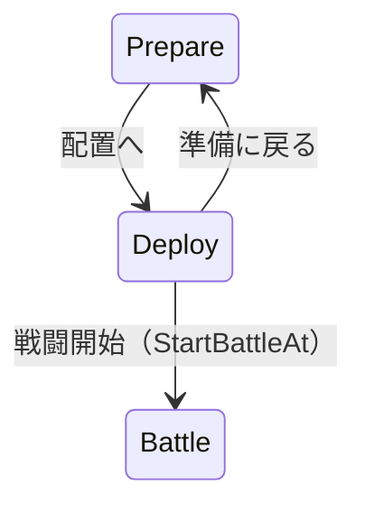

# 設計書（反復 3: 巻き戻しと出撃の配置）

- 文書 ID: DES-IT03
- 版: 0.1（案。開発者の確認を待っている）
- 作成日: 2026-10-22
- 対象: [反復 3 計画書](../iterations/it03/plan.md) の範囲の案
- 入力: SRS-001 v0.1、UC-DOC-001 v0.4、DES-IT01 v0.3、DES-IT02 v0.3、ADR-0002、IT01-RETRO v0.1 案、IT02-RETRO v0.1 案、E-35・E-36

反復 2 の設計書と同じく、変える部分と足す部分だけを書く。新規の要求は SRS に追加する案である。既存設計に対する本文の変更はすべて提案で、承認済みの設計を上書きしない。実装は確認と文書改訂のあとに行う。

補った判断には、[IT03-PLAN 9 章](../iterations/it03/plan.md#9-確認したい点) の Q-IT03-xx を付ける。同じ確認点を本書でも使う。以下の API 名・型・状態の分け方は、この案を具体化するための設計案で、独立した追加機能ではない。

## 1. 反復 1・2 の設計からの変更点

| 設計要素 | 反復 3 での扱い（提案） | 節 |
|---|---|---|
| DES-BTL-01 | Battle に履歴・残り回数・敵軍の進行位置を持たせる。外から読める履歴の値を足す | 4 章 |
| DES-BTL-02 | 通常の Act・EndPhase は従来どおり次の自軍の番まで進む。巻き戻した敵軍の途中を再開する口を足す | 4.2 節 |
| DES-RNG-01 | PCG の内部状態を履歴と一緒に戻す。命中・大盾・成長の引く順は変えない | 4.3 節 |
| DES-EVT-01 | 既存の出来事は表示に使う。履歴の戻り先と出来事の境界を対応付ける。表示用の Units だけから復元しない | 4.1・7.1 節 |
| DES-CMP-05、DES-CORE-01 | 出撃する名簿の並びと、置く枠の添字を分ける。主人公は名簿の先頭を保ち、枠は自由に選ぶ | 5 章 |
| DES-UI-02、04 | 巻き戻し一覧と確認を足す。再生中にも巻き戻しの入口を設ける | 7.1 節 |
| DES-UI-13、DES-UI-09 | 準備から配置へ進み、配置から戦闘を始める | 7.2 節 |
| DES-UI-15、17 | 勝敗の帯・敗北の選択からも、名簿への反映前なら巻き戻せる | 6・7.1 節 |
| DES-RWD-01〜04（新） | 履歴、戻す操作、乱数、回数と寿命 | 4 章 |
| DES-DEP-01（新）、DES-UI-19・20（新） | 配置の組み立て、巻き戻しの画面、配置の画面 | 5・7 章 |

攻撃・回復・経験・成長・敵の選択の規則は従来のままとする。セーブ形式と時機、定義データ、パッケージの依存先は増やさない。

## 2. アーキテクチャ

| パッケージ | 責務（案） | 依存してよい先 |
|---|---|---|
| `internal/core/tactics` | 戦闘の完全な写し、履歴、回数、巻き戻しと敵軍の続き。章や World の意味を知らず、一つの Battle の寿命だけを扱う | Go の標準ライブラリだけ |
| `internal/core` | 出撃する名簿と、枠の割り当てから Setup を作る。勝利を名簿へ反映する | `defs`、`core/tactics` |
| `internal/ui` | 行動の一覧、選択・確認・表示の巻き戻し、配置の仮の状態、結果を反映する前の入口 | `core`、`core/tactics`、`defs`、Ebitengine、bitmapfont |

- tactics に `Campaign`、章 ID、`World`、defs、ファイル、時刻、Ebitengine を持ち込まない（ADR-0002）
- 「章ごとに 10 回」は、core が章の戦闘を新しく作るとき Battle が 10 回から始まることで満たす。離脱・ロストの判定は巻き戻しの外にある（6 章）
- 配置は Setup を作る前に扱う。戦闘開始後の場所を直接書き換える口は作らない
- 失敗時の状態不変には、ゲームの値に加えて履歴・乱数・敵軍の進行位置・残り回数も含める（NFR-07）

## 3. 要求の追加案と定義データ

### 3.1 SRS に追加する要求の案

| ID（案） | 要求 | 根拠 | 優先度（案） | 検証（案） |
|---|---|---|---|---|
| FR-BTL-09 | 章ごとに 10 回、直前の行動からさかのぼり、好きな行動の前を選んで戦闘を巻き戻せること。敵軍の番の中も戻せること | E-35・E-36 | M | T・D |
| FR-CMP-11 | 戦闘開始前に、出撃するユニットの場所を出撃のマスの中で入れ替えられること | E-35。マスの制限は補った案 | M | T・D |

Q-IT03-02 で番号・優先度を確認する。FR-BTL-09 は、REV-002 で外した「出来事の記録」とは別の要求である。再利用を避ける判断になれば、本書と計画書・テストケース案の番号をまとめて変える。

### 3.2 定義データ

`MapDef.Slots` の座標を配置に使う。新しいキーは足さない。出撃の枠は通れる地形にあり、枠どうしと初めの敵に重ならないという検証を使う（DES-IT02 3.3 節）。巻き戻し回数はこの反復では 10 で固定する。章ごとの設定やルールの設定は作らない。

## 4. 巻き戻しの規則（core/tactics）

### 4.1 記録するもの（DES-RWD-01）

**推奨は、行動の前の状態の深い写しを持つ形**とする（Q-IT03-11）。初期 Setup と行動列からの再実行なら記憶量を抑えられるが、敵軍の途中で止める制御と、再実行時に履歴を重ねて作らない制御が要る。この規模では写しのほうが復元する値を確かめやすい。

| 記録 | 写す内容 |
|---|---|
| 戦闘の値 | Turn・Phase・Result、全ユニットの位置・HP・最大 HP・能力・レベル・経験・成長率・Acted・Alive・AI・武器（杖の残りを含む）・スキル・手持ち。倒れたユニットも添字を保つ |
| マップと増援 | 地形と増援の定義。変更しない値は Battle 内で共有してよいが、入力の Setup と外へ返す値からは独立させる。現れた増援は units に含める |
| 敵軍の続き | 番の開始処理を済ませたか、次に処理する敵の添字、番の開始前のユニット数（その番の増援を動かさないため）。番の終わりへ進む段階も区別する |
| 乱数 | PCG の内部状態。関数や rand.Rand のポインタの浅い写しを使わない（4.3 節） |
| 一覧用の値 | 戦闘内で単調に増える履歴 ID、ターン、陣営、行動の種類、行動者・相手の名前と添字、移動先、表示の出来事の開始・終了の境界 |

回数・次の履歴 ID・履歴そのものを写しに含めない。巻き戻して残り回数を取り戻したり、消した未来の ID が別の行動を指したりしないためである。手持ちなどのスライスも深く写し、`History()` や表示用の値を書き換えても実際の履歴と戦闘は変わらないようにする。

**戻る単位（Q-IT03-04・Q-IT03-06）**:

| 一覧の項目 | 一つにまとめる範囲 | 戻る位置 |
|---|---|---|
| 自軍の行動 | 1 体の移動＋攻撃・回復・回復薬・待機。反撃・追撃・倒れる処理・経験・成長・勝敗判定を含む | その移動の前。表示上の仮移動は含めない |
| 敵軍の行動 | 敵 1 体が選択して移動・攻撃する処理。反撃・追撃・経験・成長・勝敗判定を含む。動かなかった敵も「待機」の履歴を残す | その敵を処理する前。AI を Hold から Charge に変える前 |
| 自軍の番を終える | 明示した EndPhase、または全員行動済みによる自動の移行を区別して出す | 敵軍の番を始める前。自動移行なら再開時に自動で進む |
| 自軍の番の開始 | Turn を進め、Acted を戻し、砦を回復する処理 | 番の開始処理の前。再開すると一度だけ処理する |

敵軍の番の開始は「番を終える」の再開で、PhaseStart → 増援 → 砦の回復を一度だけ行う。New による最初の自軍の番の開始は先に済ませ、最初の自軍の行動前を最も古い戻り先とする。攻撃の 1 撃だけ、レベルアップの途中、増援 1 体だけは選べない。既存の出来事の種類や、動かない敵が出来事を出さない規則は変えず、履歴を別に持つ。

自軍の行動や EndPhase が失敗したときは、履歴も追加しない。検証の成功後、変更の直前に写しを作る。参照 API と予測、画面だけの移動と取消しも履歴に入れない。

### 4.2 戻す操作と敵軍の続き（DES-RWD-02）

| API（案） | 意味 |
|---|---|
| `History() []HistoryEntry` | 現在までの戻り先を古い順で返す。外から写しの内部へ触れない値だけを返す |
| `RewindsLeft() int` | 巻き戻しの残り回数を返す |
| `Rewind(id uint64) error` | 選んだ行動の前の状態に戻す。成功したら 1 回減らす。出来事の再実行はしない |
| `Resume() ([]Event, error)` | 巻き戻し先の保留した番の開始処理や敵軍の残りを、自軍が入力できる位置か勝敗まで進める |
| `NeedsResume() bool` | 自動で進める続きが保留されているかを返す |

`Rewind` は、次の順で検証する。

1. 残り回数が 1 以上である（`ErrNoRewinds`）
2. ID が今の履歴にあり、その行動が実行済みである（`ErrInvalidRewind`）。ない ID、消した未来の ID、未実行の行動を拒む
3. 保存した乱数の状態を含め、写しを一時的な状態へ復元できる（復元できなければ `ErrInvalidRewind` に理由を付ける）
4. 成功したら一度に状態を置き換え、選んだ項目とそれ以降の未来の履歴を捨て、残り回数を 1 減らす

履歴 ID は、同じ Battle で再利用しない。ID の検証のために公開の `Unit` の現在値などを頼らない。エラーは `errors.Is` で見分けられ、理由の文を付ける。失敗時は返す前に一時状態を捨て、現在の値・乱数・履歴・回数を一切変えない（DES-ERR-01）。

自軍の行動前に戻れば、そのユニットは再び行動前の値になり、別のコマンドを選べる。敵軍の行動前に戻れば `NeedsResume()` が真になる。自軍の行動は `ErrNotPlayerPhase` で拒み、再開ボタンで `Resume` を呼ぶ。敵軍が終わる前に自軍を操作できるようにはしない。

既存の `runEnemyPhase` を、番の開始・敵を 1 体進める・番の終わりの内部処理に分け、通常の `Act`・`EndPhase` と `Resume` が同じ処理を使う。通常は従来どおり全部を進めて出来事を返す。巻き戻したときだけ途中で保留する。既に動いた敵は再び動かさず、増援・砦の回復を二重に行わず、その番に現れた増援は動かさない。

自動移行の直前に戻った場合は自軍全員が行動済みのことがある。Phase が Player でも `NeedsResume()` を真とし、`Act`・`EndPhase` は `ErrResumeRequired` を返す。`Resume` は保留がなければ `ErrNoPendingResume` を返す。どちらも状態を変えない。自軍の番の開始前への復帰も同じ口で続ける。

**制限（確認待ち）**: 敵軍の途中に戻しても敵の選択はシステムが行う。同じ状態と乱数から再開すれば同じ結果になる。別の結果を得るためには、より前の自軍の行動へ戻り、位置・相手・順などを変える。敵軍の途中で戻れるという E-36 を、この操作で満たすかを Q-IT03-04 で確認する。

### 4.3 乱数（DES-RWD-03、DES-RNG-01 の変更案）

推奨は**乱数も行動前へ戻す**案とする（Q-IT03-04）。復元した状態で同じ行動を選ぶと、命中・大盾・成長も同じ結果になる。予測・一覧の閲覧・取消し・失敗で乱数を引かない。

- Battle は `rand.NewPCG(seed, 0)` の PCG を明示的に所有し、それを `rand.New` に渡す。PCG の `MarshalBinary` で内部状態を保存し、別の PCG の `UnmarshalBinary` で復元してから Rand と `roll` を結び直す案とする
- `rand.Rand` や `roll` の関数値をコピーしても、元の乱数源を共有するので復元にはならない。保存したバイト列も深く写す
- 攻撃と大盾のあとに成長を引く順は DES-IT02 のまま。乱数のアルゴリズムを変えず、巻き戻しを使わない既存の列を保つ
- テストの差し替えは公開 API に出さない。写しを検証するテストは実際の PCG で行う。固定列の差し替えが必要なら、テスト専用の口で列と位置を一緒に保存・復元し、本番の PCG の検証を置き換えない

依頼で示された、天刻の拍動では同じ行動でも別の結果になりうる点を考えると、巻き戻し後に別の乱数列へ進む案もある。その場合でも、初期 seed・成功した巻き戻し回数・戻り先などを入力として列を決めれば NFR-06 を守れる。ただし、当たるまで同じ行動を選ぶ使い方を促す。今回は行動を考え直す目的を優先し、同じ結果を推奨する。実作品の細かな再現は要求として確定していない。ネットワークで実作品の仕様は検証していない。

### 4.4 回数と寿命（DES-RWD-04）

| 場合 | 扱い（Q-IT03-05・Q-IT03-06） |
|---|---|
| 新しい Battle | 残り 10 回。章のやり直し・ロードからの出撃も新しい Battle とする |
| 成功した巻き戻し | 1 手でも 20 手でも 1 回減らす。戻り先の写しから残り回数を復元しない |
| 取消し・失敗・閲覧 | 回数も戦闘も変えない |
| 0 回 | 一覧の閲覧はできるが確定できない。core でも `ErrNoRewinds` を返す |
| 勝ち負けが決まった直後 | まだ Campaign に反映していなければ戻せる。主人公・ボスが倒れる前の行動へ戻すと Result も Ongoing に戻る |
| 章の結果に進む・タイトルに戻る | UI が Battle と履歴を破棄する。次の章へ履歴を持ち越さない |
| セーブ | 履歴・回数・配置を入れない。章の始めの既存形式だけを使う |

その戦闘の全履歴を持ち、古い行動を黙って落とさない（Q-IT03-11）。記憶量は概ね「行動数 × 状態の大きさ」で増える。長く待機する例と本体の 3 章で、履歴数・使用量・一覧と復元の待ち時間を測る。固定の性能基準や保持上限は今回の案では決めない。問題があれば測定値を示して設計変更を提案する。

## 5. 出撃の場所の入れ替え（core）

### 5.1 配置を渡す口（DES-DEP-01、DES-CMP-05 の変更案）

既存の `StartBattle(members, seed)` は、主人公が先頭、あとは渡した順に枠へ置く動きを保つ。新しい `StartBattleAt(members []int, slots []int, seed uint64)` を足す案とする。返す値は既存と同じ `*Sortie`・`[]tactics.Event`・`error` とする（Q-IT03-07）。

- `members[i]` の名簿のキャラを、マップの `slots[slots[i]]` の座標に置く
- `members[0]` は主人公のままとする。場所の交換で `members` や tactics のユニットの順を並べ替えない。`Units()[i]` と `Sortie.Members[i]` の対応を保ち、`FinishChapter` が別人へ成長を戻すことを防ぐ
- 主人公も枠の 1 番目以外へ置ける。出撃しないキャラは置けない。枠が余れば未使用の枠も選べる
- 検証は既存の順（クリア済み → 人数 → 名簿の範囲・生死・重複 → 主人公が先頭）のあと、`len(slots) == len(members)`、全要素が枠の添字の範囲内、同じ枠が 2 回ない、の順に行う。違えば `ErrInvalidDeployment` に理由を付ける
- 全検証の成功後に Setup を組み立て、tactics.New を呼ぶ。Campaign・入力の配列・既存の Sortie は変えない。tactics.New が失敗しても Campaign を変えない
- 旧 StartBattle は slots を 0、1、…として共通の組み立てを使う。core.NewBattle の従来の配置も保つ。初期配置を作ってから戦闘中の Unit.Pos を外から変える方法は採らない

### 5.2 配置の仮の状態

準備で出撃者と手持ちを決めてから配置する。配置中には Battle を作らず、初回の乱数や砦の回復を先に進めない。配置の状態は ui が `members` と枠の添字の写しとして持つ。場所の交換自体では Campaign の値を変えない。

例: `members = [主人公, ガルド, リナ]`、`slots = [2, 0, 4]` なら、主人公を枠 3、ガルドを枠 1、リナを枠 5 に置く。ユニットの添字は主人公 0・ガルド 1・リナ 2 のままである。ガルドとリナを交換すると slots は `[2, 4, 0]` になる。

## 6. キャンペーン・セーブとの境界

巻き戻しでは Campaign を書き換えない。経験・レベル・能力・消耗品・生死・杖の回数は Battle の写しで戻る。名簿への書き戻し・ロストによる戦死・報酬は、巻き戻したあとの最終的な勝利に対して従来どおり一度だけ行う（DES-CMP-06）。

- 勝利の帯を押して FinishChapter に成功したら、それ以降は戻せない。UI が結果に移るとき履歴への入口を閉じる
- 主人公の敗北からゲームオーバーの選択へ移るときは、Battle をまだ保持する。「巻き戻す」を足し、成功すれば戦闘の場面へ戻す。「この章をやり直す」「タイトルへ」を選ぶと保持した Battle を破棄する（Q-IT03-06）
- 敵軍の反撃でボスが倒れた場合も、勝利の反映前なら戻せる。戻した未来の勝利・経験の表示や結果通知を再利用しない
- 章の始めのメモリ上のセーブは従来どおり残す。負けた章を最初からやり直す操作と、現在の戦闘の行動前へ戻る操作を別の表示にする
- セーブ version は上げず、履歴や途中の位置は保存しない（Q-IT03-05）

既存 UC-01・02・05〜07・11・13 の改訂と、巻き戻しのユースケース（次の空き UC-14 案）を、人の確認後に別に書く。ここでは use-cases.md を変更しない。

## 7. 画面（ui）

### 7.1 巻き戻しの一覧（DES-UI-19）

開き方と操作は Q-IT03-06・Q-IT03-12 の案とする。窓の大きさは 832 × 576 のまま使う。

- 戦闘の案内に「巻き戻し 残り n/10」のボタンと「T: 巻き戻し」を出す。通常の選択中に開いた場合は仮の移動と選択をいったん保持し、取消しで元の入力状態に戻す
- Playing でも T とボタンを受け付け、再生位置・フレーム数・表示の写しを保存して一時停止する。取消しならその位置から再開する。既存の「再生中は早送り以外の入力を受け付けない」からの変更案である
- 履歴 ID と返した出来事の境界を対応付け、表示が始まった項目までを一覧に出す。内部ですでに計算した未来の敵の行動や結果は見せない。実行中の攻撃は、その攻撃全体の前へ戻せる
- 表示済みの通常の戦闘記録は UI の各履歴の境界と結び、巻き戻した行動以降を捨てる。表示済みの枠・敵の選択・予測・ポップアップ・レベルアップの帯・勝敗の帯・番終了の確認も成功時に消す。危険範囲の表示設定は保ち、復元した盤面で計算し直す

```text
┌──────────────────────────────────────────────────┐
│ 巻き戻し　残り 8/10                               │
│ 選んだ行動の「前」に戻る                          │
│  1T 自軍 レオン　移動・攻撃 → ソルジャー           │
│  1T 自軍 リナ　回復 → レオン                      │
│  1T 自軍 番を終える                              │
│ >1T 敵軍 ファイター　移動・攻撃 → ブラン           │
│ …                                      [前][次]  │
│ 戻すと、この行動から先を取り消す。残り 8 → 7      │
│                               [戻る] [この前へ]  │
└──────────────────────────────────────────────────┘
```

- 一覧は古い順で 1 ページ 8 行。開いたときは最新の行が見えるページで、その行を選ぶ。行のクリックまたは上下キーで選び、前・次のボタンか PageUp・PageDown で送る。先頭と末尾で止める
- 行はターン・陣営・名前・行動・相手を出す。長い名前は欄幅に合わせて省略し、選んだ行の詳細で折り返して全文を見せる。行の文字数と配置は描画と分けてテストする
- 「この前へ」か Enter は確認を開く。「この行動から先を取り消して戻りますか。残り n → n−1」と、「戻す」「やめる」を出す。クリックまたは確認の Enter で一度だけ Rewind を呼ぶ
- 右クリック・Esc と「戻る」は取消し。確認中の取消しは一覧に戻る。回数 0 なら理由を出して確定ボタンを無効にする。履歴がなければ「戻せる行動がありません」と出す
- 誤りは一覧に理由を出し、元の入力・再生・表示を保つ。成功したときだけ保留した入力と未来の再生列を消し、復元した Battle の値で描き直す。入力を押し続けても再度消費しない
- `NeedsResume()` が真なら「敵軍の行動を再開」または「番の処理を再開」を出す。クリック・Enter で Resume し、返した出来事を Playing で再生する。再開前にも一覧へ戻れる。続きのない自軍の行動前なら Idle にする
- Over とゲームオーバーの選択にも入口を出す。取消しでは元の勝敗の表示に戻り、巻き戻しの取消しで次の章や準備へ進まない

### 7.2 出撃の配置（DES-UI-20、DES-UI-13 の変更案）

Q-IT03-07・Q-IT03-12 の案とする。



- 準備の「出撃」を「配置へ」に変え、配置に入る。最初は主人公を先頭、あとは名簿順で、枠 1 から順に置く
- 左に既存のマップ・地形・出撃の枠・出撃者と初めの敵を描く。まだ現れていない増援は出さない。右に選んだ味方の情報、下に交換の案内を出す。敵も見せ、地形と初めの敵に応じて場所を選べる案とする
- 出撃の枠は色と枠線で示す。味方をクリックして選ぶと選択の枠を付け、別の味方をクリックすると場所を交換する。空いた出撃のマスならそこへ移す。選んだ本人を再度クリックすると選択を解除する
- 枠外・敵・壁のクリックでは位置を変えず、「出撃のマスを選んでください」と出す。右クリック・Esc は選択中なら解除、未選択なら準備へ戻る。ボタンでも「準備に戻る」を選べる
- 準備に戻ると仮の配置を捨て、次に配置へ入ると最初の並びから始める。手持ちの変更は従来どおり Campaign に残る
- 「戦闘開始」だけで StartBattleAt を呼ぶ。seed はこのとき一度だけ NextSeed から取る。配置の閲覧と交換で NextSeed を呼ばない
- 出撃に失敗したら配置の画面に理由を出し、配置と Campaign を変えない。成功時に Sortie を保持して、New の出来事を従来どおり再生する
- 開始後に配置へ戻る操作は作らない。巻き戻しの最初の戻り先も、配置を確定したあとの最初の行動前である

## 8. 設計と要求・テストの対応

### 8.1 要求との対応

| 要求 | 設計 |
|---|---|
| FR-BTL-09（案） | DES-RWD-01〜04、DES-UI-19 |
| FR-CMP-11（案） | DES-DEP-01、DES-UI-20 |
| FR-CMP-03 | DES-CMP-05 の変更案、DES-DEP-01、DES-UI-13 の変更案 |
| FR-CMP-09 | DES-MAP-04 は維持。DES-UI-15・17 の変更案、DES-UI-19 |
| IF-01、IF-02 | DES-UI-19・20 |
| NFR-04、NFR-05 | DES-NFR-01 を継続。tactics は標準ライブラリだけ |
| NFR-06 | DES-RNG-01 の変更案、DES-RWD-03 |
| NFR-07 | DES-RWD-02、DES-DEP-01、DES-ERR-01 |
| NFR-09 | DES-NFR-03 を継続 |

### 8.2 テストケースの案

この表はテスト仕様書ではない。承認した要求 ID で、実装時に `test-spec-it03.md` の前提・入力・期待結果を詳しくし、コードとトレーサビリティに対応付ける。乱数・失敗時の状態不変も、まず新規要求のケースに含める。

| ID（案） | 設計 | 確かめること |
|---|---|---|
| TC-FR-BTL-09-01 | DES-RWD-01・02 | 移動と攻撃・反撃・追撃をまとめて行動前へ戻す。位置・HP・生死・Acted・勝敗と添字が戻る |
| TC-FR-BTL-09-02 | DES-RWD-01・03 | 経験・レベル・全能力・最大 HP と今の HP・成長結果が戻る。HP の成長で増えた分も消える |
| TC-FR-BTL-09-03 | DES-RWD-01 | 回復薬の消費、杖の回数、回復する側の経験、回復された味方の HP が戻る。手持ちと履歴の写しは独立する |
| TC-FR-BTL-09-04 | DES-RWD-02 | 敵 A と B がいる番の B の行動前へ戻す。A は再実行せず、B から続く。動かない敵も選べる。Hold の変化も戻る |
| TC-FR-BTL-09-05 | DES-RWD-01・02 | 番の開始前と開始後へ戻す。増援・ふさがれた増援・砦の回復・Acted・Turn を戻し、再開で二重に処理しない。その番の増援は動かない |
| TC-FR-BTL-09-06 | DES-RWD-03 | 実際の PCG で攻撃・大盾・成長を含む行動を戻し、同じ行動の出来事と結果が一致する。複数回の戻り、同じ seed と巻き戻しを含む同じ入力列も一致する |
| TC-FR-BTL-09-07 | DES-RWD-04 | 1 手と複数手で各 1 消費。10 回目は成功して 0、11 回目は ErrNoRewinds。古い写しに戻しても回数は増えない |
| TC-FR-BTL-09-08 | DES-RWD-02 | 不正・消した未来・未実行の ID、残り 0 の優先順、復元失敗で、状態・PCG・履歴・回数・続きが変わらない。Resume の不正な呼び出しも同じ |
| TC-FR-BTL-09-09 | DES-RWD-01・02 | 戻した項目以降を捨て、別の行動には新しい ID を付ける。予測・無効な Act・取消しで履歴も乱数も増減しない |
| TC-FR-BTL-09-10 | DES-RWD-04、6 章 | 主人公敗北とボス撃破から反映前に戻れる。巻き戻した後の勝利だけを名簿に一度反映し、報酬を重ねない。章のやり直し・次章・ロードは 10 回で履歴なし |
| TC-FR-BTL-09-11 | DES-UI-19 | ボタンと T、一覧の並び、8 行のページ境界、選択、確認、取消し、0 回と履歴なしの表示を入力のテストで確認する |
| TC-FR-BTL-09-12 | DES-UI-19 | Playing を一時停止して、表示地点以降の未表示の行動を隠す。取消しで同じ再生位置へ戻り、成功で未来の表示・選択・帯を消す。キーの押し続けで二重消費しない |
| TC-FR-BTL-09-13 | DES-UI-19 | 敵軍と自動移行の前へ戻ると再開だけを許す。保留中の Act・EndPhase を拒む。Over・敗北の選択から戻せ、取消しで元の場面を保つ |
| TC-FR-BTL-09-14 | DES-UI-19 | 手動: 戻る前後の盤面、行動名・ターン・回数、長い履歴、回復と成長の表示を見分け、意図した行動前へ戻れる |
| TC-FR-CMP-11-01 | DES-DEP-01 | 主人公を含む 2 人の場所を交換する。出撃のマス以外へ置かず、名簿・ユニットの添字は保つ |
| TC-FR-CMP-11-02 | DES-DEP-01 | 主人公だけの出撃、枠いっぱい、空き枠への移動、枠の最小・最大の添字を通す |
| TC-FR-CMP-11-03 | DES-DEP-01 | 長さ違い・負・範囲外・重複の枠、不正な名簿・戦死・主人公なし・クリア済みを、ほかの誤りで隠れない入力で拒む。Campaign と入力が変わらない |
| TC-FR-CMP-11-04 | DES-DEP-01、6 章 | 場所を交換したキャラの経験・能力・生死・手持ちを、勝利時に元の正しい名簿へ返す。配置がセーブに入らない |
| TC-FR-CMP-11-05 | DES-UI-20 | 配置へ入る、交換、空き枠、本人で解除、枠外の理由、取消し・準備への戻りと配置初期化、開始失敗で配置を保つ、成功後は戻らない |
| TC-FR-CMP-11-06 | DES-UI-20 | 配置の選択・交換では NextSeed を呼ばず、戦闘開始の一度だけ呼ぶ。最初の番の回復も一度だけ |
| TC-FR-CMP-11-07 | DES-UI-20 | 手動: 出撃の枠と選択中の味方を見分け、交換と空き枠への移動、敵・地形の表示、開始と準備への戻りが分かる |

Q-IT03-08 を採るなら、REV-033 I-01 の緑の範囲・枠・「+7」と僧侶・杖の手動ケースを、既存の要求の次の未使用番号で追加する。番号は実装直前にテスト仕様書の最新状態と照らして決める。NFR-03 の Linux 手動ケースは既存 TC-NFR-03-04 を使い、新しい番号を作らない。

### 8.3 書き換える既存のテスト

ID を保ち、既存の規則の確認を弱めない。以下は影響を受けるケースの表で、すべてのテストを新しい API に置き換える指示ではない。

| Issue 案 | 既存のテスト | 変更・確認の内容 |
|---|---|---|
| 1・2 | TC-NFR-06-01〜06、TC-NFR-07-05 | PCG の保存・復元を加えても巻き戻しなしの乱数列を保つ。新しい誤りの識別を足す。固定列の差し替えは実 PCG の試験と分ける |
| 2 | TC-FR-BTL-02-01〜07、TC-FR-BTL-07-01〜18、TC-FR-MAP-03 の既存ケース、TC-FR-CMP-09-06 | 通常の Act・EndPhase の出来事・勝敗・増援・砦・敵の順は変えない。必要なら内部の差し替え口だけを合わせる |
| 3 | TC-FR-CMP-03-01〜03、TC-FR-CMP-10-01 | 旧 StartBattle の検証と配置を保つ。新しい口は新規ケースで確かめる。結果の名簿への対応を確認する |
| 4 | TC-IF-01-12・13、TC-FR-CMP-02-02、TC-FR-CMP-09-07 | Playing・Over で T と巻き戻しボタンを許す。従来の無効な入力と早送り、クリックによる結果の反映、章のやり直しの確認を残す |
| 5 | TC-FR-CMP-03-07〜11 | 出撃選択・アイテムの準備の確認を残し、「出撃」を押して即戦闘となる期待値を「配置へ」に合わせる。配置を経て開始後は準備へ戻らない |
| 4・5 | TC-FR-UNT-09-12、既存の手動ケース | ボタン・案内と情報欄が 832 × 576 に収まることを確かめる。緑の回復、撃破・危険、レベルアップを回帰確認する |

## 9. 実装の分け方（Issue の案）

番号は表の番号で、GitHub の Issue 番号ではない。要求・設計と確認点の承認、SRS・ユースケースの必要な改訂を、全 Issue の前提とする。

| # | Issue | 要求・設計 | 依存 | 完了条件 |
|---|---|---|---|---|
| 1 | tactics の状態の写し・PCG・履歴の土台 | FR-BTL-09 案、NFR-06・07 / DES-RWD-01・03 | なし | 深い写しと乱数の復元、履歴 ID と表示境界を内部で確認する。既存の進行は変えず、途中の公開機能を未完成のまま出さない |
| 2 | 巻き戻し・回数・敵軍の途中からの再開 | FR-BTL-09 案 / DES-RWD-02・04、DES-BTL-02 の変更案 | 1 | Rewind・Resume と誤り、敵軍の続き、分岐後の未来の破棄、状態不変を確認する。回帰の番・AI・増援テストも通す |
| 3 | core の出撃枠の割り当て | FR-CMP-11 案、FR-CMP-03 / DES-DEP-01 | なし | 検証・空き枠・主人公の交換・名簿への結果の対応を確認し、旧 API の配置も保つ |
| 4 | 巻き戻しの一覧・確認・再生・敗北からの復帰 | FR-BTL-09 案、IF-01 / DES-UI-19、6 章 | 2 | 再生の一時停止と未来の非表示、回数・確認・取消し、結果反映前の入口と復帰を確認する |
| 5 | 配置の画面と準備からの遷移 | FR-CMP-11 案、IF-01 / DES-UI-20 | 3、4 | 配置・準備への戻り・戦闘開始を確認する。4 と同じ ui の場面と入力を変えるので順に取り込む |
| 6 | 手動確認と小さな文書整備、遊んだ評価 | QA-02・03、FR-UNT-09、FR-BTL-08 / 8 章、Q-IT03-08・09 | 5 | 承認した説明の追記、手動ケースの追加と結果、Linux の実施または未実施の理由、H-09〜H-11 と残る評価を振り返りに記録する |

1 と 3 は独立に進められる。Issue 6 へ単体テストを先送りせず、各担当がその Issue のテスト仕様書・コード・トレーサビリティの担当行を更新する。Issue 6 で直す既存設計の追記も、人の承認を前提にする。

取り込みでは、変更した TC と要求の行を双方の内容と照らす。列数・閉じの区切り・表の中の空行を確認する。tccheck が通るだけで表の表示を確認済みにしない（REV-031 F-01、REV-033 F-01・F-02）。

## 10. 確認したい点

本書の判断は IT03-PLAN 9 章の Q-IT03-01〜12 に集約する。とくに、同じ行動なら同じ結果を推奨する点、敵軍の途中からは自軍が操作できず同じ進行になる点、主人公敗北直後にも使える点、主人公を枠の先頭以外へ置く点は既存の説明に対する変更の提案である。

- E-35・E-36 の文面と要求 ID: Q-IT03-01・02
- 僧侶の絵と小さな課題、Linux、ADR の扱い: Q-IT03-03・08〜10
- 戻す単位・乱数・敵軍の再開、回数と保存、使える時機: Q-IT03-04〜06
- 配置の範囲・主人公・画面: Q-IT03-07・12
- 写しの方式と全履歴の保持: Q-IT03-11

推奨と理由は計画書の同じ行を使う。承認前にコード・既存設計・SRS・ADR を変更しない。

## 11. 変更履歴

| 版 | 日付 | 内容 |
|---|---|---|
| 0.1 | 2026-10-22 | 初版（案）。状態と乱数の写し、敵軍の続き、回数と寿命、配置と名簿の対応、画面、既存テストの影響とテストケース・Issue の案を下書きした |
