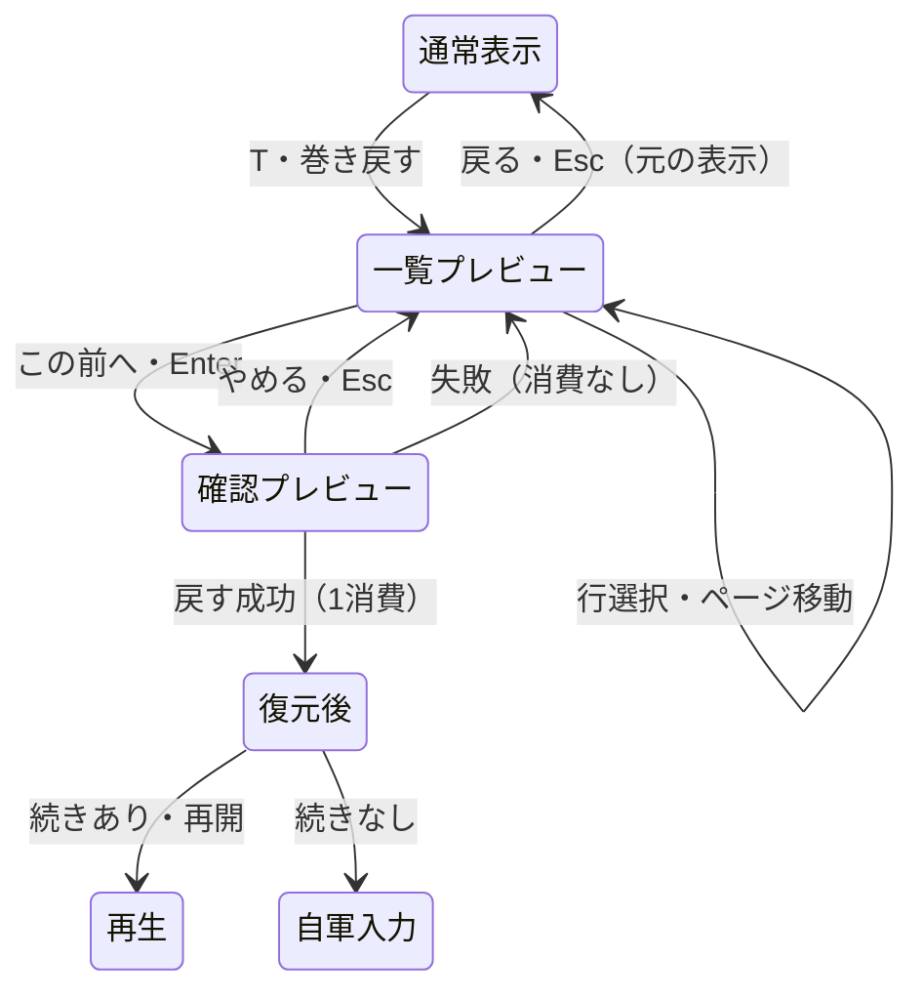
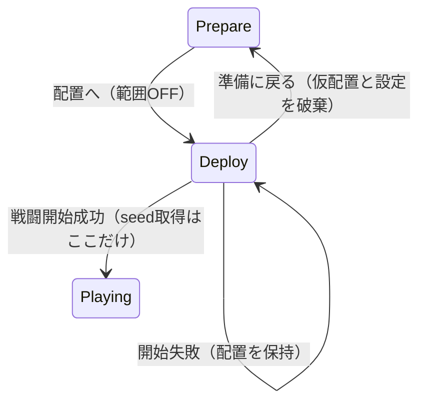

# 設計書（反復 4: 戻り先と戦況の見通し）

- 文書 ID: DES-IT04
- 版: 0.1（案。人の承認待ち）
- 作成日: 2026-10-23
- 対象: [反復 4 計画書](../iterations/it04/plan.md) v0.1 の提案範囲
- 入力: SRS-001 v0.2、UC-DOC-001 v0.5、DES-IT01・IT02 v0.4、DES-IT03 v0.3、IT03-PLAN v0.2、IT03-RETRO v0.1、ADR-0002、E-32・E-39・E-40、REV-034〜041、現行の巻き戻し・配置・範囲計算と同梱素材

変更・追加する部分だけを書く。本書の API 名・型・状態遷移も提案であり、承認済みの決定ではない。確認点は [IT04-PLAN 9 章](../iterations/it04/plan.md#9-確認したい点) の Q-IT04-01〜08 と共通。以下は推奨案を具体化した設計である。承認後の要求・UC 改訂は別 Issue で行う。

## 1. 既存設計からの変更点

| 設計要素 | 反復 4 の追加・変更案 | 節 |
|---|---|---|
| DES-RWD-01〜04 | 履歴・乱数・回数・再開の規則は維持。行動前の写しを参照する口を追加する | 4 章 |
| DES-RWD-05（新） | 消費・復元を行わないプレビュー取得 | 4.1 節 |
| DES-BTL-03、DES-CORE-01、DES-CMP-05 | 範囲計算と配置用変換を参照用途でも共用する | 2・5 章 |
| DES-DEP-02（新） | 戦闘を作らない配置の盤面と範囲の組み立て | 5 章 |
| DES-MAP-03 | 出現時機・占有時の不出現・定義順・出現した番には動かない規則を維持する | 6 章 |
| DES-RNF-01（新） | 増援定義から、進行位置に対応した予兆の領域を導く | 6.1 節 |
| DES-UI-05・06・19 | クラスに応じた騎兵の絵と、盤面を覆わない巻き戻し表示 | 7.1・7.2 節 |
| DES-UI-08・20 | 配置で敵の範囲を表示し、仮配置の占有を反映する | 5・7.3 節 |
| DES-UI-21〜24（新） | プレビュー、騎兵の絵、配置の範囲、増援の予兆の表示 | 7 章 |

既存の UI 番号は 20、RWD は 04、DEP は 01 まで使われている。RNF は未使用のため 01 から始める。増援の既存設計 ID は DES-MAP-03 であり、置き換えない。DES-UI-19・20 等の承認済み原本は本案では変更しない。

## 2. アーキテクチャ

### 2.1 分担と依存（Q-IT04-02）

| パッケージ | 担当 | 依存 |
|---|---|---|
| `internal/core/tactics` | 操作を持たない盤面参照値、履歴プレビュー、共通の移動・射程計算、予兆の抽出 | Go 標準ライブラリだけ |
| `internal/core` | 目録・名簿・出撃枠から配置用の正しい盤面を組み立てる。実出撃と検証・変換を共用する | `defs`、`core/tactics` |
| `internal/ui` | 一覧の選択・確認・取消し、参照する盤面の切替、絵の選択、配置の範囲と予兆の描画・入力 | `core`、`core/tactics`、`defs`、Ebitengine、bitmapfont |
| `internal/ui/assets` | 同梱画像と番号、騎兵の代案の素材記録 | 既存の読み込みの範囲 |

tactics はクラス ID・章・World・defs・画面色・日本語の案内文を新しく知らない（ADR-0002）。core は表示の選択や Q キーを持たず、ui は経路探索や増援の出現可否を独自に実装しない。プレビュー・配置表示で seed を取得せず、実時間・乱数・出来事の進行を使わない。

### 2.2 盤面参照値（DES-RWD-05、DES-DEP-02）

型名の案を `BoardView` とする。内部に地形とユニットを持ち、`Units`・`TerrainAt`・幅・高さ・`Reachable`・`AttackRange` を参照できる。`Act`・`EndPhase`・`Resume`・`Rewind` は持たず、PCG・履歴・回数も含めない。ユニットと Items を含む可変の配列は深く写す。返す配列も元の戦闘・履歴・参照値の内部と独立させる。地形を内部で共有する場合は書き換え口を作らず、外に返すときは独立させる。

範囲計算は `move.go` の現行アルゴリズムを内部の共通処理へ切り出し、Battle と BoardView が同じ処理を呼ぶ。移動費・味方の通過と停止・敵の通過不可・倒れたユニットの非占有、武器の最小〜最大射程、盤外の除外を変えない。範囲計算は状態・乱数を変えない。

配置から BoardView を作る入口の案は `NewBoardView(setup Setup)`（参照値と誤りを返す）。入力を検証して独立させるだけとし、`tactics.New`、番の開始、砦の回復、PCG の作成・取得、増援配置は行わない。Setup の初期 Units のみを最大 HP・Alive の状態へ変換する。初期入力の検証と UnitSetup の変換は戦闘の初期化と共用する。表示を作れない場合は誤りを返し、既存の配置・名簿に触れない。

現戦闘を参照する入口の案は `Battle.BoardView()`。現在値の独立した参照値を返す。履歴用・現在用の参照値には予兆の領域も含められるが、予兆の算出は 6 章による。配置用の参照値には予兆を含めない。

### 2.3 現行実装との照合箇所

| 箇所 | 案の根拠となる現状 |
|---|---|
| `internal/core/tactics/history.go`・`snapshot.go`・`rewind.go` | before は完全な写し、残り回数は写しの外。Rewind は成功後に未来を捨てる。参照用 API はまだない |
| `internal/core/tactics/move.go`・`act.go` | 移動・射程は Battle の参照処理。増援は敵軍開始時、占有時は不出現・再試行なし。その番の増援を動かさない |
| `internal/core/battle.go`・`campaign.go` | 共通の敵・地形・Setup の変換があり、StartBattleAt は名簿順と slots を分けて検証している |
| `internal/ui/rewind.go`・`game.go` | 8 行の一覧と確認を持つが、パネルが盤面の大半を隠す。取消しで元の入力を保つ |
| `internal/ui/deploy.go`・`input.go`・`tiles.go`・`scene_view.go` | 配置の敵には HP と位置等しかなく、戦闘の範囲計算に必要な武器・移動力がない。絵は武器別、加入表示はクラス情報を渡していない |
| `internal/ui/assets/README.md`・同梱 PNG、`data/base/maps.toml`・`classes.toml` | 素材の出典・番号、cavalier と armor の武器の共通性、既存 9 件の増援定義を照合した |

## 3. 要求の改訂案と定義データ

### 3.1 改訂の前提

[IT04-PLAN 3 章](../iterations/it04/plan.md#3-対象の要求) の SRS・UC 改訂案を正とする。既存の FR-BTL-10・FR-CMP-11・FR-UNT-09・FR-MAP-03 を詳細化する案で、新しい要求 ID を予約しない（Q-IT04-08）。騎乗素材不足を解決せずに「馬に乗った絵」を満たした文面へ改訂しない。Q-IT04-03 の回答に応じて本書と後続の要求改訂を合わせる。

### 3.2 定義データとセーブ

`maps.toml` の既存 Reinforcements の Turn と Unit.Pos、初期敵、Slots を使う。`classes.toml` の cavalier は槍・移動 7、armor は槍・移動 4 のまま。能力・ボーナス・出撃人数・出現値は変更しない。予兆用の TOML キーや表示用クラス ID は追加しない。

現在の増援は次のとおり（座標は 0 始まり。これは設計と試験の対応用で、画面には出さない）。

| マップ | 出現ターンとマス | 推奨案で予兆を出し始めるターン |
|---|---|---|
| ch01 | 3T (0,3)・(0,4)、5T (15,15) | 2T、4T |
| ch02 | 2T (0,4)、3T (0,10)、4T (0,7) | 1T、2T、3T |
| ch03 | 3T (0,14)・(15,14)、5T (4,2) | 2T、4T |

章開始のセーブ形式・版・保存時機は変えない。仮配置・表示設定・プレビュー・予兆の既読状態を保存しない。予兆は戦闘値から毎回導くため、独立した既読フラグを設けない。

## 4. 巻き戻しの盤面プレビュー（core/tactics）

### 4.1 取得の契約（DES-RWD-05、Q-IT04-02）

入口の案は `PreviewRewind(id uint64)`。参照値と誤りを返す。返す内容は、その実行済み履歴の `before` から作る BoardView、実際の Turn・Phase・Result、保留した自動進行の有無と予兆の領域である。履歴の内部型 `phaseProgress` や `battleSnapshot` は公開しない。

- `Rewind` と同じく、現在の戦闘内の実行済み ID だけを受け付ける。未実行・不正・捨てた未来の ID は既存の `ErrInvalidRewind` で識別できる誤りにする
- 閲覧には残り回数の検証をしない。0 回でも実行済み ID のプレビューは取得できる。`ErrNoRewinds` の優先順を変えるのは Rewind ではなく、新しい参照 API に限る
- 元の Battle を restore したり、一度 Rewind して戻したりしない。写しを直接参照用に変換し、乱数状態の復元・再実行もしない
- 表示に必要な位置・HP・最大 HP・能力・レベル・経験・手持ち・杖回数・生死・行動済み・AI・クラス名をすべて写す。未出現増援を Units に足さない。倒れたユニットも添字を保つが描画しない
- 読み出し成功・失敗、返り値の外部変更のいずれでも、元の戦闘・PCG・履歴・次の ID・出来事の通し位置・回数・進行位置は変わらない
- 読み出せないときは UI に理由を出し、その選択の確定を無効にする。別の行の古いプレビューを選択した行の状態として見せない

`HistoryPlayerStart` の行は次の自軍ターンをラベルに持つが、before は Turn を進める前の敵軍末尾である（`history.go`）。盤面の表示は写しの実際の値を採り、行のラベルは従来の値を保つ。「自軍の番を始める前」と「盤面: 2T 敵軍」のように区別する。名前やラベルから Turn・Phase を推定しない。

### 4.2 状態と寿命

| 状態 | 本物の戦闘 | UI が表示する盤面 | 廃棄・確定 |
|---|---|---|---|
| 一覧を開く前 | 現在値 | 通常どおり。Moved では仮移動も含む | 入力状態を保持 |
| 一覧・確認中 | 現在値のまま | 選択した履歴 ID の before | 選択変更でその 1 件だけ取得し直す |
| 確認を取り消す | 変更なし | 選択中の before のまま | 一覧へ戻る |
| 一覧を取り消す | 変更なし | 保持した入力状態による元の表示 | プレビューだけ捨てる |
| Rewind が失敗 | 変更なし | 有効な before と誤り。無効 ID なら盤面を空表示にする | 一覧に戻り、元の入力は保持 |
| Rewind が成功 | before へ復元し、未来を破棄、回数 −1 | 復元された本物の盤面 | プレビューと保留入力・未来の再生列・選択・勝敗の帯を捨てる |

UI に残すのは選択 ID と 1 件の表示用写し。行を移るたび全履歴を複製せず、描画フレームごとにも再取得しない。戦闘が変わったらキャッシュを無効にする。成功時の処理は既存 `RewindEnter` に集約する。Enter の押し始めを一度ずつ受け、長押しやクリックの持ち越しで二重に消費しない。

敵軍の途中、番の境界、勝敗からの入口・取消し・Resume と、Campaign に反映する前という制限は DES-IT03 のまま。プレビューで Result が Ongoing に見えても GameOver から勝手に Battle へ遷移しない。`syncRewind` は本物の成功後だけに適用する。

## 5. 配置と範囲の参照（core・tactics）

### 5.1 配置用の組み立て（DES-DEP-02、Q-IT04-02）

core の入口の案を `Campaign.DeploymentView(members, slots)` とし、BoardView と誤りを返す。`StartBattleAt` と同じ出撃者・枠の検証、現在名簿の能力と手持ち、主人公必須・名簿順を使う。内部の Setup 組み立てを共用し、最後の `tactics.New` の代わりに NewBoardView へ渡す。

`setupWithAllies`・`enemyUnit`・`enemyNames`・地形／武器／AI の変換を共用する。敵はクラス基礎値＋配置 Bonus の全 Stats、名前・ClassName・Weapon の射程・AI・Boss・Items を持ち、HP は最大から。今の `deploy.go` の HP だけの敵と UI 内の地形変換の写しはこの入口に置き換える（REV-040 G-01）。増援は初期 Units に入れず、範囲も予兆も出さない。

操作中の members は名簿の順のまま、交換するのは slots だけ。仮配置の変更で BoardView を作り直す。表示の組み立てに失敗したら理由を出し、範囲を消して誤った古い範囲を見せず、配置・Campaign は保持する。開始ボタンでは従来どおり検証し直して StartBattleAt を呼ぶ。表示の取得・失敗で `NextSeed` は呼ばない。

### 5.2 範囲の意味

個別範囲は、その敵の Reachable の全マスを青、そこから AttackRange が届くマスのうち青でないものを赤とする。全敵の危険範囲は、生きている各初期敵の全移動先から届く攻撃マスの和集合を橙の枠で描く（DES-UI-08 と同じ）。Hold の敵も含め、実際に AI が選ぶ攻撃の予告とはしない。

配置した味方の占有も計算に使う。味方を交換すると通路が空く／ふさがるため、範囲が変わり得る。武器の種類だけで射程を決めず、弓の最小射程なども Weapon の値を使う。配置を確定した直後の Battle と初期 BoardView は同じ地形・位置・移動力・射程を持ち、同じ範囲になる。最初の番の処理で HP 等が変わっても、範囲の規則は共通である。

## 6. 増援の予兆

### 6.1 抽出する情報（DES-RNF-01、Q-IT04-06）

予兆は出現定義から導く参照情報で、出現を変更する命令・出来事ではない。領域の値の案を `ReinforcementHint` とし、マップ内の矩形だけを返す。正確な座標・Turn・人数・クラス・予定ユニットを表示値に含めない。tactics 内で定義の位置を、原点から区切った 4 × 4 の領域へ丸める。左上は `(X/4*4, Y/4*4)`、右下は幅・高さで切り、同じ領域の複数の予兆は重複を除く。配列は上から下・左から右の順にし、マップ端でもはみ出さない。

出現ターンを T とすると、T−1 の自軍開始後から T の敵軍開始処理の直前まで表示する。Turn の比較だけでなく、番開始処理を通過したかを既存 `phaseProgress` で判定する。

| 状態 | その T の予兆 |
|---|---|
| Turn < T−1 | なし |
| Turn = T−1（自軍・敵軍、次の自軍開始前を含む） | あり |
| Turn = T の自軍入力待ち／敵軍開始前（enemyStart） | あり |
| Turn = T の敵軍開始後（enemyAction・playerStart） | なし。出現失敗でも消す |
| Turn > T、または勝敗が確定した状態 | なし |

現定義の最も早い増援は 2T なので、ch02 は最初の 1T 自軍の入力待ちで表示する。入力検証が認める T=1 の定義では、存在しない 0T を作らず 1T の自軍開始後から表示する。配置画面では T=1 相当の予兆も出さない。

出現地点に生きたユニットがいても予兆を抑制しない。占有から出現の成否を先に知らせると、確実な予告になるためである。出現時には従来の占有規則を適用し、その番に現れなかった増援を後に延期しない。同じ領域に別ターンの予兆があれば、その時点で有効な領域の和集合になる。

### 6.2 巻き戻し・再開・表示の整合

現在の BoardView は本物の Turn・Result・progress、履歴の BoardView は before の値から同じ関数で予兆を導く。巻き戻せば予兆も戻り、プレビューだけでは本物の予兆の状態は変わらない。予兆に既読・発火の可変状態を足さないため、snapshot の保存対象や PCG は増やさない。

通常の EndPhase と Resume の出現・砦回復・敵の順を変えず、予兆用 Event も追加しない。出来事の再生中は予兆を隠す。再生完了後または巻き戻し成功後に現在値から更新する。これは Controller が出来事を表示している Turn と実 Battle の先に進んだ Turn を混ぜないためである。巻き戻し一覧では選択した写しの予兆を静止画として示す。

## 7. 画面と入力（ui）

### 7.1 巻き戻しの盤面（DES-UI-21、Q-IT04-01）

既存の 832 × 576 を保つ。`drawRewind` の全面パネル（現状 x=24〜808）が盤面を覆うため、右の x=512〜832 だけを一覧・確認の背景にする。左の x=0〜512、y=0〜512 は 16 × 16 マスを従来の 32 px で描く。下の y=512〜576 はプレビューの案内に使う。縮小して盤面の HP・絵を読みにくくしない。

```text
┌──────────────────────────────┬───────────────────┐
│                              │ 巻き戻し 残り8/10 │
│  選択した行動の「前」の盤面   │ 選んだ行動の前    │
│  地形・生存者・HP・行動済み   │ > 2T 自軍 …       │
│  （出現済みの増援を含む）    │   …（8行）        │
│                              │ [前] [次]         │
│                              │ 行動名の全文      │
│                              │ 消える範囲・理由  │
│                              │ [戻る][この前へ]  │
├──────────────────────────────┤                   │
│ プレビュー中・未確定         │                   │
│ 盤面: 2T 自軍／Esc: 元へ      │                   │
└──────────────────────────────┴───────────────────┘
```

右欄の配置案は、左右余白 8 px、幅 304 px。タイトル y=8、説明 y=34、8 行の一覧 y=60〜284（1 行 28 px）、ページボタン y=292〜320、詳細 y=328〜428、回数と理由 y=436〜496、戻る／この前へ y=520〜560 とする。長い行名は省略し、詳細は欄幅に折り返して最大 5 行・ホイールで全文を読めるようにする。確認も同じ右欄内に出し、行名と消費 n→n−1 を折り返す。ボタンは同じ下端に置き、盤面と下の案内に重ねない。エラー文も表示領域内で送って全文を読めるようにする。

- 開いた直後から最新行の before を表示する。古い順・8 行・上下・PageUp／PageDown・前／次、先頭と末尾で停止する規則を保つ
- 行クリックは選択とプレビュー更新だけ。「この前へ」または Enter で確認し、「戻す」または次の Enter で本物の Rewind を一度だけ呼ぶ
- 確認中の右クリック・Esc・やめるは選択中のプレビューの一覧へ戻る。一覧の右クリック・Esc・戻るは、開く前の盤面・仮移動・行動メニュー・番終了の確認・勝敗／敗北の場面へ戻す
- 0 回でも選択とプレビューを許し、決定を無効にする。履歴なしでは盤面を元のまま静止表示し、「戻せる行動がありません」を出す。取得失敗では盤面に「プレビューを表示できません」と示す
- 閲覧中は盤面からの移動・行動・結果反映・敵軍 Resume・Q・番終了を受け付けない。盤面クリックは一覧に透過しない。範囲の上塗り・仮移動・予測・メニュー・再生の帯は一時的に描かない。元の危険範囲 ON/OFF の設定は保持する
- 「プレビュー中・未確定」と、before の実際のターン・陣営を下に示す。選んだ行動者が生存していればそのマスに枠を付ける。敵軍や番処理前なら「確定後は再開操作で続行」と案内する。プレビュー中には再開しない
- 成功後は通常の情報欄へ戻り、必要なら従来の下の再開ボタンを表示する。残る未来の表示や、開く前の勝敗の帯を重ねない（REV-039 F-01・02）



### 7.2 騎兵の絵（DES-UI-22、Q-IT04-03・04）

同梱の Tiny Town（192 × 176）・Tiny Dungeon（192 × 176）を目視で調べたが、騎乗姿と判断できるタイルは見つからなかった。馬に乗った絵を既存番号として断定しない。採用候補と限界は次のとおり。

| 候補 | 使い方・評価 |
|---|---|
| Tiny Dungeon 97（面頬の騎士） | 既存の自軍アーマー 96 と違う同梱候補。敵ボスにも使っているので、陣営の下地と「騎」の印で自軍を区別する。騎乗には見えない代案 |
| 別の同梱人物タイル | 開発者の指定があれば番号と見え方を確認する。騎乗表現の代わりになるかは別に判断する |
| 騎乗素材を別に用意 | 要望には合うが、今回の「同梱から選ぶ」制約では採用できない。保留または範囲の再承認が必要 |

推奨の代案は 97＋「騎」の印を人に確認すること。承認までは選択関数・素材 README を書き換えない。騎乗らしさが必要なら、この項目は未達として残し、残りの作業の依存とは分ける。

識別は、既存の `Unit.ClassName == "騎兵"` の自軍に限定する案とする。cavalier は現在 core でこの ClassName に変換されている。名前「エルザ」や成長で変わる Mov の値、槍だけでは識別しない。主人公・ボスの専用タイルを優先し、未知クラスは従来の武器別の絵へ戻す。表示名に依存する限界は Q-IT04-04 の判断とする。クラス ID を tactics へ持ち込む方法は今回の推奨にしない。

共通のユニット表示を、戦闘・情報欄・準備・配置・加入・プレビューで使う。現行 `scene_view.go` の加入表示は武器の種類だけの Unit を作っているため、ClassName も渡す。配置の敵にも正しい ClassName を渡すが、自軍だけの差し替え案では敵の絵を変えない。32 px の盤面と 64 px の肖像の双方で「騎」の印が HP・名前・ボス印と重ならない位置に描く。

実装で素材が確定した時点で `internal/ui/assets/README.md` の「使ったタイル」に自軍騎兵・画像名・番号・絵と代用の理由を 1 行追加し、「陣営と武器だけで選ぶ」の説明へクラス例外を追記する。CC0 の原本・出典と画像自体は変更しない。

### 7.3 配置中の敵の範囲（DES-UI-23、Q-IT04-05）

配置の状態に、カーソル位置と危険範囲の ON/OFF を持つ。配置へ入ると OFF、準備へ戻る／戦闘開始で捨てる。戦闘中の Controller.danger と共有せず、戦闘側は従来の初期値から始める。

- 敵のマスへのホバーでその敵の青い移動範囲・赤い射程を表示する。味方の選択と slots は変えない。敵から外すと個別範囲を消す
- Q の押し始めで全敵の橙の危険範囲を ON/OFF にし、「Q: 敵の危険範囲 ON／OFF」を下の空き行 y=552 に示す。個別範囲と同時表示できる
- 描画順は地形→出撃枠の下地→個別範囲の塗り→ユニット→出撃枠線→橙の危険枠→味方の選択枠。線を内外に分け、出撃枠と危険の両方を判別できるようにする
- 選択中でも Q とホバーで範囲を見られる。交換・空き枠移動で再計算し、選択解除だけでは範囲は変えない
- 敵クリックでは場所を変えず従来の理由を出す。ホバーでの範囲表示とクリックによる配置操作を混同しない。右クリック・Esc は選択中なら解除、未選択なら準備に戻る
- 戦闘開始・準備に戻るのボタンと右の味方情報は既存位置を保つ。Q の案内は既存の 2 行・ボタン・メッセージと重ねない



### 7.4 増援の気配（DES-UI-24、Q-IT04-06）

予兆領域には低い濃さの黄土色の破線を外周に描き、中央付近に小さい「…」を添える。既存の青・赤の塗り、橙の危険枠、緑の回復枠と形でも区別する。実際の出現マスにだけ印を置かず、領域全体の気配として示す。地形の上・ユニットの下を基本とし、ユニット・HP・選択枠を隠さない。

有効な予兆が一つでもあれば案内欄に「付近に気配…」を出す。巻き戻し一覧中は右欄の詳細の空きに同じ案内を出す。複数領域でも人数・発生回数を文に出さない。点滅や音・確認ダイアログは加えない。現戦闘の Playing・Over・配置では表示せず、一覧では選択中の写しに従う。消費回数・巻き戻し案内・再開ボタンとは別の行を使う。全文・しるしともテスト可能な表示値にし、色・見分けやすさは手動で評価する。

## 8. 設計と要求・テストの対応

### 8.1 要求との対応

| 要求 | 設計 |
|---|---|
| FR-BTL-10 | DES-RWD-05、DES-UI-21。DES-RWD-01〜04 の規則は継続 |
| FR-CMP-11、FR-CMP-03 | DES-DEP-02、DES-UI-23。DES-DEP-01 の検証・枠の規則は継続 |
| FR-UNT-09、FR-UNT-03 | DES-UI-22（素材と範囲の確認待ち）。役割の評価は H-15・H-13 |
| FR-MAP-03 | DES-RNF-01、DES-UI-24。DES-MAP-03 の出現規則は継続 |
| IF-01・02 | DES-UI-21〜24 |
| NFR-04〜07・09 | 操作を持たない参照値と純粋な共通計算、閲覧の状態不変、既存の再現性・失敗時不変の回帰、core の網羅率 |
| QA-02・03 | 8.2・8.3 節、Issue ごとのテスト仕様書・コード・トレーサビリティとレビュー記録 |

### 8.2 テストケースの案

本表はテスト仕様書ではない。既存の採番を確認し、FR-BTL-10 は 20、FR-CMP-11 は 07、FR-UNT-09 は 16、FR-MAP-03 は 07 の次から仮に採番する。承認・実装時に最新と再照合し、`test-spec-it04.md` に前提・入力・期待結果を記載する。既存の手動 ID を再定義しない。案だけを traceability に先行追加しない（tccheck は設計書の案を定義としては読まない）。

| ID（案） | 設計 | 確かめること |
|---|---|---|
| TC-FR-BTL-10-21 | DES-RWD-05 | 移動攻撃・回復薬・杖・成長・撃破の before を取得。位置・HP・能力・手持ち・生死・Acted が写しと一致し、同じ ID の Rewind 成功後の表示値とも一致する |
| TC-FR-BTL-10-22 | DES-RWD-05 | 複数回の閲覧・返った Items／地形／Units の変更で元の Battle・before・履歴・回数・PCG・出来事境界・進行位置が変わらない。同じ入力を続けた対照戦闘とも結果が一致する |
| TC-FR-BTL-10-23 | DES-RWD-05 | 0 回で閲覧成功、不正・未実行・破棄した ID は ErrInvalidRewind。失敗時不変と、Rewind 本体の残り 0 回優先が保たれる |
| TC-FR-BTL-10-24 | DES-UI-21 | 開いた直後・上下・行クリック・8 行境界・ページ移動でプレビューを切り替える。番開始前の実 Turn／Phase と行ラベル、0 回・空・取得失敗を区別する |
| TC-FR-BTL-10-25 | DES-UI-21 | Moved・番終了確認・Over・GameOver からの閲覧と取消しで元の入力・表示を復元。確認の取消しは一覧を保持。盤面入力を遮断し、確定成功だけ 1 消費・未来を破棄。敵軍／番境界は Resume を待つ |
| TC-FR-BTL-10-26 | DES-UI-21、DES-RNF-01 | 手動: 全盤面と 8 行・長い行名・確認文・案内が読め、意図した before を選べる。プレビュー・確定・取消しと同じ行動／Resume の結果を比較し、H-12 と再現性の結果を記録する |
| TC-FR-CMP-11-08 | DES-DEP-02 | 実出撃と同じ名簿・枠で、全初期敵の能力・射程・AI・名前と地形が一致。配置交換・空き枠移動後の個別／全敵範囲も開始直後と一致する。増援は含まれない |
| TC-FR-CMP-11-09 | DES-DEP-02 | 森・壁・通路・味方／敵の占有・倒れたユニット・弓の最小射程・Hold・空の範囲を、既知の盤面と期待マスで確認。参照用と Battle の共通計算で旧規則が保たれる |
| TC-FR-CMP-11-10 | DES-DEP-02、DES-UI-23 | 初期 OFF、ホバー、Q の切替、選択保持、交換後再計算、準備への戻りで初期化。敵クリックは配置を変えない。表示・失敗で Campaign・seed を変えず、実開始だけ一度取得する |
| TC-FR-CMP-11-11 | DES-UI-23 | 手動: 出撃枠・敵個別範囲・橙の全体枠・選択枠・Q の案内を区別する。範囲を見て役割を考えた配置と最初の行動を記録し、H-10・H-13 を評価する |
| TC-FR-UNT-09-17 | DES-UI-22 | 承認された騎兵タイルと印を自軍 ClassName で選ぶ。アーマー・未知クラス・敵・ボスは従来どおり。画像と番号が範囲内で素材 README と一致する |
| TC-FR-UNT-09-18 | DES-UI-22 | 同じ騎兵が戦闘・肖像・準備・配置・加入・プレビューで同じ絵になる。能力値・キャラ名に依存せず、ClassName が加入表示にも渡る |
| TC-FR-UNT-09-19 | DES-UI-22 | 手動: エルザとガルドを 32 px／64 px で見分け、印が HP 等と重ならない。騎乗に見えるかと代用の識別効果を別に記録する（H-15） |
| TC-FR-MAP-03-08 | DES-RNF-01 | T−2 はなし、T−1 の自軍から T の敵軍開始前まであり、開始後・過去・勝敗後はなし。T=2 の初期表示、T=1 の下限、出現地点占有でも予兆ありを確認する |
| TC-FR-MAP-03-09 | DES-RNF-01 | 4 × 4 の丸め、領域の境界、マップ端の切り詰め、同じ領域の重複除去と順序、複数方面・異なるターン。返り値の変更で入力を変えない |
| TC-FR-MAP-03-10 | DES-RNF-01、DES-RWD-05 | 出現前後・番の開始前のプレビュー／Rewind／Resume で領域が写しに一致。予兆の参照を挟んでも PCG・出来事・出現と AI の結果が対照戦闘と同じ。ふさがれた出現を延期せず、Resume で二重に出さない |
| TC-FR-MAP-03-11 | DES-UI-24 | 通常・一覧は対応する参照値から表示し、Playing・Over・配置では消す。Turn の先行した本物の値を再生中へ混ぜない。表示値に正確なマス・ターン・人数・クラスを出さない |
| TC-FR-MAP-03-12 | DES-UI-24 | 手動: ch01〜03 で予兆と出現を観察する。特に ch02 の 1T、複数方面、占有時、巻き戻し前後を確認。範囲・回復・出撃枠と区別でき、気配に気付いたか／分かりすぎたかと体感の難しさを記録する（H-14） |

core・tactics の規則は表駆動テストを基本とする。返り値の深い写しと元状態、範囲の既知の期待マス、閲覧を挟まない対照戦闘を使い、同じ実装同士の比較だけで済ませない。UI の表示値・文字幅・入力のテストと、実描画の手動結果を分ける。H-09・H-10 等と未確認の手動ケースの実施手順は IT04-PLAN 2 章を引き継ぐ。

### 8.3 書き換える既存のテスト

ID と元の規則の確認を保つ。表の Issue は 9 章の仮番号。既存ケースの定義は元の仕様書に残し、今回の再実施結果を新しい記録から参照する。

| Issue 案 | 既存のテスト | 変更・確認の内容 |
|---|---|---|
| 1 | TC-FR-BTL-10-01〜10・15〜20、TC-NFR-06-01〜06 | 既存の snapshot・PCG・Rewind・Resume・回数の確認を維持。プレビューを挟む場合を追加しても、実際の復元と実 PCG のテストを置き換えない |
| 1・3 | `move_test.go` の TC-FR-BTL-01-01・03〜08、TC-FR-MAP-01-01〜05 | 移動／射程の共通化で、地形費用・占有・順序・無効ユニット等の期待値を変えない。新しい BoardView でも同じ規則を別の入力から確認する |
| 2 | TC-FR-BTL-10-11〜14、TC-IF-01-12・13 | 8 行と操作は維持し、矩形と表示先を右欄へ変更。元の入力を保つ試験にプレビューを加える。Playing の入口拒否・早送り、0 回の閲覧、未来破棄・再開・敗北からの取消しを残す |
| 3・4 | TC-FR-CMP-11-01〜07、TC-FR-CMP-03-07〜11 | 出撃者と slots、選択・交換・準備への戻り・失敗時保持を保つ。HP だけの敵ではなく正しい敵を表示する期待値にし、範囲と seed の不変を追加する |
| 4 | `enemyrange_test.go` の TC-IF-01-18〜20・31・32、`input_test.go` の TC-IF-01-03 | 戦闘中のホバー・クリック固定・Q・非表示の状態・危険範囲の定義を変更しない。配置の試験に同じ範囲定義を用い、敵クリックの規則の違いを混同しない |
| 5 | TC-FR-UNT-09-09・11〜13・16、`input_test.go` のユニットのタイルのケース | 主人公・アーマー・敵・ボス・武器・僧侶の期待値は保つ。自軍騎兵だけを別ケースへ追加し、加入のクラス情報と印の重なりを確認する |
| 6・7 | TC-FR-MAP-03-01〜07、TC-FR-BTL-10-05、TC-FR-CMP-09-06 | 予兆は Event を増やさず、砦・出現・定義順・占有時不出現・増援の次ターン行動・巻き戻し再開の期待列を変更しない |
| 2・4・5・7 | TC-FR-UNT-09-12 | プレビューの右欄、配置の Q 案内、騎兵の印、予兆案内の位置を追加。既存の巻き戻し／再開ボタン・情報欄・2 行の案内との非重複も残す |
| 8 | TC-FR-BTL-10-14、TC-FR-CMP-11-07、TC-FR-BTL-08-24、TC-FR-UNT-09-16、既存の未確認手動ケース | Windows で確認範囲ごとに再実施し、過去の未確認を消さず今回の根拠を追記する。TC-NFR-03-04 は Q-IT04-07 の回答に従い、実施しなければ先送りを明記する |

## 9. 実装の分け方（Issue の案）

番号は GitHub の Issue 番号ではない。全 Issue は本書と IT04-PLAN の必要な確認点・文面の承認を前提とする。A は要求改訂、1〜8 は実装と評価である。依存先が閉じるまで着手しない。テストは最後の評価 Issue に先送りせず、担当 Issue 内で仕様書・コード・トレーサビリティの担当行をそろえる。

| # | Issue | 要求・設計 | 依存 | 完了条件 |
|---|---|---|---|---|
| A | SRS・UC の改訂と試験文書の骨組み | IT04-PLAN 3 章、Q-IT04-08 | なし（人の文面承認が先） | 既存要求の追記・UC の具体文面を別に承認・レビューし、テスト仕様書の骨組みを作る。旧設計の追記が必要なら文面も承認する |
| 1 | tactics の盤面参照値と履歴プレビュー | FR-BTL-10、NFR-06・07 / DES-RWD-05 | A | 操作のない参照値、深い写し、ID・0 回の閲覧、共通の範囲計算と既存移動の回帰。TC-FR-BTL-10-21〜23 を実装する |
| 2 | 巻き戻しの盤面切替と右の一覧 | FR-BTL-10、IF-01・02 / DES-UI-21 | 1 | 選択・確認・取消し・失敗・0 回・空・敵軍と敗北の入口を確認。盤面全体と案内を隠さず、成功だけ消費する。TC-FR-BTL-10-24・25 と手動 26 の仕様を追加する |
| 3 | core の配置用盤面を組み立てる口 | FR-CMP-11 / DES-DEP-02 | 1 | 実出撃と変換を共用し、完全な初期敵と仮配置の範囲が一致。tactics.New・NextSeed・番処理を呼ばない。TC-FR-CMP-11-08・09 を実装する |
| 4 | 配置の敵ホバーと Q の表示 | FR-CMP-11、IF-01 / DES-UI-23 | 3 | 入力と交換後の再計算、表示の初期化、出撃枠との重なりを確認。TC-FR-CMP-11-10 と手動 11 の仕様を追加する |
| 5 | 自軍騎兵の絵の区別と素材記録 | FR-UNT-09 / DES-UI-22 | A（Q-IT04-03・04 の解決も必要） | 承認したタイル・印・適用箇所を確認し、素材 README に画像と番号を追記。TC-FR-UNT-09-17・18 と手動 19 の仕様を追加する。騎乗未達を代案の承認なしに完了としない |
| 6 | tactics の増援予兆の抽出 | FR-MAP-03 / DES-RNF-01 | 1 | 時機・領域・重複・占有・巻き戻し・再開・返り値独立を確認し、出現の既存結果を保つ。TC-FR-MAP-03-08〜10 を実装する |
| 7 | 増援予兆の描画と一覧での表示 | FR-MAP-03、IF-02 / DES-UI-24 | 2・6 | 通常とプレビューの対応する領域を表示し、Playing 等では隠す。正確な位置・ターン・人数を出さない。TC-FR-MAP-03-11 と手動 12 の仕様を追加する |
| 8 | 手動確認・遊んだ評価・履歴使用量の測定 | QA-02・03 / 8 章、IT04-PLAN 2 章 | 2・4・5・7 | H-12〜15・H-10、再現性と既存の手動ケース、難しさ・緊張感・時間・履歴の測定を振り返りへ記録。未確認と未達を区別する |

5 は素材の回答が得られれば参照値の実装から独立して進められる。未解決なら 8 の完了も保留し、人に未達を報告する。2・4・5・7 は game.go・SceneView 等を共有するため、取り込み順を管理するが、それだけを機能依存として追加しない（REV-034 F-06）。A・各実装で更新する README・仕様書・traceability の行を取り込み時に照合する。tccheck のほか、列数・閉じ・表内の空行も確認する。

## 10. 確認したい点

確認点の推奨・ほかの案は IT04-PLAN 9 章を正とし、二重に確定しない。対応は Q-IT04-01 → 7.1 節、02 → 2・4・5 章、03・04 → 7.2 節、05 → 5・7.3 節、06 → 6・7.4 節、07 → 8 章と Issue 8、08 → 3 章と Issue A。すべて承認待ちである。

素材の不足、表示名による識別の限界、予兆による体感難度の変化、履歴の実測値がまだない点は計画書のリスクとして残す。既存の実装の成功と、今回の表示・評価の達成を混同しない。

## 11. 変更履歴

| 版 | 日付 | 内容 |
|---|---|---|
| 0.1 | 2026-10-23 | 初版（案）。状態を変えないプレビューと盤面参照値、配置の範囲、騎兵の素材候補と限界、増援の曖昧な予兆、テストへの影響と Issue・依存を提案した |
