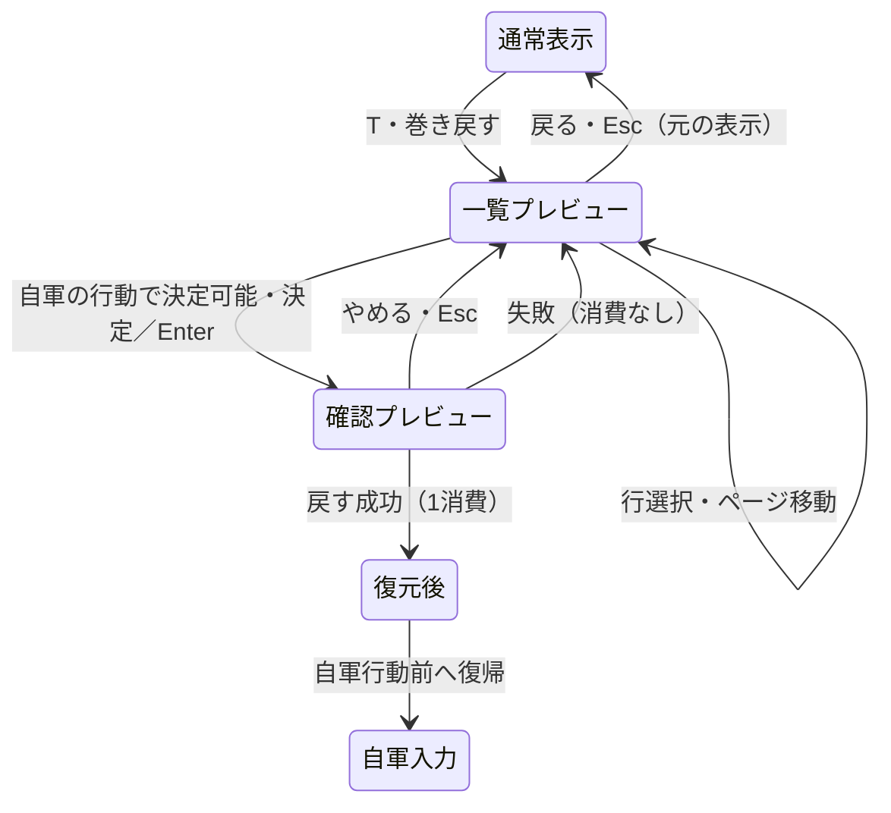
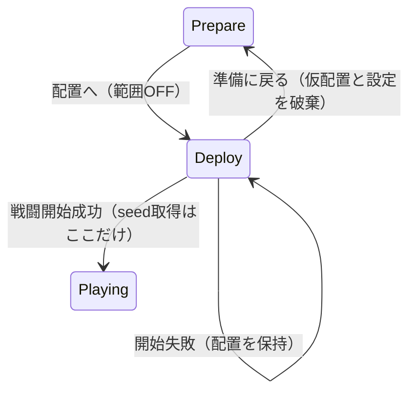

# 設計書（反復 4: 戻り先と戦況の見通し）

- 文書 ID: DES-IT04
- 版: 0.4（案）
- 作成日: 2026-10-23
- 対象: [反復 4 計画書](../iterations/it04/plan.md) v0.4（案）の対象範囲
- 入力: SRS-001 v0.3、UC-DOC-001 v0.6（E-43）、DES-IT01・IT02 v0.4、DES-IT03 v0.3、IT03-PLAN v0.2、IT03-RETRO v0.2、ADR-0002、E-32・E-39・E-40・E-41・E-42、REV-034〜042、現行の巻き戻し・配置・範囲計算と同梱素材、E-44

変更・追加する部分だけを書く。v0.4 は E-44 による追加案であり、行の表示と決定可否、core の制限と別案、要求・UC の改訂案は開発者の承認待ち。以下の E-41・E-42 による承認は v0.3 までの内容を指す。E-41・E-42 の回答を反映した本書と IT04-PLAN の一式は、開発者が承認した（E-42）。API 名・型・状態遷移も承認された設計とする。決定は [IT04-PLAN 9 章](../iterations/it04/plan.md#9-決定事項) と共通で、Q-IT04-02・04 の技術の選択は設計判断として記録する。SRS・UC は承認された改訂内容に基づき別 Issue で更新する。

## 1. 既存設計からの変更点

| 設計要素 | 反復 4 の追加・変更 | 節 |
|---|---|---|
| DES-RWD-01〜04 | 履歴・乱数・回数・再開の規則は維持。行動前の写しを参照する口を追加する。E-44 の追加案では Rewind の対象を自軍の行動に限る（7.1 節） | 4 章、7.1 節 |
| DES-RWD-05（新） | 消費・復元を行わないプレビュー取得 | 4.1 節 |
| DES-BTL-03、DES-CORE-01、DES-CMP-05 | 範囲計算と配置用変換を参照用途でも共用する | 2・5 章 |
| DES-DEP-02（新） | 戦闘を作らない配置の盤面と範囲の組み立て | 5 章 |
| DES-MAP-03 | 占有時の不出現を近くの空きマスへの決定的な出現へ変更する（E-41）。時機・定義順・出現した番には動かない規則は維持する | 6 章 |
| DES-RNF-01（新） | 増援定義から、進行位置に対応した予兆の領域を導く | 6.2 節 |
| DES-UI-05・06・19 | クラスに応じた騎兵の絵と、盤面を覆わない巻き戻し表示 | 7.1・7.2 節 |
| DES-UI-08・20 | 配置で敵の範囲を表示し、仮配置の占有を反映する | 5・7.3 節 |
| DES-UI-21〜24（新） | プレビュー、騎兵の絵、配置の範囲、増援の予兆の表示 | 7 章 |

既存の UI 番号は 20、RWD は 04、DEP は 01 まで使われている。RNF は未使用のため 01 から始める。増援の既存設計 ID は DES-MAP-03 であり、置き換えない。DES-UI-19・20 等の承認済み原本は本書では変更しない。

## 2. アーキテクチャ

### 2.1 分担と依存（設計判断。旧 Q-IT04-02）

| パッケージ | 担当 | 依存 |
|---|---|---|
| `internal/core/tactics` | 操作を持たない盤面参照値、履歴プレビュー、共通の移動・射程計算、近くの増援出現マスの選定、予兆の抽出 | Go 標準ライブラリだけ |
| `internal/core` | 目録・名簿・出撃枠から配置用の正しい盤面を組み立てる。実出撃と検証・変換を共用する | `defs`、`core/tactics` |
| `internal/ui` | 一覧の選択・確認・取消し、参照する盤面の切替、絵の選択、配置の範囲と予兆の描画・入力 | `core`、`core/tactics`、`defs`、Ebitengine、bitmapfont |
| `internal/ui/assets` | 同梱画像と追加する騎乗素材、出典・CC0 ライセンス・番号の記録 | 既存の読み込みの範囲 |

tactics はクラス ID・章・World・defs・画面色・日本語の案内文を新しく知らない（ADR-0002）。core は表示の選択や Q キーを持たず、ui は経路探索や増援の出現可否を独自に実装しない。プレビュー・配置表示で seed を取得せず、実時間・乱数・出来事の進行を使わない。

### 2.2 盤面参照値（DES-RWD-05、DES-DEP-02）

設計判断として、別 Battle への復元ではなく操作のない盤面参照値を採り、型名を `BoardView` とする（REV-042 F-04、旧 Q-IT04-02）。別 Battle は乱数・番開始・履歴を持つため閲覧で進行する誤用を防ぐ処理が増える。内部に地形とユニットを持ち、`Units`・`TerrainAt`・幅・高さ・`Reachable`・`AttackRange` を参照できる。`Act`・`EndPhase`・`Resume`・`Rewind` は持たず、PCG・履歴・回数も含めない。ユニットと Items を含む可変の配列は深く写す。返す配列も元の戦闘・履歴・参照値の内部と独立させる。地形を内部で共有する場合は書き換え口を作らず、外に返すときは独立させる。

範囲計算は `move.go` の現行アルゴリズムを内部の共通処理へ切り出し、Battle と BoardView が同じ処理を呼ぶ。移動費・味方の通過と停止・敵の通過不可・倒れたユニットの非占有、武器の最小〜最大射程、盤外の除外を変えない。範囲計算は状態・乱数を変えない。

配置から BoardView を作る入口は `NewBoardView(setup Setup)`（参照値と誤りを返す）。入力を検証して独立させるだけとし、`tactics.New`、番の開始、砦の回復、PCG の作成・取得、増援配置は行わない。Setup の初期 Units のみを最大 HP・Alive の状態へ変換する。初期入力の検証と UnitSetup の変換は戦闘の初期化と共用する。表示を作れない場合は誤りを返し、既存の配置・名簿に触れない。

現戦闘を参照する入口は `Battle.BoardView()`。現在値の独立した参照値を返す。履歴用・現在用の参照値には予兆の領域も含められるが、予兆の算出は 6 章による。配置用の参照値には予兆を含めない。

### 2.3 現行実装との照合箇所

| 箇所 | 設計の根拠となる現状 |
|---|---|
| `internal/core/tactics/history.go`・`snapshot.go`・`rewind.go` | before は完全な写し、残り回数は写しの外。Rewind は成功後に未来を捨てる。参照用 API はまだない |
| `internal/core/tactics/move.go`・`act.go` | 移動・射程は Battle の参照処理。増援は敵軍開始時、占有時は不出現・再試行なし。その番の増援を動かさない |
| `internal/core/battle.go`・`campaign.go` | 共通の敵・地形・Setup の変換があり、StartBattleAt は名簿順と slots を分けて検証している |
| `internal/ui/rewind.go`・`game.go` | 8 行の一覧と確認を持つが、パネルが盤面の大半を隠す。取消しで元の入力を保つ |
| `internal/ui/deploy.go`・`input.go`・`tiles.go`・`scene_view.go` | 配置の敵には HP と位置等しかなく、戦闘の範囲計算に必要な武器・移動力がない。絵は武器別、加入表示はクラス情報を渡していない |
| `internal/ui/assets/README.md`・同梱 PNG、`data/base/maps.toml`・`classes.toml` | 素材の出典・番号、cavalier と armor の武器の共通性、既存 9 件の増援定義を照合した |

## 3. 要求の改訂内容と定義データ

### 3.1 改訂の前提

[IT04-PLAN 3 章](../iterations/it04/plan.md#3-対象の要求) の SRS・UC 改訂内容を正とする。既存の FR-BTL-10・FR-CMP-11・FR-UNT-09・FR-MAP-03 を詳細化し、新しい要求 ID は追加しない（決定（E-42）、Q-IT04-08）。騎乗の絵は両軍を対象とする決定（E-41）を反映する。FR-MAP-03 の改訂には、予兆だけでなく占有時の代替出現も含める。探索上限はマンハッタン距離 2 以内、候補がなければその増援だけ出さず延期しない（決定（E-42）、Q-IT04-09・10）。

E-44 の FR-BTL-10・UC-14 改訂案は IT04-PLAN 3 章「改訂の案（E-44）」に記す。SRS v0.3・UC v0.6 の本体は承認後に変更し、今回は変更しない。

### 3.2 定義データとセーブ

`maps.toml` の既存 Reinforcements の Turn と Unit.Pos、初期敵、Slots を使う。`classes.toml` の cavalier は槍・移動 7、armor は槍・移動 4 のまま。能力・ボーナス・出撃人数・定義の出現値は変更しない。占有時の実出現位置は 6.1 節の規則で変わる。予兆用の TOML キーや表示用クラス ID は追加しない。

現在の増援は次のとおり（座標は 0 始まり。これは設計と試験の対応用で、画面には出さない）。

予兆の時機は決定（E-41）。領域は決定（E-42、Q-IT04-09）の距離上限 R=2 と 6.2 節の丸めで求めた閉区間であり、TC-FR-MAP-03-09 の期待値とする。

| マップ | 増援（定義順） | 出現ターンとマス | 予兆開始（自軍の番） | 予兆の領域（x、y の両端を含む） |
|---|---|---|---|---|
| ch01 | ファイター | 3T (0,3) | 3T | x=0〜3、y=0〜7 |
| ch01 | ソルジャー | 3T (0,4) | 3T | x=0〜3、y=0〜7 |
| ch01 | 剣士 | 5T (15,15) | 5T | x=12〜15、y=12〜15 |
| ch02 | ソルジャー | 2T (0,4) | 2T | x=0〜3、y=0〜7 |
| ch02 | ファイター | 3T (0,10) | 3T | x=0〜3、y=8〜15 |
| ch02 | 騎兵 | 4T (0,7) | 4T | x=0〜3、y=4〜11 |
| ch03 | 騎兵（西） | 3T (0,14) | 3T | x=0〜3、y=12〜15 |
| ch03 | 騎兵（東） | 3T (15,14) | 3T | x=12〜15、y=12〜15 |
| ch03 | ファイター | 5T (4,2) | 5T | x=0〜7、y=0〜7 |

章開始のセーブ形式・版・保存時機は変えない。仮配置・表示設定・プレビュー・予兆の既読状態を保存しない。予兆は戦闘値から毎回導くため、独立した既読フラグを設けない。

## 4. 巻き戻しの盤面プレビュー（core/tactics）

### 4.1 取得の契約（DES-RWD-05）

入口は `PreviewRewind(id uint64)`。参照値と誤りを返す。返す内容は、その実行済み履歴の `before` から作る BoardView、実際の Turn・Phase・Result、保留した自動進行の有無と予兆の領域である。履歴の内部型 `phaseProgress` や `battleSnapshot` は公開しない。

- 現在の戦闘内の実行済み ID だけを受け付ける。自軍・敵軍の行動と番境界の全種類が閲覧対象であり、7.1 節の Rewind の対象制限とは分ける（E-44 の案）。未実行・不正・捨てた未来の ID は既存の `ErrInvalidRewind` で識別できる誤りにする
- 閲覧には残り回数の検証をしない。0 回でも実行済み ID のプレビューは取得できる。`ErrNoRewinds` の優先順を変えるのは Rewind ではなく、新しい参照 API に限る
- 元の Battle を restore したり、一度 Rewind して戻したりしない。写しを直接参照用に変換し、乱数状態の復元・再実行もしない
- 表示に必要な位置・HP・最大 HP・能力・レベル・経験・手持ち・杖回数・生死・行動済み・AI・クラス名をすべて写す。未出現増援を Units に足さない。倒れたユニットも添字を保つが描画しない
- 読み出し成功・失敗、返り値の外部変更のいずれでも、元の戦闘・PCG・履歴・次の ID・出来事の通し位置・回数・進行位置は変わらない
- 読み出せないときは UI に理由を出し、その選択の確定を無効にする。別の行の古いプレビューを選択した行の状態として見せない

`HistoryPlayerStart` の行は次の自軍ターンをラベルに持つが、before は Turn を進める前の敵軍末尾である（`history.go`）。盤面の表示は写しの実際の値を採り、行のラベルは従来の値を保つ。「自軍の番を始める前」と「盤面: 2T 敵軍」のように区別する。名前やラベルから Turn・Phase を推定しない。

### 4.2 状態と寿命

| 状態 | 本物の戦闘 | UI が表示する盤面 | 廃棄・確定 |
|---|---|---|---|
| 一覧を開く前 | 現在値 | 通常どおり。Moved では仮移動も含む | 入力状態を保持 |
| 一覧・確認中 | 現在値のまま | 選択した履歴 ID の before | 選択変更でその 1 件だけ取得し直す |
| 確認を取り消す | 変更なし | 選択中の before のまま | 一覧へ戻る |
| 一覧を取り消す | 変更なし | 保持した入力状態による元の表示 | プレビューだけ捨てる |
| Rewind が失敗 | 変更なし | 有効な before と誤り。無効 ID なら盤面を空表示にする | 一覧に戻り、元の入力は保持 |
| Rewind が成功 | before へ復元し、未来を破棄、回数 −1 | 復元された本物の盤面 | プレビューと保留入力・未来の再生列・選択・勝敗の帯を捨てる |

UI に残すのは選択 ID と 1 件の表示用写し。行を移るたび全履歴を複製せず、描画フレームごとにも再取得しない。戦闘が変わったらキャッシュを無効にする。成功時の処理は既存 `RewindEnter` に集約する。Enter の押し始めを一度ずつ受け、長押しやクリックの持ち越しで二重に消費しない。

敵軍の途中、番の境界、勝敗から一覧を開く入口・取消しと、Campaign に反映する前という制限は DES-IT03 のまま。E-44 の追加案では、開いた時点にかかわらず決定先は自軍の行動前だけとし、敵軍・番境界への復元後に Resume を待つ経路は通常の巻き戻し操作から外れる。Resume 自体の規則や内部の写しの復元は変更しない。プレビューで Result が Ongoing に見えても GameOver から勝手に Battle へ遷移しない。`syncRewind` は本物の成功後だけに適用する。

## 5. 配置と範囲の参照（core・tactics）

### 5.1 配置用の組み立て（DES-DEP-02）

core の入口を `Campaign.DeploymentView(members, slots)` とし、BoardView と誤りを返す。`StartBattleAt` と同じ出撃者・枠の検証、現在名簿の能力と手持ち、主人公必須・名簿順を使う。内部の Setup 組み立てを共用し、最後の `tactics.New` の代わりに NewBoardView へ渡す。

`setupWithAllies`・`enemyUnit`・`enemyNames`・地形／武器／AI の変換を共用する。敵はクラス基礎値＋配置 Bonus の全 Stats、名前・ClassName・Weapon の射程・AI・Boss・Items を持ち、HP は最大から。今の `deploy.go` の HP だけの敵と UI 内の地形変換の写しはこの入口に置き換える（REV-040 G-01）。増援は初期 Units に入れず、範囲も予兆も出さない。

操作中の members は名簿の順のまま、交換するのは slots だけ。仮配置の変更で BoardView を作り直す。表示の組み立てに失敗したら理由を出し、範囲を消して誤った古い範囲を見せず、配置・Campaign は保持する。開始ボタンでは従来どおり検証し直して StartBattleAt を呼ぶ。表示の取得・失敗で `NextSeed` は呼ばない。

### 5.2 範囲の意味

個別範囲は、その敵の Reachable の全マスを青、そこから AttackRange が届くマスのうち青でないものを赤とする。全敵の危険範囲は、生きている各初期敵の全移動先から届く攻撃マスの和集合を橙の枠で描く（DES-UI-08 と同じ）。Hold の敵も含め、実際に AI が選ぶ攻撃の予告とはしない。

配置した味方の占有も計算に使う。味方を交換すると通路が空く／ふさがるため、範囲が変わり得る。武器の種類だけで射程を決めず、弓の最小射程なども Weapon の値を使う。配置を確定した直後の Battle と初期 BoardView は同じ地形・位置・移動力・射程を持ち、同じ範囲になる。最初の番の処理で HP 等が変わっても、範囲の規則は共通である。

## 6. 増援の出現と予兆

### 6.1 占有時の代替出現（DES-MAP-03 の変更）

決定（E-41）: 出現マスがふさがれていたら、近くの空きマスに出す。DES-IT01 の「占有時は不出現」を本反復で変更する。既存設計書の原本は今回変更せず、この節に差分を記す。決定（E-42）: 探索上限はマンハッタン距離 2 以内とし、候補がなければその増援だけ出さず延期しない。以下を出現規則とする。

1. 敵軍開始時に、そのターン T の増援を定義順に扱う。元のマスがマップ内で立てる地形かつ空きなら、そこに出す
2. 元のマスが生存ユニットで占有されていれば、元の座標からマンハッタン距離 `abs(dx)+abs(dy)` が上限 R=2 以内の候補を探す。候補はマップ内で、その増援が立てる地形（現行は Terrain.Cost >= 1）かつ生存ユニットのいないマス。倒れたユニットは占有としない。移動経路の到達性・移動費・Mov は距離に使わず、壁の向こうも条件に合えば候補とする
3. 候補は距離の昇順、同距離なら Y の昇順、さらに X の昇順（上から下、左から右）で先頭を選ぶ。map の走査順・乱数・実時間には依存しない。先に現れた同ターンの増援も占有に含めるため、同じマスに重ねない
4. 選んだ位置にユニットを追加し、`Reinforce.To` と出来事の Units の位置にも実出現位置を入れる。定義の Unit.Pos は変更しない。候補がなければ、その増援だけ出さず延期しない（ユニット・Reinforce の追加なし）。これは番処理の誤りではなく規則上の結果であり、ほかの増援・砦回復・敵軍処理は続ける

番処理の順は PhaseStart → 増援（定義順）→ 砦回復（添字順）のまま。新しい位置でも増援は出現した番には動かない。候補を探す処理は参照のみとし、選定前に地形・占有・定義・PCG を変更しない。Act・EndPhase・Rewind・Resume の検証失敗時は元の状態を保ち、出現を部分的に適用してから誤りを返さない。新しい出現位置は通常の units の写しに含まれるため、新たな保留状態は不要である。

### 6.2 抽出する情報（DES-RNF-01、Q-IT04-06）

予兆は出現定義から導く参照情報で、出現命令・出来事ではない。領域の値を `ReinforcementHint` とし、マップ内の矩形だけを返す。正確な座標・Turn・人数・クラス・予定ユニットを表示値に含めない。

代替出現が予兆の外にならないよう、元のマスだけでなく距離 R 以内の候補全域を含める。占有・地形によって予兆を狭めず、元の座標 `(X,Y)` に対する `[X−R,X+R] × [Y−R,Y+R]` をマップ内へ切り、左上を 4 マス単位で切り下げ、右下（含む）を 4 マス単位の末尾へ切り上げ、再びマップ内へ切る。例えば最小 X は `max(0,X−R)/4*4`、最大 X は `min(width−1,(min(width−1,X+R)/4+1)*4−1)`。Y も同様。マンハッタン距離の外にある隅も曖昧な予兆の一部として含める。領域の大きさは 4×4 固定ではなく、その倍数を端で切った矩形となる。同一矩形だけ重複を除き、左上 Y・X、右下 Y・X の昇順に並べる。重なる別矩形の描画は重なりを濃くしない。既存 9 定義の期待領域は 3.2 節に記す。

決定（E-41）: 出現ターン T の自軍開始後から T の敵軍開始処理の直前まで表示する。直前の自軍の番 1 回で気付ける。T−1 開始案は 2 回の自軍の番で分かるため採らない（REV-042 F-02）。Turn と Phase だけでなく、番開始処理を通過したかを既存 `phaseProgress` で判定する。

| 状態 | その T の予兆 |
|---|---|
| Turn < T（T−1 の自軍・敵軍と、T の自軍開始前の before を含む） | なし |
| Turn = T の自軍開始後の入力待ち／敵軍開始前（enemyStart） | あり |
| Turn = T の敵軍開始後（enemyAction・playerStart） | なし。空きなしで不出現の場合でも消す |
| Turn > T、または勝敗が確定した状態 | なし |

現定義の最も早い増援は 2T なので、ch02 の最初の 1T 自軍には表示せず、2T 自軍から表示する。Setup の増援は T>=2 の検証を維持し、T=1 は受け付けない。配置でも表示しない。

出現地点の占有では予兆を抑制・移動せず、実出現の成否・位置を先に確定して知らせない。予兆は候補全域を覆い、ふさいでも近くに出る規則と整合する。同時に有効な領域を表示し、候補がなく出現しない場合も、出現処理後に消して再予告しない（決定（E-42））。

### 6.3 巻き戻し・再開・表示の整合

現在の BoardView は本物の Turn・Result・progress、履歴の BoardView は before の値から同じ関数で予兆を導く。巻き戻せば予兆も戻り、プレビューだけでは本物の予兆の状態は変わらない。予兆に既読・発火の可変状態を足さないため、snapshot の保存対象や PCG は増やさない。

通常の EndPhase と Resume は 6.1 節の同じ選定処理を使う。E-44 の追加案では、自軍の行動前へ戻して同じ行動・番終了を行い、同じ占有で同じ代替位置へ出現することと、復元済みの増援を二重に出さないことを確認する。番開始前の写しはプレビューと内部復元の確認に残すが、その行を Rewind の決定先にしない。同じ seed・入力・占有なら出現位置と後続の AI・乱数結果が同じになる。出現・砦回復・敵の順を変えず、予兆用 Event も追加しない。出来事の再生中は予兆を隠す。再生完了後または巻き戻し成功後に現在値から更新する。これは Controller が出来事を表示している Turn と実 Battle の先に進んだ Turn を混ぜないためである。巻き戻し一覧では選択した写しの予兆を静止画として示す。

## 7. 画面と入力（ui）

### 7.1 巻き戻しの盤面（DES-UI-21、Q-IT04-01）

決定（E-41）: 左に盤面、右に一覧とする。既存の 832 × 576 を保つ。`drawRewind` の全面パネル（現状 x=24〜808）が盤面を覆うため、右の x=512〜832 だけを一覧・確認の背景にする。左の x=0〜512、y=0〜512 は 16 × 16 マスを従来の 32 px で描く。下の y=512〜576 はプレビューの案内に使う。縮小して盤面の HP・絵を読みにくくしない。

```text
┌──────────────────────────────┬───────────────────┐
│                              │ 巻き戻し 残り8/10 │
│  選択した行動の「前」の盤面   │ 選んだ行動の前    │
│  地形・生存者・HP・行動済み   │ > 2T 自軍 …       │
│  （出現済みの増援を含む）    │   …（8行）        │
│                              │ [前] [次]         │
│                              │ 行動名の全文      │
│                              │ 消える範囲・理由  │
│                              │ [戻る][決定]      │
├──────────────────────────────┤                   │
│ プレビュー中・未確定         │                   │
│ 盤面: 2T 自軍／Esc: 元へ      │                   │
└──────────────────────────────┴───────────────────┘
```

右欄の配置は、左右余白 8 px、幅 304 px。タイトル y=8、説明 y=34、8 行の一覧 y=60〜284（1 行 28 px）、ページボタン y=292〜320、詳細 y=328〜428、回数と理由 y=436〜496、戻る／決定 y=520〜560 とする。長い行名は省略し、詳細は欄幅に折り返して最大 5 行・ホイールで全文を読めるようにする。確認も同じ右欄内に出し、行名と消費 n→n−1 を折り返す。ボタンは同じ下端に置き、盤面と下の案内に重ねない。エラー文も表示領域内で送って全文を読めるようにする。

- 開いた直後から最新行の before を表示する。古い順・8 行・上下・PageUp／PageDown・前／次、先頭と末尾で停止する規則を保つ
- 行クリックは選択とプレビュー更新だけ。決定可能な自軍の行動の行で「決定」または Enter を押すと確認へ進み、「戻す」または次の Enter で本物の Rewind を一度だけ呼ぶ
- 確認中の右クリック・Esc・やめるは選択中のプレビューの一覧へ戻る。一覧の右クリック・Esc・戻るは、開く前の盤面・仮移動・行動メニュー・番終了の確認・勝敗／敗北の場面へ戻す
- 0 回でも選択とプレビューを許し、決定を無効にする。履歴なしでは盤面を元のまま静止表示し、「戻せる行動がありません」を出す。取得失敗では盤面に「プレビューを表示できません」と示す
- 閲覧中は盤面からの移動・行動・結果反映・敵軍 Resume・Q・番終了を受け付けない。盤面クリックは一覧に透過しない。範囲の上塗り・仮移動・予測・メニュー・再生の帯は一時的に描かない。元の危険範囲 ON/OFF の設定は保持する
- 「プレビュー中・未確定」と、before の実際のターン・陣営を下に示す。選んだ行動者が生存していればそのマスに枠を付ける。敵軍・番境界の行には以下の閲覧専用の理由を出し、「確定後は再開操作で続行」は出さない（E-44 の案）。プレビュー中には再開しない
- 成功後は通常の情報欄と自軍入力へ戻る。E-44 の案では敵軍・番境界へ確定しないため、この成功経路で再開ボタンは表示しない。残る未来の表示や、開く前の勝敗の帯を重ねない（REV-039 F-01・02）

#### 一覧の行と決定の規則（E-44、追加案）

「選べる」は before のプレビューを表示できること、「戻せる」は確認を経て Rewind を実行できることを指す。敵軍・番境界の行も一覧に残し、クリック・上下・ページ移動で飛ばさず選べる。開いた直後の最新行も従来どおり選ぶ。

| 行の種類 | 判定・例 | 文字の色・濃さ（推奨案） | 選択・プレビュー | 戻せる対象 |
|---|---|---|---|---|
| 自軍の行動 | HistoryAction かつ Side == Player。移動・攻撃・回復・薬・待機などの一行動 | 白、通常の濃さ | 可 | 対象 |
| 敵軍の行動 | HistoryAction かつ Side == Enemy。移動・攻撃・待機など | 赤、低い濃さ | 可 | 対象外 |
| 敵軍へ移る番境界 | HistoryEndPhase。明示の「番を終える」と全員行動済みの自動移行（敵軍の番の始めの前） | 赤、低い濃さ | 可 | 対象外 |
| 自軍へ移る番境界 | HistoryPlayerStart。自軍の番の始めの前 | 灰、低い濃さ | 可 | 対象外 |

番境界の色は移行先の陣営で揃える推奨案とする。HistoryEndPhase は記録の Side が Player でも赤とし、HistoryPlayerStart の before が敵軍末尾でも灰とする。Kind を先に判定し、表示文やプレビュー盤面の Phase から決定可否を推定しない。別案は番境界を両軍とも薄い灰に統一すること。境界を見分けやすい一方、移行先の陣営は行名で読む必要がある。

低い濃さは通常の文字の半分程度を目安とし、右欄の背景で読めるか手動確認する。選択枠は全種類で見えるように描き、選択しても閲覧専用行を白・通常の濃さに変えない。色だけで判断させず、選択した対象外の行には「自軍の行動の前だけ戻せます」と表示する。

一覧の「この前へ」は「決定」に改名する。確認の文・「戻す」「やめる」は維持する。「決定」は、対象が自軍の実行済み行動で、プレビュー取得成功かつ残り回数が 1 以上のときだけ有効。対象外ではボタンを無効表示し、クリック・Enter とも確認へ進めず、Rewind も呼ばない。0 回の理由や取得失敗の表示は維持し、対象外にも該当すれば上の理由を併記する。理由は y=436〜496 内で折り返し、長いエラーを含め従来どおり送って全文を読めるようにし、決定ボタンと重ねない。自軍の行動が一件もなく敵軍・番境界だけの場合も閲覧でき、「履歴なし」とは区別する。

#### 制限を置く場所（DES-RWD-02 の変更案、承認待ち）

**推奨案: tactics と UI の双方で制限する。** tactics の Rewind は実行済みの履歴のうち `Kind == HistoryAction && Side == Player` の ID だけを復元対象とする。それ以外は復元・未来の破棄・回数消費の前に、既存の ErrInvalidRewind で識別できる誤りとして拒む。戦闘・PCG・履歴・次の ID・出来事境界・進行位置・回数は失敗時に変えない。残り 0 回の ErrNoRewinds を先に返す既存の優先順は維持する。PreviewRewind は全種類の実行済み ID を引き続き受け付け、0 回でも閲覧できる。

自軍の行動前だけに戻せることをゲームの規則として tactics に置けば、別の UI やふしぎ錬金への移植先が直接 Rewind を呼んでも規則が揃う。陣営と履歴の種類だけで判断でき、tactics に色や日本語の表示を持ち込む必要はない。UI は同じ条件で無効表示・入力の遮断・理由を出し、確認から実行するときも有効性を検証する。

**別案: UI だけで制限する。** 色・理由・決定ボタンと Enter の制限を UI に置き、tactics の Rewind は従来どおり全種類を復元可能にする。既存の敵軍・番境界の Rewind／Resume テストと API の互換性を保てるが、UI 以外の呼出元からは敵軍や番境界へ戻せる。規則の保証が呼出元ごとになるため推奨しない。8.2・8.3 節と Issue 9 は推奨案を前提とし、別案を選ぶ場合は core の拒否テストと既存ケースの変更範囲を見直す。

回数（章ごと 10 回、成功だけ 1 消費）・行動の単位・確認・取消し・0 回の閲覧・乱数・結果反映・主人公が倒れたあとの入口と取消しは維持する。敗北後も結果反映前なら過去の自軍行動前へ戻せる。敵の攻撃前へ直接戻すことだけは今回の制限対象である。対象の自軍行動がなければ決定できない。



### 7.2 騎兵の絵（DES-UI-22、旧 Q-IT04-03・04）

決定（E-41）: 自軍のエルザと敵の cavalier の双方を、馬に乗った絵で歩兵と区別する。同梱の Tiny Town・Tiny Dungeon には騎乗姿と判断できるタイルが見つからなかった。Tiny Dungeon 97（面頬の騎士）の代用は推奨・採用から外す（REV-042 F-01）。

実装 Issue 5 で管理役が、同梱の Kenney と絵柄の合う CC0 の騎乗素材を探して追加する（Kenney の他パックなど）。見つからなければ 16×16 のドット絵を自前で描く。どのパック・画像・番号を使うかは実装時に確定し、今回の文書修正では検索・取得・作画を行わない。両軍に同じ騎乗素材を使ってよく、青・赤の陣営の下地を保つ。

識別方法は人への確認点から外す設計判断とする（REV-042 F-04、旧 Q-IT04-04）。既存の `Unit.ClassName == "騎兵"` で両軍を識別する。cavalier は core でこの ClassName に変換される。名前「エルザ」・Mov・槍だけでは識別しない。表示名を変える場合はこの判定とテストも変更する。クラス ID を tactics に追加しない（ADR-0002）。選択の優先順は主人公専用→騎兵（両軍）→ボス専用→従来の陣営・武器別とし、騎兵のボスも騎乗の絵にボスの印を重ねる。未知クラス・騎兵以外のボスは従来の絵を保つ。

戦闘・情報欄・準備・配置・加入・プレビューで共通の選択関数を使う。現行 `scene_view.go` の加入表示は武器だけの Unit を作っているため ClassName も渡す。配置の敵にも正しい ClassName を渡す。32 px の盤面・64 px の肖像で騎乗と分かるかを確認し、HP・名前・ボス印と重ねない。騎乗素材なしに印だけで完了としない。

同じ実装 Issue で管理役が `internal/ui/assets/README.md` に、作者・パックと版・配布元・確認日・CC0・元ファイル名と取り込んだ画像・番号・用途（自軍／敵騎兵）を記録し、追加素材のライセンス原本を同梱する。自作なら作者・作成日・自作と CC0 の扱いを記録する。既存のライセンス原本は変更しない。「陣営と武器だけで選ぶ」の説明にクラスの選択を反映する。README の 108 の絵の説明は、実際の「緑のゴースト」に訂正する申し送りも Issue 5 に含める（REV-042 F-08）。これは僧侶の画像差し替えではない。

### 7.3 配置中の敵の範囲（DES-UI-23、Q-IT04-05）

決定（E-42）: 戦闘中と同じホバーと Q による範囲表示を行う。配置の状態に、カーソル位置と危険範囲の ON/OFF を持つ。配置へ入ると OFF、準備へ戻る／戦闘開始で捨てる。戦闘中の Controller.danger と共有せず、戦闘側は従来の初期値から始める。

- 敵のマスへのホバーでその敵の青い移動範囲・赤い射程を表示する。味方の選択と slots は変えない。敵から外すと個別範囲を消す
- Q の押し始めで全敵の橙の危険範囲を ON/OFF にし、「Q: 敵の危険範囲 ON／OFF」を下の空き行 y=552 に示す。個別範囲と同時表示できる
- 描画順は地形→出撃枠の下地→個別範囲の塗り→ユニット→出撃枠線→橙の危険枠→味方の選択枠。線を内外に分け、出撃枠と危険の両方を判別できるようにする
- 選択中でも Q とホバーで範囲を見られる。交換・空き枠移動で再計算し、選択解除だけでは範囲は変えない
- 敵クリックでは場所を変えず従来の理由を出す。ホバーでの範囲表示とクリックによる配置操作を混同しない。右クリック・Esc は選択中なら解除、未選択なら準備に戻る
- 戦闘開始・準備に戻るのボタンと右の味方情報は既存位置を保つ。Q の案内は既存の 2 行・ボタン・メッセージと重ねない



### 7.4 増援の気配（DES-UI-24、Q-IT04-06）

予兆領域には低い濃さの黄土色の破線を外周に描き、中央付近に小さい「…」を添える。既存の青・赤の塗り、橙の危険枠、緑の回復枠と形でも区別する。実際の出現マスにだけ印を置かず、領域全体の気配として示す。地形の上・ユニットの下を基本とし、ユニット・HP・選択枠を隠さない。

有効な予兆が一つでもあれば案内欄に「付近に気配…」を出す。巻き戻し一覧中は右欄の詳細の空きに同じ案内を出す。複数領域でも人数・発生回数を文に出さない。点滅や音・確認ダイアログは加えない。現戦闘の Playing・Over・配置では表示せず、一覧では選択中の写しに従う。消費回数・巻き戻し案内・再開ボタンとは別の行を使う。全文・しるしともテスト可能な表示値にし、色・見分けやすさは手動で評価する。

## 8. 設計と要求・テストの対応

### 8.1 要求との対応

| 要求 | 設計 |
|---|---|
| FR-BTL-10 | DES-RWD-05、DES-UI-21。DES-RWD-01〜04 の規則は継続。ただし E-44 の案で DES-RWD-02 の Rewind 対象を制限する |
| FR-CMP-11、FR-CMP-03 | DES-DEP-02、DES-UI-23。DES-DEP-01 の検証・枠の規則は継続 |
| FR-UNT-09、FR-UNT-03 | DES-UI-22（両軍の騎乗。決定（E-41））。役割の評価は H-15・H-13 |
| FR-MAP-03 | DES-MAP-03 の占有時の代替出現、DES-RNF-01、DES-UI-24。距離 2 以内、候補なしなら不出現・延期なし（決定（E-42）） |
| IF-01・02 | DES-UI-21〜24 |
| NFR-04〜07・09 | 操作を持たない参照値と純粋な共通計算、閲覧の状態不変、既存の再現性・失敗時不変の回帰、core の網羅率 |
| QA-02・03 | 8.2・8.3 節、Issue ごとのテスト仕様書・コード・トレーサビリティとレビュー記録 |

### 8.2 テストケースの案

本表はテスト仕様書ではない。E-44 の新規案は既存の 26 の次の 27〜30 とし、承認・実装時に仕様書とコードと traceability をそろえる。既存の採番を確認し、FR-BTL-10 は 20、FR-CMP-11 は 07、FR-UNT-09 は 16、FR-MAP-03 は 07 の次から仮に採番する。実装時に最新と再照合し、`test-spec-it04.md` に前提・入力・期待結果を記載する。既存の手動 ID を再定義しない。案だけを traceability に先行追加しない（tccheck は設計書の案を定義としては読まない）。

| ID（案） | 設計 | 確かめること |
|---|---|---|
| TC-FR-BTL-10-21 | DES-RWD-05 | 移動攻撃・回復薬・杖・成長・撃破の before を取得。位置・HP・能力・手持ち・生死・Acted が写しと一致し、同じ ID の Rewind 成功後の表示値とも一致する |
| TC-FR-BTL-10-22 | DES-RWD-05 | 複数回の閲覧・返った Items／地形／Units の変更で元の Battle・before・履歴・回数・PCG・出来事境界・進行位置が変わらない。同じ入力を続けた対照戦闘とも結果が一致する |
| TC-FR-BTL-10-23 | DES-RWD-05 | 0 回で閲覧成功、不正・未実行・破棄した ID は ErrInvalidRewind。失敗時不変と、Rewind 本体の残り 0 回優先が保たれる |
| TC-FR-BTL-10-24 | DES-UI-21 | 開いた直後・上下・行クリック・8 行境界・ページ移動でプレビューを切り替える。番開始前の実 Turn／Phase と行ラベル、0 回・空・取得失敗を区別する |
| TC-FR-BTL-10-25 | DES-UI-21 | Moved・番終了確認・Over・GameOver からの閲覧と取消しで元の入力・表示を復元。確認の取消しは一覧を保持。盤面入力を遮断し、確定成功だけ 1 消費・未来を破棄。敵軍／番境界は閲覧専用とし、決定による Resume 待ちには進まない（E-44 の案） |
| TC-FR-BTL-10-26 | DES-UI-21 | 手動: 全盤面と 8 行・長い行名・確認文・案内が読め、意図した before を選べる。プレビュー・確定・取消しと同じ行動／Resume の結果を比較し、H-12 と再現性の結果を記録する |
| TC-FR-BTL-10-27 | DES-RWD-02、DES-UI-21 | 自軍の移動・攻撃・回復・薬・待機の実行済み ID は Rewind 成功。敵軍の攻撃・待機、明示／自動の HistoryEndPhase、HistoryPlayerStart は ErrInvalidRewind。拒否前後の戦闘・PCG・履歴・次の ID・出来事境界・進行位置・回数が不変。0 回では ErrNoRewinds 優先を保つ |
| TC-FR-BTL-10-28 | DES-RWD-05、DES-UI-21 | 敵軍・各番境界もクリック・上下・8 行境界・ページ移動で選べ、最新行が対象外でも開いた直後にプレビューする。0 回でも全種類の before を閲覧でき、実際の Turn・Phase・盤面が正しく、閲覧で元状態が不変 |
| TC-FR-BTL-10-29 | DES-UI-21 | 白・通常の濃さは自軍行動だけ。敵軍行動と HistoryEndPhase は薄い赤、HistoryPlayerStart は薄い灰。選択しても色を維持し枠を出す。「決定」への改名、対象外の無効表示・理由・クリック／Enter の遮断、対象行への選択変更で有効に戻ること、0 回・取得失敗の理由、閲覧専用行だけの一覧も確認する |
| TC-FR-BTL-10-30 | DES-UI-21 | 手動: 薄い赤・灰の可読性と白との区別、全種類の選択枠・左のプレビュー・無効な決定と理由を確認。長い理由とボタンの非重複、自軍行動の確認・取消し・成功だけ 1 消費、敗北後から自軍行動前への復帰、0 回の閲覧を記録する |
| TC-FR-CMP-11-08 | DES-DEP-02 | 実出撃と同じ名簿・枠で、全初期敵の能力・射程・AI・名前と地形が一致。配置交換・空き枠移動後の個別／全敵範囲も開始直後と一致する。増援は含まれない |
| TC-FR-CMP-11-09 | DES-DEP-02 | 森・壁・通路・味方／敵の占有・倒れたユニット・弓の最小射程・Hold・空の範囲を、既知の盤面と期待マスで確認。参照用と Battle の共通計算で旧規則が保たれる |
| TC-FR-CMP-11-10 | DES-DEP-02、DES-UI-23 | 初期 OFF、ホバー、Q の切替、選択保持、交換後再計算、準備への戻りで初期化。敵クリックは配置を変えない。表示・失敗で Campaign・seed を変えず、実開始だけ一度取得する |
| TC-FR-CMP-11-11 | DES-UI-23 | 手動: 出撃枠・敵個別範囲・橙の全体枠・選択枠・Q の案内を区別する。範囲を見て役割を考えた配置と最初の行動を記録し、H-10・H-13 を評価する |
| TC-FR-UNT-09-17 | DES-UI-22 | 両軍の ClassName で騎乗素材を選ぶ。主人公・騎兵・ボス・武器の優先順と騎兵のボスの印、アーマー・未知クラスの従来の絵を確認する。画像・番号・CC0 記録が素材 README と一致し、97 を代用にしない |
| TC-FR-UNT-09-18 | DES-UI-22 | 自軍エルザと敵の騎兵が、戦闘・肖像・準備・配置・加入・プレビューの該当場面で同じ騎乗の絵になる。能力値・キャラ名に依存せず、ClassName が加入表示にも渡る |
| TC-FR-UNT-09-19 | DES-UI-22 | 手動: エルザ・敵 cavalier とガルドを 32 px／64 px で見分け、両軍とも馬に乗って見えるか、HP・ボス印と重ならないかを記録する（H-15） |
| TC-FR-MAP-03-08 | DES-RNF-01 | T−1 の自軍・敵軍と T 自軍開始前はなし、T 自軍開始後から敵軍開始前まであり、処理後・過去・勝敗後はなし。ch02 の 1T はなし・2T はあり。T=1 は Setup の検証で拒否。出現地点占有・候補なしでも処理前の予兆を抑制しない |
| TC-FR-MAP-03-09 | DES-RNF-01 | 距離上限 R=2 の候補全域を覆う丸めと端の切り詰め。R=2 の既存 9 定義は 3.2 節の領域列と一致する。同一矩形の重複除去・順序、複数方面・異なるターン、代替出現位置を必ず含むこと、返り値の変更で入力が不変なことを確認する |
| TC-FR-MAP-03-10 | DES-MAP-03、DES-RNF-01、DES-RWD-05 | 出現前後・番の開始前のプレビューで領域が写しに一致。E-44 の案では公開 Rewind は自軍行動前への復元と同じ入力・番終了の再実行で確認し、番境界の内部復元と Resume も別に確認する。予兆の参照を挟んでも PCG・出来事・出現と AI の結果が対照戦闘と同じ。同じ占有なら同じ近くの空きマスへ出て、出現後の巻き戻し・Resume で二重に出さない。候補なしでは不出現・延期なし。無効な操作・閲覧失敗で units・定義・進行位置が変わらない |
| TC-FR-MAP-03-11 | DES-UI-24 | 通常・一覧は対応する参照値から表示し、Playing・Over・配置では消す。Turn の先行した本物の値を再生中へ混ぜない。表示値に正確なマス・ターン・人数・クラスを出さない |
| TC-FR-MAP-03-12 | DES-UI-24 | 手動: ch01〜03 で予兆と出現を観察。ch02 は 1T なし・2T あり、複数方面、占有時の近くへの出現、巻き戻し一覧で選択中の写しの予兆と確定後の一致・取消しを確認する。範囲・回復・出撃枠と区別でき、気配と、ふさいでも近くに出ることに気付いたか、分かりすぎたか、難しさを記録する（H-14）。一覧の予兆の手動確認は本ケースに集約する（REV-042 F-06） |

追加の規則のテスト案（距離 2 以内・候補なしなら不出現の決定（E-42）を反映）:

| ID（案） | 設計 | 確かめること |
|---|---|---|
| TC-FR-MAP-03-13 | DES-MAP-03 | 元のマスが空きなら不変。自軍・敵軍の占有時は距離最小、同距離は Y・X 昇順。立てない地形・盤外・生存占有を除き、倒れたユニットのマスは候補から除外しない。5×5 の平地で元の (2,2) を占有した場合は (2,1)、距離 1 の 4 マスも占有した場合は距離 2 の (2,0) に出る。距離 2 以内をすべて占有し、距離 3 の盤内の (4,1) だけが空いていても出現しない。元が (0,0) の占有なら盤外を除いて (1,0) に出る。壁越しも距離 2 以内の立てるマスは候補とする |
| TC-FR-MAP-03-14 | DES-MAP-03 | 同ターンの複数増援は定義順で、それ以前の増援を占有に含む。Reinforce.To・Units の写しが実位置と一致し、元定義は不変。出現した番に動かず、砦回復との順序を保つ |
| TC-FR-MAP-03-15 | DES-MAP-03 | 候補が全占有または立てない地形だけなら、当該ユニット・Reinforce を追加せず、延期・乱数消費なし。ほかの番処理は続く。候補探索のみで状態を変えず、E-44 の案では自軍行動前への巻き戻しから同じ行動・番終了で同じ結果を再現する |

core・tactics の規則は表駆動テストを基本とする。返り値の深い写しと元状態、範囲の既知の期待マス、閲覧を挟まない対照戦闘を使い、同じ実装同士の比較だけで済ませない。UI の表示値・文字幅・入力のテストと、実描画の手動結果を分ける。H-09・H-10 等と未確認の手動ケースの実施手順は IT04-PLAN 2 章を引き継ぐ。

### 8.3 書き換える既存のテスト

ID と変更対象でない元の規則の確認を保つ。占有時不出現の期待値は DES-MAP-03 の変更に合わせて書き換える。表の Issue は 9 章の仮番号。実装 Issue で元の仕様書の担当ケースの期待値と traceability も同時に更新し、ID は維持する。今回の文書修正では仕様書を変更しない。E-44 については Issue 9 の行を優先し、旧案の敵軍・番境界への Rewind 成功という期待を引き継がない。再実施結果は新しい記録に残す。

| Issue 案 | 既存のテスト | 変更・確認の内容 |
|---|---|---|
| 1 | TC-FR-BTL-10-01〜10・15〜20、TC-NFR-06-01〜06 | 既存の snapshot・PCG・回数と変更対象外の Rewind・Resume の確認を維持。E-44 の変更対象は下の Issue 9 の行による。プレビューを挟む場合を追加しても、実際の復元と実 PCG のテストを置き換えない |
| 9 | TC-FR-BTL-10-04・05・08・10 | `rewind_test.go` の敵行動前・番境界への Rewind 成功を前提とする部分は、ErrInvalidRewind と失敗時不変の期待に改訂する。敵 A／B・Hold・増援・砦・番処理・勝敗の写しは PreviewRewind と内部復元での再開試験へ分けて残す。公開操作の再現性は、それより前の自軍行動を用意し、そこへ Rewind して同じ入力と番終了を再実行して比較する。08 の ResumeRequired の前提も内部復元で組み立て、0 回優先・不正 ID・復元失敗の期待を保つ。10 は主人公敗北後・勝利後から自軍行動前へ戻る前提に直し、名簿への一度だけの反映も維持する |
| 9 | TC-FR-BTL-10-11〜14・21・24〜26、TC-IF-01-12・13、TC-FR-UNT-09-12 | ボタン名の期待値・探索を「決定」に変更。敵軍／番境界の選択とプレビューは残し、確認・確定の成功を期待する部分（特に 25）を無効・理由・Enter 拒否へ改訂。21 の Rewind 成功後との比較は自軍行動だけとし、番境界の実 Turn・Phase は写しと直接比較する。敗北からの確定先は過去の自軍行動に変更。手動 14・26 に色・可読性・理由・閲覧専用を加え、入力保持・0 回・非重複を保つ |
| 9 | TC-FR-MAP-03-10・12・15、TC-FR-BTL-10-06・07・09・15〜20・22・23、TC-NFR-06-01〜06 | MAP の番境界前への公開 Rewind を自軍行動前からの同じ行動・番終了の再実行へ変更し、番境界のプレビューと内部復元による Resume の確認は残す。増援・予兆・砦の二重適用なしと PCG 一致を保つ。ほかは自軍行動への Rewind・写し・乱数・回数・ID・閲覧の規則を回帰確認し、禁止行への復元成功を前提にしていれば同様に前提を直す |
| 1・3 | `move_test.go` の TC-FR-BTL-01-01・03〜08、TC-FR-MAP-01-01〜05 | 移動／射程の共通化で、地形費用・占有・順序・無効ユニット等の期待値を変えない。新しい BoardView でも同じ規則を別の入力から確認する |
| 2 | TC-FR-BTL-10-11〜14、TC-IF-01-12・13 | 8 行と操作は維持し、矩形と表示先を右欄へ変更。元の入力を保つ試験にプレビューを加える。Playing の入口拒否・早送り、0 回の閲覧、未来破棄・再開・敗北からの取消しを残す |
| 3・4 | TC-FR-CMP-11-01〜07、TC-FR-CMP-03-07〜11 | 出撃者と slots、選択・交換・準備への戻り・失敗時保持を保つ。HP だけの敵ではなく正しい敵を表示する期待値にし、範囲と seed の不変を追加する |
| 4 | `enemyrange_test.go` の TC-IF-01-18〜20・31・32、`input_test.go` の TC-IF-01-03 | 戦闘中のホバー・クリック固定・Q・非表示の状態・危険範囲の定義を変更しない。配置の試験に同じ範囲定義を用い、敵クリックの規則の違いを混同しない |
| 5 | TC-FR-UNT-09-09・11〜13・16、`input_test.go` のユニットのタイルのケース | 主人公・アーマー・騎兵以外の敵とボス・武器・僧侶の期待値は保つ。両軍の騎兵を追加し、騎兵のボスの優先順、加入のクラス情報と印の重なりを確認する。素材 README の 108 の説明訂正は Issue 5 の担当とする |
| 6・7 | TC-FR-MAP-03-01〜07、TC-FR-BTL-10-05、TC-FR-CMP-09-06 | 予兆は Event を増やさない。砦・定義順・増援の次ターン行動の規則は維持。TC-FR-MAP-03-05（`gimmick_test.go`）は「ふさがれて出ない」から、占有する主人公と先行増援を避け、固定順の近くのマスへ出る期待座標・体数・Reinforce 列へ書き換える。距離 2 以内に候補がない場合は、不出現・延期なしのケースとして分ける。TC-FR-BTL-10-05（`rewind_test.go`）の占有条件も代替出現位置・再開後の一致へ変更する。03・04・06・07 の非占有時の座標・定義順・倒れたユニットの扱いは維持する |
| 2・4・5・7 | TC-FR-UNT-09-12 | プレビューの右欄、配置の Q 案内、騎兵の印、予兆案内の位置を追加。既存の巻き戻し／再開ボタン・情報欄・2 行の案内との非重複も残す |
| 8 | TC-FR-BTL-10-14、TC-FR-CMP-11-07、TC-FR-BTL-08-24、TC-FR-UNT-09-16、既存の未確認手動ケース | Windows で確認範囲ごとに再実施し、過去の未確認を消さず今回の根拠を追記する。TC-NFR-03-04 は今回も未実施のまま先送りを明記する（決定（E-42）、Q-IT04-07） |

## 9. 実装の分け方（Issue の案）

番号は GitHub の Issue 番号ではない。本書と IT04-PLAN の v0.3 は承認済み（E-42）。v0.4 の E-44 の追加案（Issue 9）は承認待ち。決定（E-41・E-42）に従って各 Issue を進める。A は要求改訂、1〜8 は既存の実装と評価、9 は巻き戻しの追加変更である。依存先が閉じるまで着手しない。テストは最後の評価 Issue に先送りせず、担当 Issue 内で仕様書・コード・トレーサビリティの担当行をそろえる。

| # | Issue | 要求・設計 | 依存 | 完了条件 |
|---|---|---|---|---|
| A | SRS・UC の改訂と試験文書の骨組み | IT04-PLAN 3 章、Q-IT04-08 | なし（方針・追記内容は E-42 で承認済み） | 承認された内容に基づいて既存要求の追記・UC の改訂を行い、レビューし、テスト仕様書の骨組みを作る。旧設計の追記が必要なら文面も承認する |
| 1 | tactics の盤面参照値と履歴プレビュー | FR-BTL-10、NFR-06・07 / DES-RWD-05 | A | 操作のない参照値、深い写し、ID・0 回の閲覧、共通の範囲計算と既存移動の回帰。TC-FR-BTL-10-21〜23 を実装する |
| 2 | 巻き戻しの盤面切替と右の一覧 | FR-BTL-10、IF-01・02 / DES-UI-21 | 1 | 選択・確認・取消し・失敗・0 回・空・敵軍と敗北の入口を確認。盤面全体と案内を隠さず、成功だけ消費する。TC-FR-BTL-10-24・25 と手動 26 の仕様を追加する |
| 3 | core の配置用盤面を組み立てる口 | FR-CMP-11 / DES-DEP-02 | 1 | 実出撃と変換を共用し、完全な初期敵と仮配置の範囲が一致。tactics.New・NextSeed・番処理を呼ばない。TC-FR-CMP-11-08・09 を実装する |
| 4 | 配置の敵ホバーと Q の表示 | FR-CMP-11、IF-01 / DES-UI-23 | 3 | 入力と交換後の再計算、表示の初期化、出撃枠との重なりを確認。TC-FR-CMP-11-10 と手動 11 の仕様を追加する |
| 5 | 両軍の騎乗素材の追加と識別・素材記録 | FR-UNT-09 / DES-UI-22 | A | 管理役が絵柄の合う CC0 素材を探して取得し、なければ 16×16 で自作。両軍の騎兵に共通適用し、出典・README・ライセンス・画像と番号を記録する。README の 108 を実際の緑のゴーストという説明に訂正する（画像変更なし）。TC-FR-UNT-09-17・18 と手動 19 の仕様を追加。97 の代用では完了としない |
| 6 | tactics の代替出現と予兆の抽出 | FR-MAP-03 / DES-MAP-03 の変更、DES-RNF-01 | 1 | 距離・固定順・地形・占有・空きなし・複数増援の選定と失敗時不変、T 自軍からの時機、候補全域を覆う領域・重複・巻き戻し・再開・返り値独立を確認する。TC-FR-MAP-03-08〜10・13〜15 を実装し、8.3 節の占有時の既存期待値を更新する |
| 7 | 増援予兆の描画と一覧での表示 | FR-MAP-03、IF-02 / DES-UI-24 | 2・6 | 通常とプレビューの対応する領域を表示し、Playing 等では隠す。正確な位置・ターン・人数を出さない。TC-FR-MAP-03-11 と手動 12 の仕様を追加する |
| 9 | 自軍の行動前だけに巻き戻しを限定する（E-44） | FR-BTL-10、UC-14、IF-01・02、NFR-06・07 / DES-RWD-02・05、DES-UI-21 | なし | v0.4 の案と要求・UC の改訂文面の承認後、SRS・UC を更新。推奨案の Rewind の対象制限、全種類の PreviewRewind、行の色・選択・決定・理由を実装し、TC-FR-BTL-10-27〜29 と手動 30 の仕様を追加する。8.3 節の既存ケースと仕様書・traceability を更新する。反復 4 の #83（下の Issue 8）の前に完了する |
| 8 | 手動確認・遊んだ評価・履歴使用量の測定（#83） | QA-02・03 / 8 章、IT04-PLAN 2 章 | 2・4・5・7・9 | H-12〜15・H-10、再現性と既存の手動ケース、難しさ・緊張感・時間・履歴の測定を振り返りへ記録。未確認と未達を区別する |

Issue 9 の依存なしは追加の先行 Issue を要求しないという意味で、文書案の承認を実装着手の前提とする。#83 は E-44 の変更後の状態で評価し、Issue 9 の色・理由・手動 30 も含める。

5 は参照値の実装から独立して進められる。素材取得・自作が未完なら 8 の完了も保留し、人に未達を報告する。2・4・5・7 は game.go・SceneView 等を共有するため、取り込み順を管理するが、それだけを機能依存として追加しない（REV-034 F-06）。A・各実装で更新する README・仕様書・traceability の行を取り込み時に照合する。tccheck のほか、列数・閉じ・表内の空行も確認する。

## 10. 決定事項

決定は IT04-PLAN 9 章を正とする。決定（E-41）は Q-IT04-01 → 7.1 節、03 → 7.2 節、04 の両軍適用 → 7.2 節、06 → 6.2・7.4 節に反映した。旧 Q-IT04-02 と 04 の技術の選択は、2・4・5 章と 7.2 節の設計判断として文書一式とともに承認された（決定（E-42））。

決定（E-42）は Q-IT04-05 → 5・7.3 節、07 → 8 章と Issue 8、08 → 3 章と Issue A、09・10 → 3.2・6 章と Issue 6 に反映した。配置の範囲は戦闘中と同じホバーと Q、手動確認は Windows のみ、SRS・UC は既存要求の詳細化として別 Issue で改訂する。増援は距離 2 以内、候補なしなら不出現・延期なしとする。開発者は回答を入れた文書一式を承認した（E-42）。騎乗素材の調達、表示名による識別の限界、占有時の出現変更と予兆による難しさ、履歴の実測値がまだない点をリスクとして残す。

E-44 の追加案の確認点は、7.1 節の「tactics と UI の双方で制限する」推奨案か「UI だけ」の別案か、および番境界を移行先に応じた薄い赤／灰にする推奨案か薄い灰に統一する別案かとする。v0.4 の案と IT04-PLAN 3 章の要求・UC の改訂文面は承認待ちであり、E-42・E-43 の承認済み範囲に含めない。

## 11. 変更履歴

| 版 | 日付 | 内容 |
|---|---|---|
| 0.1 | 2026-10-23 | 初版（案）。状態を変えないプレビューと盤面参照値、配置の範囲、騎兵の素材候補と限界、増援の曖昧な予兆、テストへの影響と Issue・依存を提案した |
| 0.2 | 2026-10-23 | REV-042 F-01〜08 と E-41 を反映。左盤面・右一覧、両軍の騎乗素材、T 自軍からの予兆を決定として記録し、技術の選択を設計判断に移した。DES-MAP-03 の占有時の代替出現、未決の上限と空きなし、候補を覆う領域表、テスト・Issue と素材 README の申し送りを追加・更新した |
| 0.3 | 2026-10-23 | E-42 の回答と文書一式の承認を反映。距離 2 以内・候補なしなら不出現と延期なし、配置の範囲、評価環境と要求改訂の方針を確定。予兆領域・テスト案の期待値、Issue の前提、決定事項と入力の版を更新した |
| 0.4 | 2026-10-23 | 案。E-44 に基づき、自軍行動だけ白で決定可能、敵軍と番境界は薄く表示して閲覧専用、「決定」への改名と理由を追加。tactics の Rewind 制限を推奨し UI のみの別案も記載。既存テストへの影響、新規 27〜30、依存なしで #83 より前に行う Issue 9 と要求・UC 改訂案への参照を追加。開発者の承認待ち |
