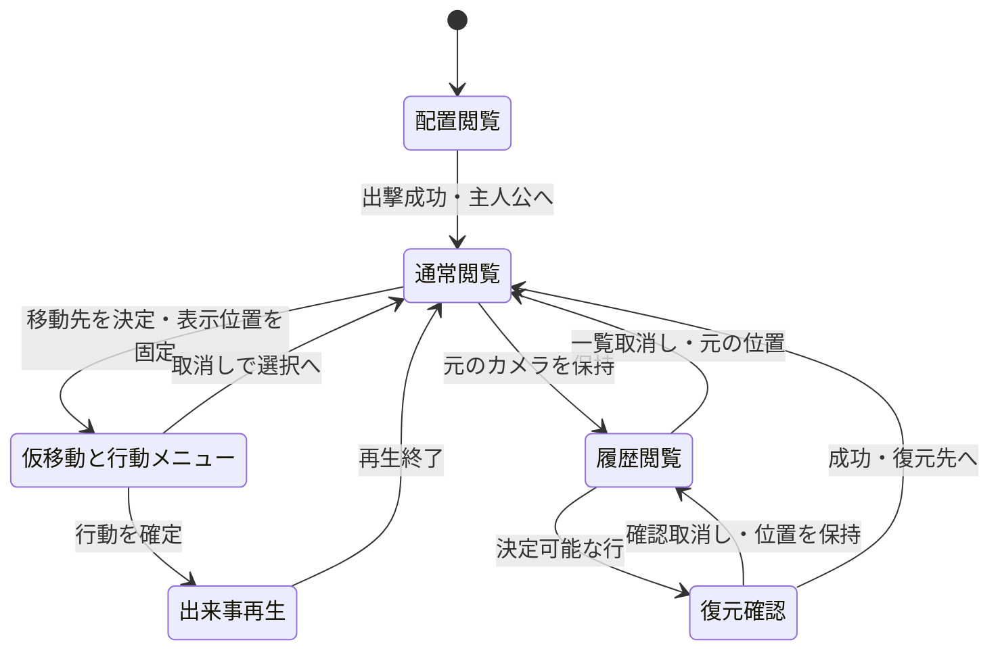
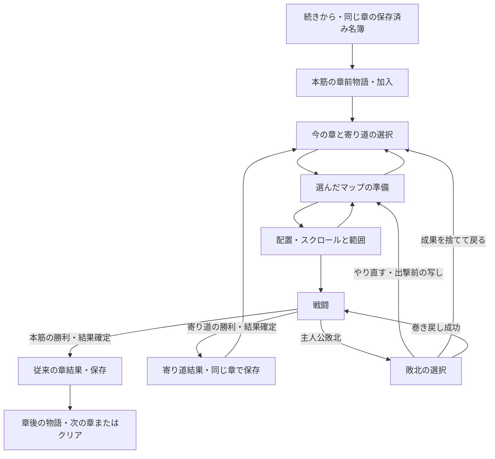

# 設計書（反復 5: 広い戦場と育成の寄り道）

- 文書 ID: DES-IT05
- 版: 0.1（案・未承認）
- 作成日: 2026-10-23
- 対象: [IT05-PLAN v0.1](../iterations/it05/plan.md) の推奨案
- 入力: SRS-001 v0.4、UC-DOC-001 v0.7、DES-IT01・IT02 v0.4、DES-IT03 v0.3、DES-IT04 v0.4、IT04-RETRO v0.1（案）、CON-001、ADR-0002・0003、E-04・09・32・44〜47、REV-041〜052、現行コードと data/base

追加・変更する部分だけを書く。全て未承認の設計案であり、Q-IT05-01〜15の回答によって変更する。API名・データのキーも提案で、実装指示や要求の承認ではない。SRS・UCの改訂案は IT05-PLAN 3 章を正とし、回答を反映した文書一式の承認と別 Issue の要求改訂を実装の前提にする。承認済みの原本は変更しない。

## 1. 既存設計からの変更点

設計書 it01〜04 の使用IDを照合した。MAPは04、UIは24、DATは03、CMPは08、GRWは03、SAVは03、NFRは03まで使用済み。新規はそれぞれ続きとし、既存設計の変更には元のIDも併記する。

| 設計要素 | 追加・変更の案 | 節 |
|---|---|---|
| DES-MAP-05（新）、DES-DAT-03の変更 | 定義読込の上限を16から32へ広げる。tacticsに画面寸法の上限は持たせない | 3・4章 |
| DES-DAT-04（新）、DES-DAT-01・02の拡張 | マップに用途・解放章・育成上限・難しさの目安・目的文を加える。省略は既存マップ互換 | 3章 |
| DES-UI-25（新）、DES-UI-01〜04・08・18・21・23・24の変更 | 盤面用カメラ、座標変換、入力・描画・再生・配置・履歴のスクロールを共通化 | 4・7章 |
| DES-MAP-06（新） | 広い攻略・短い課題・育成用のマップ制作と解法の評価 | 6章 |
| DES-CMP-09（新）、DES-CMP-05〜08・DES-DEP-01・02の拡張 | 章を進めない寄り道の選択・出撃・結果反映・やり直し | 5章 |
| DES-GRW-04（新）、DES-GRW-01〜03の拡張 | 寄り道の経験上限を攻撃と回復に共通適用 | 5.3節 |
| DES-SAV-04（新）、DES-SAV-01〜03の拡張 | 寄り道勝利後の保存と出撃前への復帰。保存形式v1の維持 | 5.4節 |
| DES-UI-26（新）、DES-UI-10〜15・20の拡張 | マップ選択、出撃準備、寄り道結果と敗北の分岐 | 7.2節 |
| DES-NFR-04（新） | 32×32で描画・思考・履歴・範囲の性能を測定 | 8.1節 |

DES-MAP-04は既存の勝敗判定であり、詰め将棋用に再利用して意味を変えない。DES-RWD-01〜05・DES-RNF-01の規則は保ち、カメラと育成上限の受渡しに必要な追加だけを本書に記す。

## 2. アーキテクチャ

### 2.1 core と ui の分担

| パッケージ | 担当 | 依存と境界 |
|---|---|---|
| `internal/defs` | マップの追加項目の型と目録の参照 | 他パッケージに依存しない |
| `internal/defload` | 32×32までの長方形、追加項目、解放章とマップ用途の整合の検証 | defs、TOML。UIや戦闘を作らない |
| `internal/core/tactics` | 任意寸法の盤面、移動・射程・敵AI・増援・成長。経験を止めるレベルの入力 | 標準ライブラリだけ。章・マップID・defs・画面・実時間を知らない |
| `internal/core` | 寄り道の解放判定、名簿を使うSetup、出撃種別と結果反映、保存・再試行の基準 | defs、tactics。選択画面のカーソルを持たない |
| `internal/ui` | カメラ、キーとクリック、マップ選択・配置・結果の表示、画面外案内 | core、tactics、defsと既存の描画ライブラリ |
| `internal/savefile` | 一時ファイルから置換する保存、保存先 | 標準ライブラリだけ。既存の責務のまま |
| `data/base` | 手作りの戦場と短い目的文 | TOMLをembedする既存の方式 |

移動・敵危険範囲は全盤面を使う既存の規則で計算し、UIは結果を表示範囲で切る。画面外にいる敵も戦闘に参加する。カメラ移動はCommand・Event・履歴を作らず、PCG・Turn・回数・名簿を変更しない。測定の時計はテスト・測定用の外側に置き、coreに実時間を導入しない。

### 2.2 現状の根拠と差分

| 箇所 | 読み取った現状と今回の方針 |
|---|---|
| `internal/defload/load.go` | `maxMapSize = 16`。rowsの行数とrune長を検証。上限32へ変更し、1〜32の長方形を扱う |
| `tactics/battle.go`・`boardview.go`・`move.go` | 地形は可変長で、幅・高さと盤内判定を持つ。画面用16マス制約を追加せず32×32の境界を回帰確認 |
| `tactics/ai.go`・`growth.go`・`heal.go` | AIはCharge/Holdと固定の比較順。経験は撃破30・命中10・その他1、回復は10、100で成長・上限20。敵のレベル差で経験は減らない |
| `core/campaign.go` | 出撃・配置は現在章のMapを参照。FinishChapterは勝利反映とChapter++・加入を一体に処理する。寄り道で直接呼ばない |
| `core/save.go`・`ui/scenes.go` | 保存v1は章ID・ルール・名簿・在庫・クリア。章開始の保存と再試行用の記憶がある。寄り道後は同じ章の成長済み状態を保存する |
| `ui/layout.go`・`game.go`・`input.go` | MapSize=512、1マス32 px、CellAtは画面座標÷32。描画・メニュー・ホバーも世界座標を直接画面に置く。全呼出しを共通カメラへ移す |
| `ui/deploy.go`・`rewind.go`・`hint.go` | 配置用BoardView、選択中の履歴のBoardViewと予兆がある。実戦闘の先行値をプレビュー・再生へ混ぜない |
| `data/base` | 16×16の3枚、chaptersの順が本筋、storyは3章で結末。charactersは6人、armorの移動4・cavalierは7。マップ追加のために結末・成長率を変更しない |

## 3. 要求の改訂案と定義データ

### 3.1 前提と省略値（DES-DAT-04）

新FR-CMP-12・13、UC-16・17は候補ID。既存FR-MAP-02・06の実現だけでは寄り道を正当化できない。要求改訂Aで承認された範囲を反映してから実装する。

`maps.toml`のrows・slots・enemies・reinforcementsを共用し、次の項目をMapDefへ追加する案とする。章の順はchapters.tomlだけで管理する。寄り道一覧はID昇順で返す参照口をCatalogに加え、mapの走査順に依存しない。

| 項目（TOMLのキー案） | 型・省略時 | 用途と検証 |
|---|---|---|
| `kind` | 文字列、`chapter` | `chapter`・`challenge`・`training`だけ。後二者は寄り道。chapterだけがChapterDef.Mapの参照先になる |
| `unlock_chapter` | 章ID、空 | 寄り道では必須かつ存在する章。現在章がその章以降なら選べる。chapterでは指定不可 |
| `recommended_level` | 整数、0 | 寄り道では1〜20、戦闘前に表示する目安。敵能力を動的に変えない |
| `exp_level_cap` | 整数、0 | 寄り道では1〜20。chapterでは0（既存のLv20上限のみ）。未指定と明示0をraw型で区別し、寄り道の欠落は診断 |
| `objective` | 文字列、空 | 寄り道では空白だけを禁止。例「山道を抜け、砦の隊長を倒せ」。実際の勝利条件はボス撃破と明記して表示 |

難しさの目安は育成上限以下とする。空のkindを明示した場合は誤り、省略だけchapterとする。既存3枚は追加キーなしで従来の意味になる。意図しない暗黙値を避けるためrawの省略判定と定義型の正規化を分ける。

TOMLの項目例（説明用。今回データファイルは書かない）:

```toml
[[maps]]
id = "side_training_01"
name = "街道の残敵"
kind = "training"
unlock_chapter = "ch01"
recommended_level = 2
exp_level_cap = 3
objective = "森を使って接近し、隊長を倒せ（ボス撃破で勝利）"
# rows、slots、enemies、reinforcementsは既存の形式
```

新しい定義ファイルや勝利条件DSLは作らない。短い目的文はmaps.tomlに置き、story.tomlの本筋を繰り返さない。寄り道の加入・品の報酬・初回報酬・クリア回数は今回持たないため、永続的な解放フラグは不要。chapters.toml・characters.toml・classes.toml・story.tomlは推奨案では据え置く。

### 3.2 検証（DES-DAT-03の変更、DES-MAP-05）

rowsの高さと全行のrune数は各1〜32、長さ一致・既知地形を維持する。32×1・1×32・32×32を許し、33行・33文字・空行・不揃いを拒む。slots・初期敵の盤内・通行可・重複なし、初期ボスちょうど1体、増援は2T以降・盤内・通行可・ボス不可、クラス・武器・アイテム等の参照を維持する。増援の定義位置は初期配置と重なってよい。

全ファイルを読み込んで章IDを集めた後、寄り道の解放章を検証する。chapterへの寄り道項目指定、寄り道をChapterDef.Mapへ指定すること、kindの未知値、上限外、参照不正はファイル・位置・理由付きでまとめて返す。存在しない章を第1章に丸めない。到達可能性・詰み・面白さは構文検証の合格に含めず、6章の試遊で確認する。

## 4. 大きな盤面とカメラ（DES-MAP-05、DES-UI-25）

### 4.1 寸法と座標の契約

窓832×576、盤面の表示領域 `[0,512)×[0,512)`、右欄320 px、下欄64 px、1マス32 pxは維持する。16×16は表示できるマス数であり、データの寸法ではない。世界座標は左上(0,0)、Xは右・Yは下のマス単位。カメラは表示左上の世界座標(Ox,Oy)を整数で持ち、上限は `(max(0,W−16),max(0,H−16))`。32×32なら各0〜16。小さいマップの盤外部分は背景だけで、クリックできない。

- 描画位置は `((X−Ox)×32,(Y−Oy)×32)`。盤面用の描画先を512×512で切り、地形・ユニット・HP・印・範囲・予兆・選択・ダメージ・経験のポップアップを共通に変換する
- 逆変換は表示領域内の画面座標に限り `(floor(x/32)+Ox,floor(y/32)+Oy)`。変換後もW・Hで盤内を検証する。x=512・y=512・負数は無効。右欄・下欄の操作を世界座標にしない
- 例: 32×32でO=(16,16)なら画面(0,0)は世界(16,16)、(511,511)は(31,31)。世界(0,0)は画面外。O=(7,9)で画面(32,64)は(8,11)
- `CellAt`・`MenuRects`と全呼出し（input・info・ホバー・配置・Gameの描画）を、同じカメラ値と盤面寸法を受ける変換に統一する。Controller.Clickへは世界座標を渡す。画面座標を持つカーソル参照も同じ逆変換を通す
- メニューは変換後の移動先の横に置き、右端なら左、下端なら上へ寄せる。画面外なら移動先を表示内へ入れてから開く。描画とヒット判定は同じ矩形を使う。入力中のメニュー・確認を開いている間はカメラを固定する

盤面表示範囲だけの地形描画にし、範囲やユニットも画面外の描画を省く。範囲の計算自体は全域であり、画面端を移動・射程・増援の境界にしない。

### 4.2 手動スクロールと入力の優先順

Q-IT05-01の推奨案: 矢印キーの押し始めで1マス、押し続けた場合はUIのフレーム数で12フレーム後から4フレームごとに1マス。ホイール上はOy−1、下はOy+1、Shift併用でOxを同方向へ変更する。盤面上にカーソルがあるときだけホイールをカメラへ渡す。端ではクランプして何も進めず、クリックへ読み替えない。入力待ちのIdle・Selected・攻撃対象選択・回復対象選択、配置、巻き戻し一覧の盤面閲覧で使える。対象選択でも画面外の候補へスクロールしてクリックできる。Movedの行動メニュー・アイテム一覧・確認中は位置を固定し、取消しでSelectedへ戻れば再び見渡せる。右欄へ「矢印／ホイールで盤面移動」の案内を出す。

入力の優先順位は確認ダイアログ→巻き戻し一覧の右欄→盤面移動→盤面クリック。巻き戻し中の上下・PageUp/Downは既存の行選択に使い、カメラのキー移動には渡さない。この場面の盤面はホイール上下・Shift＋ホイール左右で見る。右欄上のホイールは既存の理由詳細の送り、盤面上はカメラとし、一度の入力を両方へ送らない。確認中はスクロールしない。通常のQ・E・T、早送りSpace/Enter、Esc／右クリックの取消しは保つ。

### 4.3 自動追従・再生・履歴

自動追従は焦点が変わった時だけ行い、毎フレーム中央へ戻して手動の閲覧を妨げない。対象マスを見える最小の移動で表示範囲内へ入れ、境界でクランプする。新しい配置では主人公、配置から開始では確定した主人公へ。対象選択へ入るときは最初の候補（Unitsの添字順）へ寄り、その後は手動でほかの候補を見て選べる。行動メニューを置く先も表示内にし、対象選択の取消しでメニューへ戻るときは仮移動先へ寄せ直す。

再生中は手動移動を止め、現在のEventのFrom・To・対象の位置・Unitsから焦点を決める。実Battleの最終Unitsを使わない。移動はTo、攻撃・回復は対象（可能なら実行者も見える位置）、撃破・成長は当該ユニット、増援は実際のToへ寄る。両者を同時に映せないときは対象を優先し、右欄の名前と出来事の記録を残す。番開始だけなら直前の位置を保つ。早送りでも同じ規則で、出来事を飛ばさない。

巻き戻しを開く直前のカメラを元の入力と共に保持する。行選択時はそのbeforeのBoardViewと対象位置から専用のプレビューカメラを作り、手動閲覧を許す。別の行を選ぶとその行へ追従し、確認取消しでは行とカメラを保持、一覧取消しでは元のカメラへ戻る。成功では復元した盤面を基に選んだ行の焦点へ寄り、プレビューからの行動は拒む。取得失敗で別の行の盤面・カメラを流用しない。閲覧専用行・0回の閲覧・決定可能な自軍行動と明示の番終了は現行どおり。

通常用・配置用・プレビュー用のカメラを分ける。配置から準備へ戻ったら配置用は破棄、開始・ロード・やり直しでは主人公から初期化する。カメラはセーブ・snapshot・PCGに含めない。

予兆の矩形は既存のBoardView.ReinforcementHintsを世界座標のまま受け、表示領域と交差する部分を描く。画面外にも領域がある場合、右欄の予兆案内に「画面外にも気配」を添える。正確な座標・ターン・人数を追加開示しない。配置・Playing・Overで予兆を隠す規則と、履歴のbeforeから導く規則を保つ。

## 5. 章を進めない出撃と育成

### 5.1 出撃の選択（DES-CMP-09）

本筋の入口StartBattleAt・DeploymentViewは既存の意味を維持する。寄り道用に `AvailableSideMaps`、`SideDeploymentView(mapID,members,slots)`、`StartSideBattleAt(mapID,members,slots,seed)` を加える案。これらはCampaignの現在章から解放を再検証する。UIの一覧で隠すだけにしない。存在しない・本筋用・未解放・クリア済み・出撃中の選択を拒む。

内部はmapIDを受け取るSetup組立てと名簿・枠の検証を共用する。主人公必須、名簿の生存者だけ、枠の範囲と重複禁止、主人公の枠交換も可。SideDeploymentViewは独立したBoardViewを返すだけで、NextSeed・tactics.New・番処理を呼ばない。戦闘を始めるときにだけ種を一度取得する。選択や配置失敗では種を取得しない。New失敗後のseed取得の扱いは既存の実出撃と同じにし、呼出し前の検証を共用する。

Sortieの内部に本筋／寄り道、mapID、現在章、出撃前の名簿の深い写し、出撃者対応、反映済みを持つ。Campaignには現在有効な出撃の識別を持たせ、一つだけを許す。勝利・破棄で無効化し、以前の同じ章・同じmapIDのSortieや別Campaignの結果を反映できないようにする。識別値は一時的で保存しない。既存APIもこの有効出撃の検証にそろえる。

### 5.2 結果を戻す（DES-CMP-09、DES-CMP-06〜08の拡張）

寄り道は `FinishSideBattle(sortie)` の案を使い、FinishChapterとは種別を相互に拒む。未勝利・反映済み・古い出撃・別Campaignを検証後、Campaignの深い写しへ結果を反映し、全て成功してから置き換える。失敗ではキャンペーン・Sortie・入力を変えない。

成長・手持ち・戦死の反映とMemberResultの作成は本筋と共用する。寄り道はChapterを増やさず、Clearedを変えず、enterChapter・章報酬・加入・章前後の物語を呼ばない。結果はmapID・名前と出撃前後のレベル・経験・能力差・離脱／戦死を持つ。反映成功で戦闘の履歴を捨て、以後その戦闘へ戻せない。

Q-IT05-06の推奨案では、勝利時に離脱の倒れた仲間は名簿へ残して次の出撃から最大HPで復帰し、ロストはAlive=falseで手持ちを失う。戦死者は章の加入でも再加入しない既存条件を維持する。HPと杖は出撃ごとに全快、消耗品の使用は残す。寄り道の品の報酬は空。主人公敗北・やり直し・選択へ戻る場合は名簿に未確定の戦闘成果を反映せず、直前の出撃準備に入る前の基準状態へ戻す。敗北からも結果反映前なら現行の巻き戻しを使える。

### 5.3 育成上限（DES-GRW-04）

既存の固定経験・成長率・上限20を保ち、Setupに `ExpLevelCap`（0は既存の上限20）を加える案。coreがマップ定義から渡し、tacticsは章やkindを知らない。0または1〜20以外はErrInvalidSetupで拒む。BoardViewの初期検証も共用する。寄り道で上限以上の仲間も出撃できるが経験を得ない。

共通のgainExpで、有効上限以上の自軍への経験加算・EventExp・EventLevelUp・成長乱数を発生させない。上限到達時は通常の成長を一度行い、余りの経験を0にする。上限を超えた仲間の既存レベル・能力・経験を下げない。例えばcap3・Lv2/Exp90から撃破30ならLv3/Exp0、cap3・Lv3/Exp40なら経験も40のまま、cap0なら既存動作。上限未満で既存の成長乱数の順を変えない。

攻撃・反撃・回復は全てこの共通口を通す。固定経験のため、敵のレベルを足すだけでは周回対策にならない。回復での稼ぎも上限で止める。一時的に得た成長は通常のsnapshotで戻し、経験上限は戦闘生成時の不変の設定としてBattleに保持してRewindで変えない。履歴を別Battleへ再開する将来の口が必要なら設定の受渡しも必要だが、今回そのAPIは増やさない。

仮値は1章解放Lv3・2章Lv5・3章Lv7（Q-IT05-05）。上限はマップごとに固定して後の章でも変えず、後のマップを解放する。既存の本筋はcap0、敵の能力や成長率を自動補正しない。本筋の中で攻撃・回復を繰り返す稼ぎは従来から可能であり、今回の制約で全ての過剰育成を防げるとはしない。

### 5.4 保存とやり直し（DES-SAV-04）

推奨案は寄り道回数・初回報酬・途中戦闘を保存しないため、保存v1の項目で足りる。Chapterは今から攻略する本筋の章、Rosterは寄り道反映後のものとする。解放は章IDから導く。v1の既存セーブも読み、同じ章の準備へ進む。camera・選択mapID・仮配置・Sortie・経験上限は保存しない。固定メンバーや初回報酬など別案採用時はこの前提を見直す。

UIは章開始と各寄り道勝利直後に、やり直し基準となるCampaignの深い写しを更新する。準備のアイテム交換はこの基準のあとで行い、敗北の「このマップをやり直す」は基準の写しを復元して同じmapIDの準備へ戻す。過去の寄り道で確定した成長は保持し、今回の交換・戦闘・消耗・成長を取り消す。再試行の写しは元Campaign・Items等と配列を共有しない。タイトルから続ける場合は最後に保存成功した基準から再開する。

保存失敗はcoreの結果反映を取り消さず、現在の成果を保持して理由を表示し「保存を再試行」を用意する。再試行は現在CampaignのSaveと既存savefileの置換だけで、FinishSideBattleを再実行しない。失敗中も次の出撃は可能とするが、終了して続きからでは最後の保存成功時点へ戻る旨を示す。本筋の保存失敗の扱いと一貫させる。既存セーブ破損時はロード時に既存の診断を出し、未保存の成功を保存済みとして案内しない。

## 6. 考えるマップを作る（DES-MAP-06）

Q-IT05-02〜05・08〜11の推奨を使う。新規6枚を以下の制作台帳案で区別し、制作Issueで地形32行または16〜24行、全slots、敵・増援の座標・数・能力・時機と想定解を確定する。本書の概略だけで受入完了としない。最初の1枚の試遊後に残りの数値を調整し、要求・設計判断を変える場合は承認を得る。

| 仮ID | 大きさ・解放・枠・育成上限 | 考える中心 | 既存の仕組みで作る方法 |
|---|---|---|---|
| side_challenge_large | 32×32・ch03・6人・Lv7 | 分かれ道の役割分担と合流、遠い敵の射程を見て進む | 森・山・砦・壁で二つの経路を作る。Holdの弓兵とChargeの近接兵、方面の異なる増援。最奥のボス撃破 |
| side_challenge_order | 16×16・ch02・5人・Lv5 | アーマーで受け、弓と高速のロードで敵を減らす順番 | 狭い入口と射程2の敵。一本道の唯一解にはせず、釣って下がる別解も試す |
| side_challenge_route | 16×16・ch03・5人・Lv7 | 安全な迂回と危険な短路、回復の位置取り | 山の弓兵と砦、短路をふさぐ低耐久の敵。増援で滞留に判断を要するが時間制限の勝敗は加えない |
| side_training_01 | 16×16・ch01・5人・Lv3 | 初期メンバーの役割で森の敵を攻略 | 固定の低段階の敵。育成なしの初期名簿でクリア可能にする |
| side_training_02 | 24×24・ch02・6人・Lv5 | 騎兵の移動と回復役の距離 | 二方面の砦と弓兵。移動だけが続かないよう途中に交戦点を置く |
| side_training_03 | 24×24・ch03・5人・Lv7 | 少人数で耐える役と倒す役を選ぶ | 出撃者を一人外す選択と、地形・射程で補う攻略。後半向け固定敵 |

全マップの勝敗はボス撃破／主人公敗北を維持し、敵AIは既存のCharge/Hold、増援は出た番に動かない。既存の3章の敵配置・能力とクラス・仲間の基礎能力は変更しない。既存の砦回復・予兆・代替出現で緊張感を作り、新しい仕掛けを暗黙に実装しない。

各マップの制作記録には、初期／寄り道上限付近の名簿、seed、配置、想定する2通り以上の攻略、失敗しやすい行動、命中に失敗したとき立て直す手、ターン数・歩くだけのターン数・時間を残す。乱数があるので唯一の手順の正解を保証せず、実現可能な攻略を自動の固定seedで再現し、人の試遊では解法を先に見せない。経路の使い分けが消える、耐久が成長で崩れる、初期成長のばらつきで詰む場合は数値と配置を見直す。cap値や新しい勝敗条件を変える提案は先に承認する。

## 7. UI の状態と画面

### 7.1 カメラと入力状態（DES-UI-25）



これはUIの表示状態でありtacticsの番や進行位置を増やさない。敵軍行動・自動移行の境界は引き続き閲覧専用。確認失敗は理由を出して一覧へ戻り、回数や世界を変えない。右の情報欄・一覧・確認・下の案内は固定した画面座標に描き、カメラで動かさない。課題の目的とボス撃破の条件は準備で読み返せる。寄り道の戦闘中の情報欄にも育成上限を表示し、選択した仲間が上限以上なら「育成上限のため経験なし」と示す。行動のたびに警告を重ねない。

### 7.2 マップ選択と結果（DES-UI-26）



既存の新規開始・続きからでは、現行どおり章前物語と加入表示を経て選択へ入る。ロードでjoinsを二重に加えない既存の名簿検査を保つ。寄り道からSelectへ戻る経路はStory・Joinedを通らず、本筋の前後の文章は繰り返さない。クリア済みは従来のClearへ進み、寄り道を開かない。

選択画面は固定レイアウトで6行ずつ表示し、ページボタンで切り替える。名前、種類、推奨レベル、育成上限、枠、目的、離脱／ロスト、巻き戻し10回、品の報酬なしを詳細に示す。本筋は最初の行に置く。出撃の印・装備・配置は既存を共用し、選択mapIDから枠と盤面を取得する。戻ってマップを変えると仮配置と範囲を捨てるが手持ちの変更は残す。未解放は選択肢に出さず、coreでの拒否も用意する。

敗北には「このマップをやり直す」「成果を捨てて選択へ」「タイトルへ」「巻き戻す」を寄り道で表示する。本筋の敗北は従来の選択を維持する。GameOverも同じmapID・種別を保持する。勝利の帯を進めるまで結果を反映せず、現行の巻き戻しを許す。結果反映後のクリック連打・保存再試行では成長を重ねない。

## 8. テスト計画

### 8.1 性能と手動評価（DES-NFR-04）

TBD-11・12はQ-IT05-14の回答後に要求として確定する。仮の性能負荷は32×32・総40体（自軍6・敵34）、増援後も生存総数が40になる構成。測定用データであり、本番の6枚全てを40体にする意味ではない。初期32体＋増援8体等、投入前後の数を明記する。

Windowsの機種・CPU・GPU・メモリ・OS・描画ドライバ・画面倍率・Go版・ビルド条件を記録する。通常盤面、個別範囲、Q全体範囲、配置交換直後、再生、長い履歴の一覧とプレビューを別々に測る。ウォームアップ後60秒のfpsとフレーム時間の分布・最大、Update/Drawの負荷を記録し、目標60 fpsの維持を判断する。VSyncの待ちと計算負荷を区別し、平均fpsだけで合格にしない。

敵思考はEndPhaseのルール計算を外側で計時し、描画の20フレーム／出来事等の再生待ちは除く。固定seed・入力列で少なくとも30回、地形・全敵が移動する場合・攻撃候補が多い場合を分け、最大1秒以内を確認する。タイミングの閾値を通常CIの不安定な単体テストにはしない。CIでは結果の決定性と境界を確認し、基準PCの測定記録を受入根拠にする。

既存3章と大マップで短期10T・長期50Tの入力列を用意し、実際に到達したターン・履歴数・Event数、保持中のヒープ増分（地形・履歴・出来事を可能な範囲で区別）、一覧を開く／行を選ぶ／復元の時間を記録する。途中で勝敗ならその時点の条件を記録し、50T測定をしたと偽らない。履歴に関する時間・メモリの受入閾値はまだないため実測を報告し、問題があれば別に承認を得る。閲覧ごとに全履歴を複製せず選択1件を再利用する既存方針を保つ。

### 8.2 テストケースの案

以下は予約案。今回テスト仕様書・コード・traceabilityへ登録しない。Aで未実装／未実施と明記した骨組みを作り、各実装で3か所をそろえる。FR・IFの既存末尾を実装着手時にも照合する。

| ID（案） | 設計 | 確かめることと期待結果 |
|---|---|---|
| TC-FR-MAP-02-01 | DES-MAP-05 | 1・16・32の寸法と長方形を読み、端(31,31)の出撃・移動・射程・増援を扱う。33行／文字、空、不揃い、未知地形を位置付きで拒む |
| TC-FR-MAP-02-02 | DES-MAP-05 | 同じseedと世界座標の入力で、32×32のBattle・BoardView・配置表示の地形と範囲が一致。画面端16を越えても探索が続く |
| TC-FR-MAP-06-01 | DES-UI-25 | O=(0,0)、(7,9)、(16,16)で4.1節の既知座標と逆変換。負数、512境界、盤外、小マップ、右欄／下欄のクリックを拒む。往復変換だけの自己比較で済ませない |
| TC-FR-MAP-06-02 | DES-UI-25 | 全描画対象・メニュー・ヒット判定・敵ホバー・配置枠が同じカメラを使う。キー保持、ホイール、右欄と盤面、履歴選択の入力を二重処理しない |
| TC-FR-MAP-06-03 | DES-UI-25 | 再生はEventの写し、履歴はbeforeから焦点と予兆を導く。行変更・確認取消し・一覧取消し・成功・取得失敗で4.3節の位置を満たし、戦闘・PCG・履歴・回数は閲覧で不変 |
| TC-FR-MAP-06-04 | DES-UI-25 | 手動: 832×576で配置・通常・範囲・再生・回復・成長・勝敗・履歴の四隅、画面外の気配、メニューと右欄・下欄の非重複を確認。H-16を記録 |
| TC-FR-MAP-04-01 | DES-MAP-06 | 手動: 各課題の複数の解き方・役割・立て直し・運・時間、広い戦場の歩くだけのターンを記録。H-17を判定 |
| TC-FR-CMP-12-01 | DES-DAT-04 | 追加キーの省略で既存3枚は不変。未知kind・不正解放章・不正上限・用途不一致・欠落を全て位置付きで診断 |
| TC-FR-CMP-12-02 | DES-CMP-09 | 章ごとの解放とID順、未解放・本筋ID・不正ID・クリア済み拒否。配置参照と実出撃が一致し、閲覧・失敗でCampaignと次seedが不変 |
| TC-FR-CMP-12-03 | DES-UI-26 | 選択→準備→配置→開始、取消しとマップ変更、6行ページ、未解放・上限・戦死・枠の説明を確認。重複したseed取得なし |
| TC-FR-CMP-13-01 | DES-CMP-09 | 寄り道勝利で経験・能力・手持ち・離脱／ロストを一度反映。Chapter・Cleared・joins・章報酬が不変。再反映、別Campaign、古いSortie、種別違い、未勝利は失敗し全状態不変 |
| TC-FR-CMP-13-02 | DES-GRW-04 | cap0・1・3・20、cap直前／到達／超過を攻撃・反撃・回復で表駆動。5.3節の既知値、上限到達の余り0、既存経験保持、成長とPCG消費の有無を確認。不正capのSetup拒否 |
| TC-FR-CMP-13-03 | DES-GRW-04 | 上限到達前へRewindし同じ入力で経験・能力・PCG・出来事が同じ。回復でも一致し、0回と閲覧専用の拒否を別条件で隠さない |
| TC-FR-CMP-13-04 | DES-SAV-04 | 寄り道後の保存・ロードは同じ章と成長済み名簿。既存v1もロード可能。敗北と再試行では今回の成果だけを捨て、前回成功の成長を保持。深い写しと保存失敗後の再試行・二重反映なし |
| TC-FR-CMP-13-05 | DES-UI-26 | 手動: 寄り道を選び育成し同じ章へ戻る。敗北・ロスト・上限・保存失敗の案内を確認しH-18・19を記録。本筋を直接進めても成立する |
| TC-NFR-01-01 | DES-NFR-04 | 基準PC・確定した体数・32×32で60 fpsの実測。個別範囲・Q・配置・再生・長い履歴を分けて条件と結果を残す |
| TC-NFR-02-01 | DES-NFR-04 | 基準PC・確定した体数で敵番のルール計算が1秒以内。再生時間を除き、seed・入力・環境・繰返し回数・最大を記録 |

新FRの承認や番号変更に合わせ、TC-FR-CMP-12・13も確定する。NFR測定は実測用ケースとして仕様書に手順を置き、自動・手動・測定の実施状態を明記する。core・defloadの規則は全て単体テスト、UIの座標・入力・表示値は自動、実画面の読みやすさと面白さは手動に分ける。自己参照の期待値を避け、未知キー・上限外・未解放等を独立して拒む入力を使う（REV-044・046・052）。

### 8.3 書き換える既存のテスト

変更しない規則の確認は残し、16の上限拒否だけを32へ変える。固定16×16の期待座標を機械的に大マップへ置換しない。各担当Issueで元の仕様書とtraceabilityを同時に更新する。以下のID群とファイルを両方検索し、実装時に担当する具体的サブケースを照合する。

| Issue（9章の仮番号） | 既存テスト・対象 | 変更・維持すること |
|---|---|---|
| 1 | `defload/load_test.go`・`load_it02_test.go`のマップ寸法とTC-FR-SYS-04の該当ケース | 17を上限超過として拒む期待は33へ変更し、17・32の受理を追加。空・長さ不一致・rune数・盤外・参照の拒否は維持。本体の3枚の値は不変 |
| 1・2 | TC-FR-BTL-01-01・03〜08、TC-FR-MAP-01-01〜05、`boardview_test.go` | 既存の移動費・占有・射程・返却配列独立の期待を保ち、大マップ境界を追加。最適化しても結果と順序を変えない |
| 2 | TC-IF-01-03・18〜20・31・32、`layout`相当の`input_test.go`・`info_test.go`・`enemyrange_test.go` | 原点カメラなら既存座標・メニュー・ホバーと一致。世界座標Clickと画面座標入力を混同せず、オフセット付きの既知値を追加 |
| 2 | TC-FR-CMP-11-01〜11、`deploy_test.go`・`deploy_range_test.go`・`deployment_view_test.go` | 枠交換・空き枠・主人公・敵ホバー・Q・取消し・失敗時保持・seed不変は維持。画面外の枠・敵を見る座標とカメラ初期化を追加 |
| 2 | TC-FR-BTL-10-11〜14・21〜30、TC-IF-01-12・13、`rewind_preview_test.go`・`rewind_own_test.go` | 8行・全行の閲覧・自軍行動と明示の番終了のみ決定・色・0回・取消し・失敗不変・敗北入口を維持。原点での既存表示を保ち、元のカメラ復帰とbeforeへの追従を追加。UI再開操作を復活させない |
| 2 | TC-FR-MAP-03-08〜15、TC-FR-UNT-09-12・18・19、TC-FR-BTL-08-24 | 予兆の時機・距離2・候補なし不出現・順序・非重複・回復の緑・騎兵の絵は不変。表示領域で切っても世界の範囲を削らない。画面外案内とポップアップの座標を追加 |
| 4 | `growth_test.go`・`heal_test.go`のTC-FR-UNT-04・05とTC-FR-BTL-08、巻き戻しの成長再現 | cap0では既存30/10/1・回復経験・100で成長・Lv20・PCG順の期待を保つ。既存テストのSetup省略値は0。上限用の新規試験で代用しない |
| 5 | `campaign_test.go`・`deployment_test.go`・`integration_test.go`のTC-FR-CMP-01〜11 | 本筋の出撃→勝利→次章→加入→クリアを維持。新しい有効出撃の検査に合わせ、並行・古いSortieを成功前提にする補助処理があれば前提を直し、二重反映拒否を弱めない |
| 5・6 | `save_test.go`・`scenes_test.go`・`prepare_result_test.go`のTC-FR-SYS-01、TC-FR-CMP-09・10とIF-04 | v1のJSON・不正値・保存失敗で旧ファイルを保つ期待は維持。準備の前に選択画面が入る場面だけ入力経路を追加。敗北の基準を寄り道後に更新する試験を追加 |
| 8 | IT04-PLAN 2章とTST-IT04 3.11節の未確認手動、TC-NFR-03-04 | #93後のWindowsで先に実施し、新機能後も影響場面を再確認する。過去の未確認を消さず新しい結果を追記。Linux先送りなら未実施と明記 |

既存のテストIDが同じでも、仕様書の期待値が古い上限・座標・画面経路のまま残らないよう査閲する（REV-050）。カメラはUIの状態なのでcoreの再現性テストに画面値を混ぜない。

## 9. 実装の分け方（Issue の案と依存）

番号はGitHub Issue番号ではない。全て未起票・未承認。label `it05` とmilestone `IT05` を実装起票時に付け、依存先のマージ・クローズを確認してから着手する。今回git・ghは使用しない。

| # | Issueの案 | 要求・設計 | 依存 | 完了条件 |
|---|---|---|---|---|
| 0 | #93後の手動確認と既存3章の測定基準 | FR-BTL-10、QA-03、H-04 / 8.1節 | なし（既存承認範囲の評価） | IT04の未確認をWindowsで範囲別に記録。履歴数・使用量・待ち時間・再現性を測り、未実施と不具合を区別する |
| A | IT05のSRS・UC改訂と試験文書骨組み | IT05-PLAN 3・9章 | 文書一式・改訂文面への人の承認 | 新FR・UCと既存の例外・図・TBDを改訂。試験IDの重複を確認し、仕様書とtraceabilityに担当行を追加。承認記録を残す |
| 1 | 32×32の読込と盤面の境界確認 | FR-MAP-02 / DES-MAP-05、DES-DAT-03 | A | 1〜32の寸法・不正値、盤端の地形・範囲・出撃を確認。既存3枚の読込は不変。試験用32×32を用意 |
| 2 | 共通カメラと配置・再生・履歴を含むスクロール | FR-MAP-06、IF-01・02 / DES-UI-25 | 1 | 全座標と入力優先順、追従・取消し・クリップ・画面外案内を自動確認。実画面でH-16の初回結果とNFR予備測定を記録 |
| 3 | 32×32の攻略マップ1枚の試作 | FR-MAP-04 / DES-MAP-06 | 2 | `side_challenge_large`の全地形・配置・数値・攻略2通りを制作記録に残す。寄り道入口完成前は試験用起動で評価。H-17と性能の初回結果を記録 |
| 4 | 寄り道定義と経験上限 | FR-CMP-12・13 / DES-DAT-04、DES-GRW-04 | A・1 | 追加キーと検証、共通gainExp、攻撃／回復、RewindとPCG、cap0の回帰。既存3章の能力・経験値は保つ |
| 5 | 寄り道の出撃・反映・保存・再試行 | FR-CMP-12・13、FR-SYS-01 / DES-CMP-09、DES-SAV-04 | 4 | coreの参照と実出撃の共用、種別・有効Sortie・一度だけ反映、同じ章の保存・v1ロード・深い基準状態と失敗時不変を実装 |
| 6 | マップ選択と寄り道1枚の往復 | FR-CMP-12・13 / DES-UI-26 | 2・3・5 | `side_training_01`で選択・準備・配置・勝敗・保存再試行・再出撃まで通す。大マップも一覧から選べ、章の物語・加入・報酬を重複させない。H-18・19初回評価 |
| 7 | 課題2枚と残りの育成用2枚を制作・統合 | FR-MAP-04、FR-CMP-12・13 / DES-MAP-06 | 6 | 先行2枚を含め合意した6枚が選べる。各枚の全定義・初期／上限名簿・複数攻略・試遊結果を記録し、単に読めるだけで完了にしない |
| 8 | 性能測定・手動確認・遊んだ評価と振り返り | NFR-01・02、QA-02・03 / DES-NFR-04、IT05-PLAN 2章 | 0・7 | 確定環境と人数で測り、H-16〜20・持越しの判定と未確認・未達を記録。TCと元仕様書・traceability、表の整合を確認 |

推奨する取り込み順は0とA→1→2→3→4→5→6→7→8。4はコード上3に依存しないが、まず大マップの操作と負荷・攻略を確かめる順を推奨する。別案として4→5を先行し小マップで育成の往復を評価できる。Q-IT05-15で分割する場合は、5へ押し込まず反復6の計画へ寄り道を移し、Aの新FR・UCの適用時期と3の遊ぶ入口も改めて承認する。

各Issueで担当TCの仕様・コード・traceabilityを更新し、実装後にまとめてテストを付けない。game.go・scenes.go・campaign.goと共有文書の取り込み順を管理する。READMEの自分の行だけを追記し、他の表を並べ替えない。表の列数・閉じ・空行、節番号、PRのIT05表記を照合する（REV-042・047・049）。

## 10. 決定事項と残る判断

決定の正はIT05-PLAN 9章。現時点でQ-IT05-01〜15は未決。カメラの整数座標と共通変換、coreでの出撃種別の検証、保存v1を維持できる前提、経験上限の共通口は本書の設計判断の案であり、個別の遊びの質問にはしない。推奨と異なる回答があれば影響する節・試験・依存を更新して一式を再提示する。

TBD-11・12未決と履歴の未測定、ランダム成長と持込み名簿により課題の難度が変わること、固定経験・杖全快で稼げること、本筋内の無制限な稼ぎは残る点を制約として報告する。壁越し増援の自然さは評価だけを引き継ぎ、規則変更を同時に行わない。既存承認文書・要求抽出記録の原本は今回変更しない。

## 11. 変更履歴

| 版 | 日付 | 内容 |
|---|---|---|
| 0.1 | 2026-10-23 | 大マップの共通カメラ、寄り道のデータ・出撃と保存、経験上限、6枚の制作台帳、状態遷移、性能と試験案・既存試験への影響、Issueと依存を提案。未承認 |
