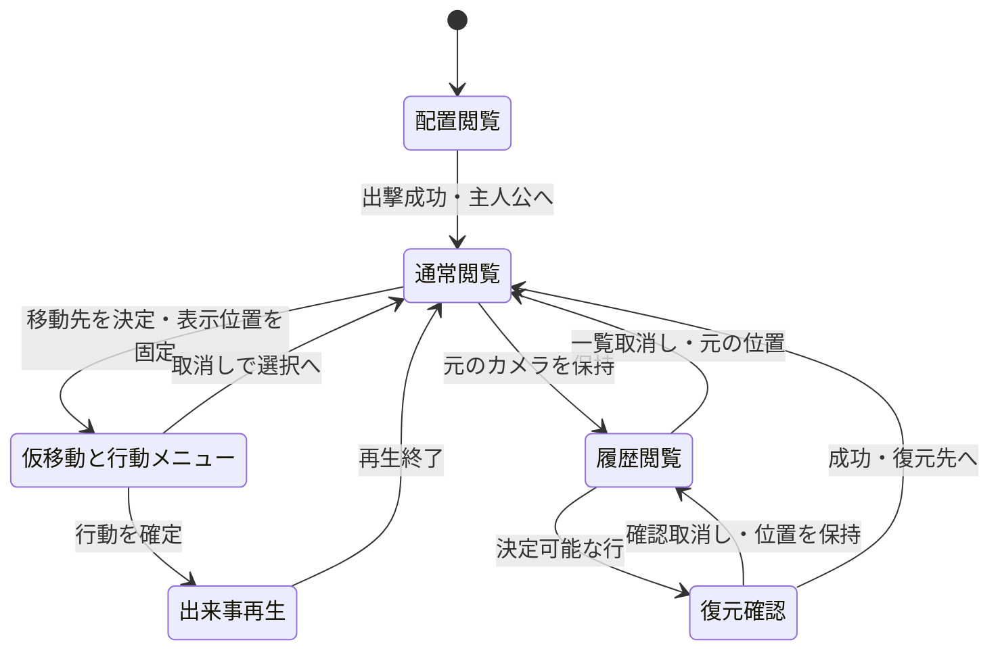
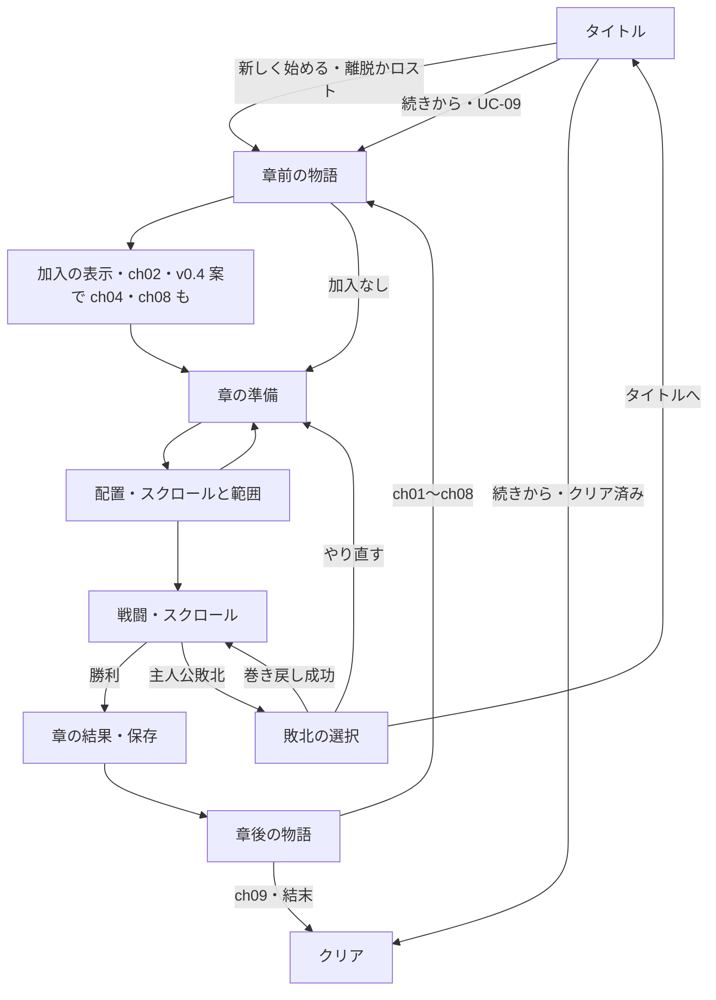

# 設計書（反復 5: 広い戦場と本筋の章の追加）

- 文書 ID: DES-IT05
- 版: 0.4（案。仲間 2 人の加入（E-55）。v0.3 は承認（E-50））
- 作成日: 2026-10-23
- 対象: [IT05-PLAN v0.4（案）](../iterations/it05/plan.md)
- 入力: SRS-001 v0.4、UC-DOC-001 v0.7、DES-IT01・IT02 v0.4、DES-IT03 v0.3、DES-IT04 v0.4、IT04-RETRO v0.2（承認 E-48）、CON-001、ADR-0002・0003、E-04・08・09・32・44〜50、REV-041〜054、現行コードと data/base。v0.4 は E-51〜E-55、REV-055〜061、map-ch04〜ch09.md、SRS v0.6・UC v0.9・企画書 v0.5（いずれも案）

追加・変更する部分だけを書く。本書は開発者が承認した（E-50）。API 名は設計の案であり、実装で変えるときは理由を PR に書く。SRS・UC・企画書の改訂の文面は IT05-PLAN 3 章を正とする。新しい章のデータ（9 章の 4 以降）は、さらに別 Issue の要求改訂（A）を前提にする。承認済みの原本は変更しない。

E-49 で寄り道（繰り返し遊べる育成の戦場）を作らないことが決まったので、v0.1 の寄り道の選択・出撃・結果反映、経験の上限、寄り道の保存、マップの追加キーはすべて外した。新しいマップはすべて本筋の章であり、物語・加入・準備・配置・戦闘・結果・保存の流れは既存のまま、章が 3 から 9 に増えるだけである。

v0.4（案）で、E-55 の仲間 2 人の加入を足した（3.4 節、7.3 節、8 章、9 章の 8）。加入の仕組み（joins と加入の表示）は既存のままで、新しいキー・兵種・絵は足さない。v0.4 の追加は開発者の承認を待っている。

## 1. 既存設計からの変更点

設計書 it01〜04 の使用 ID を照合した。MAP は 04、UI は 24、DAT は 03、CMP は 08、CMD は 02、NFR は 03 まで使用済み。新規はそれぞれ続きとし、既存設計の変更には元の ID も併記する。

| 設計要素 | 追加・変更の案 | 節 |
|---|---|---|
| DES-MAP-05（新）、DES-DAT-03 の変更 | 定義読込の上限を 16 から 32 へ広げる。tactics に画面寸法の上限は持たせない | 3・4 章 |
| DES-CMP-09（新）、DES-CMP-01・02・06・DES-STY-01 の拡張 | 本筋の章を 9 章へ増やす。章の並び、結末の移動、途中の版の並び、既存セーブとの互換 | 3.3 節 |
| DES-UI-25（新）、DES-UI-01〜04・08・18・21・23・24 の変更 | 盤面用カメラ、座標変換、入力・描画・再生・配置・履歴のスクロールを共通化 | 4・7 章 |
| DES-CMD-03（新）、DES-CMD-02 の拡張 | 開発用の開始章の指定（`-chapter`）。本番の遊びには影響しない | 5 章 |
| DES-MAP-06（新） | 新しい章（大きな攻略・課題・ほか）のマップ制作と解法の評価 | 6 章 |
| DES-NFR-04（新） | 32×32 で描画・思考・履歴・範囲の性能を測定 | 8.1 節 |
| DES-CMP-10（新。v0.4 案）、DES-STY-01・DES-DAT-02 の拡張 | 弓と回復の仲間 2 人の定義と joins、加入の場面の物語、自動の試し遊びの見直し | 3.4 節 |
| DES-SAV-04（新。v0.4 案） | 加入を足す前のセーブを読んだとき、その章までに加わるはずの仲間を名簿の後ろに足す | 3.4 節 |
| DES-UI-13 の変更（v0.4 案） | 準備の画面に 8 人の名簿と在庫・ボタン・案内が重ならずに収まるよう、行の間隔と案内の位置を変える | 7.3 節 |

DES-MAP-04 は既存の勝敗判定であり、詰め将棋の章にも意味を変えずに使う。DES-RWD-01〜05・DES-RNF-01 の規則は保ち、カメラの受渡しに必要な追加だけを本書に記す。保存（DES-SAV-01〜03）・出撃（DES-CMP-05・DES-DEP-01・02）・成長（DES-GRW-01〜03）は変えない。

v0.1 で候補にした DES-DAT-04・DES-GRW-04・DES-SAV-04・DES-UI-26 は取り下げた。どの承認済み文書・試験仕様書・traceability にも登録していない候補なので、欠番として予約せず、今後の要素に使ってよい。DES-CMP-09 は同じ理由で、新しい内容（章の追加）に使い直した。v0.4 で、DES-SAV-04 を新しい内容（加入を足す前のセーブ）に使い直した。DES-CMP-10 は設計書 it01〜05 で未使用である。

## 2. アーキテクチャ

### 2.1 core と ui の分担

| パッケージ | 担当 | 依存と境界 |
|---|---|---|
| `internal/defs` | 変更なし（既存の型で 9 章と 8 人を表せる） | 他パッケージに依存しない |
| `internal/defload` | 32×32 までの長方形の検証 | defs、TOML。UI や戦闘を作らない |
| `internal/core/tactics` | 任意寸法の盤面、移動・射程・敵 AI・増援・成長。境界の回帰確認だけ | 標準ライブラリだけ。章・マップ ID・defs・画面・実時間を知らない |
| `internal/core` | 開発用に指定した章から始めるキャンペーンの組み立て（5 章）。加入を足す前のセーブを読んだときの加入の追いつき（3.4 節。v0.4 案）。そのほかは既存のまま | defs、tactics |
| `internal/ui` | カメラ、キーとクリック、配置・再生・履歴の表示、画面外の案内。開始章の受け取り | core、tactics、defs と既存の描画ライブラリ |
| `internal/savefile` | 変更なし | 標準ライブラリだけ |
| `cmd/renkin` | `-chapter` の解釈と検証 | すべて |
| `data/base` | 新しい 6 章のマップ・章・物語。新しい仲間 2 人と joins、加入の場面の段落（v0.4 案） | TOML を embed する既存の方式 |

移動・敵危険範囲は全盤面を使う既存の規則で計算し、UI は結果を表示範囲で切る。画面外にいる敵も戦闘に参加する。カメラ移動は Command・Event・履歴を作らず、PCG・Turn・回数・名簿を変更しない。測定の時計はテスト・測定用の外側に置き、core に実時間を導入しない。

### 2.2 現状の根拠と差分

| 箇所 | 読み取った現状と今回の方針 |
|---|---|
| `internal/defload/load.go` | `maxMapSize = 16`。rows の行数と rune 長を検証。上限 32 へ変更し、1〜32 の長方形を扱う。知らないキーは拒む（`Undecoded`）ので、データに新しいキーは書かない |
| `tactics/battle.go`・`boardview.go`・`move.go` | 地形は可変長で、幅・高さと盤内判定を持つ。画面用 16 マス制約を追加せず 32×32 の境界を回帰確認 |
| `core/campaign.go` | `Campaign.Chapter` は章の添字。`enterChapter` がその章の joins を名簿へ加える。`FinishChapter` が勝利反映と次の章への移行を行う。章の数に依存する分岐はなく、9 章でもそのまま動く |
| `core/save.go`・`ui/scenes.go` | 保存 v1 は章 ID・ルール・名簿・在庫・クリア。読むときは名簿をそのまま使い、章の joins は足さない（v0.4 で読み取り、3.4 節の DES-SAV-04 で変える）。クリア済みは章 ID を空にし、読むと章の添字を章の数にする。章に入るたび（新しく始めたとき・章の勝利の後）に保存し、やり直し用の写しを持つ。この時機は変えない |
| `ui/layout.go`・`game.go`・`input.go` | MapSize=512、1 マス 32 px、CellAt は画面座標÷32。描画・メニュー・ホバーも世界座標を直接画面に置く。全呼出しを共通カメラへ移す |
| `ui/game.go`（75 行付近） | 巻き戻しの一覧を開いている間、ホイールはカーソルの位置によらず `RewindDetail`（理由の詳細の送り）へ渡る。盤面の上ならカメラへ渡すよう変える（4.2 節、8.3 節） |
| `ui/deploy.go`・`rewind.go`・`hint.go` | 配置用 BoardView、選択中の履歴の BoardView と予兆がある。実戦闘の先行値をプレビュー・再生へ混ぜない |
| `cmd/renkin/main.go` | `-savedir`・`-seed` を解釈して `ui.Config` を渡す。`-chapter` を足す（5 章） |
| `data/base` | 16×16 の 3 枚、chapters の順が本筋、story は ch03 の章後が結末。characters は 6 人（エルザは ch02 で加入）。出撃枠は ch01・ch03 が 5、ch02 が 6。v0.4（案）で characters を 8 人にし、ch04・ch08 に joins を足す（3.4 節） |

## 3. 定義データと章の追加

### 3.1 データの形（キーは足さない）

新しい章は、既存の `chapters.toml`（id・name・map・before・after・joins・reward）、`maps.toml`（rows・slots・enemies・reinforcements）、`story.toml`（id・paragraphs）のキーだけで書く。defload は知らないキーを拒むので、新しいキーを使うなら、その読込を実装する Issue をデータの Issue より先に取り込む必要がある。本設計では新しいキーを使わない。

出撃枠の数は maps.toml の slots の数で決まる（既存の規則）。章の目的文や難度の目安を持つ項目は足さず、目的は章前の物語の中で示す（既存の 3 章と同じ）。

### 3.2 検証（DES-DAT-03 の変更、DES-MAP-05）

rows の高さと全行の rune 数は各 1〜32、長さ一致・既知地形を維持する。32×1・1×32・32×32 を許し、33 行・33 文字・空行・不揃いを拒む。slots・初期敵の盤内・通行可・重複なし、初期ボスちょうど 1 体、増援は 2T 以降・盤内・通行可・ボス不可、クラス・武器・アイテム等の参照を維持する。増援の定義位置は初期配置と重なってよい。

17〜32 マスのマップは上限の変更（9 章の Issue 1）を取り込むまで読めない。ch04〜ch09 のうち 17 マス以上のもの（ch04・ch06・ch08・ch09）のデータは Issue 1 に依存する。到達可能性・詰み・面白さは構文検証の合格に含めず、6 章の試遊で確認する。

### 3.3 章の並びと結末（DES-CMP-09）

章の順は chapters.toml に書いた順（既存）。完成時の並びは ch01〜ch09 の 9 章とし、各章の大きさ・種類・出撃枠・ねらいは IT05-PLAN 5 章の表を正とする（E-50 で承認）。

| 章 | 大きさ | 種類 | 出撃枠 | joins | before・after |
|---|---|---|---|---|---|
| ch01〜ch03 | 16×16 | 既存 | 5・6・5 | ch02 のエルザだけ（既存） | 既存。ただし `ch03_after` は結末から次の章への橋渡しへ書き換える |
| ch04 | 18×18 | ほか | 6 | ティオ（v0.4 案） | `ch04_before`（ティオの加入の場面）・`ch04_after` |
| ch05 | 16×16 | 課題 | 5 | なし | `ch05_before`・`ch05_after` |
| ch06 | 20×20 | ほか | 6 | なし | `ch06_before`・`ch06_after` |
| ch07 | 16×16 | 課題 | 5 | なし | `ch07_before`・`ch07_after`（ハンナの加入の場面。v0.4 案） |
| ch08 | 24×24 | ほか | 5 | ハンナ（v0.4 案） | `ch08_before`・`ch08_after` |
| ch09 | 32×32 | 大きな攻略 | 6 | なし | `ch09_before`・`ch09_after`（結末。今の `ch03_after` の結びをここへ移す） |

- 物語の段落は、1 段落以上・各 200 文字以下を既存の検証（defload）で確かめる。各章 4〜6 段落は書き方の目安で、検証の規則にはせず、TC-FR-CMP-07-05 のデータ試験で確かめる。Claude が書き、開発者が確認する（E-07・E-49）。~~新しい仲間の加入はない~~ v0.4（案）で、ch04 と ch08 の始めに 1 人ずつ加わる（3.4 節、E-55）
- 報酬（reward）は既存の 3 章と同じく、章ごとに少数の回復薬などを置く。数は制作 Issue で決める。品の数で物量押しにならないようにする（E-03）
- 途中の版: ch09 を ch04〜ch08 より先に作るので、9 章の Issue 4 の後は並びが ch01・ch02・ch03・ch09 の 4 章になる。この版でも新しく始めてから結末とクリアまで遊べる。Issue 5・6 で ch03 と ch09 の間へ ch04〜ch08 を挿入する
- 既存のセーブ: 保存 v1 の形式は変えない。章 ID で保存しているので、ch03 のセーブから続けると ch03 の勝利後は次の章（完成時は ch04）へ進む。クリア済みのセーブ（章 ID が空）は、読むと既存どおりクリアの画面になる。新しい章を遊ぶには新しく始める。保存の時機（新しく始めたとき・章の勝利の後）は変わらない
- 章の数に依存する既存のテスト（TC-FR-CMP-01-01 の「章は 3 つ」など）は、8.3 節のとおり担当の Issue で書き換える

### 3.4 仲間 2 人の加入（DES-CMP-10、DES-SAV-04。v0.4 案）

E-55 で、弓と回復の仲間を 1 人ずつ加えることになった（Q-IT05-16）。どちらの章で誰が加わるか（Q-IT05-17）と強さ（Q-IT05-18）は推奨であり、v0.4 の承認で確かめる。新しいキー・兵種・絵・スキルは足さず、既存の `characters.toml` のキー（id・name・class・bonus・level・growth・weapon・items・skill）と `chapters.toml` の `joins` だけで書く。

**新しい仲間の定義（DES-CMP-10。推奨）**

能力はクラスの base に bonus を足した値で、加わるときのレベルでも成長は入らない（既存の newMember の規則。エルザと同じ）。そこで、加わる章の想定名簿（map-ch04.md・map-ch08.md の 3 章）の「低め」に近い能力になるよう bonus を決めた。

| 項目 | ティオ（弓） | ハンナ（回復） |
|---|---|---|
| id | `tio` | `hanna` |
| 素性 | 焼け野の村の猟師の若者。村を焼かれ、隊についていく | ベルントの護送隊に付けられていた帝国の従軍の僧侶。荷駄を奪われたあと、置き去りにされた負傷兵の手当てをしていて、隊に加わる（企画書のプロットの「帝国の側にも…途中で味方になる者」） |
| 兵種・絵 | アーチャー（`archer`）。ミラと同じ兵種・絵 | 僧侶（`cleric`）。リナと同じ兵種・絵 |
| 加わる時機（joins） | ch04 の始め（`ch04` の `joins = ["tio"]`）。4 章で出撃できる | 7 章の物語のあと。名簿に入るのは ch08 の始め（`ch08` の `joins = ["hanna"]`）。joins は章の始めに名簿へ加える既存の仕組みなので、加入の表示は ch08_before のあとに出る |
| 加入レベル | 3（ch04 の想定名簿のミラは平均 4・低め 3） | 6（ch08 の想定名簿のリナは平均 7・低め 6） |
| bonus | hp +1、str +1、skl +2、spd +1、def 0、mov 0 | hp +2、str 0、skl +1、spd 0、def +2、mov 0 |
| 加入時の能力 HP/力/技/速さ/守備/移動 | 18/6/9/7/3/5（ミラの低め 18/5/10/8/3/5、平均 19/6/11/8/4/5） | 18/0/3/6/4/5（リナの低め 18/0/3/8/3/5、平均 19/0/4/10/4/5） |
| 成長率 hp/str/skl/spd/def | 60/55/40/35/15（ミラは 55/40/60/45/20） | 60/0/35/30/45（リナは 55/0/40/60/30） |
| 武器・手持ち・スキル | 鉄の弓（`iron_bow`）、手持ちなし、スキルなし | 癒やしの杖（`heal_staff`）、手持ちなし、スキルなし |

- 今いる仲間との違い: ティオは力が伸びて一撃が重いが、技・速さが伸びにくく、命中と追撃でミラに劣る。ミラの狙撃（`snipe`）を持たない。ハンナは HP・守備が伸びて打たれ強いが、速さが伸びにくく、追撃されやすい。回復の量と杖の回数は同じ杖なので変わらない。どちらも「失ったときの代わり」にはなるが、生きているミラ・リナの上位にはならない
- 手持ちを持たせないのは、加入で薬の総数が増えて物量押しにならないようにするため（E-03）。必要なら準備の画面で在庫から渡す
- スキルを持たせないのは、新しい仲間を「控えの代わり」に保ち、既存の 4 人の強み（鼓舞・大盾・怒り・狙撃）を薄めないため。エルザもスキルを持たない
- 値は試験用の想定名簿から決めた推奨値であり、8 の Issue の自動の試し遊び（下の「易しくなりすぎないかの見方」）で確かめる。値を変えるときは制作記録と PR に理由を書く

**加入の場面と物語（DES-STY-01 の拡張）**

- 加入の場面でだけ、その仲間が話し、動く。今のエルザ（ch02_before）と同じ決まりで、物語の文は誰が生きているかで変えない
- ティオ: 加入の場面は ch04_before。村人の中から弓を持った若者が名乗り出る段落を足す（今の 4 段落に 1〜2 段落。6 段落以下）。ch04 で倒れて戦死しうるので、ch04_after 以降では話さず動かない
- ハンナ: 加入の場面は ch07_after。荷駄を奪ったあと、置き去りの負傷兵を手当てしている帝国の僧侶が、ついていくと申し出る段落を足す（今の 4 段落に 1〜2 段落。6 段落以下）。ch08_before は変えない（加入の表示はその後に出る）。ch08_before 以降では話さず動かない
- ch04_before・ch07_after は E-53・E-54 で承認された文である。加入の段落を足した文は、8 の Issue で Claude が書き、全文を開発者に見せて確かめる。ほかの章の物語は変えない
- 加入の表示（`Joined`、DES-UI-12）は既存のまま。名前・絵・クラス・レベル・能力を出す

**名簿と出撃（DES-CMP-05 は変えない）**

- 名簿の順は加わった順（レオン・ガルド・ブラン・ミラ・リナ・エルザ・ティオ・ハンナ）。準備の画面に入ったときの出撃の印は、今と同じく主人公と名簿の順に枠の数まで付ける。そのため、仲間を失っていなければ新しい仲間は控えになり、失っていれば（戦死者は名簿の行に出ない）空いた枠に入る
- 出撃の枠（5〜6）・主人公は必須・枠を超えて選べないことは変えない。自軍の最大は 6 のままなので、TBD-11 の 40 体は変わらない
- 開発用の開始章（DES-CMD-03）は、指定した章までの joins を加えるので、`-chapter ch05` ならティオ、`-chapter ch08` 以降ならティオとハンナも名簿にいる。コードの変更は要らない

**加入を足す前のセーブ（DES-SAV-04。推奨は Q-IT05-19）**

今の `LoadCampaign` は、セーブの名簿をそのまま読み、章の joins を足さない（joins を足すのは `enterChapter` で、新しく始めたときと章の勝利の後だけ）。そのため、加入を足す前の版で ch04 以降に入って保存したセーブを読むと、ティオ（ch08 以降ならハンナも）は加わらず、ch04 または ch08 のセーブでは加入の表示が空の画面になる（`Joined` は名簿にいない仲間を描かない）。

- 推奨: `LoadCampaign` の検証が通ったあと、クリア済みでなければ、最初の章からセーブした章までの joins を章の順に見て、名簿にいない仲間を `newMember`（加わるときのレベル・能力・手持ち）で名簿の後ろに足す。名簿にいる仲間（戦死して `Alive=false` で残っている者を含む）は足し直さない。`enterChapter` と同じ規則で、エルザなど既にいる仲間は変わらない
- ch04 のセーブなら、ティオが加わり、ch04_before のあとに加入の表示が出る。ch05〜ch07 のセーブではティオが表示なしで名簿に加わる（準備の画面に出る）。ch08 のセーブではティオは表示なし、ハンナは加入の表示が出る。ch09 のセーブでは 2 人とも表示なしで加わる。表示なしで加わる場合の物語の食い違い（加入の場面を見ていない）は受け入れる
- 保存の形式（v1）と保存の時機は変えない。読んだあとの名簿は、次に保存するときにそのまま書かれる。ch01〜ch03 のセーブとクリア済みのセーブは、足す仲間がいない（または読まない）ので今と同じ
- 加入を足す前のセーブは、開発者が `-chapter` などで作った試しのセーブくらいしかない見込みである。足さない案（新しい仲間を使うには新しく始める）も選べるが、その場合でも空の加入の表示を出さないよう、名簿にいない仲間の表示を飛ばす変更が要る

**自動の試し遊びの見直し**

各章の制作記録（map-ch04〜ch09.md）の 3 章・5 章と、`estimatedRoster`（`internal/core/ch04_06_plan_test.go`）を、8 の Issue で見直す。敵は弱めない（E-32）。

- 想定名簿: ティオは ch04 の開始に Lv 3・上の能力で加わり、ch05 から先は既存の見積もりと同じく章ごとに平均 1 レベル分（低めは上がる数を 1 少なく、伸びを成長率の 6 割）を加える。ハンナは ch08 の開始に Lv 6 で加わり、ch09 で 1 レベル分を加える
- 減った名簿: 既存の参考測定（ミラ・リナ・両方が戦死済み）に、新しい仲間を名簿の順で空いた枠へ入れた場合を足す。ch04〜ch07 はティオだけ、ch08・ch09 はティオとハンナが入る。とくに、低めの成長でミラを失った名簿の ch08・ch09（今は全作戦 0/12）が、ティオを入れて 12 回中 1 回以上勝てるかを見る。0/12 のままなら、敵を弱めず配置・地形を見直すか開発者に判断を仰ぐ（E-54）
- 全員生存で易しくなりすぎないかの見方: 枠は変わらないので、同時に戦う人数は増えない。効くのは、控えから選ぶ幅と、弓 2 人・回復 2 人の編成である。平均・低めの全員生存の名簿で、既存の作戦の出撃者のうち 1〜2 人を新しい仲間に入れ替えた編成の勝ち数（seed 1〜12）を、今の 6 人の作戦の勝ち数と比べる。12 回中 3 回以上増える章があれば「易しくなりすぎ」の疑いとして開発者に報告し、新しい仲間の加入レベル・bonus を下げる案を出す（敵は弱めない）。増えなければ、新しい仲間は控え・代わりにとどまっていると判断する
- ch08（5 枠）と ch09（6 枠）は、名簿が 8 人で 3 人・2 人が控えになる。E-52 で強くし直した ch09 の評価（map-ch09.md 5 章）と ch08 の評価（map-ch08.md 5 章）は、加入を入れた名簿でやり直し、表を更新する。固定 seed の自動試験（TC-FR-MAP-04-02・04・06）の出撃者は今の 6 人の作戦のままとし、想定名簿に新しい仲間が増えても結果が変わらないことを確かめる（変わるなら seed を選び直し、理由を記録する）
- 単章の自動の勝ち数は人の成功率ではない。人の評価は #105 の通し（H-19・H-21）で行う

## 4. 大きな盤面とカメラ（DES-MAP-05、DES-UI-25）

### 4.1 寸法と座標の契約

窓 832×576、盤面の表示領域 `[0,512)×[0,512)`、右欄 320 px、下欄 64 px、1 マス 32 px は維持する。16×16 は表示できるマス数であり、データの寸法ではない。世界座標は左上 (0,0)、X は右・Y は下のマス単位。カメラは表示左上の世界座標 (Ox,Oy) を整数で持ち、上限は `(max(0,W−16),max(0,H−16))`。32×32 なら各 0〜16、24×24 なら 0〜8、20×20 なら 0〜4、18×18 なら 0〜2、16×16 なら 0 だけ。小さいマップの盤外部分は背景だけで、クリックできない。

- 描画位置は `((X−Ox)×32,(Y−Oy)×32)`。盤面用の描画先を 512×512 で切り、地形・ユニット・HP・印・範囲・予兆・選択・ダメージ・経験のポップアップを共通に変換する
- 逆変換は表示領域内の画面座標に限り `(floor(x/32)+Ox,floor(y/32)+Oy)`。変換後も W・H で盤内を検証する。x=512・y=512・負数は無効。右欄・下欄の操作を世界座標にしない
- 例: 32×32 で O=(16,16) なら画面 (0,0) は世界 (16,16)、(511,511) は (31,31)。世界 (0,0) は画面外。O=(7,9) で画面 (32,64) は (8,11)
- `CellAt`・`MenuRects` と全呼出し（input・info・ホバー・配置・Game の描画）を、同じカメラ値と盤面寸法を受ける変換に統一する。Controller.Click へは世界座標を渡す。画面座標を持つカーソル参照も同じ逆変換を通す
- メニューは変換後の移動先の横に置き、右端なら左、下端なら上へ寄せる。画面外なら移動先を表示内へ入れてから開く。描画とヒット判定は同じ矩形を使う。入力中のメニュー・確認を開いている間はカメラを固定する

盤面表示範囲だけの地形描画にし、範囲やユニットも画面外の描画を省く。範囲の計算自体は全域であり、画面端を移動・射程・増援の境界にしない。

### 4.2 手動スクロールと入力の優先順

Q-IT05-01 の決定（E-49）: 矢印キーの押し始めで 1 マス、押し続けた場合は UI のフレーム数で 12 フレーム後から 4 フレームごとに 1 マス。ホイール上は Oy−1、下は Oy+1、Shift 併用で Ox を同方向へ変更する。盤面上にカーソルがあるときだけホイールをカメラへ渡す。端ではクランプして何も進めず、クリックへ読み替えない。入力待ちの Idle・Selected・攻撃対象選択・回復対象選択、配置、巻き戻し一覧の盤面閲覧で使える。対象選択でも画面外の候補へスクロールしてクリックできる。Moved の行動メニュー・アイテム一覧・確認中は位置を固定し、取消しで Selected へ戻れば再び見渡せる。右欄へ「矢印／ホイールで盤面移動」の案内を出す。

入力の優先順位は確認ダイアログ→巻き戻し一覧の右欄→盤面移動→盤面クリック。巻き戻し中の上下・PageUp/Down は既存の行選択に使い、カメラのキー移動には渡さない。この場面の盤面はホイール上下・Shift＋ホイール左右で見る。右欄上のホイールは既存の理由詳細の送り、盤面上はカメラとし、一度の入力を両方へ送らない。今はカーソルの位置によらず理由詳細へ送っているので、この振る舞いを変える（8.3 節）。確認中はスクロールしない。通常の Q・E・T、早送り Space/Enter、Esc／右クリックの取消しは保つ。

### 4.3 自動の寄り・再生・履歴

自動の寄りは焦点が変わった時だけ行い、毎フレーム中央へ戻して手動の閲覧を妨げない。対象マスを見える最小の移動で表示範囲内へ入れ、境界でクランプする。例: 32×32 で O=(0,0) のとき対象 (20,5) なら O=(5,0)、続けて対象 (3,3) なら O=(3,0)、対象 (31,31) なら O=(16,16)。新しい配置では主人公、配置から開始では確定した主人公へ。対象選択へ入るときは最初の候補（Units の添字順）へ寄り、その後は手動でほかの候補を見て選べる。行動メニューを置く先も表示内にし、対象選択の取消しでメニューへ戻るときは仮移動先へ寄せ直す。

再生中は手動移動を止め、現在の Event の From・To・対象の位置・Units から焦点を決める。実 Battle の最終 Units を使わない。移動は To、攻撃・回復は対象（可能なら実行者も見える位置）、撃破・成長は当該ユニット、増援は実際の To へ寄る。両者を同時に映せないときは対象を優先し、右欄の名前と出来事の記録を残す。番開始だけなら直前の位置を保つ。早送りでも同じ規則で、出来事を飛ばさない。

巻き戻しを開く直前のカメラを元の入力と共に保持する。行選択時はその before の BoardView と対象位置から専用のプレビューカメラを作り、手動閲覧を許す。別の行を選ぶとその行へ寄り、確認取消しでは行とカメラを保持、一覧取消しでは元のカメラへ戻る。成功では復元した盤面を基に選んだ行の焦点へ寄り、プレビューからの行動は拒む。取得失敗で別の行の盤面・カメラを流用しない。閲覧専用行・0 回の閲覧・決定可能な自軍行動と明示の番終了は現行どおり。

通常用・配置用・プレビュー用のカメラを分ける。配置から準備へ戻ったら配置用は破棄、開始・ロード・やり直しでは主人公から初期化する。カメラはセーブ・snapshot・PCG に含めない。

予兆の矩形は既存の BoardView.ReinforcementHints を世界座標のまま受け、表示領域と交差する部分を描く。画面外にも領域がある場合、右欄の予兆案内に「画面外にも気配」を添える。正確な座標・ターン・人数を追加開示しない。配置・Playing・Over で予兆を隠す規則と、履歴の before から導く規則を保つ。

## 5. 開発用の開始章（DES-CMD-03）

32×32 の ch09 などの新しい章を、前の章を全部遊ばずに実画面で確かめるための起動フラグ。REV-054 F-03 への対応。

- `-chapter <章 ID>`（例 `go run ./cmd/renkin -chapter ch09 -savedir /tmp/rt-dev`）。指定すると、タイトルの「新しく始める」が、1 章ではなく指定した章の章前の物語から始まる。離脱／ロストの選択・保存・それ以降の流れは通常と同じ
- 名簿と在庫: 初期名簿に、指定した章までの各章の joins を順に加える（指定した章の joins は通常どおり章前の物語の後に表示する）。在庫は初期在庫に、指定した章より前の章の reward を加える。レベル・能力・経験は定義の初期値のままで、前の章の成長は入らない。このため難しさの確認には使わず、データ・表示・スクロール・性能の確認に使う。難しさは 1 章から通して遊んで評価する
- 本番への影響をなくす: `-chapter` を指定したときは `-savedir` も必須とし、なければ理由を標準エラーに出して終了コード 2 で終わる（開発者の普段のセーブを上書きしない）。知らない章 ID も、章 ID の一覧を添えて終了コード 2。`-chapter` を指定しなければ、起動・タイトル・新しく始める・続きからの動作は今と同じ
- core: `NewCampaignAt(cat, rule, chapterID)` を足す案。NewCampaign と同じ検証をし、上の名簿・在庫・章の添字にした Campaign を返す。知らない ID・クリア済みに当たる添字は誤りを返す。`NewCampaign(cat, rule)` は `NewCampaignAt(cat, rule, 最初の章)` と同じ結果になる
- ui: `Config.StartChapter`（空なら今と同じ）。空でなければ「新しく始める」で `NewCampaignAt` を呼ぶ。続きからはセーブのとおり
- 試験: TC-IF-01-37（フラグの解釈）と TC-FR-CMP-01-06（指定した章の組み立て）。8.2 節。TC-FR-CMP-01-06 は、Issue 3 では本体の ch01〜ch03 と試験用の目録で確かめ、本体の ch09 を指定する場合は Issue 4 で足す

## 6. 新しい章のマップを作る（DES-MAP-06）

Q-IT05-02・04・08・09・11 の決定（E-49・E-50）を使う。新規 6 章を以下の制作台帳案で区別し、制作 Issue で地形の全行、全 slots、敵・増援の座標・数・能力・時機と想定解を確定する。本書の概略だけで受入完了としない。最初に作る ch09 の試遊後に残りの数値を調整し、要求・設計判断を変える場合は承認を得る。

| 章 | 大きさ・枠・敵（仮） | 考える中心 | 既存の仕組みで作る方法 |
|---|---|---|---|
| ch04 焼け野の村 | 18×18・6 人・12＋3 | 二方面の敵に隊を分けるか、まとめて押すか | 村の両側の道と森。片方に騎兵、片方に歩兵と弓兵。3T 以降に背後の増援 |
| ch05 狭間の関所 | 16×16・5 人・9＋2 | アーマーで受け、弓と高速のロードで敵を減らす順番 | 狭い入口と射程 2 の敵。一本道の唯一解にはせず、釣って下がる別解も試す |
| ch06 山道の突破 | 20×20・6 人・14＋4 | 騎兵の移動と回復役の距離 | 山の弓兵と砦、谷沿いの道。移動だけが続かないよう途中に交戦点を置く |
| ch07 補給の荷駄 | 16×16・5 人・10＋4 | 安全な迂回と危険な近道、回復の位置取り | 山の弓兵と砦、近道をふさぐ低耐久の敵。増援で滞留に判断を要するが時間制限の勝敗は加えない |
| ch08 黒い森 | 24×24・5 人・16＋6 | 少人数で耐える役と倒す役を選ぶ | 森の多い盤面と 2 つの砦。出撃者を一人外す選択と、地形・射程で補う攻略 |
| ch09 ヴァルトの門 | 32×32・6 人・26＋8 | 分かれ道の役割分担と合流、遠い敵の射程を見て進む | 森・山・砦・壁で二つの経路を作る。Hold の弓兵と Charge の近接兵、方面の異なる増援。最奥のボス撃破 |

全マップの勝敗はボス撃破／主人公敗北を維持し、敵 AI は既存の Charge/Hold、増援は出た番に動かない。既存の 3 章の敵配置・能力とクラス・仲間の基礎能力は変更しない。既存の砦回復・予兆・代替出現で緊張感を作り、新しい仕掛けを暗黙に実装しない。敵は章ごとに固定（Q-IT05-09、E-50）で、名簿の強さに合わせて変えない。

各マップの制作記録には、想定する開始時の名簿（1 章から通した平均的な成長と、低めの成長）、seed、配置、想定する 2 通り以上の攻略、失敗しやすい行動、命中に失敗したとき立て直す手、ターン数・歩くだけのターン数・時間を残す。乱数があるので唯一の手順の正解を保証せず、実現可能な攻略を自動の固定 seed で再現し、人の試遊では解法を先に見せない。経路の使い分けが消える、初期成長のばらつきで詰む場合は、敵を弱めず（E-32）配置と地形で見直す。開始時の名簿は、前の章を遊んだセーブ（`-savedir` で分ける）か 5 章の開始章の指定で用意し、後者では成長が入らないことを記録に書く。

## 7. UI の状態と画面

### 7.1 カメラと入力状態（DES-UI-25）

これは UI の表示状態であり tactics の番や進行位置を増やさない。敵軍行動・自動移行の境界は引き続き閲覧専用。確認失敗は理由を出して一覧へ戻り、回数や世界を変えない。右の情報欄・一覧・確認・下の案内は固定した画面座標に描き、カメラで動かさない。

### 7.2 画面の流れ（既存のまま）

章が増えるだけで、場面と遷移は変えない。IT05-PLAN 7 章と同じ流れである。

開発用の開始章（5 章）は、「新しく始める」の後の Story を指定した章にするだけで、遷移は同じ。続きからは、セーブした章の章前の物語から始まる（UC-09、既存）。ロードで joins を二重に加えない既存の名簿検査を保つ。v0.4（案）では、ロードのあとにその章までの joins のうち名簿にいない仲間だけを足す（3.4 節、DES-SAV-04）。名簿にいる仲間は二重に加えない。

### 7.3 準備の画面の名簿（DES-UI-13 の変更。v0.4 案）

今の `prepareView`（`internal/ui/prepare.go`）は、名簿の行を y=72 から 40 px ごとに置き（行の矩形は高さ 36）、行のあと 12 px 空けて「在庫:」を、その 28 px 下から在庫と手持ちの入れ替えのボタン（1 種類ごとに 40 px、高さ 36）を置く。「配置へ」は (360,528)〜(504,568)。準備の画面の案内（「出撃は N 人までです」「主人公は必ず出撃します」「手持ちは 5 個までです」など）は `scene_view.go` で y=424 に固定して描く。

| 名簿の人数 | 行の終わり | 「在庫:」 | ボタン（品が 1 種類） | 案内 y=424 との重なり |
|---|---|---|---|---|
| 6（今） | 312 | 324 | 352〜388 | なし |
| 7（ch04〜ch07） | 352 | 364 | 392〜428 | ボタンと重なる |
| 8（ch08・ch09） | 392 | 404 | 432〜468 | 「在庫:」とボタンの間に重なる |

窓の高さ（576）には 8 人でも収まるが、案内が名簿の下の在庫・ボタンと重なる。そこで次のように変える。

- 行の間隔を 40 から 36 px にし、行の矩形の高さを 32 にする（ユニットの絵は 32 px なので収まる）。8 人で行は 360 まで、「在庫:」は 372、ボタンは品が 1 種類なら 400〜436、2 種類なら 476 まで
- 準備の画面の案内は固定の y=424 をやめ、ボタンの最後の行の 8 px 下に置く（8 人・品 2 種類で 484 から。「配置へ」の 528 より上）。ほかの場面の案内の位置は変えない
- 印と行のクリックの範囲は、描く矩形と同じものを使う（今と同じ）。右の情報欄・結果・クリアの画面は変えない（結果は出撃した 6 人まで、クリアは生きている 8 人で y=408 までに収まる）
- 名簿が 9 人以上になる設計はない（E-55 の 2 人を越える加入は範囲外）。9 人以上に備えたスクロールや 2 列の名簿は作らない

## 8. テスト計画

### 8.1 性能と手動評価（DES-NFR-04）

TBD-11・12 は Q-IT05-14 の承認後に要求として確定する。仮の性能負荷は 32×32・総 40 体（自軍 6・敵 34）で、ch09 の初期 26 体＋増援 8 体がこれに当たる。増援の後も生存総数が 40 を超えない。測定用の試験データでも同じ体数と投入前後の数を明記する。

基準の PC は開発者がいつも遊ぶ Windows の PC（Intel Core i5-10400F、NVIDIA GeForce GTX 1660 SUPER、メモリ 32GB、Windows 11 Home。E-50）。測定時に描画ドライバ・画面倍率・Go 版・ビルド条件も記録する。通常盤面、個別範囲、Q 全体範囲、配置交換直後、再生、長い履歴の一覧とプレビューを別々に測る。ウォームアップ後 60 秒の fps とフレーム時間の分布・最大、Update/Draw の負荷を記録し、目標 60 fps の維持を判断する。VSync の待ちと計算負荷を区別し、平均 fps だけで合格にしない。

敵思考は EndPhase のルール計算を外側で計時し、描画の 20 フレーム／出来事等の再生待ちは除く。固定 seed・入力列で少なくとも 30 回、地形・全敵が移動する場合・攻撃候補が多い場合を分け、最大 1 秒以内を確認する。タイミングの閾値を通常 CI の不安定な単体テストにはしない。CI では結果の決定性と境界を確認し、基準 PC の測定記録を受入根拠にする。

既存 3 章と ch09 で短期 10T・長期 50T の入力列を用意し、実際に到達したターン・履歴数・Event 数、保持中のヒープ増分（地形・履歴・出来事を可能な範囲で区別）、一覧を開く／行を選ぶ／復元の時間を記録する。途中で勝敗ならその時点の条件を記録し、50T 測定をしたと偽らない。履歴に関する時間・メモリの受入閾値はまだないため実測を報告し、問題があれば別に承認を得る。閲覧ごとに全履歴を複製せず選択 1 件を再利用する既存方針を保つ。

### 8.2 テストケースの案

以下は予約案。今回テスト仕様書・コード・traceability へ登録しない。A で未実装／未実施と明記した骨組みを作り、各実装で 3 か所をそろえる。既存の末尾（TC-FR-CMP-01 は 04、03 は 11、07 は 04、TC-IF-01 は 36、TC-FR-MAP-02・04・06 と TC-NFR-01・02 はなし）を実装着手時にも照合する。

| ID（案） | 設計 | 確かめることと期待結果 |
|---|---|---|
| TC-FR-MAP-02-01 | DES-MAP-05 | 1・16・32 の寸法と長方形を読み、端 (31,31) の出撃・移動・射程・増援を扱う。33 行／文字、空、不揃い、未知地形を位置付きで拒む |
| TC-FR-MAP-02-02 | DES-MAP-05 | 同じ seed と世界座標の入力で、32×32 の Battle・BoardView・配置表示の地形と範囲が一致。画面端 16 を越えても探索が続く |
| TC-FR-MAP-06-01 | DES-UI-25 | O=(0,0)、(7,9)、(16,16) で 4.1 節の既知座標と逆変換。カメラの上限（32・24・20・18・16 マス）と 4.3 節の自動の寄りの既知値。負数、512 境界、盤外、小マップ、右欄／下欄のクリックを拒む。往復変換だけの自己比較で済ませない |
| TC-FR-MAP-06-02 | DES-UI-25 | 全描画対象・メニュー・ヒット判定・敵ホバー・配置枠が同じカメラを使う。キー保持、ホイール、巻き戻し一覧の右欄と盤面のホイールの振り分け、履歴選択の入力を二重処理しない |
| TC-FR-MAP-06-03 | DES-UI-25 | 再生は Event の写し、履歴は before から焦点と予兆を導く。行変更・確認取消し・一覧取消し・成功・取得失敗で 4.3 節の位置を満たし、戦闘・PCG・履歴・回数は閲覧で不変 |
| TC-FR-MAP-06-04 | DES-UI-25 | 手動: 832×576 で配置・通常・範囲・再生・回復・成長・勝敗・履歴の四隅、画面外の気配、メニューと右欄・下欄の非重複を確認。H-16 を記録 |
| TC-FR-MAP-04-01 | DES-MAP-06 | 手動: ch05・ch07・ch09 の複数の解き方・役割・立て直し・運・時間、広い章の歩くだけのターンを記録。H-17 を判定 |
| TC-FR-CMP-01-05 | DES-CMP-09 | 本体のデータで章は 9 つ、順・名前・マップ・出撃枠（5・6・5・6・5・6・5・5・6）・ボスが表のとおり。ch03 の勝利で ch04、ch09 の勝利でクリア。ch03 のセーブから続けると ch04 へ進み、クリア済みのセーブはクリアのまま |
| TC-FR-CMP-01-06 | DES-CMD-03 | `NewCampaignAt` で章を指定し、章の添字・名簿（エルザは ch02 以降で 1 人だけ）・在庫（前の章の報酬だけ）・レベルの初期値を確認。ch01 指定は NewCampaign と同じ。知らない ID は誤りで状態を作らない。Issue 3 では本体の ch01〜ch03 と、4 章以上の試験用の目録で確かめる。本体の ch09 の場合は Issue 4 で足す |
| TC-FR-CMP-03-12 | DES-CMP-09 | 新しい章でも主人公必須、枠の数を超える出撃と空き枠を既存どおり扱う。6 枠の章で名簿 6 人、5 枠の章で 1 人を外す |
| TC-FR-CMP-07-05 | DES-CMP-09 | 新しい 6 章の章前・章後の物語があり、段落は 4〜6・各 200 文字以下。結末は `ch09_after` にあり、`ch03_after` は結末の文を含まない |
| TC-FR-CMP-07-06 | DES-CMP-09 | 手動: 1 章から通して、各章の物語のつながり、難しさの上がり方、時間・再試行・巻き戻し回数を記録。H-18・19 を判定 |
| TC-IF-01-37 | DES-CMD-03 | `-chapter ch09 -savedir d` で Config.StartChapter が ch09。`-chapter` だけ（`-savedir` なし）・知らない章 ID は画面を動かさず終了コード 2 と理由。未指定なら StartChapter は空で、従来の Config と同じ |
| TC-NFR-01-01 | DES-NFR-04 | 基準 PC・確定した体数・32×32 で 60 fps の実測。個別範囲・Q・配置・再生・長い履歴を分けて条件と結果を残す |
| TC-NFR-02-01 | DES-NFR-04 | 基準 PC・確定した体数で敵番のルール計算が 1 秒以内。再生時間を除き、seed・入力・環境・繰返し回数・最大を記録 |

**v0.4（案）で予約するテストケース（9 章の 8）**: 2026-10-24 に、テスト仕様書（it01〜it05）・テストコード・traceability の使用済みの末尾を照合した（TC-FR-CMP-03 は 12、07 は 06、08 は 03、TC-FR-SYS-01 は 07、TC-IF-01 は 37、TC-FR-MAP-04 は 06）。下はその続きで、8 の Issue の着手時にもう一度照合する。

| ID（案） | 設計 | 確かめることと期待結果 |
|---|---|---|
| TC-FR-CMP-08-04 | DES-CMP-10 | 本体のデータで、加入は ch02 のエルザ・ch04 のティオ・ch08 のハンナの 3 つだけで、初めの 5 人と合わせて仲間の総数は 8。ティオ・ハンナのクラス・レベル・加入時の能力・成長率・武器・手持ちなし・スキルなしが 3.4 節の表のとおり（期待値は表から書き、目録から写さない） |
| TC-FR-CMP-08-05 | DES-CMP-10 | 両ルールで新しく始めて章を勝ち進むと、ch04 の始めにティオ、ch08 の始め（ch07 の勝利の後）にハンナが名簿の後ろに加わり、加入の表示に出る。ch07 の勝利の後の保存から続けてもハンナが一度だけ加わる。ロストで戦死したティオは ch08 で足し直さない。ch04 で負けてやり直しても二重に加わらない |
| TC-FR-CMP-07-07 | DES-CMP-10、DES-STY-01 | 加入の場面の文: ch04_before にティオ、ch07_after にハンナの台詞があり、段落は 6 以下・各 200 文字以下。ほかの物語（ch04_after〜ch09_after、ch08_before を含む）にティオ・ハンナの台詞（名前に続く「」）がない |
| TC-FR-SYS-01-08 | DES-SAV-04 | 加入を足す前の形の名簿（6 人）で、ch03・ch04・ch05・ch08・ch09・クリア済みのセーブを読む。ch04〜ch07 はティオ、ch08・ch09 はティオとハンナが加入時の値で名簿の後ろに加わり、ほかの仲間の値・順・在庫・ルール・章は変わらない。ch03 とクリア済みは今と同じ。戦死（Alive=false）で残るティオは足し直さない。読んで保存して読み直しても増えない。足す仲間が目録にない誤りは状態を作らない |
| TC-FR-CMP-03-13 | DES-CMP-05、DES-UI-13 | 名簿 8 人で、準備の画面の初めの印は主人公と名簿の順に枠の数まで（新しい 2 人は控え）。ミラ・リナが戦死済みなら新しい 2 人が空いた枠に入る。5 枠・6 枠とも、主人公は外せず、枠を超えて選べない。出撃した者だけが配置・戦闘に入る |
| TC-IF-01-38 | DES-UI-13 | 名簿 6・7・8 人と、在庫・手持ちの品が 1・2 種類の組合せで、行・印・「在庫:」・入れ替えのボタン・案内・「配置へ」の矩形が互いに重ならず、窓（832×576）と盤面の幅の中に収まる。各行の印をクリックすると、その行の仲間の印が切り替わる |
| TC-FR-MAP-04-07 | DES-CMP-10、DES-MAP-06 | 加入を入れた想定名簿で、ch04〜ch09 の減った名簿（ミラ・リナ・両方が戦死済みで新しい仲間が入る）と全員生存の入れ替え編成の勝ち数（seed 1〜12）を制作記録に残す。固定 seed の自動試験（TC-FR-MAP-04-02・04・06）が加入を入れた版でも通る。測定の一時テストは CI に入れない（既存の参考測定と同じ） |

NFR 測定は実測用ケースとして仕様書に手順を置き、自動・手動・測定の実施状態を明記する。core・defload の規則は全て単体テスト、UI の座標・入力・表示値は自動、実画面の読みやすさと面白さは手動に分ける。自己参照の期待値を避け、上限外・不正な章 ID 等を独立して拒む入力を使う（REV-044・046・052）。

### 8.3 書き換える既存のテスト

変更しない規則の確認は残し、16 の上限拒否だけを 32 へ変える。固定 16×16 の期待座標を機械的に大マップへ置換しない。各担当 Issue で元の仕様書と traceability を同時に更新する。

| Issue（9 章の仮番号） | 既存テスト・対象 | 変更・維持すること |
|---|---|---|
| 1 | `defload/load_test.go`・`load_it02_test.go` のマップ寸法と TC-FR-SYS-04 の該当ケース | 17 を上限超過として拒む期待は 33 へ変更し、17・32 の受理を追加。空・長さ不一致・rune 数・盤外・参照の拒否は維持。本体の 3 枚の値は不変 |
| 1・2 | TC-FR-BTL-01-01・03〜08、TC-FR-MAP-01-01〜05、`boardview_test.go` | 既存の移動費・占有・射程・返却配列独立の期待を保ち、大マップ境界を追加。最適化しても結果と順序を変えない |
| 2 | TC-IF-01-03・18〜20・31・32、`input_test.go`・`info_test.go`・`enemyrange_test.go` | 原点カメラなら既存座標・メニュー・ホバーと一致。世界座標 Click と画面座標入力を混同せず、オフセット付きの既知値を追加 |
| 2 | TC-FR-CMP-11-01〜11、`deploy_test.go`・`deploy_range_test.go`・`deployment_view_test.go` | 枠交換・空き枠・主人公・敵ホバー・Q・取消し・失敗時保持・seed 不変は維持。画面外の枠・敵を見る座標とカメラ初期化を追加 |
| 2 | TC-FR-BTL-10-11〜14・21〜30、TC-IF-01-12・13、`rewind_preview_test.go`・`rewind_own_test.go`、`ui/game.go` の巻き戻し中のホイール | 8 行・全行の閲覧・自軍行動と明示の番終了のみ決定・色・0 回・取消し・失敗不変・敗北入口を維持。原点での既存表示を保ち、元のカメラ復帰と before への寄りを追加。ホイールは右欄の上なら今どおり理由詳細の送り、盤面の上ならカメラへ渡す（今はカーソルの位置によらず理由詳細へ送る）。UI 再開操作を復活させない |
| 2 | TC-FR-MAP-03-08〜15、TC-FR-UNT-09-12・18・19、TC-FR-BTL-08-24 | 予兆の時機・距離 2・候補なし不出現・順序・非重複・回復の緑・騎兵の絵は不変。表示領域で切っても世界の範囲を削らない。画面外案内とポップアップの座標を追加 |
| 3 | TC-FR-SYS-04-23、TC-IF-01-17、`cmd/renkin/main_test.go` | `-seed`・`-savedir` の既存の期待は維持。`-chapter` 未指定の Config が従来と同じことを足す |
| 4・5・6 | TC-FR-CMP-01-01（「章は 3 つ」）、TC-FR-CMP-07-01（`ch03_after` の段落と文）、TC-FR-SYS-03-07、`defload/base_it02_test.go` | ch01〜ch03 の地形・敵・枠・報酬・ボス・章前の物語の期待は維持。章の数と並び、`ch03_after` の文を新しい値へ変え、新しい章の値は TC-FR-CMP-01-05・07-05 で確かめる。途中の版（ch01〜03・ch09）の期待は Issue 4 で、完成の 9 章は Issue 6 で確定する |
| 4・5・6 | TC-FR-CMP-02-02（`ui/scenes_test.go` の「最後の物語からクリアへ」。3 章目でクリアになる前提）、TC-FR-CMP-01-02・02-01（`core/campaign_test.go`） | 最後の章の勝利でクリア、それ以外で次の章へ、という期待は維持し、最後の章の添字を章の数から求める形に直す（3 に固定しない） |
| 8（v0.4 案） | TC-FR-CMP-08-01（`defload/base_it02_test.go`。「加入は 2 章の [エルザ] だけ」）、TC-FR-CMP-01-06（`core/start_chapter_test.go` の ch04〜ch09 の名簿）、`core/ch04_06_test.go`・`ch09_test.go` の「名簿は 6 人」、`core/save_test.go`（試験用の目録の joins とロードの名簿の人数）、`ui/prepare_result_test.go` の行の矩形 | 先頭 3 章の加入がエルザだけであることは保ち、ch04・ch08 の加入は TC-FR-CMP-08-04 で確かめる。名簿の人数の期待を 7・8 人へ直す。ロードの追いつきで名簿の人数が変わる既存のロードのテストは、試験用の目録の joins とセーブの章を見直し、追いつきが起きない入力と起きる入力（TC-FR-SYS-01-08）を分ける。固定 seed の作戦の出撃者は 6 人のまま |
| 7 | IT04-PLAN 2 章と TST-IT04 3.11 節の未確認手動、TC-NFR-03-04 | #93 後の Windows で先に実施し、新機能後も影響場面を再確認する。過去の未確認を消さず新しい結果を追記。Linux 先送りなら未実施と明記 |

既存のテスト ID が同じでも、仕様書の期待値が古い上限・座標・章の数のまま残らないよう査閲する（REV-050）。カメラは UI の状態なので core の再現性テストに画面値を混ぜない。

## 9. 実装の分け方（Issue の案と依存）

番号は GitHub Issue 番号ではない。全て未起票。（v0.4 の時点で、0＝#98、A＝#97、1＝#99、3＝#100、2＝#101、4＝#102、5＝#103、6＝#104、7＝#105 が起票済み。8 は未起票で、v0.4 の承認後に起票する）label `it05` と milestone `IT05` を実装起票時に付け、依存先のマージ・クローズを確認してから着手する。

| # | Issue の案 | 要求・設計 | 依存 | 完了条件 |
|---|---|---|---|---|
| 0 | #93 後の手動確認と既存 3 章の測定基準 | FR-BTL-10、QA-03、H-04 / 8.1 節 | なし（既存承認範囲の評価） | IT04 の未確認（IT05-PLAN 2 章の表のケース ID）を Windows で範囲別に記録。履歴数・使用量・待ち時間・再現性を測り、未実施と不具合を区別する |
| A | IT05 の SRS・UC・企画書の改訂と試験文書の骨組み | IT05-PLAN 3・10 章 | 本書と IT05-PLAN の承認、改訂文面への人の承認 | FR-CMP-01・03、FR-MAP-02・06、NFR-01・02、TBD-01・04・11・12、UC と図、CON-001 のプロットと Q-04・07 を改訂。試験 ID の重複を確認し、仕様書と traceability に担当行を追加。承認記録を残す |
| 1 | 32×32 の読込と盤面の境界確認 | FR-MAP-02 / DES-MAP-05、DES-DAT-03 | 本書と IT05-PLAN の承認 | 1〜32 の寸法・不正値、盤端の地形・範囲・出撃を確認。既存 3 枚の読込は不変。試験用 32×32 を用意（本体のデータには入れない） |
| 2 | 共通カメラと配置・再生・履歴を含むスクロール | FR-MAP-06、IF-01・02 / DES-UI-25 | 1 | 全座標と入力優先順、自動の寄り・取消し・クリップ・画面外案内を自動確認。巻き戻し一覧のホイールの振り分けを変える。確認は自動の試験だけとする（実画面で 32×32 を開く手段がまだないため、H-16 の初回評価と NFR の予備測定は Issue 4 で行う） |
| 3 | 開発用の開始章の指定 | IF-01 / DES-CMD-03 | 本書と IT05-PLAN の承認 | `-chapter`・`-savedir` 必須・知らない ID の拒否、`NewCampaignAt`、未指定時の不変を確認。本体の ch01〜ch03 と試験用の目録で TC-FR-CMP-01-06 を確かめる（本体の ch09 の場合は Issue 4） |
| 4 | ch09（32×32 の大きな攻略）と結末の移動 | FR-MAP-02・04、FR-CMP-01・02・07 / DES-MAP-06、DES-CMP-09 | A・2・3 | ch09 の地形・枠・敵・増援・ボス・報酬と章前・章後の物語を追加し、`ch03_after` を橋渡しへ書き換える。並びは ch01〜03・ch09。攻略 2 通りを制作記録に残し、`-chapter ch09` で実画面を開き、H-16 の初回評価（四隅・画面外の予兆・配置と履歴のスクロール）、H-17、NFR の予備測定を記録。TC-FR-CMP-01-06 に本体の ch09 の場合を足す |
| 5 | ch04〜ch06 の章と物語 | FR-MAP-04、FR-CMP-01・07 / DES-MAP-06、DES-CMP-09 | 4 | ch03 と ch09 の間へ ch04〜ch06 を挿入。各章の全定義・想定する名簿・複数攻略・試遊結果を記録し、読めるだけで完了にしない |
| 6 | ch07・ch08 の章と物語、9 章の通し | FR-MAP-04、FR-CMP-01・02・07 / DES-MAP-06、DES-CMP-09 | 5 | ch07・ch08 を挿入して 9 章をそろえる。新しく始めてから ch09 の結末とクリアまで通ることを自動と手動で確認 |
| 8 | 仲間 2 人の加入（v0.4 案） | FR-CMP-03・08、FR-SYS-01、IF-01 / DES-CMP-10、DES-SAV-04、DES-UI-13、DES-STY-01 | 6（#104）、本書 v0.4・IT05-PLAN v0.4・SRS v0.6・UC v0.9・企画書 v0.5 の承認 | ティオ・ハンナの定義と ch04・ch08 の joins を足し、ch04_before・ch07_after に加入の段落を書いて開発者に確かめる。準備の画面の行の間隔と案内の位置を変える（7.3 節）。ロードの加入の追いつき（DES-SAV-04）。TC-FR-CMP-08-04・05、07-07、TC-FR-SYS-01-08、TC-FR-CMP-03-13、TC-IF-01-38、TC-FR-MAP-04-07 を 3 か所にそろえ、8.3 節の既存テストを直す。制作記録 map-ch04〜ch09.md の 3 章・5 章を加入を入れた名簿で見直し、低めの成長でミラを失った ch08・ch09 の勝ち数と、全員生存の入れ替え編成の勝ち数（3.4 節の見方）を記録する。易しくなりすぎの疑い・0/12 のままの章は人に報告する。`-chapter ch08` などで加入の表示と 8 人の準備の画面を実画面で見る確認は #105 にまとめてよい |
| 7 | 性能測定・手動確認・遊んだ評価と振り返り | NFR-01・02、QA-02・03 / DES-NFR-04、IT05-PLAN 2 章 | 0・6・8 | 確定環境と人数で測り、H-16〜20・持越しの判定と未確認・未達を記録。TC と元仕様書・traceability、表の整合を確認 |

推奨する取り込み順は 0・1・3・A（互いに並行可）→ 2 → 4 → 5 → 6 → 8 → 7（v0.4 案で 8 を 7 の前に入れた）。0 は 8 と並行してよい。A は新しい章のデータ（4 以降）の前提に絞り、大マップとスクロール（1・2）と開発用の開始章（3）は待たせない。データに新しいキーは使わないので、defload の変更より先にデータを書く順の問題は 17 マス以上のマップ（Issue 1 に依存）だけである。

各 Issue で担当 TC の仕様・コード・traceability を更新し、実装後にまとめてテストを付けない。game.go・scenes.go・chapters.toml・story.toml と共有文書の取り込み順を管理する。README の自分の行だけを追記し、他の表を並べ替えない。表の列数・閉じ・空行、節番号、PR の IT05 表記を照合する（REV-042・047・049）。

## 10. 決定事項と残る判断

決定の正は IT05-PLAN 10 章。Q-IT05-01〜04・08・11・15 は E-49 で決まった（03 は「寄り道を作らない」という決定）。05・06・10・12 は寄り道を作らないため取り下げた。07・09・13・14 は推奨のまま一式で承認された（E-50）。カメラの整数座標と共通変換、データのキーを足さないこと、保存 v1 と保存の時機を変えないこと、開発用の開始章は本書の設計判断であり、一式として承認された（E-50）。実装で変える必要が出たら、設計への提案として人の承認を得る。

v0.4（案）: Q-IT05-16 は E-55 で決まった。Q-IT05-17（4 章で弓・7 章のあとで回復）、Q-IT05-18（加入レベルと能力はミラ・リナの「低め」くらい、スキルなし）、Q-IT05-19（加入を足す前のセーブにも途中から加える）は推奨であり、v0.4 の承認で確かめる。名前（ティオ・ハンナ）と素性は Claude Code の案で、物語の文と一緒に確かめる。準備の画面の行の間隔と案内の位置（7.3 節）、手持ちなし、ハンナの名簿入りを ch08 の joins にすること（加入の表示は ch08_before のあと）は本書の設計判断である。

SRS の TBD-11・12 が要求改訂（A）まで未記入であること、履歴の未測定、ランダム成長で後半の章の難度が変わることを制約として報告する。壁越し増援の自然さは評価だけを引き継ぎ、規則変更を同時に行わない。既存承認文書・要求抽出記録の既存の行は今回変更しない。

## 11. 変更履歴

| 版 | 日付 | 内容 |
|---|---|---|
| 0.1 | 2026-10-23 | 大マップの共通カメラ、寄り道のデータ・出撃と保存、経験上限、6 枚の制作台帳、状態遷移、性能と試験案・既存試験への影響、Issue と依存を提案。未承認 |
| 0.2 | 2026-10-23 | E-49 で寄り道を作らないことになったため、DES-DAT-04・DES-GRW-04・DES-SAV-04・DES-UI-26 と寄り道の出撃・保存・選択画面を取り下げ、DES-CMP-09 を本筋の章の追加（9 章の並び・結末の移動・途中の版・セーブ互換）に使い直した。開発用の開始章 DES-CMD-03 を追加（REV-054 F-03）。画面の流れを既存のまま章が増える形にそろえ（F-04）、保存の時機は変えないと明記（F-07）。巻き戻し一覧のホイールの変更を 8.3 節へ（F-11）。Issue の依存を A は新しい章のデータの前提に絞った（F-10）。未承認。再レビューの F-12〜F-15 に対応: 実画面の H-16 初回評価と NFR の予備測定を Issue 2 から Issue 4 へ移し、TC-FR-CMP-01-06 の確かめ方を Issue 3（ch01〜03・試験用の目録）と Issue 4（ch09）に分け、10 章の Q-IT05-03 を決定にそろえ、物語の段落数の目安と既存の検証を書き分けた |
| 0.3 | 2026-10-23 | 開発者が一式を承認した（E-50）。版を承認済みにし、確認点の状態と基準の PC の型（Intel Core i5-10400F、NVIDIA GeForce GTX 1660 SUPER、メモリ 32GB、Windows 11 Home）を書いた |
| 0.4 | 2026-10-24 | 案。E-55 の仲間 2 人の加入を足した。1 章の表に DES-CMP-10・DES-SAV-04・DES-UI-13 の変更、2 章に現状の読み取り（ロードは joins を足さない、characters は 6 人）、3.3 節の joins、3.4 節（ティオ・ハンナの定義、加入の場面、名簿と出撃、加入を足す前のセーブ、自動の試し遊びの見直しと易しくなりすぎないかの見方）、7.2 節の流れ、7.3 節（準備の画面の 8 人の配置）、8.2 節の予約 7 件、8.3 節の 8 の行、9 章の Issue 8 と依存（7 は 8 を待つ）、10 章を足した。開発者の承認待ち |
